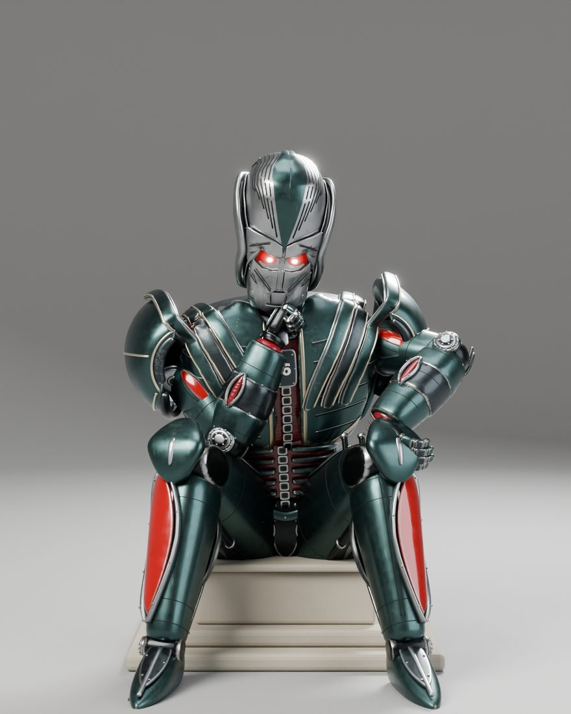
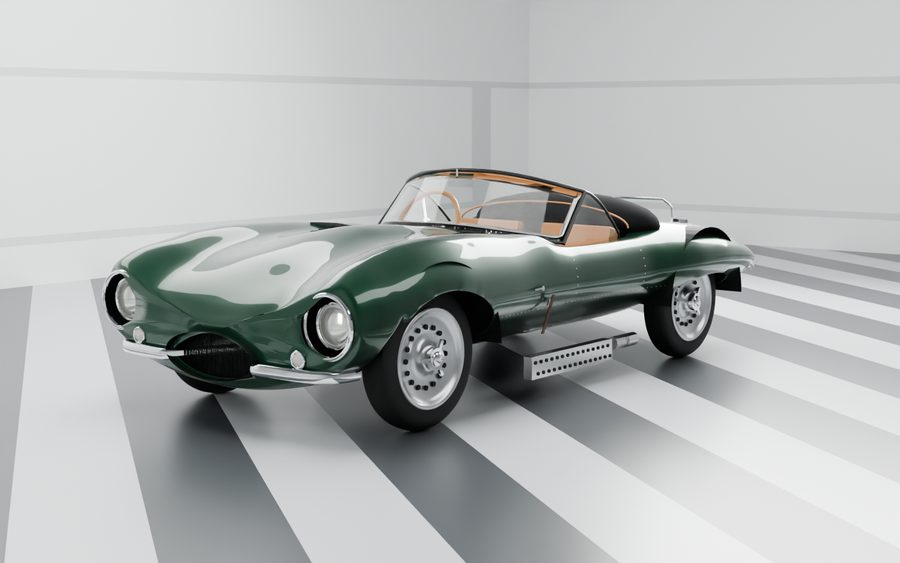
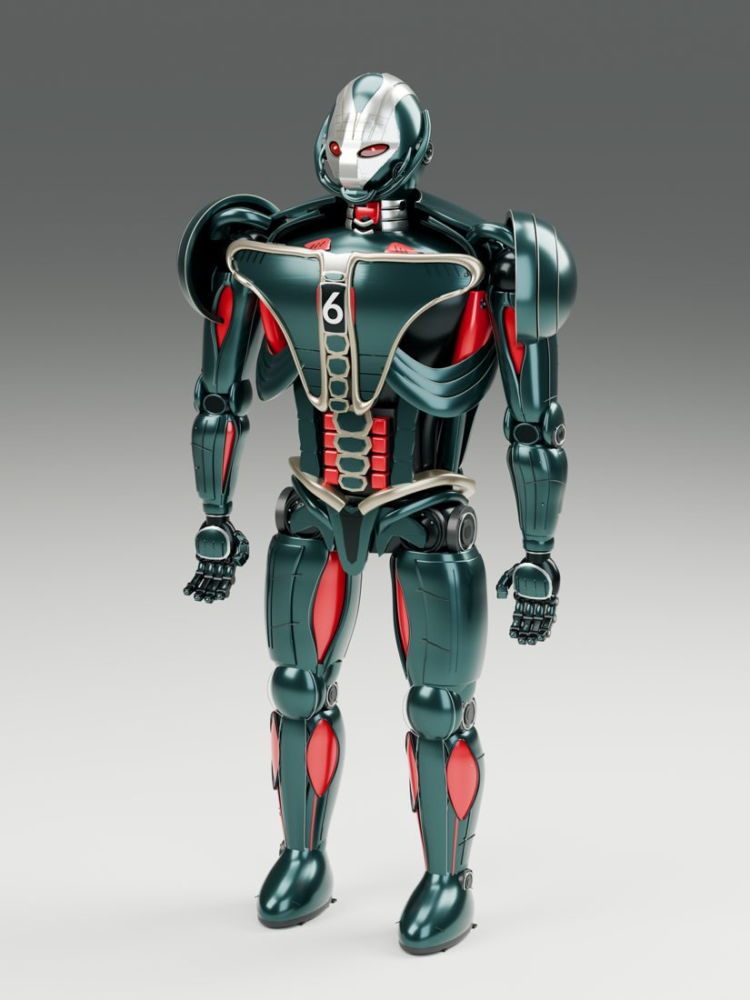
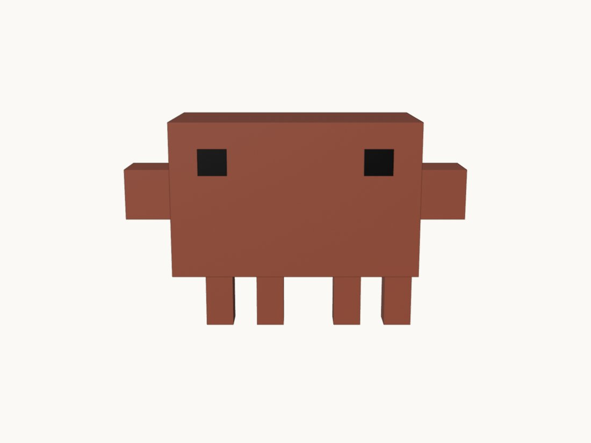
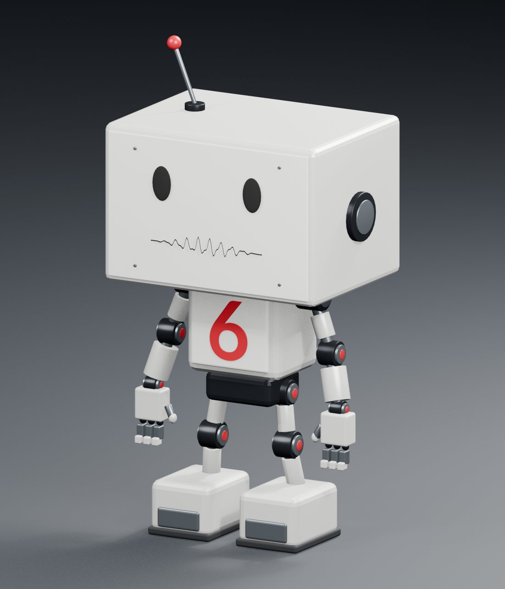
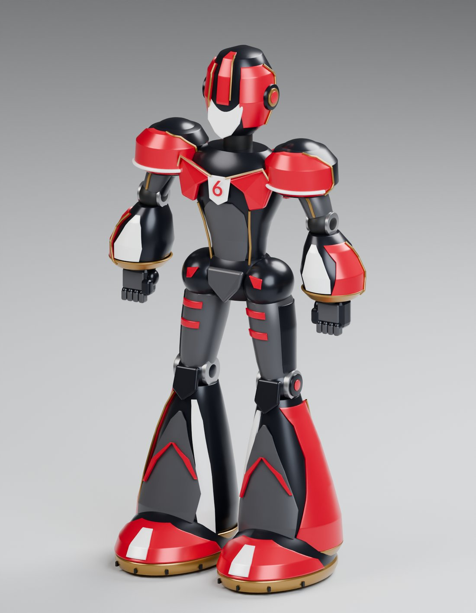
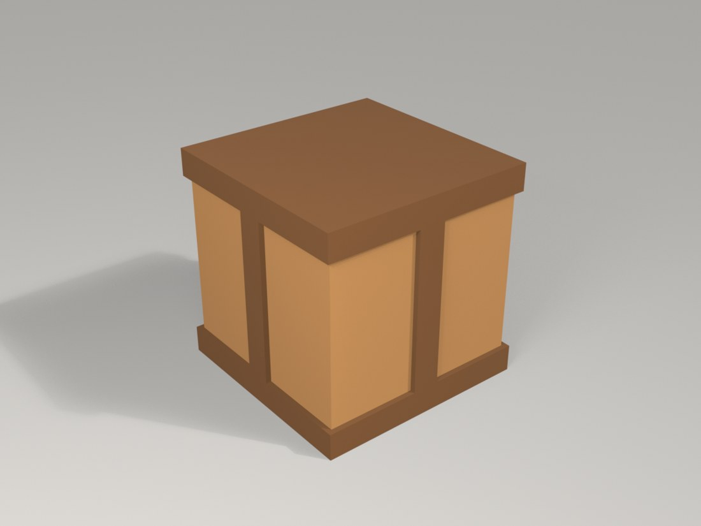
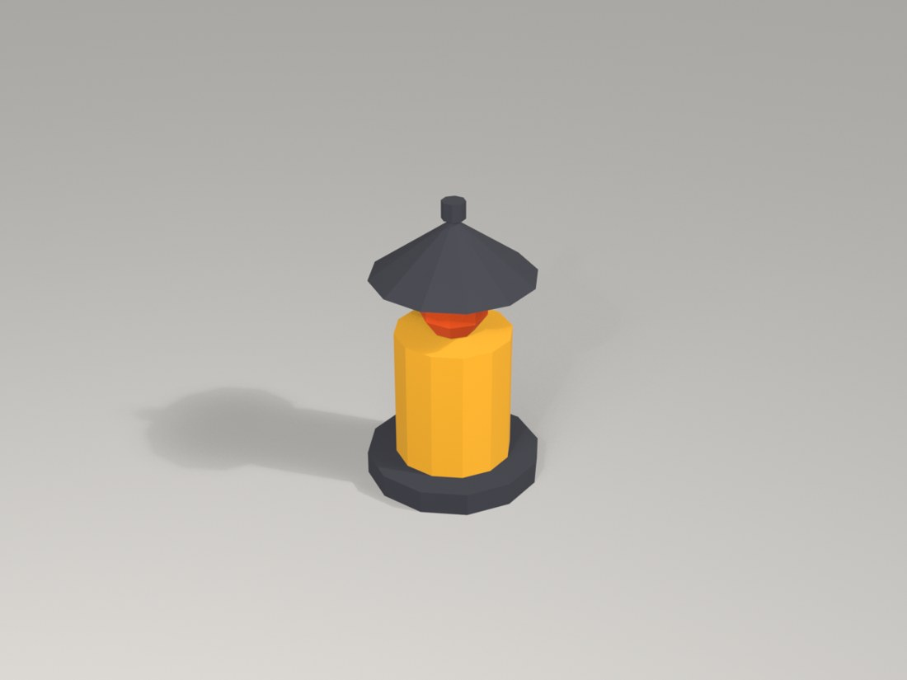
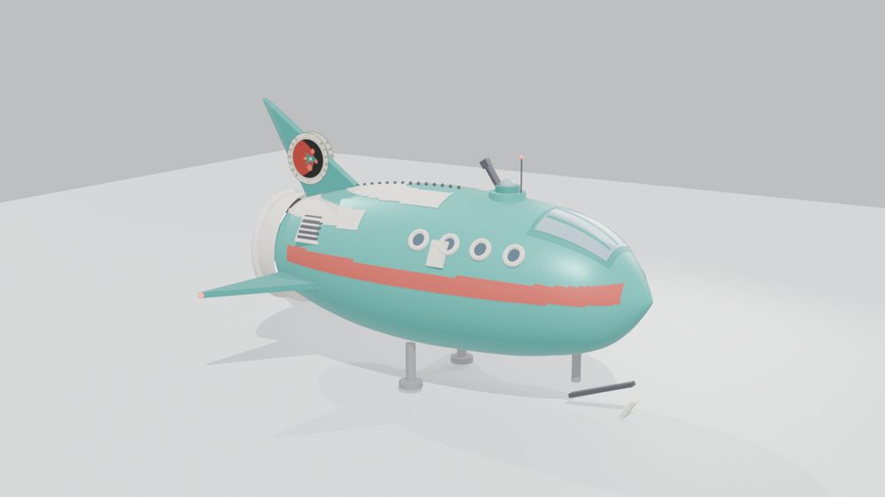

# Blender builds

Every 3D model built for this course gets its own subfolder here. Several AI builders add models to this folder (Grok Bot, Claude, Codex, Muse), so **every folder name ends with the builder's name**: `-grok`, `-claude`, `-codex` or `-muse`. Folder names are also specific to the model (for example `seis-bot-grok`, not `robot`), since many models of the same kind will be added.

Each model folder has a `README.md` you can read on GitHub (views, comparisons with the references, downloads, import instructions and limitations) and a self-contained `index.html` viewer. The viewer links use GitHub Pages, which has to be enabled for this repo for them to work; the fallback links open the same page through htmlpreview.

To download a single file, use the links in a model's README, or open the file on GitHub and click **Download raw file**. To get everything, clone the repo or use **Code → Download ZIP**. The `.blend` files open in Blender 4.2 or later.

| Preview | Folder | Builder | What it is | Pages |
|---|---|---|---|---|
|  | [`seis-bot-grok/`](seis-bot-grok/) | Grok Bot | SEIS Bot, an armored humanoid robot with a white 6 on the chest and a worn, distressed finish, built from AI-generated reference images. Version 4 of 4. Files: `robot_seated.blend`, `robot_standing.blend`, `robot_v4.glb`. | [README](seis-bot-grok/README.md) · [viewer](https://nikbearbrown.github.io/csye-7270-building-virtual-environments/blender/seis-bot-grok/) ([fallback](https://htmlpreview.github.io/?https://github.com/nikbearbrown/csye-7270-building-virtual-environments/raw/main/blender/seis-bot-grok/index.html)) |
|  | [`jaguar-xkss-1957-grok/`](jaguar-xkss-1957-grok/) | Grok Bot | A 1957 Jaguar XKSS (the road-going D-type) in British Racing Green, built from studio photos. First pass, after 8 comparison rounds. Files: `xkss.blend`, `xkss.glb`. | [README](jaguar-xkss-1957-grok/README.md) · [viewer](https://nikbearbrown.github.io/csye-7270-building-virtual-environments/blender/jaguar-xkss-1957-grok/) ([fallback](https://htmlpreview.github.io/?https://github.com/nikbearbrown/csye-7270-building-virtual-environments/raw/main/blender/jaguar-xkss-1957-grok/index.html)) |
|  | [`crystal-palace-1851-claude/`](crystal-palace-1851-claude/) | Claude | The iron frame of the 1851 Crystal Palace, west half (37 of its 77 bays, 888 ft), built by script from Charles Downes's 1852 plates and tested against their figures. An unfinished frame, not a likeness. Files: `crystal-palace-1851.blend`, `crystal-palace-1851.glb`. | [README](crystal-palace-1851-claude/README.md) · [viewer](https://nikbearbrown.github.io/csye-7270-building-virtual-environments/blender/crystal-palace-1851-claude/) ([fallback](https://htmlpreview.github.io/?https://github.com/nikbearbrown/csye-7270-building-virtual-environments/raw/main/blender/crystal-palace-1851-claude/index.html)) |
|  | [`seis-bot-v004-claude/`](seis-bot-v004-claude/) | Claude | An armored robot with a white 6, built in Blender from reference images by Claude. A separate model from the Grok Bot one in seis-bot-grok/. Files: `seis-bot-v004-standing.blend`, `seis-bot-v004-seated-thinker.blend`, `seis-bot-v004.glb`. | [README](seis-bot-v004-claude/README.md) · [viewer](https://nikbearbrown.github.io/csye-7270-building-virtual-environments/blender/seis-bot-v004-claude/) ([fallback](https://htmlpreview.github.io/?https://github.com/nikbearbrown/csye-7270-building-virtual-environments/raw/main/blender/seis-bot-v004-claude/index.html)) |
|  | [`seis-bot-v005-codex/`](seis-bot-v005-codex/) | Codex | A rebuild of the SEIS bot from Bear's video frames, by Codex. This is Codex's own model, separate from the Grok Bot model in seis-bot-grok. Files: `seis-bot-v005-codex.blend`, `seis-bot-v005-codex.glb`. | [README](seis-bot-v005-codex/README.md) · [viewer](https://nikbearbrown.github.io/csye-7270-building-virtual-environments/blender/seis-bot-v005-codex/) ([fallback](https://htmlpreview.github.io/?https://github.com/nikbearbrown/csye-7270-building-virtual-environments/raw/main/blender/seis-bot-v005-codex/index.html)) |
|  | [`claude-mascot-claude/`](claude-mascot-claude/) | Claude | The nine-box Claude mascot, built by a Blender script from the 2D mascot's exact numbers, with a 9-bone rig. Files: `claude-mascot.blend`, `claude-mascot.glb`. | [README](claude-mascot-claude/README.md) · [viewer](https://nikbearbrown.github.io/csye-7270-building-virtual-environments/blender/claude-mascot-claude/) ([fallback](https://htmlpreview.github.io/?https://github.com/nikbearbrown/csye-7270-building-virtual-environments/raw/main/blender/claude-mascot-claude/index.html)) |
|  | [`claude-mascot-mcp-claude/`](claude-mascot-mcp-claude/) | Claude | The same nine-box Claude mascot, built by Claude Code driving Blender through the MCP for Blender add-on. Files: `claude-mascot-mcp.blend`, `claude-mascot-mcp.glb`. | [README](claude-mascot-mcp-claude/README.md) · [viewer](https://nikbearbrown.github.io/csye-7270-building-virtual-environments/blender/claude-mascot-mcp-claude/) ([fallback](https://htmlpreview.github.io/?https://github.com/nikbearbrown/csye-7270-building-virtual-environments/raw/main/blender/claude-mascot-mcp-claude/index.html)) |
|  | [`seis-robot-studies-v001-codex/`](seis-robot-studies-v001-codex/) | Codex | Two rigged white-box-head robot mascots for the SEIS AI Lab, built from primitives in Blender. A design study, not a final model. Files: `seis_robot_compact_v001.blend`, `seis_robot_slim_v001.blend`, `seis_robot_compact_v001.glb`, `seis_robot_slim_v001.glb`. | [README](seis-robot-studies-v001-codex/README.md) · [viewer](https://nikbearbrown.github.io/csye-7270-building-virtual-environments/blender/seis-robot-studies-v001-codex/) ([fallback](https://htmlpreview.github.io/?https://github.com/nikbearbrown/csye-7270-building-virtual-environments/raw/main/blender/seis-robot-studies-v001-codex/index.html)) |
|  | [`seis-robot-engineer-v002-codex/`](seis-robot-engineer-v002-codex/) | Codex | An engineer version of the SEIS robot with armoured legs, a connector arm, a wrist display and a red Lato Bold 6. A design study, not a final model. Files: `seis_robot_engineer_v002.blend`, `seis_robot_engineer_v002.glb`. | [README](seis-robot-engineer-v002-codex/README.md) · [viewer](https://nikbearbrown.github.io/csye-7270-building-virtual-environments/blender/seis-robot-engineer-v002-codex/) ([fallback](https://htmlpreview.github.io/?https://github.com/nikbearbrown/csye-7270-building-virtual-environments/raw/main/blender/seis-robot-engineer-v002-codex/index.html)) |
|  | [`seis-robot-reference-body-v003-codex/`](seis-robot-reference-body-v003-codex/) | Codex | A static armoured robot body in Northeastern red, gold, gray, white and black, rebuilt around seven supplied photographs. A design study with a placeholder head, not a final model. Files: `seis_robot_reference_body_v003.blend`, `seis_robot_reference_body_v003.glb`. | [README](seis-robot-reference-body-v003-codex/README.md) · [viewer](https://nikbearbrown.github.io/csye-7270-building-virtual-environments/blender/seis-robot-reference-body-v003-codex/) ([fallback](https://htmlpreview.github.io/?https://github.com/nikbearbrown/csye-7270-building-virtual-environments/raw/main/blender/seis-robot-reference-body-v003-codex/index.html)) |
|  | [`crate-prop-claude/`](crate-prop-claude/) | Claude | A teaching prop for CSYE 7270: a wooden crate: one 0.76 m cube plus four thin cuboid bands (two rings, two straps), from basic shapes only. Files: `crate.blend`, `crate.glb`. | [README](crate-prop-claude/README.md) · [viewer](https://nikbearbrown.github.io/csye-7270-building-virtual-environments/blender/crate-prop-claude/) ([fallback](https://htmlpreview.github.io/?https://github.com/nikbearbrown/csye-7270-building-virtual-environments/raw/main/blender/crate-prop-claude/index.html)) |
|  | [`lantern-prop-claude/`](lantern-prop-claude/) | Claude | A teaching prop for CSYE 7270: a lantern: iron base, a glass cylinder, a flame sphere, a cone roof and a finial, from basic shapes only. Files: `lantern.blend`, `lantern.glb`. | [README](lantern-prop-claude/README.md) · [viewer](https://nikbearbrown.github.io/csye-7270-building-virtual-environments/blender/lantern-prop-claude/) ([fallback](https://htmlpreview.github.io/?https://github.com/nikbearbrown/csye-7270-building-virtual-environments/raw/main/blender/lantern-prop-claude/index.html)) |
|  | [`coin-prop-claude/`](coin-prop-claude/) | Claude | A teaching prop for CSYE 7270: a gold coin: a 24-sided disc with a raised 12-sided medallion on each face, from basic shapes only. Files: `coin.blend`, `coin.glb`. | [README](coin-prop-claude/README.md) · [viewer](https://nikbearbrown.github.io/csye-7270-building-virtual-environments/blender/coin-prop-claude/) ([fallback](https://htmlpreview.github.io/?https://github.com/nikbearbrown/csye-7270-building-virtual-environments/raw/main/blender/coin-prop-claude/index.html)) |
|  | [`planet-express-ship-muse/`](planet-express-ship-muse/) | Muse | A Planet Express ship (Futurama) in teal with a red cheatline stripe, built from five model-kit photos. First pass, after 1 comparison round. Files: `planet-express-ship.blend`, `planet-express-ship.glb`. | [README](planet-express-ship-muse/README.md) · [viewer](https://nikbearbrown.github.io/csye-7270-building-virtual-environments/blender/planet-express-ship-muse/) ([fallback](https://htmlpreview.github.io/?https://github.com/nikbearbrown/csye-7270-building-virtual-environments/raw/main/blender/planet-express-ship-muse/index.html)) |

## Inside each subfolder

- **`README.md`**: a readable page with every view, the reference comparisons, downloads, import instructions, stats and limitations.
- **`index.html`**: a self-contained viewer (images embedded) with view buttons, a thumbnail strip and the comparison grid. It works offline after download.
- **`.blend`**: the full Blender scene, with the model, materials, lights and comparison cameras.
- **`.glb`**: a portable export for game engines and web viewers. It carries flat colours only, so procedural wear and panel lines show up in Blender and the renders but not in the GLB.
- **`renders/`**: still renders of the finished model (`renders/web/` has smaller JPEG copies for the pages).
- **`compare/`**: the render beside the reference image, from matching camera angles.
- **`scripts/`**: the Blender Python scripts that generated the model.
- **`BUILD_NOTES.md`**: dimensions, mesh and triangle counts, method, and known limitations.

## seis-bot-grok/ (Grok Bot)

- **Stats:** 1,179 meshes, about 1.48 million triangles, a 50-bone FK rig with finger bones, and 2.21 m tall.
- **Poses:** standing and seated (Thinker), both included in the GLB.
- **Known gaps:** a human review by Professor Bear judged the face badly off, despite Grok Bot rating it "fairly close" against a feature checklist. That gap is why a human needs to stay in the loop. The shoulder armour still reads as a round dome rather than the reference's long sculpted plates.

## jaguar-xkss-1957-grok/ (Grok Bot)

- **Scale:** wheelbase (2,300 mm) and tracks (1,270 / 1,220 mm against the published 1,270 / 1,219 mm) match the real car's specs.
- **Build method:** the body is a single smooth mesh traced from the side profile photo.
- **Grok Bot's self-assessment** (about 4 out of 10 for likeness):
  - The side profile is the closest view.
  - The rear three-quarter view has a too-thin tail and a floating exhaust heat shield.
  - The front is the weakest view: soft wing crowns and frog-eyed headlamps.
- **Reference photos:** Jaguar Classic XKSS press images, used for comparison only.

## planet-express-ship-muse/ (Muse)

- **Stats:** 96 meshes, 51,416 triangles, 11 materials, 5.54 × 7.62 × 4.60 Blender units.
- **Build method:** fully scripted with Blender's Python API, run headless; the fin logo texture was generated with Pillow and packed into the .blend.
- **Muse's self-assessment** (about 6 out of 10 for likeness):
  - The rear view is the closest: the glowing thruster cluster, cream pod and rising fin read correctly.
  - The side profile tracks the kit, but the kit's fin sweeps much farther back and its stripe is a deeper red.
  - The front three-quarter is let down by a blunter nose and a slightly blimp-like hull.
- **Reference photos:** five photos of a physical Planet Express model kit, used for comparison only.
