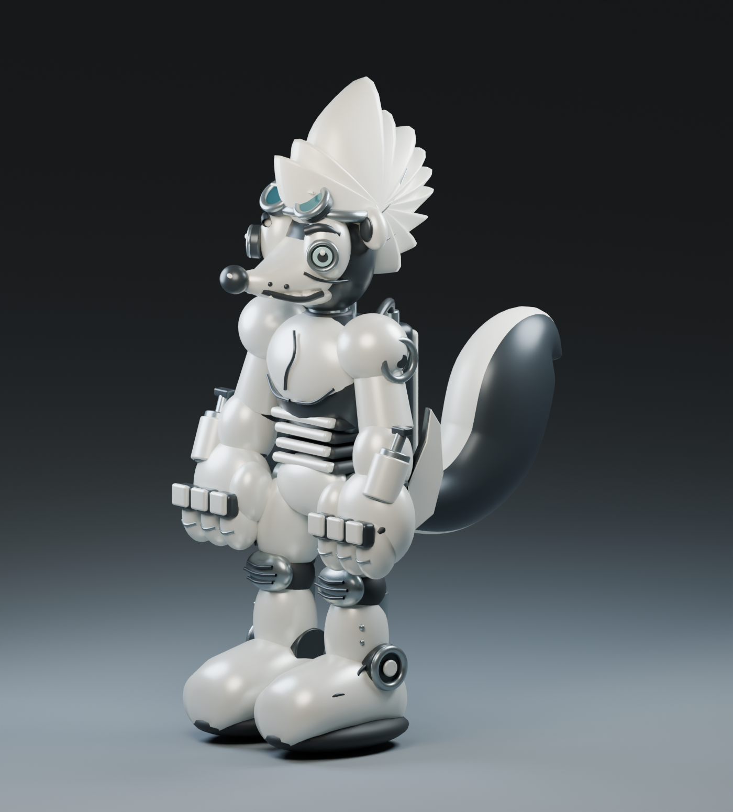
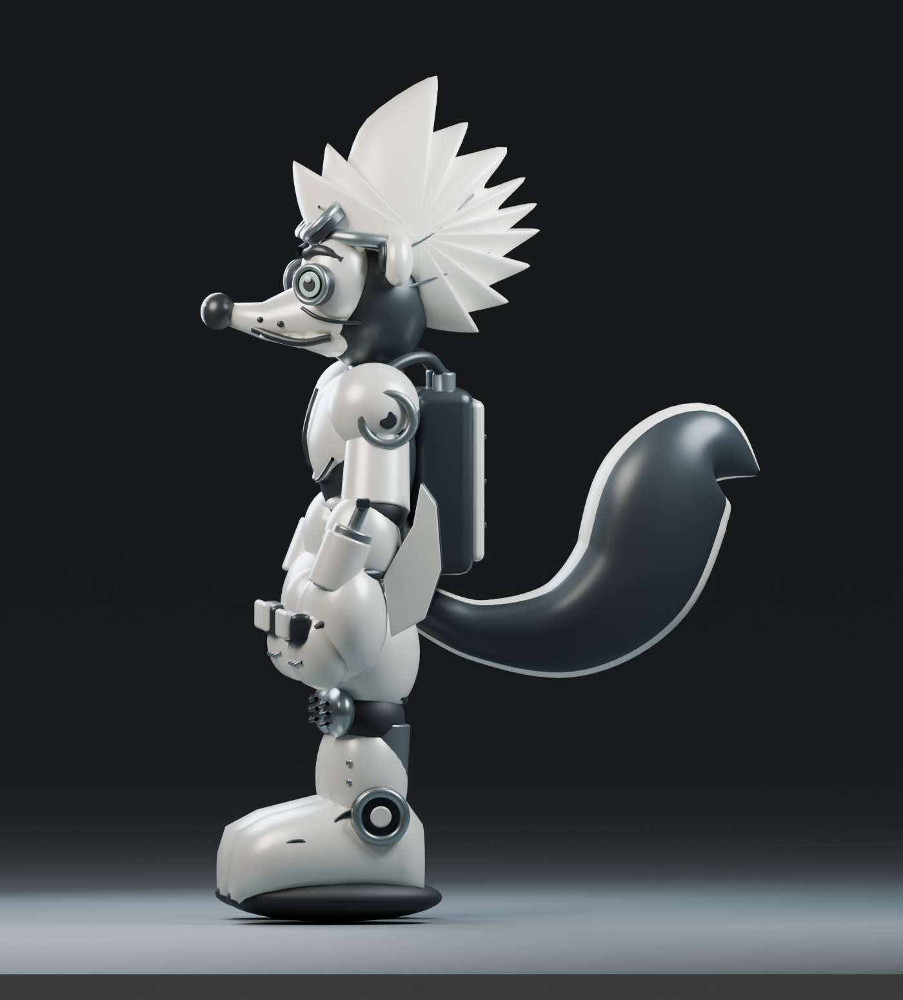
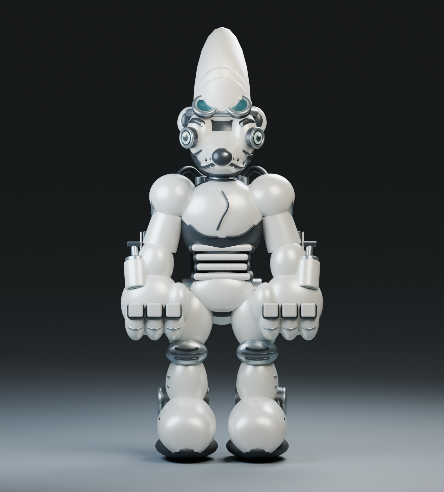
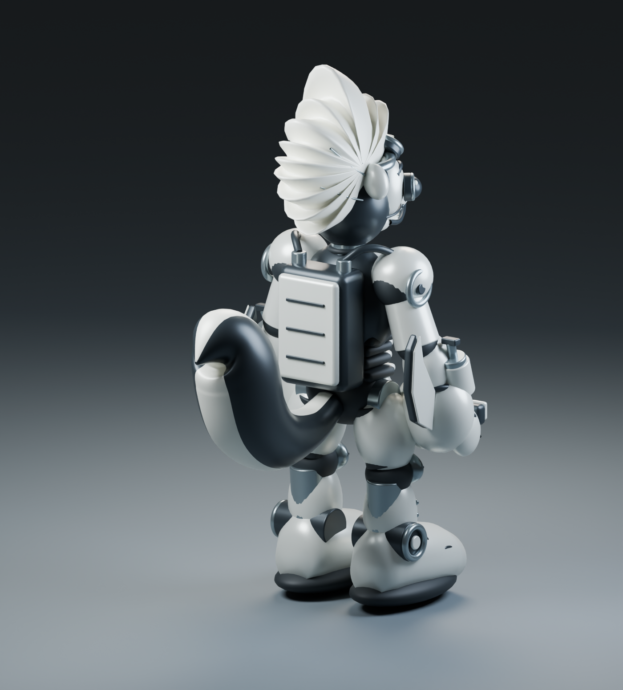
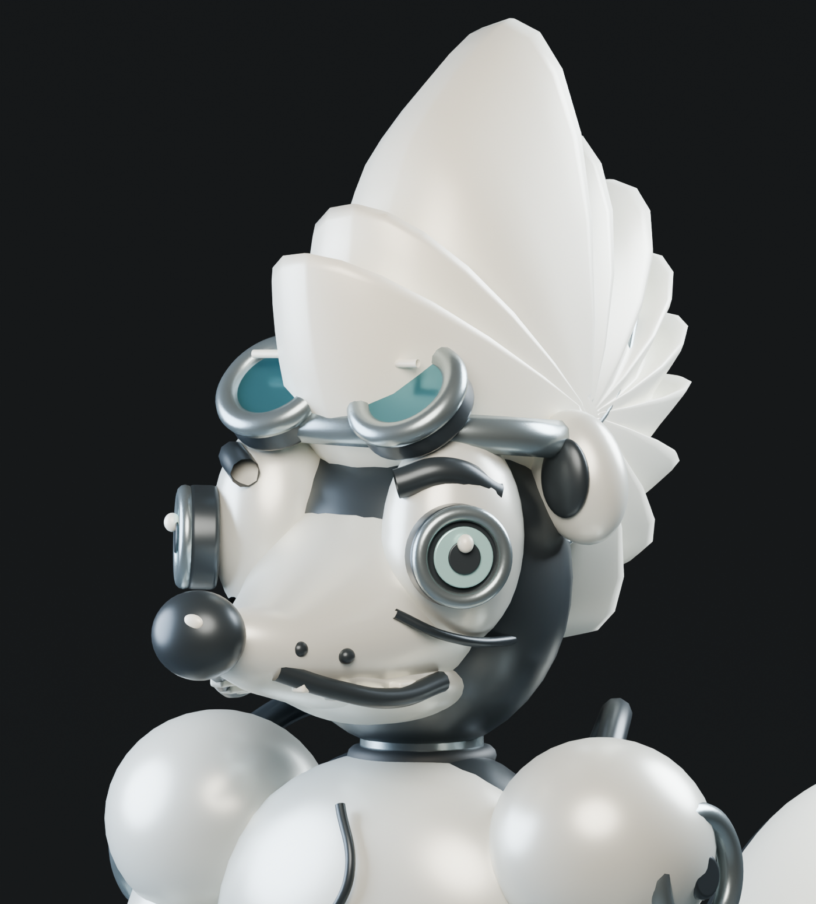
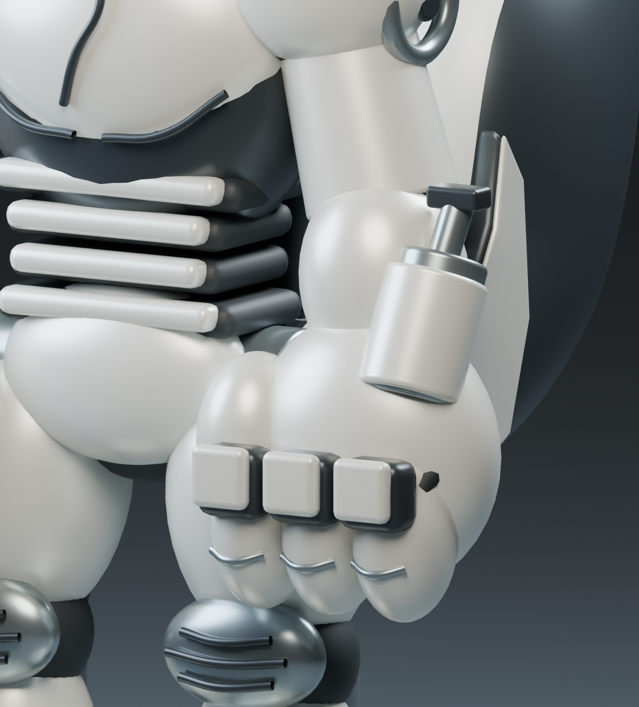
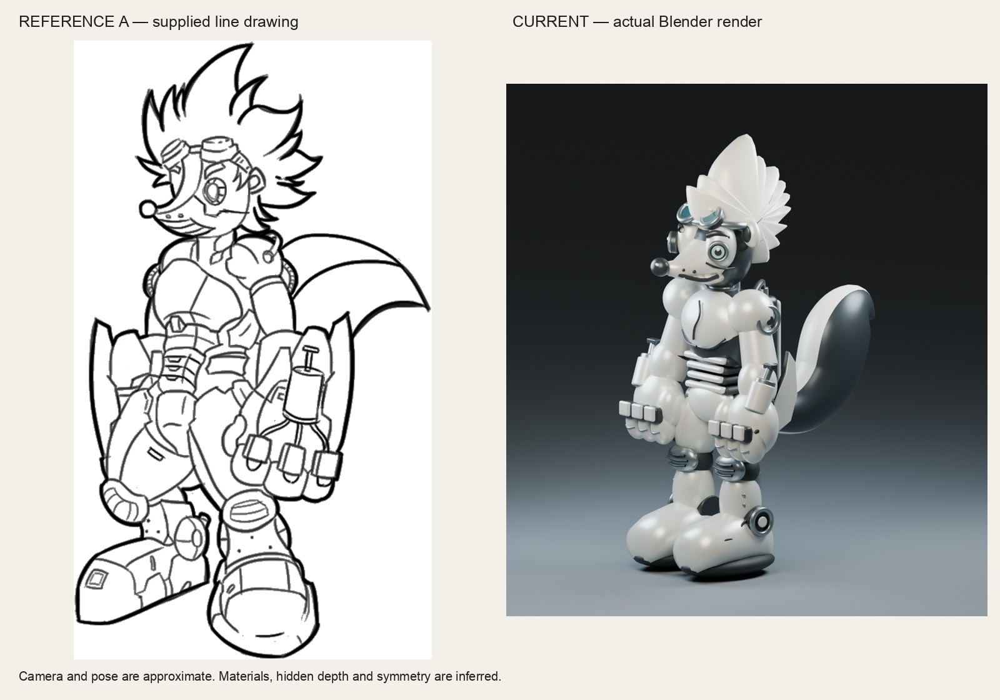
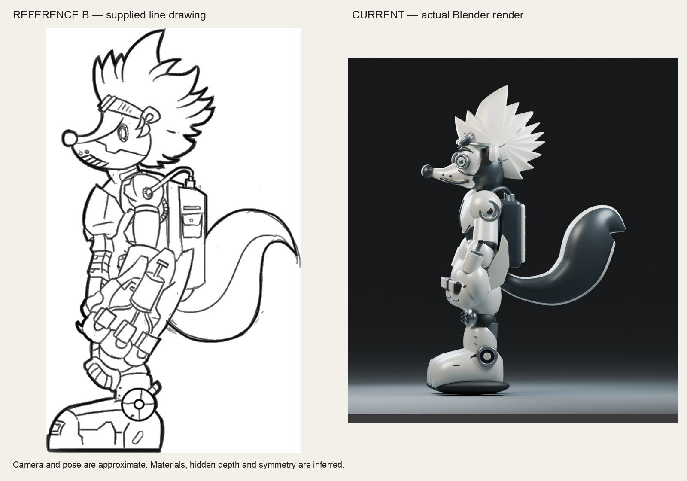

# AI Skunkworks robot skunk

A first stylized 3D interpretation of two supplied robot-skunk drawings, with inferred depth and materials.

151 meshes + 36 curves · 147,860 evaluated triangles · 7 materials · 4.116 × 5.777 × 8.690 design units (XYZ) · Blender 4.2.0 · Codex

## Three-quarter view

The long muzzle, goggles, broad chest shield, piston gloves and tall crest in the first completed interpretation.

[Full-size image](renders/hero.png)

## Side profile

The S-shaped tail and backpack follow reference B; the tail cross-section and rear construction are inferred.

[Full-size image](renders/side.png)

## Front view

Symmetric armor and gloves; there is no supplied front orthographic drawing, so this view exposes inferred width.

[Full-size image](renders/front.png)

## Rear quarter

Backpack, shoulder hoses and tail stripe. The hidden rear surfaces are an interpretation, not reference-confirmed.

[Full-size image](renders/rear.png)

## Face and goggles

A mechanical eye, curved smile, long muzzle and swept crest; the crest remains more fan-like than the drawing.

[Full-size image](renders/head.png)

## Mechanical glove

Three curled fingers, knuckle caps, thumb, hydraulic barrel, cable and forearm fin; these are static parts.

[Full-size image](renders/gauntlet.png)

## Reference A comparison

Supplied reference A left; actual hero render right. Approximate alignment; no claim of exact reconstruction.

[Full-size comparison](compare/reference-A-vs-current.jpg)

## Reference B comparison

Supplied reference B left; actual side render right. Approximate alignment; no claim of exact reconstruction.

[Full-size comparison](compare/reference-B-vs-current.jpg)

## Film

Companion film: coming soon
<!-- FILM_URL -->

## Downloads

| File | Size | Purpose |
|---|---|---|
| [ai-skunkworks-robot-skunk.blend](https://github.com/nikbearbrown/csye-7270-building-virtual-environments/raw/main/blender/ai-skunkworks-robot-skunk-codex/ai-skunkworks-robot-skunk.blend) | 6.62 MB | Editable scene, separated parts, materials, lights and six cameras |
| [ai-skunkworks-robot-skunk.glb](https://github.com/nikbearbrown/csye-7270-building-virtual-environments/raw/main/blender/ai-skunkworks-robot-skunk-codex/ai-skunkworks-robot-skunk.glb) | 3.47 MB | Character-only evaluated geometry and PBR material colors; no image textures |

## Import

Open the `.blend` in Blender 4.2 or later (saved and reopened in 4.2.0). For the GLB, use File → Import → glTF 2.0. The native file preserves editable parts and modifiers; the GLB bakes evaluated geometry, including curve cables. Studio lights, cameras, floor and modifier editability are not exported.

## Offline review viewer

Download [index.html](index.html) and open it in a browser. Its images, styles and controls are embedded; no network is needed for the gallery. It is an image review viewer, not a live 3D orbit.

[Pages viewer](https://nikbearbrown.github.io/csye-7270-building-virtual-environments/blender/ai-skunkworks-robot-skunk-codex/) · [HTML preview fallback](https://htmlpreview.github.io/?https://github.com/nikbearbrown/csye-7270-building-virtual-environments/raw/main/blender/ai-skunkworks-robot-skunk-codex/index.html). GitHub Pages is not configured for this repository (API returned 404 on October 21, 2026); use the downloaded offline viewer or the fallback.

## Built by

Builder: Codex. Method: scripted Blender mesh, curve and loft construction from two user-supplied drawings; three documented visual comparison rounds. Tools: Blender 4.2.0 (Cycles and built-in glTF exporter), Python and Pillow for packaging. Build date: October 21, 2026. Reference drawing authorship was not supplied; reference images provided by Nik Bear Brown. Human review: Professor Bear — pending.

## Limitations

First interpretation, not a finished likeness. The crest is more fan-like and the face more mechanical than the drawings; the boots are smoother, the armor and glove articulation are simplified, and the pose differs. Black/ivory materials and optical accent colors are proposed because the supplied references are uncolored line art. No rear, front or top drawing establishes depth, so symmetry, rear surfaces and cross-sections are inferred. Arbitrary design units, no verified real-world scale. No rig, animation, working hydraulics or game-ready retopology. Parts overlap; no watertight or 3D-printing suitability claim. Human review: Professor Bear — pending.
