# Claude mascot (scripted, rigged), by Claude

*The nine-box Claude mascot, built by a Blender script from the 2D mascot's exact numbers, with a 9-bone rig.*

`1 mesh (9 boxes), 108 triangles, 2 flat-colour materials, 1 armature with 9 bones, 1.36 x 0.495 x 0.86 m, no cameras or lights in the .blend (measured with Blender 5.1.2)`

A blocky 3D version of the Claude mascot (torso, two arms, two eyes, four legs) built by running `build_mascot.py` in Blender with no GUI and no Blender MCP. The proportions come from the numbers in the 2D mascot's Remotion scene (torso 96x60, arms 20x20, eyes 11x10, legs 11x26, body #dd775b, eyes black; 1 pixel = 1 cm). The depth of every part is invented, because the 2D scene has none. The rig has one bone per part, and a pose sheet tests it against the 18 named 2D animations. No animation clips exist.

## Views

### Front, three-quarter height

Front view from the 8-angle turnaround: wide torso, two black eyes, arms at the sides, four legs.

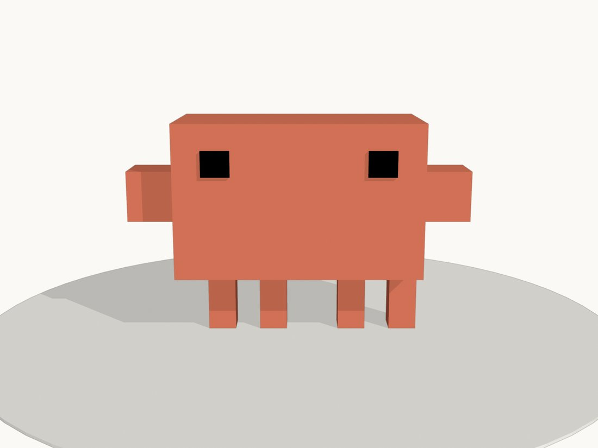

[Full-size file](renders/turnaround-az000.png)

### Three-quarter

Shows the 0.48 m torso depth and the shallow raised eyes.

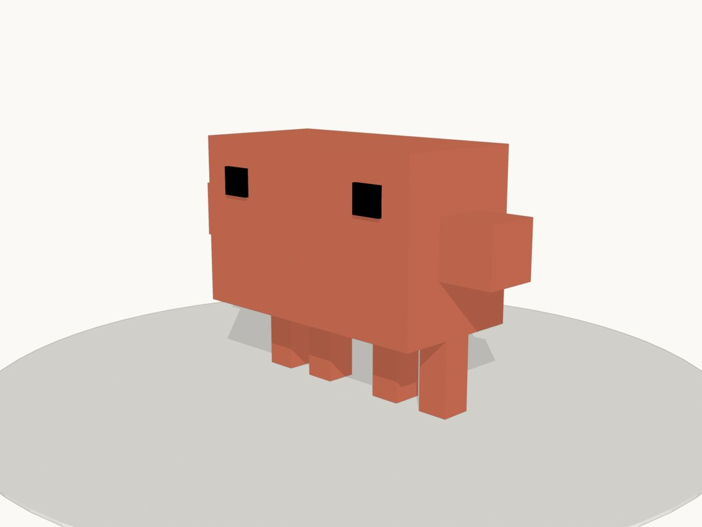

[Full-size file](renders/turnaround-az045.png)

### Side

Thin side view; the arm is a cube and the eye sits 1.5 cm proud of the face.

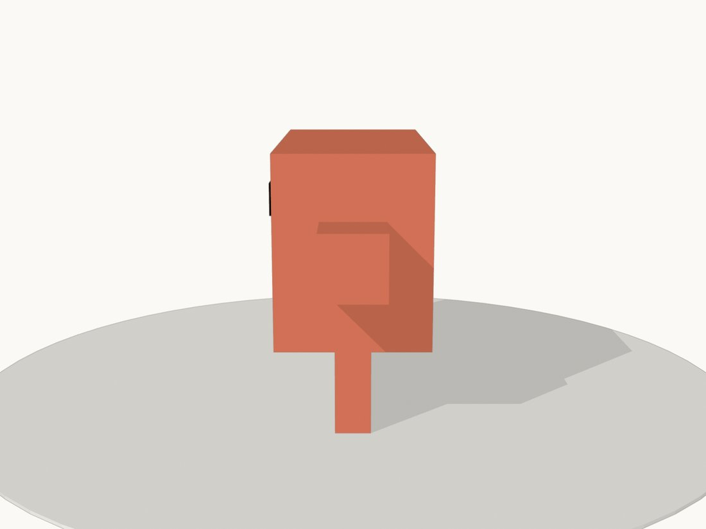

[Full-size file](renders/turnaround-az090.png)

### Back

Back of the torso is blank; the legs show the uneven spacing (the fourth leg sits flush with the torso's right edge, as in 2D).

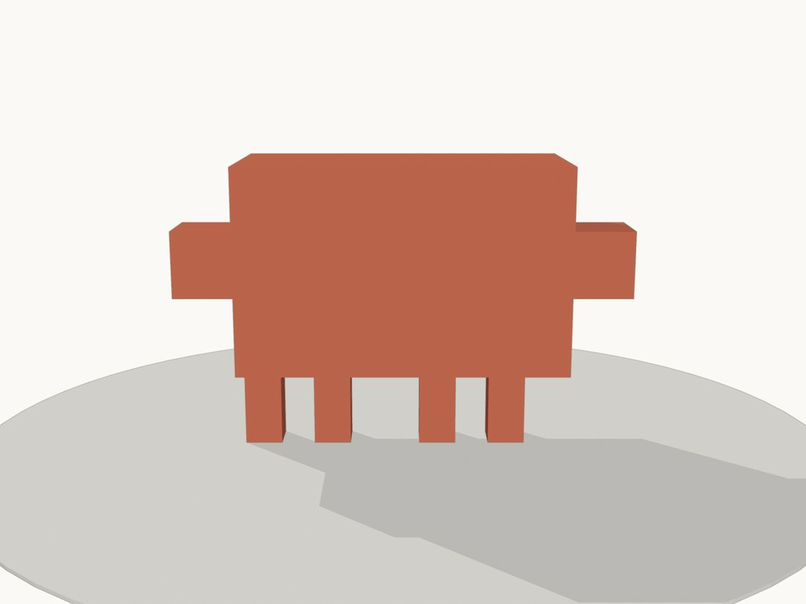

[Full-size file](renders/turnaround-az180.png)

### Orthographic front

Flat front view, the nearest match to the 2D mascot's silhouette.

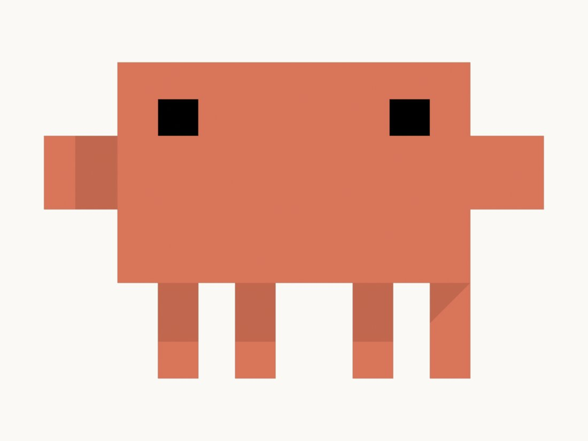

[Full-size file](renders/ortho-front.png)

### Orthographic top

Top view showing the depths chosen for each part.

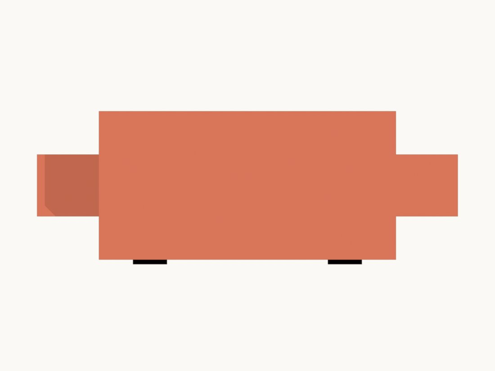

[Full-size file](renders/ortho-top.png)

### Orthographic back

Back view in orthographic projection.

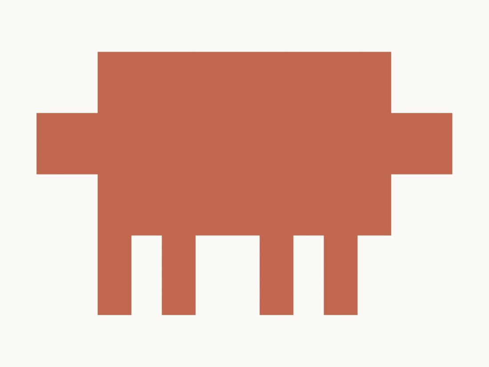

[Full-size file](renders/ortho-back.png)

### Wireframe

The 108 triangles' edges: nine plain boxes.

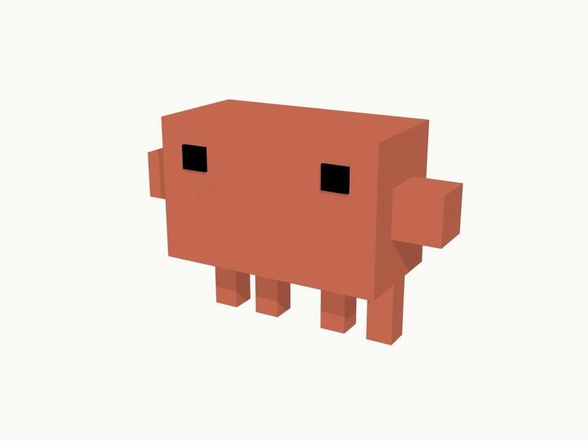

[Full-size file](renders/wireframe.png)

### Rig diagram

Where each of the nine bones' joints sits.

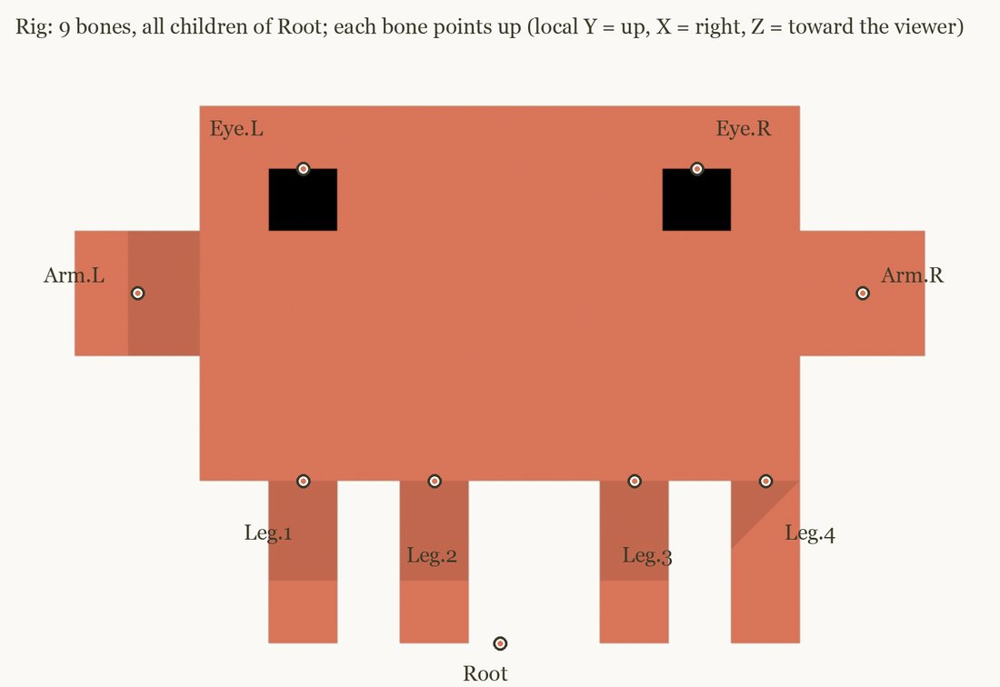

[Full-size file](renders/rig-diagram.png)

### Rig pose tests

One extreme frame of each of the 18 named 2D animations, posed on the rig with the 2D scene's own formulas. Some poses (spin, celebrate) look odd because they are single frames of motion.

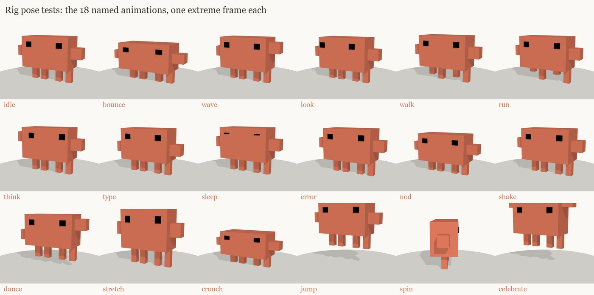

[Full-size file](renders/sheet-poses.png)

### Turnaround sheet

All eight turnaround angles on one sheet.

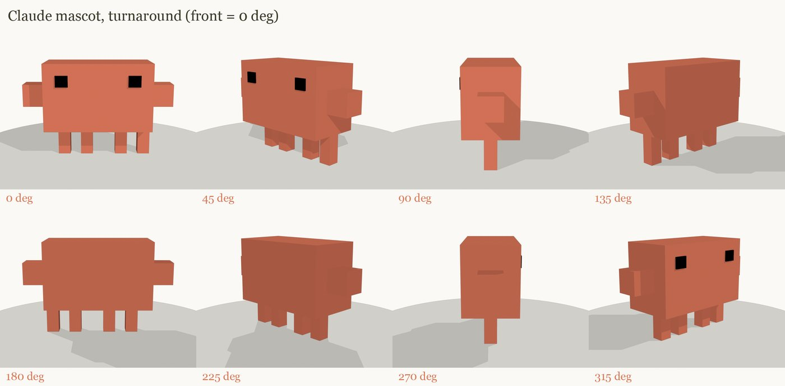

[Full-size file](renders/sheet-turnaround.png)

## Compare with references

No side-by-side comparison was made. The source folder holds no photo or still of the 2D mascot (checked the renders, the build record and the folder root); the model was built from the 2D scene's numbers, not from an image. A fake reference would be worse than none. A real comparison would need a screenshot of the 2D mascot at a matching angle (front orthographic).

## Film

Companion film: coming soon

<!-- FILM_URL -->

## Download

| File | Size | What it is | Download |
|---|---|---|---|
| `claude-mascot.blend` | 95 KB | Blender scene: mesh, rig, materials (no camera or lights saved) | [download](https://github.com/nikbearbrown/csye-7270-building-virtual-environments/raw/main/blender/claude-mascot-claude/claude-mascot.blend) |
| `claude-mascot.glb` | 14 KB | Model plus 9-bone skeleton for a game engine (+Y up) | [download](https://github.com/nikbearbrown/csye-7270-building-virtual-environments/raw/main/blender/claude-mascot-claude/claude-mascot.glb) |
| `renders/sheet-poses.png` | 537 KB | Rig pose test, 18 poses in one sheet | [download](https://github.com/nikbearbrown/csye-7270-building-virtual-environments/raw/main/blender/claude-mascot-claude/renders/sheet-poses.png) |
| `renders/sheet-turnaround.png` | 597 KB | Eight-angle turnaround sheet | [download](https://github.com/nikbearbrown/csye-7270-building-virtual-environments/raw/main/blender/claude-mascot-claude/renders/sheet-turnaround.png) |
| `ANIMATION-PLAN.md` | 4 KB | Maps each 2D animation to bone channels | [download](https://github.com/nikbearbrown/csye-7270-building-virtual-environments/raw/main/blender/claude-mascot-claude/ANIMATION-PLAN.md) |
| `BUILD_NOTES.md` | 3 KB | How it was built and what was checked | [download](https://github.com/nikbearbrown/csye-7270-building-virtual-environments/raw/main/blender/claude-mascot-claude/BUILD_NOTES.md) |
| `index.html` | 305 KB | Offline viewer | [download](https://github.com/nikbearbrown/csye-7270-building-virtual-environments/raw/main/blender/claude-mascot-claude/index.html) |

The .glb uses flat material colours only (2 materials, 0 images or textures), 11 nodes, 1 skin, 0 animations, read back from the file.

## How to import into Blender

- **`.blend`:** open it in Blender 4.2 or later (File > Open). Saved with Blender 5.1.2, never tested in 4.2.
- **`.glb`:** in Blender, File > Import > glTF 2.0 (.glb/.gltf), or drop it into a game engine or a web viewer.

## Viewer

A self-contained interactive viewer is in [`index.html`](index.html) (images embedded, works offline once downloaded):

- GitHub Pages: https://nikbearbrown.github.io/csye-7270-building-virtual-environments/blender/claude-mascot-claude/ (works once Pages is enabled for the repo)
- Fallback through htmlpreview: https://htmlpreview.github.io/?https://github.com/nikbearbrown/csye-7270-building-virtual-environments/raw/main/blender/claude-mascot-claude/index.html

## Built by

- **Builder:** Claude (no model or version is recorded in the source files)
- **Method:** Scripted: `build_mascot.py` run with Blender in background mode. Not built through the Blender MCP (the source README says so). Zero render-vs-reference rounds, because there is no image reference; checks were numeric (dimensions, triangle count, torso colour 217,117,89 against canonical 221,119,91), every render looked at, and a Godot import test reported in the source README (not re-run here).
- **Tools:** Blender 5.1.2 (read from the .blend by count_scene.py); Godot 4.7.2 for the import test, as the source README states
- **Build date:** 2026-10-06 (file times and README check date)
- **Human review:** Professor Bear: pending. The source README lists four open decisions for him (scale, spin, MCP or script, next video).

## Honest limitations

- Depth, scale (1 pixel = 1 cm) and the raised eyes are invented; the 2D scene only fixes width and height.
- No animation clips exist; the 18 poses are single frames, not tested motion.
- The .blend was saved by Blender 5.1.2 and has never been opened in Blender 4.2; it may not open there.
- No camera or lights are saved in the .blend, so it opens without a ready view.
- The .glb has a skeleton and one skinned mesh node but the model is rigid boxes only; no textures.
- Likeness to the 2D mascot was not compared against an image; it rests on the numbers. Judged by eye, the shape is a plain box creature with the right proportions, but it has no detail beyond that.
