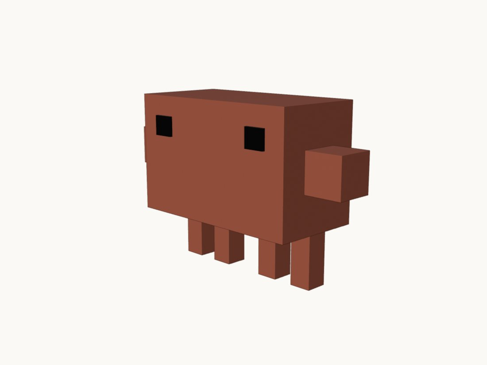
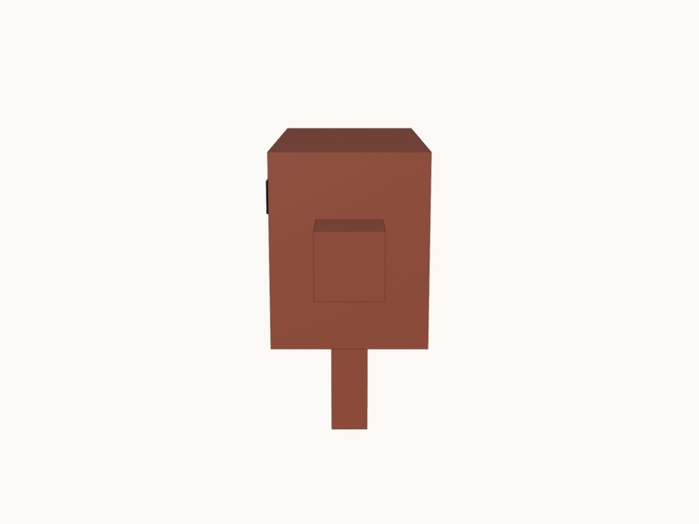
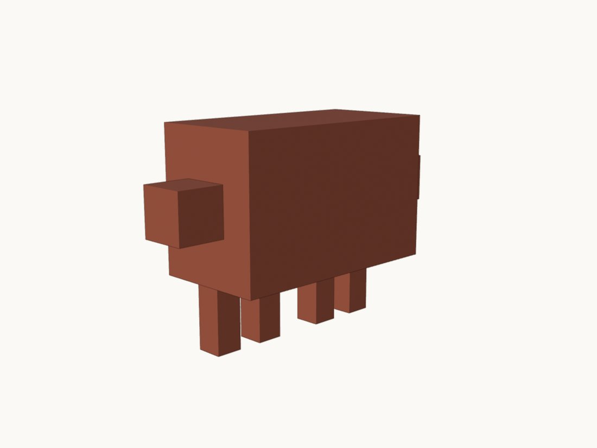
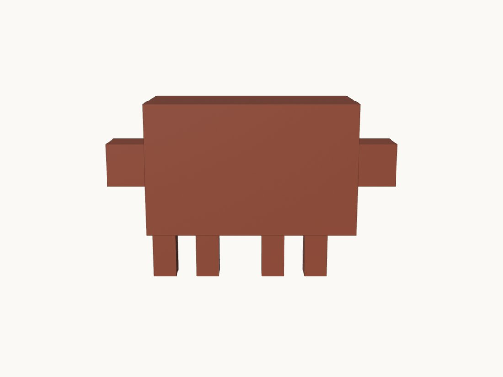
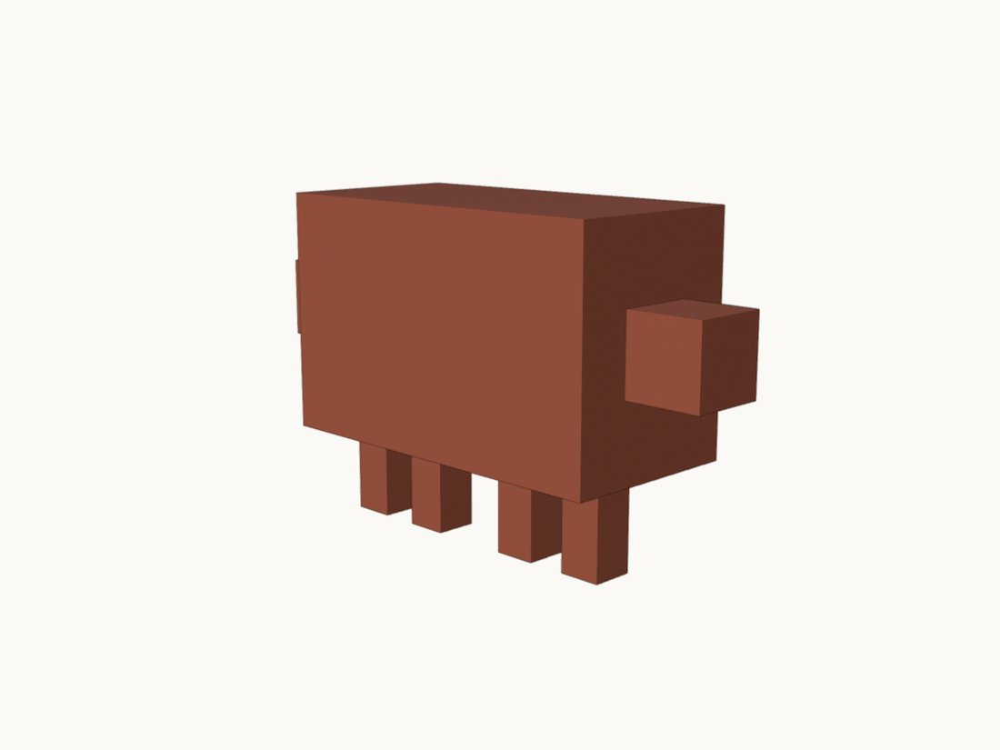
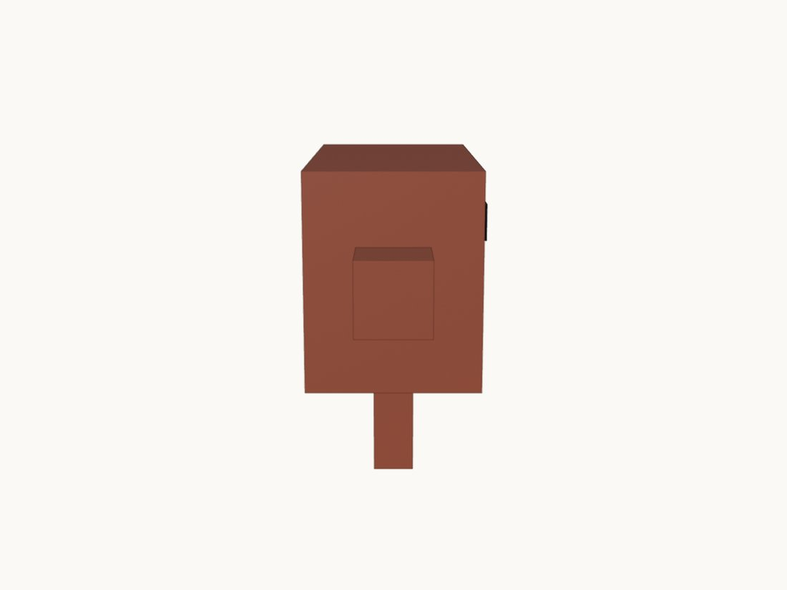
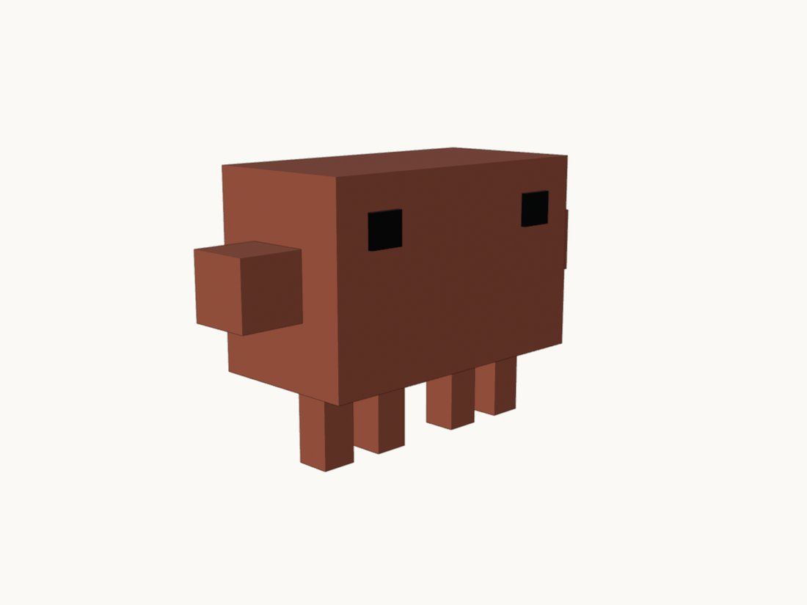
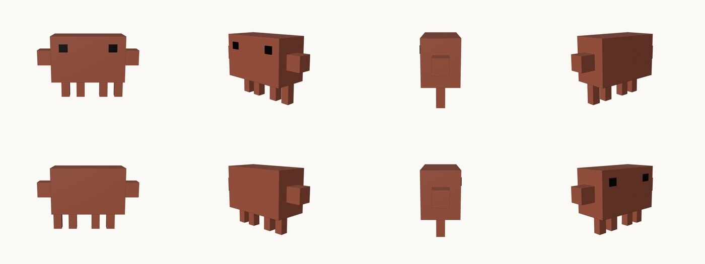
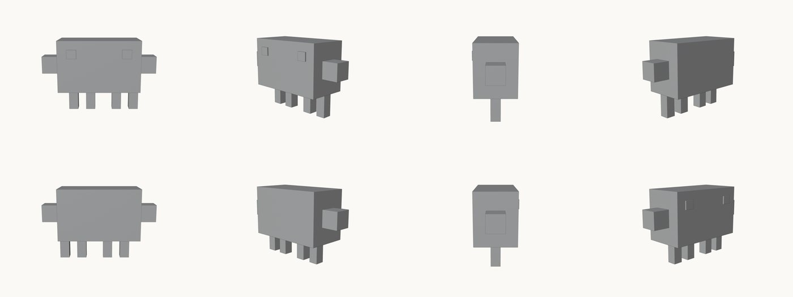

# Claude mascot (built through the Blender MCP), by Claude

*The same nine-box Claude mascot, built by Claude Code driving Blender through the MCP for Blender add-on.*

`9 mesh objects, 108 triangles, 3 materials (2 used), 1 armature with 9 bones, 1 camera, 1 light, 1.36 x 0.495 x 0.86 m (measured with Blender 5.1.2)`

A second build of the same mascot, done to test the Blender MCP route. A Claude Code session (model `claude-sonnet-4-6` per the session logs) was given `MASCOT-BRIEF.md` (a table of nine box sizes and positions in metres) and five prompts, and built, rendered and rigged the model through the MCP for Blender add-on connected to a running Blender 5.1.2. The geometry numbers in the brief are the same as the scripted build's. The first renders came out grey; a later prompt found and fixed the cause.

## Views

### Front

Front view, Workbench render, transparent background (shown on cream), after the colour fix.

[Full-size file](renders/turnaround-az000.png)

### Three-quarter

Front left three-quarter.

[Full-size file](renders/turnaround-az045.png)

### Side

Side view.

[Full-size file](renders/turnaround-az090.png)

### Rear three-quarter

Back left three-quarter.

[Full-size file](renders/turnaround-az135.png)

### Back

Back view.

[Full-size file](renders/turnaround-az180.png)

### Rear three-quarter, right

Back right three-quarter.

[Full-size file](renders/turnaround-az225.png)

### Other side

Other side view.

[Full-size file](renders/turnaround-az270.png)

### Front right

Front right three-quarter.

[Full-size file](renders/turnaround-az315.png)

### MCP look tool

Front and three-quarter views captured with the MCP's `look` tool during the build.

[Full-size file](renders/mcp-look-front-and-three-quarter.png)

### First attempt: grey

The first eight-view render, plain grey. Kept to show the failure: Workbench reads the material's viewport colour, which the session had not set.

[Full-size file](renders/first-attempt-grey.png)

## Compare with references

No comparison was made. The source folder holds no photo or still of the 2D mascot, and the model was built from the brief's numbers. The only colour check in the logs compares a rendered torso pixel with the target hex, not an image of the 2D mascot.

## Film

Companion film: coming soon

<!-- FILM_URL -->

## Download

| File | Size | What it is | Download |
|---|---|---|---|
| `claude-mascot-mcp.blend` | 104 KB | Blender scene saved through the MCP: 9 parts, rig, camera, light | [download](https://github.com/nikbearbrown/csye-7270-building-virtual-environments/raw/main/blender/claude-mascot-mcp-claude/claude-mascot-mcp.blend) |
| `claude-mascot-mcp.glb` | 15 KB | Model plus skeleton (+Y up) | [download](https://github.com/nikbearbrown/csye-7270-building-virtual-environments/raw/main/blender/claude-mascot-mcp-claude/claude-mascot-mcp.glb) |
| `MASCOT-BRIEF.md` | 2 KB | The brief the session was given | [download](https://github.com/nikbearbrown/csye-7270-building-virtual-environments/raw/main/blender/claude-mascot-mcp-claude/MASCOT-BRIEF.md) |
| `prompts/prompt1.txt` | 1 KB | First prompt (plan; the other four are beside it) | [download](https://github.com/nikbearbrown/csye-7270-building-virtual-environments/raw/main/blender/claude-mascot-mcp-claude/prompts/prompt1.txt) |
| `checks/check_scene.log` | 2 KB | Scene check printout | [download](https://github.com/nikbearbrown/csye-7270-building-virtual-environments/raw/main/blender/claude-mascot-mcp-claude/checks/check_scene.log) |
| `checks/check_rig.log` | 2 KB | Rig check printout | [download](https://github.com/nikbearbrown/csye-7270-building-virtual-environments/raw/main/blender/claude-mascot-mcp-claude/checks/check_rig.log) |
| `BUILD_NOTES.md` | 4 KB | What happened, step by step | [download](https://github.com/nikbearbrown/csye-7270-building-virtual-environments/raw/main/blender/claude-mascot-mcp-claude/BUILD_NOTES.md) |
| `index.html` | 206 KB | Offline viewer | [download](https://github.com/nikbearbrown/csye-7270-building-virtual-environments/raw/main/blender/claude-mascot-mcp-claude/index.html) |

The .glb uses flat material colours only (2 materials, 0 images or textures), 19 nodes, 1 skin, 0 animations, read back from the file.

## How to import into Blender

- **`.blend`:** open it in Blender 4.2 or later (File > Open). Saved with Blender 5.1.2, never tested in 4.2.
- **`.glb`:** in Blender, File > Import > glTF 2.0 (.glb/.gltf), or drop it into a game engine or a web viewer.

## Viewer

A self-contained interactive viewer is in [`index.html`](index.html) (images embedded, works offline once downloaded):

- GitHub Pages: https://nikbearbrown.github.io/csye-7270-building-virtual-environments/blender/claude-mascot-mcp-claude/ (works once Pages is enabled for the repo)
- Fallback through htmlpreview: https://htmlpreview.github.io/?https://github.com/nikbearbrown/csye-7270-building-virtual-environments/raw/main/blender/claude-mascot-mcp-claude/index.html

## Built by

- **Builder:** Claude, via Claude Code (session logs name the model `claude-sonnet-4-6`, Claude Code 2.1.150)
- **Method:** Driven through the Blender MCP: five prompts, one Claude Code run each, one `execute_blender_code` call per object, each reporting size, location, rotation and scale. One correction round (grey renders, fixed in prompt 4). No reference image, so no render-vs-reference rounds. Who wrote the five prompts is not recorded in the folder.
- **Tools:** Blender 5.1.2; MCP for Blender add-on v1.8 (as the session reported) over `uvx mcp-for-blender`; Claude Code 2.1.150
- **Build date:** 2026-10-07 (log and file times, around 00:03 local); the five prompts ran in the same session window
- **Human review:** Professor Bear: pending. The source records no verdict.

## Honest limitations

- The .blend was saved by Blender 5.1.2 and has never been opened in Blender 4.2.
- The parts are bone-parented, not skinned: the .glb has one skin with 9 joints, but no mesh node references it (read back from the file). A game engine that expects weighted skinning will not deform the parts through it; it relies on the node hierarchy.
- The session itself reported it did not verify: that the glb stands upright in a +Y-up viewer, and that the glb coordinates match Blender's. These were not re-checked here.
- The first renders were grey. The fix worked, but the rendered torso reads (196, 149, 133) rather than #dd775b because of Workbench studio lighting.
- The .blend also holds two unused default materials (`Dots Stroke`, `Material`) and its scene contains an unrelated default camera and light.
- No animation clips; the rig was tested by moving a few bones once (Arm.R, Leg.1, Eye.L) in the session's own report.
- No reference image comparison; likeness rests on the brief's numbers and my reading of the renders: a plain box creature with the right proportions.
