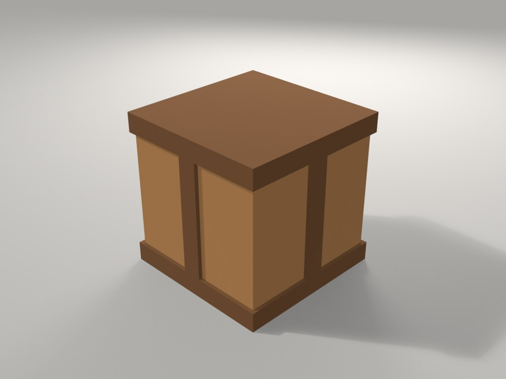
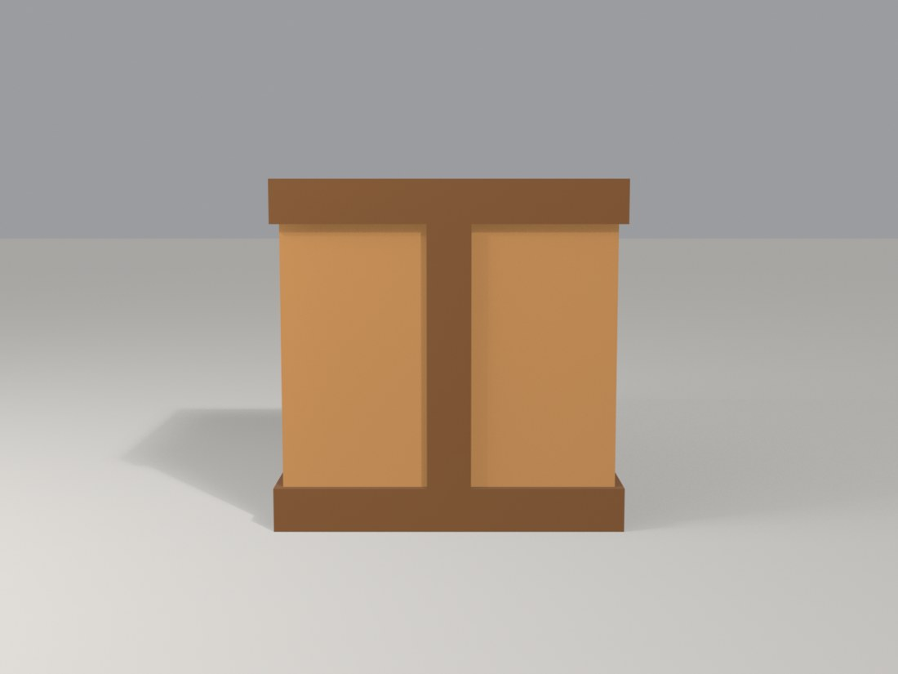
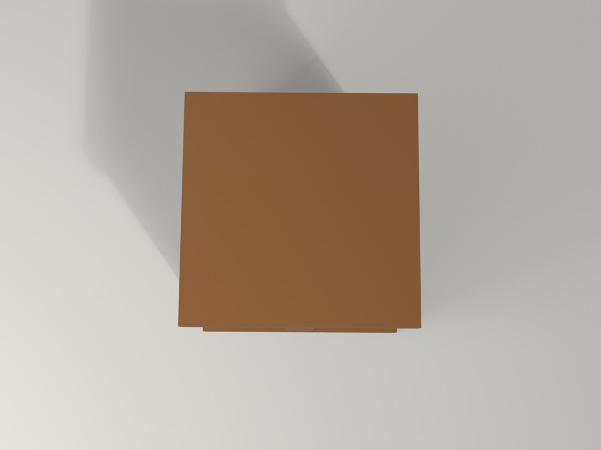
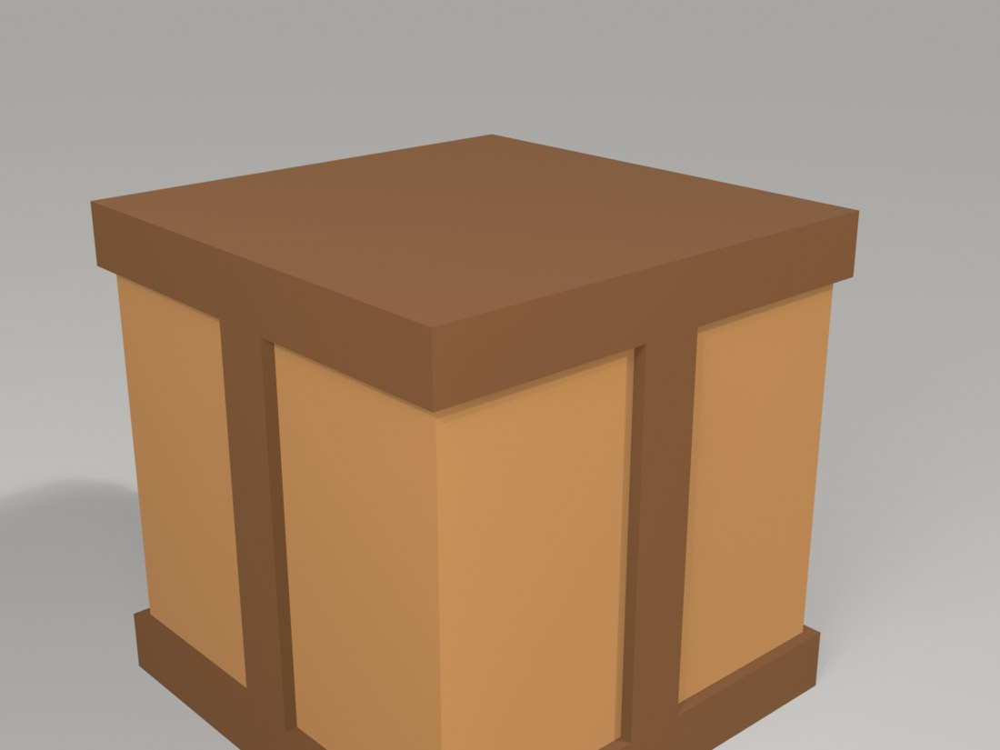

# Crate (teaching prop), built by Claude

*A teaching prop for CSYE 7270: a wooden crate: one 0.76 m cube plus four thin cuboid bands (two rings, two straps), from basic shapes only.*

`5 basic shapes · 60 triangles · 2 materials · 0.80 x 0.80 x 0.80 m · Blender 5.1.2`

One of three tiny assets made for Assignment 3 of CSYE 7270 (course limits: at most 6 shapes, at most 500 triangles). It is a wooden crate: one 0.76 m cube plus four thin cuboid bands (two rings, two straps). Flat colours only, joined into one object, origin at the centre of the underside, lowest point at z = 0. These are teaching primitives, not likenesses of any real object.

## Views

### Front three-quarter

From front-left and above, the main view.

[Full-size file](renders/crate_front34.png)

### Back three-quarter

From back-right and above, to check the far sides.

[Full-size file](renders/crate_back34.png)

### Side, low

Almost level with the floor, to check proportions and that the prop sits on z = 0.

[Full-size file](renders/crate_side.png)

### Top

Straight down, to check the footprint.

[Full-size file](renders/crate_top.png)

### Close-up, top corner

The lid ring, a strap and the wood body at the near top corner. Straps and rings are flat cuboids; nothing is bevelled or textured.

[Full-size file](renders/crate_close.png)

## Compare with references

No photo or drawing reference exists for this prop: it is a primitives-only teaching asset made to the course limits, not a copy of a real object. There is nothing to compare it against.

## Film

Companion film: coming soon

<!-- FILM_URL -->

## Download

| File | Size | What it is | Download |
|---|---|---|---|
| `crate.blend` | 94 KB | Blender scene: one joined mesh, flat-colour materials. No camera or light is stored in it. | [download](https://github.com/nikbearbrown/csye-7270-building-virtual-environments/raw/main/blender/crate-prop-claude/crate.blend) |
| `crate.glb` | 6 KB | glTF binary, exported with +Y Up on; flat base colours, no textures. | [download](https://github.com/nikbearbrown/csye-7270-building-virtual-environments/raw/main/blender/crate-prop-claude/crate.glb) |
| `scripts/build_crate.py` | 4 KB | The script that built the prop (run in background Blender). | [download](https://github.com/nikbearbrown/csye-7270-building-virtual-environments/raw/main/blender/crate-prop-claude/scripts/build_crate.py) |
| `scripts/build_crate.log` | 1 KB | Terminal output of that run, as recorded. | [download](https://github.com/nikbearbrown/csye-7270-building-virtual-environments/raw/main/blender/crate-prop-claude/scripts/build_crate.log) |
| `scripts/render_props.py` | 4 KB | Renders the five views in renders/ (EEVEE). | [download](https://github.com/nikbearbrown/csye-7270-building-virtual-environments/raw/main/blender/crate-prop-claude/scripts/render_props.py) |
| `scripts/ASSETS-source.md` | 6 KB | The source folder's ASSETS.md for all three props, copied unchanged. | [download](https://github.com/nikbearbrown/csye-7270-building-virtual-environments/raw/main/blender/crate-prop-claude/scripts/ASSETS-source.md) |
| `scripts/count_scene.py` | 1 KB | Counts meshes, triangles, materials and size from the .blend. | [download](https://github.com/nikbearbrown/csye-7270-building-virtual-environments/raw/main/blender/crate-prop-claude/scripts/count_scene.py) |
| `scripts/make_pages.py` | 11 KB | Generates README.md, BUILD_NOTES.md and index.html. | [download](https://github.com/nikbearbrown/csye-7270-building-virtual-environments/raw/main/blender/crate-prop-claude/scripts/make_pages.py) |
| `BUILD_NOTES.md` | 4 KB | How it was built and what is unverified. | [download](https://github.com/nikbearbrown/csye-7270-building-virtual-environments/raw/main/blender/crate-prop-claude/BUILD_NOTES.md) |
| `index.html` | 161 KB | Self-contained viewer with the renders. | [download](https://github.com/nikbearbrown/csye-7270-building-virtual-environments/raw/main/blender/crate-prop-claude/index.html) |

crate.glb carries flat base colours only: no textures, no UVs of note. The source's Godot import check reported identical colours after import (per ASSETS.md; not re-run here).

## How to import into Blender

- **`.blend`:** open it in Blender 4.2 or later (File > Open). 
- **`.glb`:** in Blender, File > Import > glTF 2.0 (.glb/.gltf), or drop it into a game engine or a web viewer.

## Viewer

A self-contained interactive viewer is in [`index.html`](index.html) (images embedded, works offline once downloaded):

- GitHub Pages: https://nikbearbrown.github.io/csye-7270-building-virtual-environments/blender/crate-prop-claude/ (works once Pages is enabled for the repo)
- Fallback through htmlpreview: https://htmlpreview.github.io/?https://github.com/nikbearbrown/csye-7270-building-virtual-environments/raw/main/blender/crate-prop-claude/index.html

## Built by

- **Builder:** Claude (no model version is recorded in the source files)
- **Method:** Scripted: build_crate.py was run once in background Blender (`Blender -b --factory-startup --python-exit-code 1 --python build_crate.py`), as ASSETS.md and build_crate.log record. It was NOT built through the Blender MCP: the lecture's BUILD-LOG.md says 'The three assets in the film were built by a Blender script (the assignment's fallback route)' and that nobody has run the MCP route. No render-versus-reference rounds and no hand-modelling rounds: one scripted build, no references. The five renders here were made on 2026-10-18 by scripts/render_props.py (one pass, plus two layout adjustments of the cameras).
- **Tools:** Blender 5.1.2 (read from the .blend by count_scene.py and from the build log); glTF exporter bundled with Blender; Godot 4.7.2 was used by the source film for an import check (evidence/godot logs, not copied here).
- **Build date:** 2026-10-06 (build logs at 12:59, .blend saved 13:27); renders 2026-10-18
- **Human review:** Professor Bear: pending (no verdict is recorded in the source folder).

## Honest limitations

- The top face is band-coloured because the top ring is a full 0.80 m cube: it reads as a lid, but there is no separate lid and no slats, nails or wood grain.
- The straps and rings overlap and share coplanar faces inside the joined mesh, so the 60 triangles include hidden ones. In a first Cycles test those coplanar faces rendered black in places; the renders here use EEVEE, which shows them correctly.
- The .blend was saved by Blender 5.1.2 (save_blend_demo.py) and has never been opened in Blender 4.2; Blender 4.2 may refuse or warn.
- The .blend has no camera and no light; the renders use a stage (floor and lights) added at render time, which is not in the file.
- The source folder's own note: the glass, flame and colours are flat Principled base colours, not textured; the .glb is small because there are no textures.
