# Crystal Palace, Hyde Park 1851: the west half's iron frame

A Blender model of the iron frame of the 1851 Crystal Palace, 37 of its 77 bays (the west half, 888 ft), built by script from Charles Downes's 1852 working drawings and tested against figures read from them. It is an unfinished frame, not a likeness.

**7,757 placed parts · 12 library collections (164 meshes) · 1,081,608 triangles with instances · 4 materials · 888 × 408 ft between column lines · Blender 5.1.2.** Built by Claude.

**Interactive viewer:** [open the viewer](https://nikbearbrown.github.io/csye-7270-building-virtual-environments/blender/crystal-palace-1851-claude/) (GitHub Pages) · [htmlpreview fallback](https://htmlpreview.github.io/?https://github.com/nikbearbrown/csye-7270-building-virtual-environments/raw/main/blender/crystal-palace-1851-claude/index.html) · or download [`index.html`](https://github.com/nikbearbrown/csye-7270-building-virtual-environments/raw/main/blender/crystal-palace-1851-claude/index.html) and open it locally; it is self-contained.

## Views

### Overview, from the south-west

All 37 built bays (888 ft between the end column lines) from the south-west and high: three stepped tiers under ridge-and-valley roofs, tier 1 (408 ft across) nearest, tiers 2 (264 ft) and 3 (120 ft) stepping back. Nothing east of the transept's west face is built.

Full size: [renders/overview.png](renders/overview.png)

### West end, from the south-west

The west end and the tier-1 roof in front, tiers 2 and 3 stepping back behind it. The roofs are plain sheets with the ridge-and-valley profile; there are no walls or glazing, so the frame shows through.

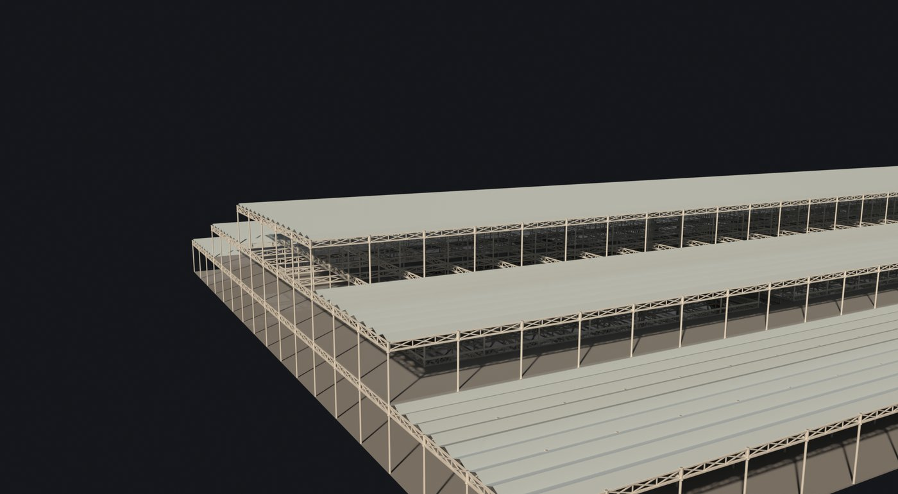

Full size: [renders/iso.png](renders/iso.png)

### Cross-section view, looking east

Orthographic, looking east from the west end, 440 ft across, lit. Every bay's frame lies behind the first, so it reads as one cross-section: tiers 408, 264 and 120 ft wide, girder tops at 22′ 2″, 42′ 2″ and 62′ 2″. This is the view set beside Plate VI.

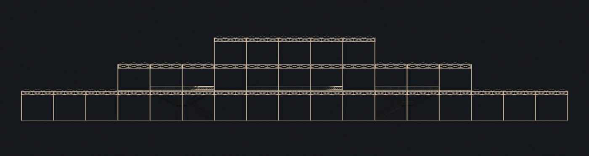

Full size: [renders/section.png](renders/section.png)

### Inside the nave

From the nave at gallery height looking north-east and up: columns, connecting pieces and lattice girders under the roofs, with the lattice gallery railing in view. Interior light is raised 2.5 stops, because the roofs are opaque.

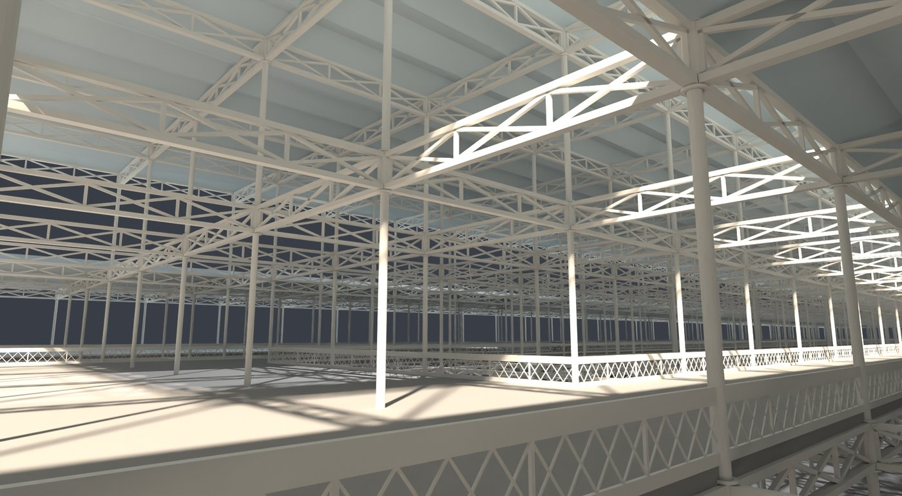

Full size: [renders/nave.png](renders/nave.png)

### From the gallery floor

From the nave-side gallery floor strip (22′ 11″ above the ground floor) looking across the nave void: the railing along the void edge, the frame and the roof beyond.

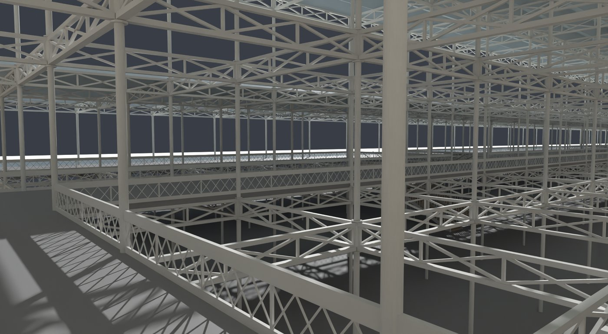

Full size: [renders/gallery.png](renders/gallery.png)

### The end of the nave void

From inside the nave void looking west at the cross railing that closes the void 72 ft from the west end (control D24), with the gallery floor beyond it.

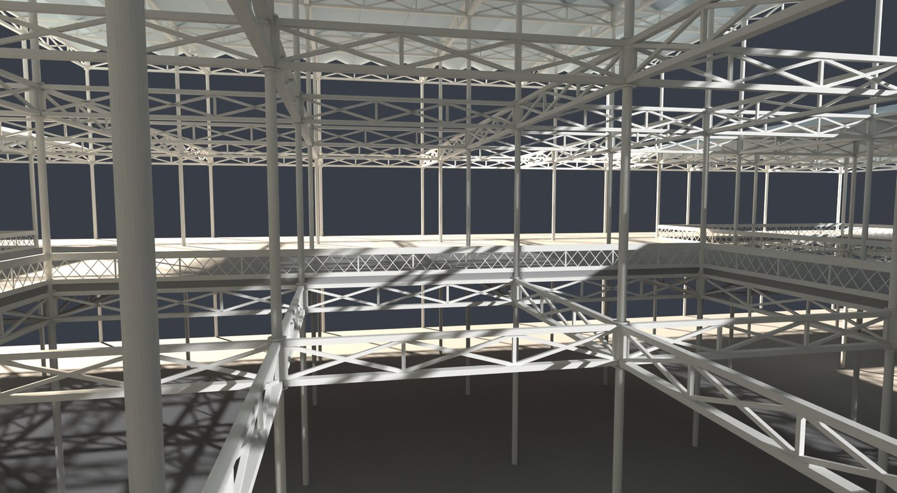

Full size: [renders/voidend.png](renders/voidend.png)

### A staircase from the ground floor

One avenue staircase (bay 192–216 ft, north avenue) from the nave floor: the ground flights rise to the landing, then the upper flights climb to the galleries, under the 48 × 24 ft cross gallery.

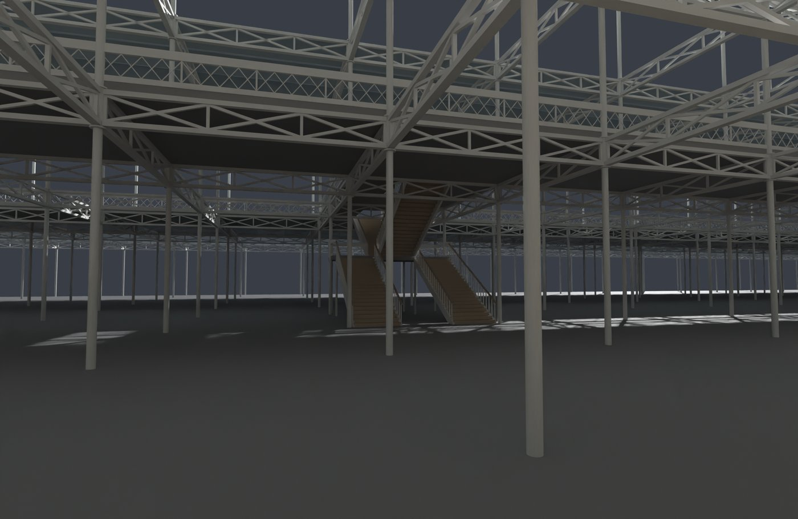

Full size: [renders/stairs.png](renders/stairs.png)

### The stair wells from the gallery

From the nave-side gallery looking north over the cross gallery, the two well holes (8 × 16 ft) and the landing.

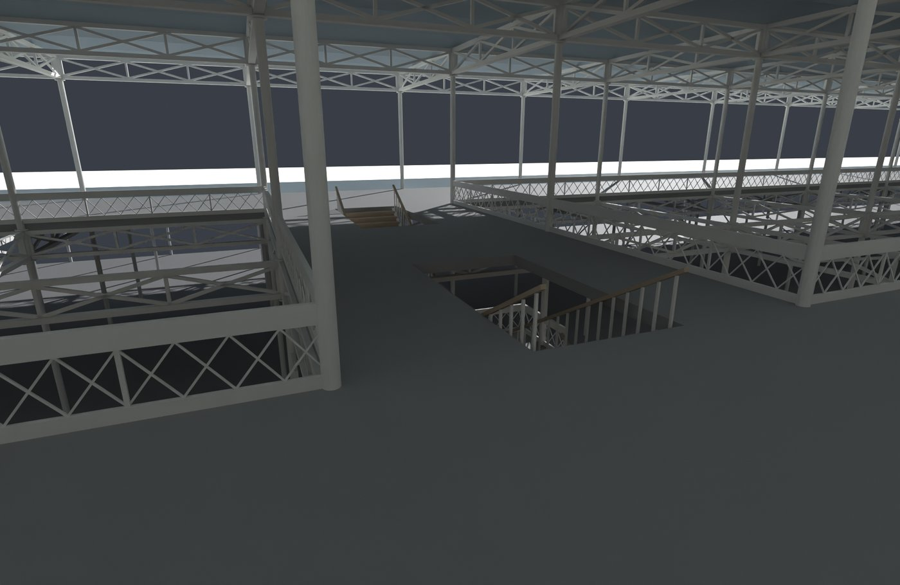

Full size: [renders/stairgal.png](renders/stairgal.png)

### Under the gallery, close-up

A close-up from the ground floor looking up at the underside of the gallery: column heads and connecting pieces, the lattice girders and the underside of the gallery floor slab.

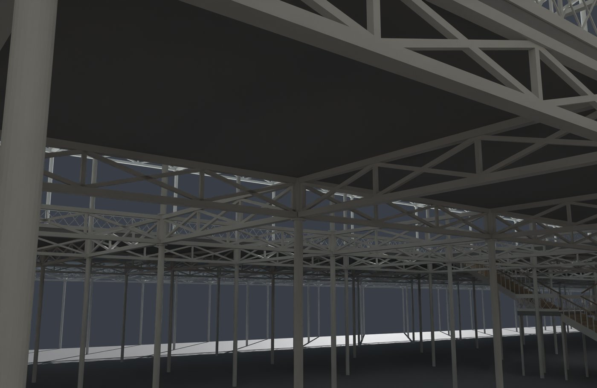

Full size: [renders/joint.png](renders/joint.png)

### Stair section, unlit

Orthographic section along the flights, north avenue, drawn white on black and unlit so every part shows: two ground flights, the landing and its columns, the upper flights and the cross gallery. This is the view set beside Plate XV; the lit render was too dark to read.

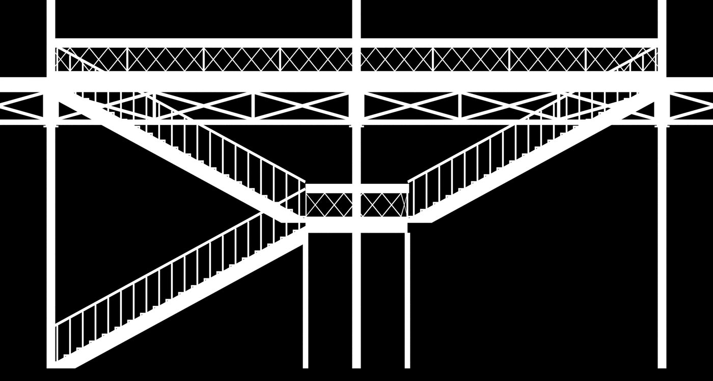

Full size: [renders/stairsec_flat.png](renders/stairsec_flat.png)

## Compare with references

The references are Plates VI and XV of Charles Downes, *The Building Erected in Hyde Park for the Great Exhibition* (London: John Weale, 1852), from the scan by McGill University Library held by the Internet Archive. The work is in the public domain; the Internet Archive item states no licence for the scan. Each plate is cropped to the model's camera window and shown for comparison only.

### Transverse section, left half: Plate VI beside the model

Left: Plate VI of Downes (1852), transverse section on line A-B, cropped to the model's camera window. Right: the model's section view in the same window, left half only. The tier stepping, the girder levels and the column grid fall where the plate draws them (registered on the plate's scale bar and ground line). The plate has what the model lacks: the glazing, the end walls and doors, the arched ironwork and cresting, the foundation pads. The model was built from this plate's own figures, so the match is a consistency check, not independent evidence.

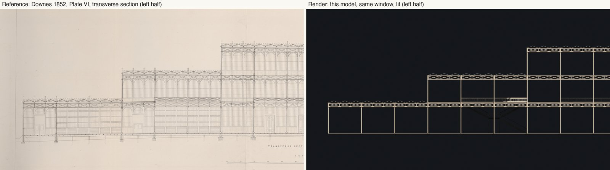

Full size: [compare/section_left_half_vs_plateVI.jpg](compare/section_left_half_vs_plateVI.jpg)

### Transverse section, full width: plate above, render below

The same comparison at full width. The section is so wide (440 ft across, 3.75 : 1) that side by side would be unreadable, so here the plate is above and the render below.

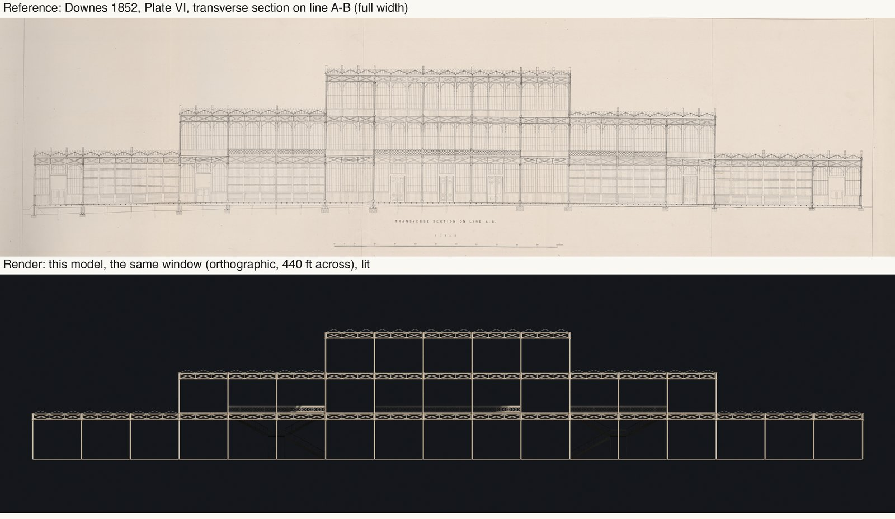

Full size: [compare/section_full_stacked_vs_plateVI.jpg](compare/section_full_stacked_vs_plateVI.jpg)

### Transverse section: the model overlaid on Plate VI

The model's unlit render in red over the plate. It lies on the plate's frame, tiers and stairs; everything the plate shows outside the red is what the model leaves out.

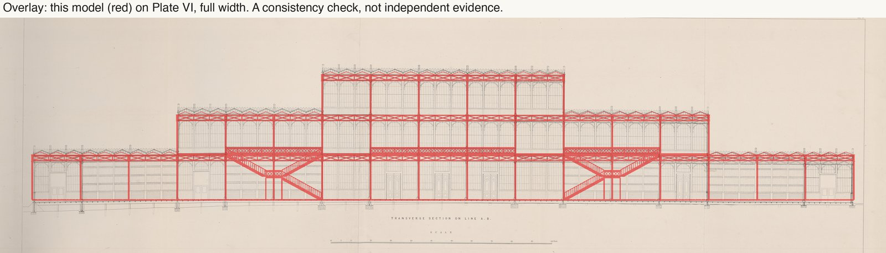

Full size: [compare/section_overlay_plateVI.jpg](compare/section_overlay_plateVI.jpg)

### Staircase section: Plate XV beside the model

Left: Plate XV, section through the staircases. Right: the model's stair-section view, unlit, same window. The flights, the landing and the cross gallery fall where the plate draws them. The plate has the cast lattice standards, the diagonal bracing between the columns and the I-section strings, which the model leaves out. Registration used the plate's three main columns (74.4 px/ft across, 1% more than the scale bar's 73.65 px/ft up the height, from paper stretch).

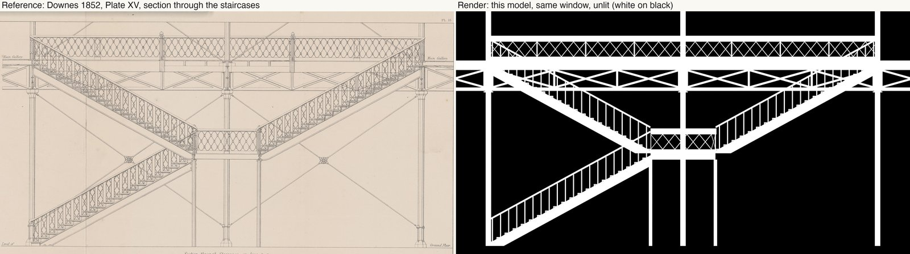

Full size: [compare/stair_section_vs_plateXV.jpg](compare/stair_section_vs_plateXV.jpg)

### Staircase section: the model overlaid on Plate XV

The model's unlit render in red over the plate. A consistency check, not independent evidence: the model was built from this sheet's figures.

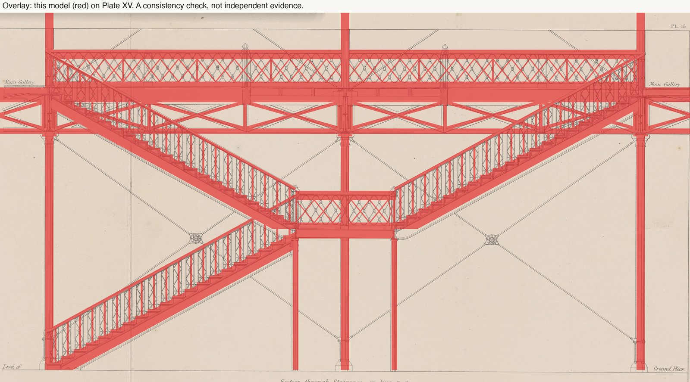

Full size: [compare/stair_section_overlay_plateXV.jpg](compare/stair_section_overlay_plateXV.jpg)

## Film

<!-- FILM_URL: paste the companion film link on the next line, replacing 'coming soon' (also set FILM_URL at the top of the script in index.html). -->
**Companion film: coming soon.**

## Download

Click a file name to download it directly. To get everything, clone the repo or use [Code → Download ZIP](https://github.com/nikbearbrown/csye-7270-building-virtual-environments/archive/refs/heads/main.zip).

| File | Size | What it is |
|---|---|---|
| [`crystal-palace-1851.blend`](https://github.com/nikbearbrown/csye-7270-building-virtual-environments/raw/main/blender/crystal-palace-1851-claude/crystal-palace-1851.blend) | 1.0 MB | Blender scene: 7,757 parts (all but the floor slab are instances of 12 library collections), materials, two lights, ten cameras. |
| [`crystal-palace-1851.glb`](https://github.com/nikbearbrown/csye-7270-building-virtual-environments/raw/main/blender/crystal-palace-1851-claude/crystal-palace-1851.glb) | 3.0 MB | glTF binary, flat colours only, no textures; instances are shared meshes. |
| [`BUILD_NOTES.md`](https://github.com/nikbearbrown/csye-7270-building-virtual-environments/raw/main/blender/crystal-palace-1851-claude/BUILD_NOTES.md) | 11 KB | Dimensions, counts, the full gate table, method, how to rebuild, limitations. |
| [`DEPARTURES-LEDGER.md`](https://github.com/nikbearbrown/csye-7270-building-virtual-environments/raw/main/blender/crystal-palace-1851-claude/DEPARTURES-LEDGER.md) | 15 KB | Every place the model infers, simplifies or departs from the record (28 rows). |
| [`checks/gate-west-03_v001.json`](https://github.com/nikbearbrown/csye-7270-building-virtual-environments/raw/main/blender/crystal-palace-1851-claude/checks/gate-west-03_v001.json) | 14 KB | The dimension gate's output for this model. |
| [`checks/controls.json`](https://github.com/nikbearbrown/csye-7270-building-virtual-environments/raw/main/blender/crystal-palace-1851-claude/checks/controls.json) | 28 KB | The plates' figures the model is tested against. |
| [`scripts/build_slice.py`](https://github.com/nikbearbrown/csye-7270-building-virtual-environments/raw/main/blender/crystal-palace-1851-claude/scripts/build_slice.py) | 15 KB | Builds the model: `blender -b -P build_slice.py -- --out x.blend --lines 0:37`. |
| [`scripts/parts.py`](https://github.com/nikbearbrown/csye-7270-building-virtual-environments/raw/main/blender/crystal-palace-1851-claude/scripts/parts.py) | 17 KB | The part library the builder places. |
| [`index.html`](https://github.com/nikbearbrown/csye-7270-building-virtual-environments/raw/main/blender/crystal-palace-1851-claude/index.html) | 1.6 MB | The self-contained interactive viewer. |

## How to import into Blender

1. **Native scene:** install Blender 4.2 or later and open `crystal-palace-1851.blend` with **File > Open**. It was saved in Blender 5.1.2 and not tested in 4.2 (see the limitations). You get the model with its materials, two sun lights and ten cameras (one per view).
2. **GLB:** use **File > Import > glTF 2.0 (.glb/.gltf)** and pick `crystal-palace-1851.glb`. It also works in game engines and web viewers.

The GLB carries flat colours only.

## Viewer

Open [`index.html`](https://nikbearbrown.github.io/csye-7270-building-virtual-environments/blender/crystal-palace-1851-claude/) via GitHub Pages ([htmlpreview fallback](https://htmlpreview.github.io/?https://github.com/nikbearbrown/csye-7270-building-virtual-environments/raw/main/blender/crystal-palace-1851-claude/index.html)), or download it and open it in a browser. It has view buttons, a thumbnail strip, the reference comparisons, light and dark themes and a mobile layout.

## Built by

- **Builder:** Claude (Anthropic), working in Claude Code across several sessions on 17 and 18 October 2026. This publishing session ran on Claude Sonnet 5.5; the model version of the earlier build sessions is not recorded in the project files.
- **Method:** Scripted. `build_slice.py` places parts from a library (`parts.py`) on the 24 ft grid; all but the floor slab of its {PARTS} parts are instances of the 12 library collections. Drawings first: the figures went into `controls.json`, a dimension gate checks the model against them, and a departures ledger records every inference and simplification. Comparison: two plate overlays (Plate VI section, Plate XV stair section). No likeness-improvement rounds were run: the model has no surface finish to compare.
- **Tools:** Blender 5.1.2 (Cycles, CPU, OpenImageDenoise; glTF exporter 5.1.20), Python 3.14.6 with Pillow 12.3.0 and NumPy 2.3.5 for the overlays, comparison images and these pages. The Downes plates are the 1852 originals as scanned by McGill University Library and held by the Internet Archive.
- **Build date:** The model was built 17–18 October 2026; these files were published on 18 October 2026.
- **Human review:** Professor Bear (verdict pending).

## Honest limitations

**What was checked.** 29 of the plates' figures were run against the model: 25 gated checks pass and 0 fail, and 4 text-only figures (taken from the printed text, no plate) are reported but never gate. 6 controls (D01, D05a, D05b, D19a, D19b, D20) were skipped because the parts they measure do not exist yet. Several checks are true by construction, because the model is built to the same figures. The gate catches build mistakes, not misreadings of the plates, and it does not look for parts that are missing.

- **Unfinished.** 37 of the building's 77 bays: the west half, to the transept's west face. Not built: the transept and its vault, the east half, the walls, doors and louvres, the north strip, the west entrance and end wall, glazing and sash bars, base plates and foundation pads, and six of the twelve avenue staircases (the ledger lists everything).
- **Look.** White, grey and wood preview materials, opaque roof sheets and a generic dark ground. Owen Jones's 1851 colour scheme is not applied.
- **Simplified and inferred.** The ledger has 28 rows: 7 match the record, 9 are simplified, 6 are inferred (roof rise 1.6 ft, railing height 3.06 ft, the stair going and landing level, among others), 3 are departures (the solid 6 in floor slab, no colour, the preview lighting) and 3 are scope notes.
- **The plate overlays are consistency checks.** The model was built from the same plates' figures, so a close match shows where the model is missing parts, not that the plates were read correctly.
- **Two text-only checks read wrongly.** D28 and D34 report 648 ft against 24 ft, because the `sample` tag that selects one stair part now sits on four parts (one per stair bay) and the check measures all four together. The parts are 24 ft by construction; the report is misleading, not the model.
- **Blender version.** The .blend was saved in Blender 5.1.2. It was not opened in Blender 4.2, so 4.2 compatibility is untested; the GLB or `scripts/build_slice.py` are the safer routes in an older Blender.
- **GLB.** Flat PBR colours only, no textures. Collection instances become shared meshes (165 meshes, 59,082 nodes).
- **Plate scans are not in this folder.** The comparison scripts need the Internet Archive scans of Plates VI and XV; the images here are crops of them.

**Assessment.** As a likeness of the Crystal Palace this model is poor. It is a bare iron frame under plain grey roofs: no glass, no walls, no colour, no transept and no vault, which is the part that gives the real building its silhouette. Someone who knows the palace would see the three stepped tiers and the ridge-and-valley roofs and might guess what it is going for, but would not take it for the building. What it is good for is a dimensioned frame: its figures were tested against the plates, and every place it infers or simplifies is written down in the ledger. That is the author's own assessment, made by looking at the renders next to the plates; Professor Bear's review is pending.

**Human review:** pending (Professor Bear).

Full technical record: [BUILD_NOTES.md](https://github.com/nikbearbrown/csye-7270-building-virtual-environments/raw/main/blender/crystal-palace-1851-claude/BUILD_NOTES.md). Every inference and simplification: [DEPARTURES-LEDGER.md](https://github.com/nikbearbrown/csye-7270-building-virtual-environments/raw/main/blender/crystal-palace-1851-claude/DEPARTURES-LEDGER.md).
