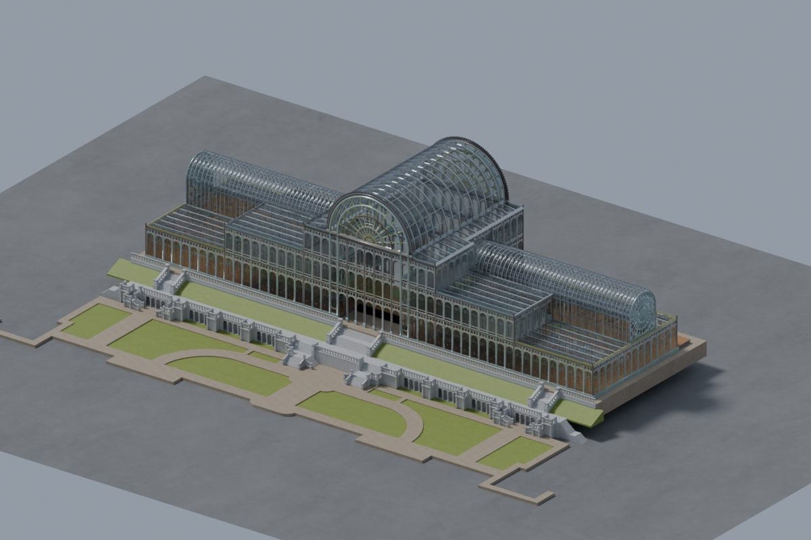
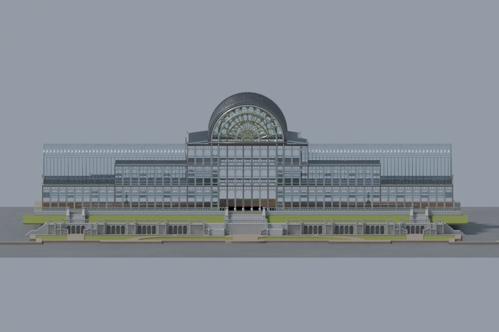
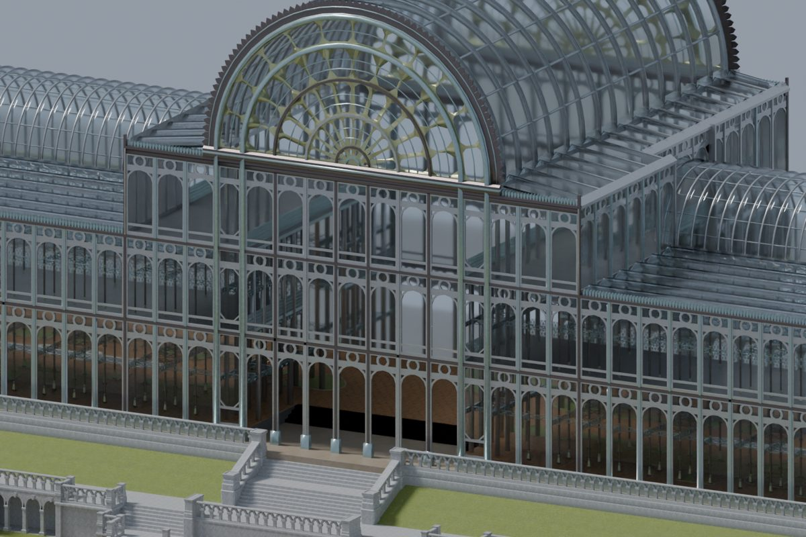
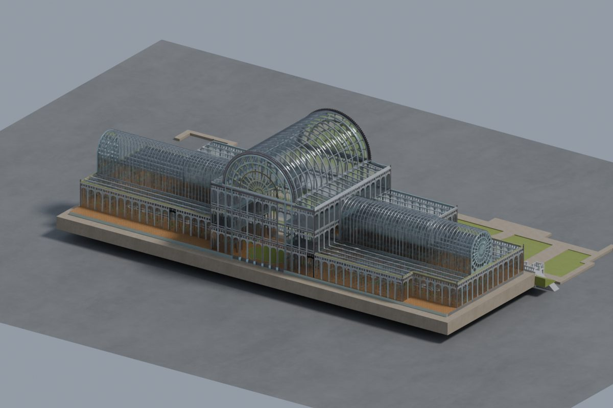
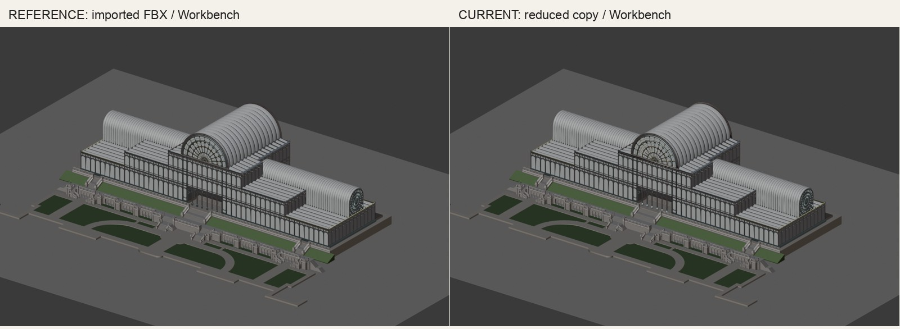
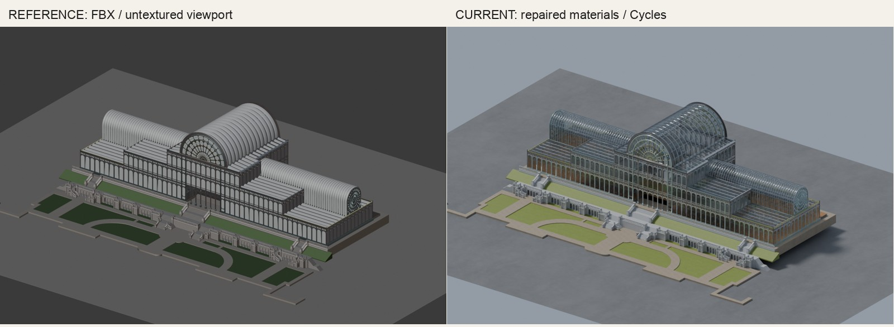
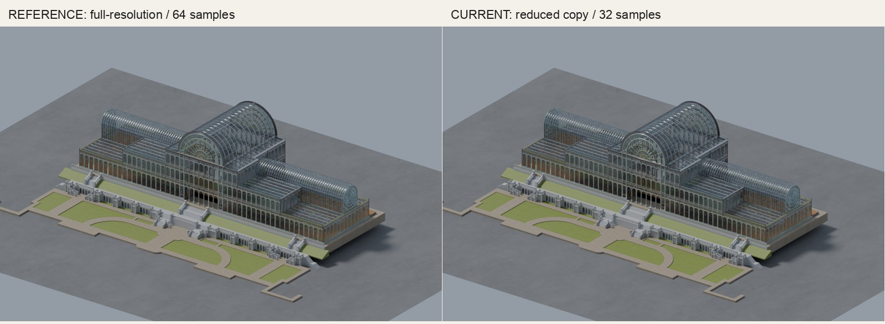

# Crystal Palace — FBX conversion

A textured Blender conversion of the Crystal Palace model supplied by Nik Bear Brown, with a smaller course export.

11 mesh objects · 2,143,430 triangles · 16 materials · structure 124.00 × 36.82 × 34.67 scene meters · Blender 5.1.2 · conversion by Codex

## Garden overview

The converted building with repaired glazing, mapped materials, terraces, and gardens.

[Full-size render](renders/overview.png)

## Front elevation

An orthographic elevation for checking the main facade and repeated bays.

[Full-size render](renders/front.png)

## Entrance detail

The central stair, ironwork, glazing, and interior floor visible through the facade.

[Full-size render](renders/entrance.png)

## Reverse overview

The rear facade and roof structure, preserved from the supplied FBX.

[Full-size render](renders/reverse.png)

## Geometry comparison

Source FBX at left; reduced conversion at right. The same camera and Workbench settings isolate geometry changes.

[Full-size comparison](compare/geometry-comparison.jpg)

## Material reconstruction

Source FBX viewport at left; actual Cycles render at right. Camera matches; lighting and shaders intentionally differ. This is conversion evidence, not a historical photo comparison.

[Full-size comparison](compare/materials-comparison.jpg)

## Full-resolution versus course copy

Full-resolution native render at left; simplified public copy at right. Camera and materials match, while samples and texture resolution differ.

[Full-size comparison](compare/full-vs-course.jpg)

## Film

Companion film: coming soon
<!-- FILM_URL -->

## Downloads

| File | Size | Purpose | Download |
|---|---:|---|---|
| crystal-palace.blend | 92.83 MB | Textured, reduced native scene, lights and four cameras | [Download](https://github.com/nikbearbrown/csye-7270-building-virtual-environments/raw/main/blender/crystal-palace-fbx-codex/crystal-palace.blend) |
| crystal-palace.glb | 19.95 MB | Textured reduced geometry, embedded images and Draco compression | [Download](https://github.com/nikbearbrown/csye-7270-building-virtual-environments/raw/main/blender/crystal-palace-fbx-codex/crystal-palace.glb) |
| index.html | under 5 MB | Self-contained offline render review viewer | [Download](https://github.com/nikbearbrown/csye-7270-building-virtual-environments/raw/main/blender/crystal-palace-fbx-codex/index.html) |

## Import

Open `crystal-palace.blend` in Blender 5.1.2 (verified). Blender 4.2 support has not been verified. For GLB, use File → Import → glTF 2.0; Draco support is required. All images are embedded. The full-resolution local file is `crystal-palace-full.blend` in the original Crystal Palace asset directory; it is too large for this repository package.

## Viewer

Download `index.html` and open it locally for offline image review. This is a render gallery, not a live 3D orbit viewer.

[GitHub Pages](https://nikbearbrown.github.io/csye-7270-building-virtual-environments/blender/crystal-palace-fbx-codex/) · [HTML preview fallback](https://htmlpreview.github.io/?https://github.com/nikbearbrown/csye-7270-building-virtual-environments/raw/main/blender/crystal-palace-fbx-codex/index.html). Pages availability is not confirmed; its API returned 404 during the build.

## Built by

Conversion builder: Codex, for Nik Bear Brown. Method: scripted FBX import, material reconstruction, lighting, cameras, structural mesh reduction and glTF export. Two documented comparison rounds: source geometry/material review, then full-resolution versus reduced copy. Tools: Blender 5.1.2, its bundled Python/glTF exporter, and Pillow. Build date: October 23, 2026. Original source modeling is not credited to Codex; the creator and license were not identified in the supplied files. Human review: Professor Bear — pending.

## Limitations

The source geometry and scale are inherited, not a verified historical reconstruction. The source folder supplied no historical reference images or original renderer previews. Texture assignments are inferred from names and visual appearance; the original Corona/Scanline shaders were not recovered. The public copy reduces only STRUCTURE to 20% of its original triangle count, so fine ornament can differ; the full-resolution native file remains beside the source assets. Ten used images are packed; unused alternate maps are left in the source folder. The GLB contains textures and transmission materials, but procedural bump detail and Blender lighting do not transfer exactly; a Draco-capable importer is required. No collision, rig, or animation is provided. Native files were reopened in Blender 5.1.2; Blender 4.2 compatibility is unverified. Human review: Professor Bear — pending.
