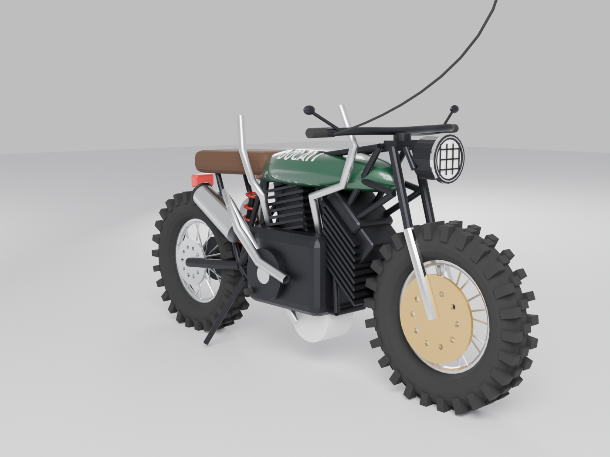
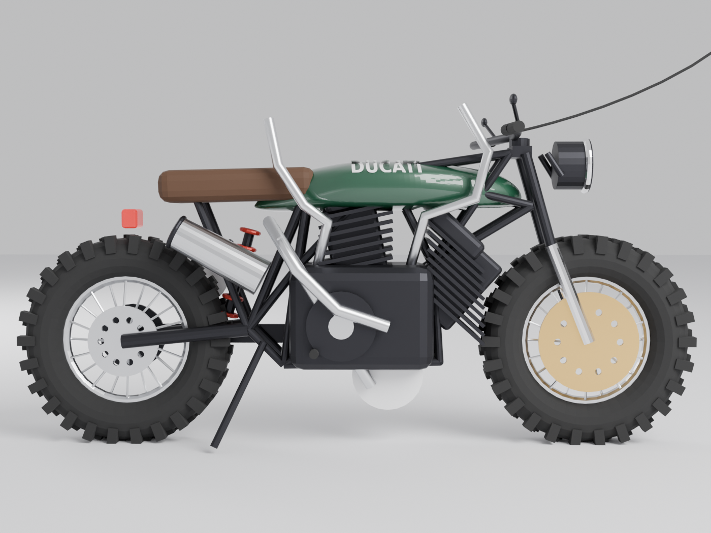
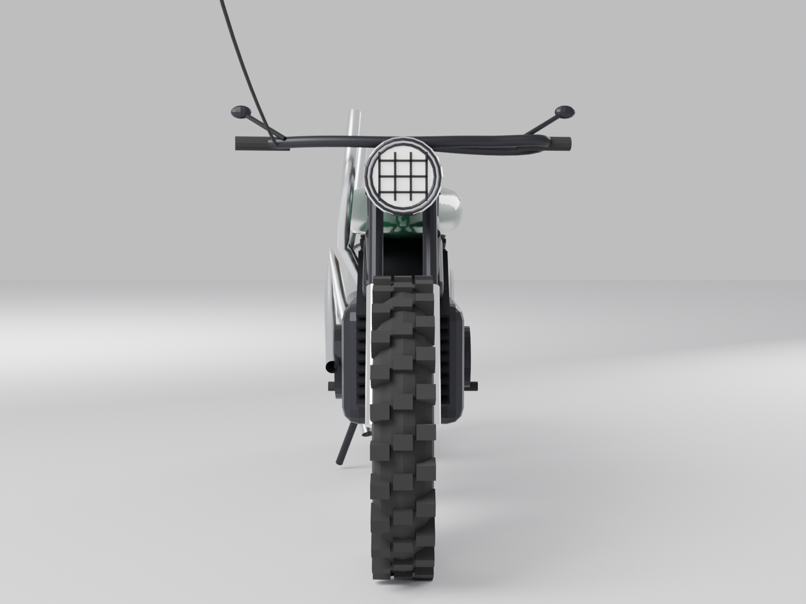
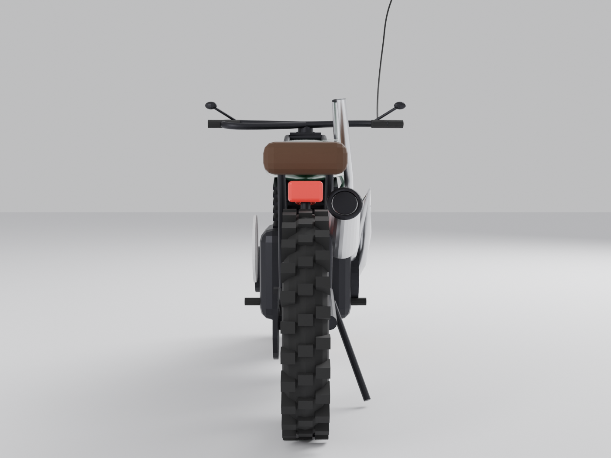
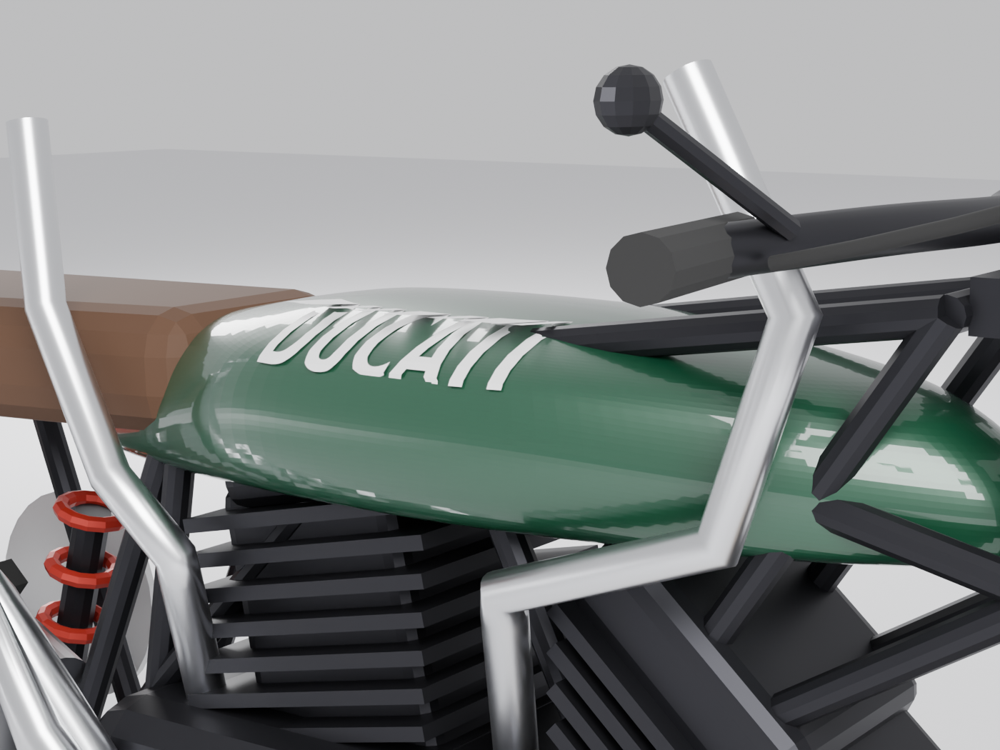
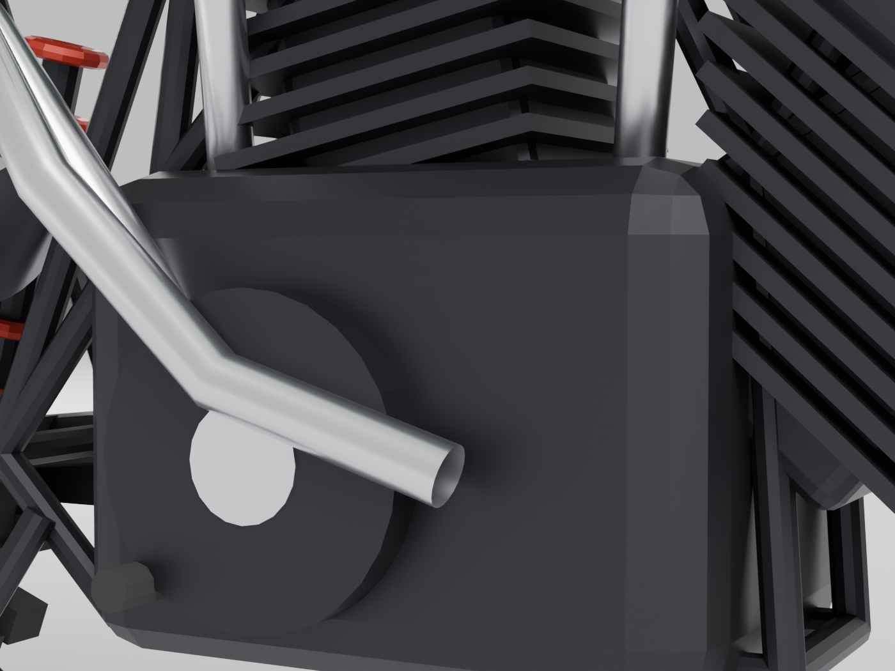
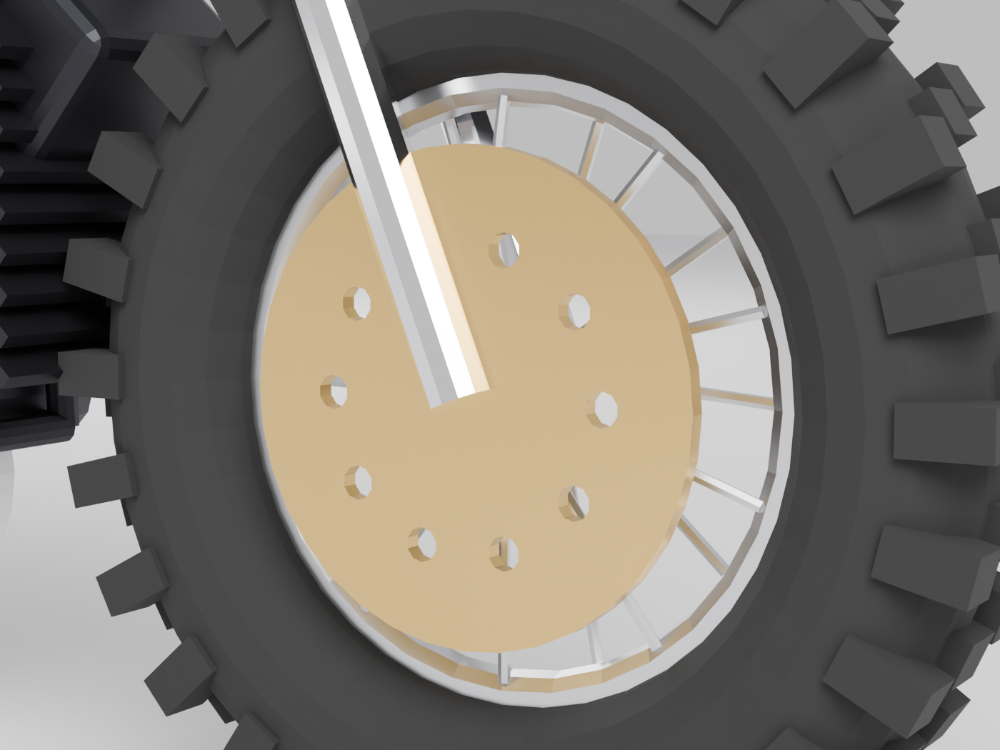
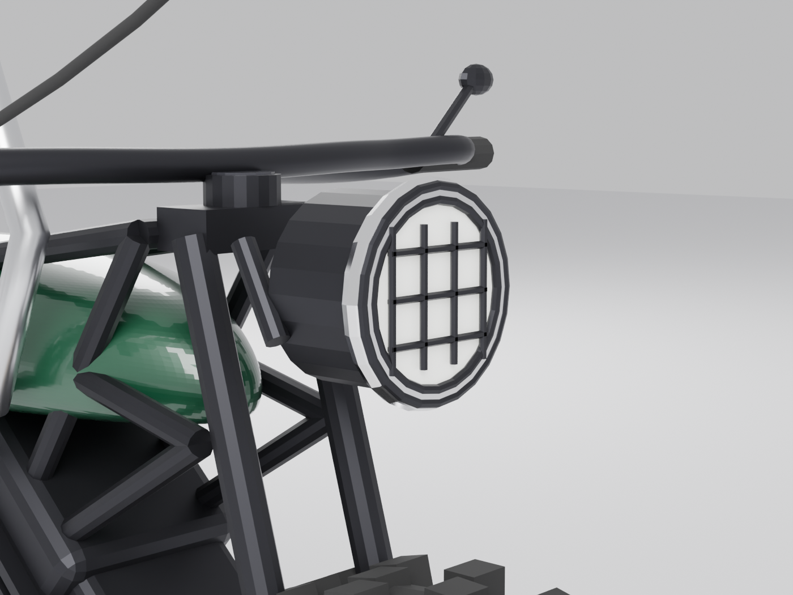
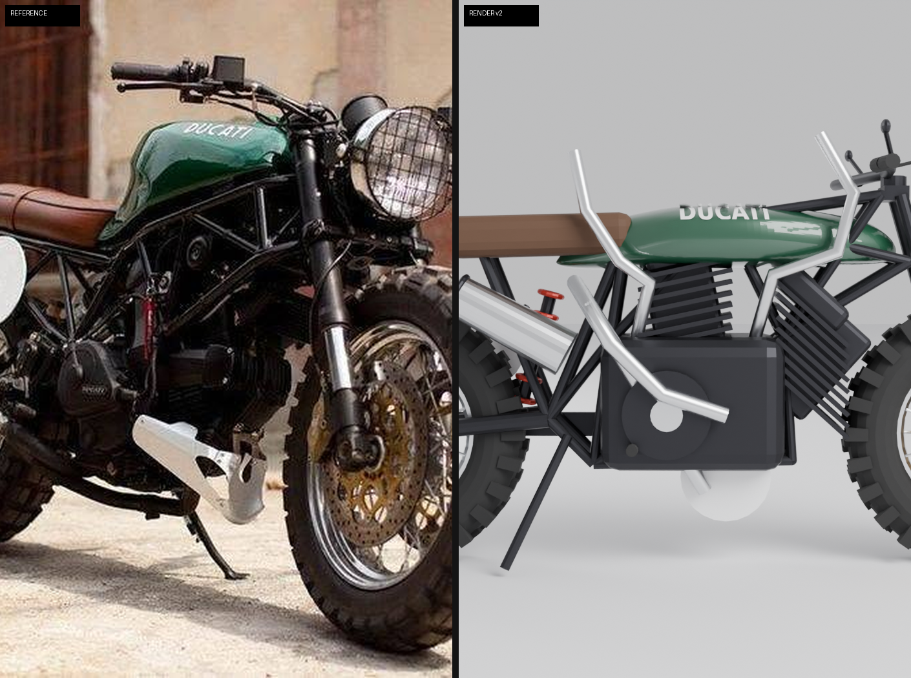

# Ducati Scrambler Custom — 3D Model

Procedural Blender model of the green Ducati scrambler/cafe-racer custom: green tank with white DUCATI script, brown leather solo seat, knobby off-road tires, gold front brake disc, high-mounted silver exhaust, round grilled headlight, black trellis frame, white round number plate, spoked wheels.

`140 meshes · 19,206 triangles · 14 materials · 2.10 x 0.82 x 1.06 m · Blender 4.2.0`

## Views

### Three-quarter
Right-front three-quarter hero view of the finished model.

[Full size](renders/three_quarter.png)

### Right side
Full right-side profile, matching the reference hero shot.

[Full size](renders/right_side.png)

### Front
Head-on view: grilled headlight, chrome fork sliders, knobby front tire, gold brake disc.

[Full size](renders/front.png)

### Rear
Rear view: taillight, high exhaust muffler, knobby rear tire.

[Full size](renders/rear.png)

### Tank detail
Green tank with the DUCATI script decal and brown leather seat.

[Full size](renders/detail_tank.png)

### Engine detail
Black engine block with cooling fins and clutch cover.

[Full size](renders/detail_engine.png)

### Front wheel detail
Knobby tread, spokes, and the gold drilled brake disc.

[Full size](renders/detail_frontwheel.png)

### Headlight detail
Round headlight with black grille guard and chrome rim.

[Full size](renders/detail_headlight.png)

## Compare with references

### Side profile vs hero

[Full size](compare/compare_side.png)

## Film

Companion film: coming soon
<!-- FILM_URL -->

## Download

| File | Size | Purpose | Direct link |
|------|------|---------|-------------|
| ducati-scrambler-custom.blend | 2 MB | Full Blender 4.2+ scene | https://github.com/nikbearbrown/csye-7270-building-virtual-environments/raw/main/blender/ducati-scrambler-custom-muse/ducati-scrambler-custom.blend |
| ducati-scrambler-custom.glb | 1 MB | glTF 2.0 for engines / web viewers (with packed DUCATI decal texture) | https://github.com/nikbearbrown/csye-7270-building-virtual-environments/raw/main/blender/ducati-scrambler-custom-muse/ducati-scrambler-custom.glb |

## How to import into Blender

1. Open `ducati-scrambler-custom.blend` in Blender 4.2 or newer, or
2. File > Import > glTF 2.0 and choose the `.glb` file.

## Viewer

Interactive viewer (all views + comparisons in one page):
https://nikbearbrown.github.io/csye-7270-building-virtual-environments/blender/ducati-scrambler-custom-muse/

If GitHub Pages is not up yet, paste the `index.html` URL into
https://htmlpreview.github.io/ to preview it.

## Built by

- **Builder:** Muse
- **Method:** scripted procedural modeling in Blender Python (bpy), with 7 render-vs-reference comparison rounds
- **Tools:** Blender 4.2.0
- **Build date:** 2026-10-18
- **Human review:** by Professor Bear

## Honest limitations

<ul>
<li>Tank green is close but not the hero's near-black deep green; bright studio lighting lifts it.</li>
<li>The DUCATI script decal did not render visibly in the final views — likely a shrinkwrap-projection or transparent-material issue. The decal geometry and PIL-drawn texture exist in the .blend.</li>
<li>Exhaust muffler is a simple tapered cone; the reference has weld seams, a riveted end cap, and a mounting bracket.</li>
<li>No cables, hoses, brake lines, or wiring; the cockpit (clocks, switches) is minimal.</li>
<li>Spokes are straight cylinders; the reference has slightly crossed lacing.</li>
<li>Reads as a clean stylized game asset, not a photoreal replica. Silhouette and identity features (green tank, brown seat, knobbies, gold disc, high pipe, grilled light, trellis frame, number plate) are all present.</li>
</ul>

## Human reviewer verdict

_Awaiting Professor Bear's review._
