# Futurama-toy Enterprise

The classic starship Enterprise, reimagined as a chunky Futurama-style vinyl toy: an inflated saucer with a red rubber bumper, a bubble-dome bridge, a pudgy egg-shaped secondary hull and two fat sausage nacelles. Built by Grok Bot entirely in code with Blender's Python API. The style target is a Grok Bot concept image that Professor Bear approved ("you definitely recognize the Enterprise, but it's not the Enterprise"); the layout and proportions come from his blueprint images, then made rounder, fatter and more compact. It is a generic toy design with no registry number, logos or insignia.

**Interactive viewer:** [open the viewer](https://nikbearbrown.github.io/csye-7270-building-virtual-environments/blender/enterprise-futurama-toy-grok/) (GitHub Pages) · [htmlpreview fallback](https://htmlpreview.github.io/?https://github.com/nikbearbrown/csye-7270-building-virtual-environments/raw/main/blender/enterprise-futurama-toy-grok/index.html) · or download [`index.html`](https://github.com/nikbearbrown/csye-7270-building-virtual-environments/raw/main/blender/enterprise-futurama-toy-grok/index.html) and open it locally; it is self-contained.

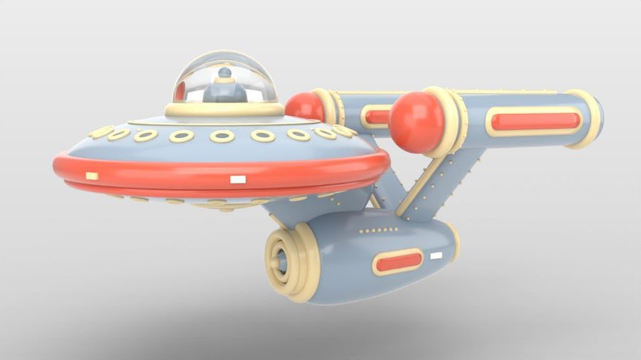

## Stats

- **Objects:** 266 mesh objects in the GLB (curves converted; rivets and portholes are separate objects)
- **Triangles:** 155,640
- **Materials:** 6 (glossy grey-blue vinyl, cream, red, dark slate, white, clear glass)
- **Size:** 3.57 long x 2.11 wide x 1.74 high in model units; the saucer is 2.0 across, 2.11 with the bumper
- **Built with:** Blender 4.2.3, headless, Cycles CPU with Open Image Denoise

## Views

### Hero, three-quarter (concept camera)

The camera matched to the concept image: the puffy saucer and red bumper, the bubble bridge, the stubby neck, the deflector and both nacelles.

Full size: [renders/hero.jpg](renders/hero.jpg)

### Side

Orthographic profile: the saucer and bridge, the swept neck, the egg-shaped secondary hull and a nacelle on its pylon.

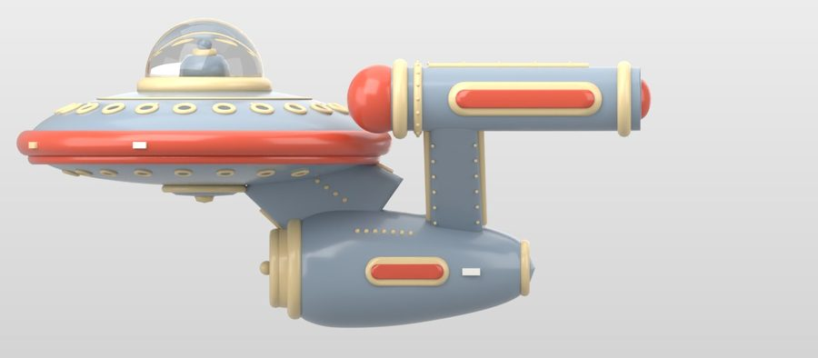

Full size: [renders/side.jpg](renders/side.jpg)

### Front

Orthographic front: the saucer edge-on with the nacelle caps above it and the cream-ringed deflector below.

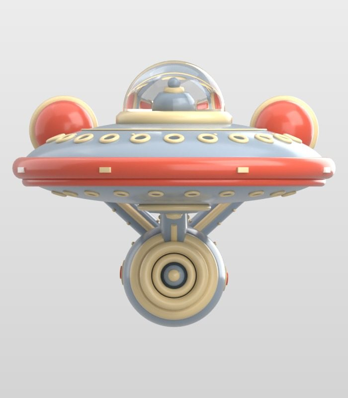

Full size: [renders/front.jpg](renders/front.jpg)

### Top

Orthographic top: the porthole ring and cream line on the saucer, the pylons and the two parallel nacelles.

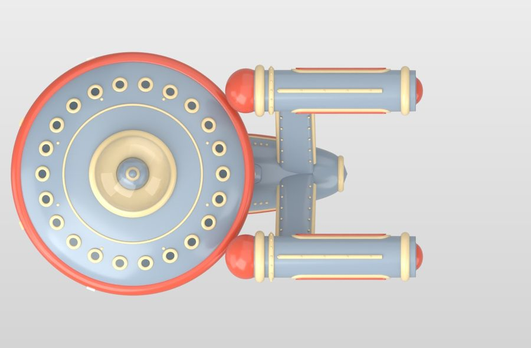

Full size: [renders/top.jpg](renders/top.jpg)

### Rear three-quarter

From behind: the red rear caps and cream end rings of the nacelles and the tapered tail of the secondary hull.

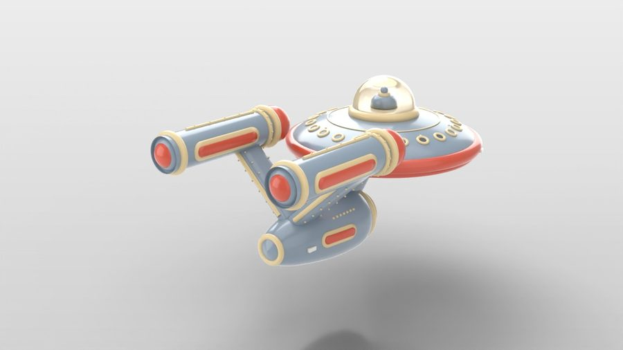

Full size: [renders/rear34.jpg](renders/rear34.jpg)

### Front three-quarter, other side

The starboard side from the front, high, showing the top of the saucer.

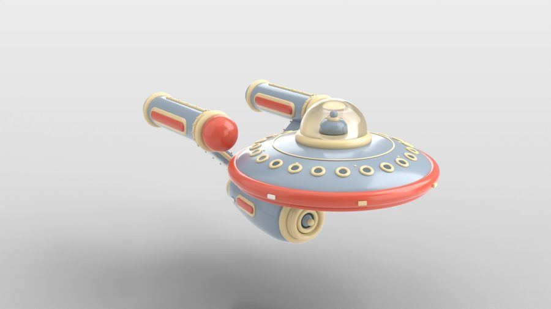

Full size: [renders/front34.jpg](renders/front34.jpg)

### From below

The underside: the lower porthole row, the cream-ringed sensor hub and the belly of the secondary hull.

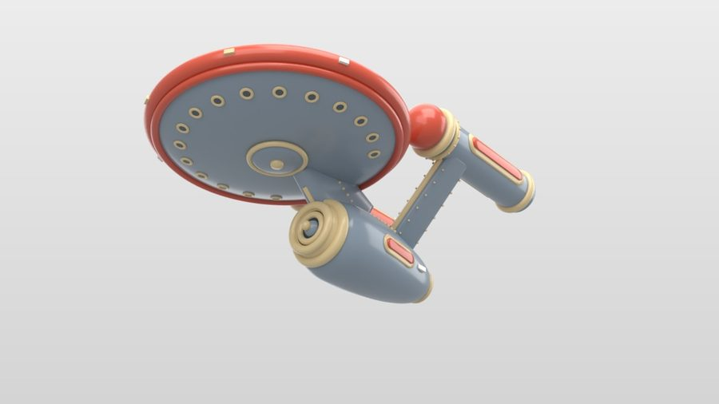

Full size: [renders/below.jpg](renders/below.jpg)

### Bridge dome close-up

The clear bubble dome on its cream ring, with the grey-blue bridge core and knob inside.

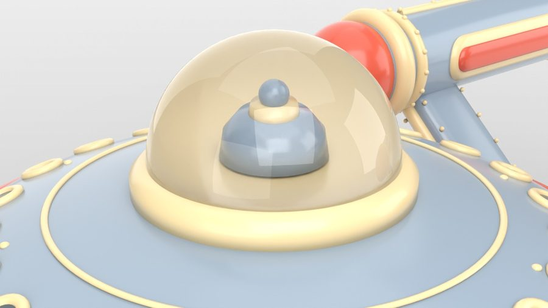

Full size: [renders/detail_bridge.jpg](renders/detail_bridge.jpg)

### Nacelle close-up

A nacelle front: the red cap, the cream front ring, the riveted second ring, the red stripe panel in its cream frame and the riveted pylon piping.

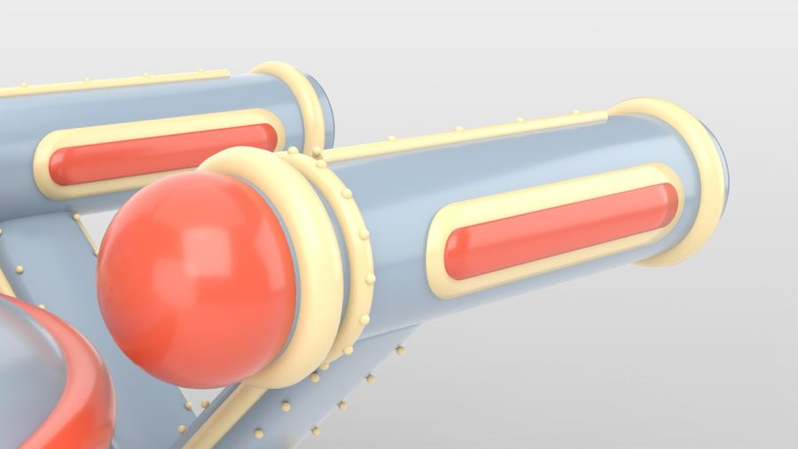

Full size: [renders/detail_nacelle.jpg](renders/detail_nacelle.jpg)

### Deflector close-up

The stepped cream deflector housing, the dark dish, the spoked cone and the cream tip.

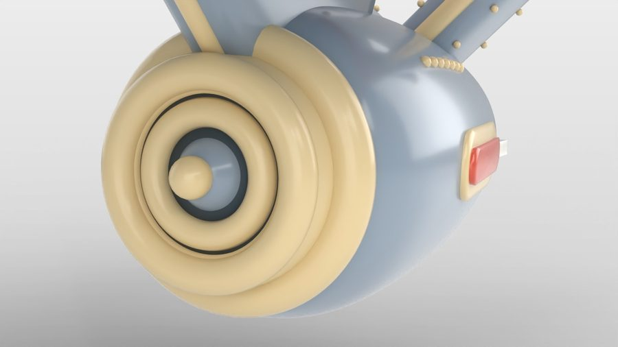

Full size: [renders/detail_deflector.jpg](renders/detail_deflector.jpg)

### Gallery contact sheet

All ten gallery views on one sheet.

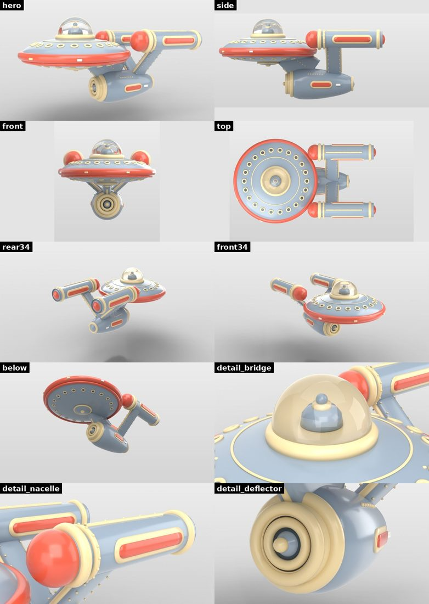

Full size: [renders/contact_sheet.jpg](renders/contact_sheet.jpg)

## Compare with references

Comparisons: the Grok Bot concept image (style target) and Professor Bear's blueprint images (layout), each above or beside the Grok Bot render. Style concept: a Grok Bot concept image approved by Professor Bear. Layout: Professor Bear's blueprint images, shown for comparison only.

### Hero vs concept (Grok Bot: 6/10)

Top: the concept image. Bottom: the final round from a matched camera. The parts, colours and layout match; the model is cleaner, the saucer is thinner and the hull is smaller and less prominent.

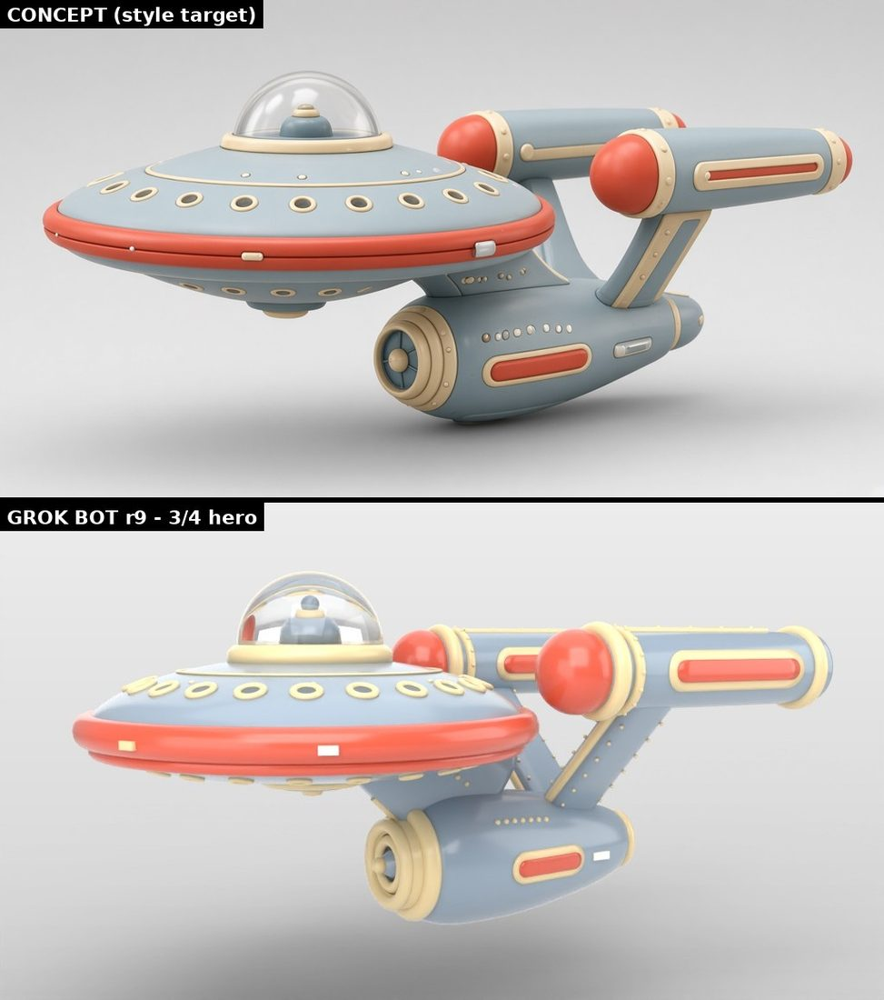

Full size: [compare/r9_hero_vs_concept.jpg](compare/r9_hero_vs_concept.jpg)

### Rounds 1 to 9

The concept and the hero view from rounds 1, 2, 5, 7 and 9: colours fixed in round 2, the whole ship made more compact in round 5 (measured off the concept), the eye-level camera and double bumper in round 7.

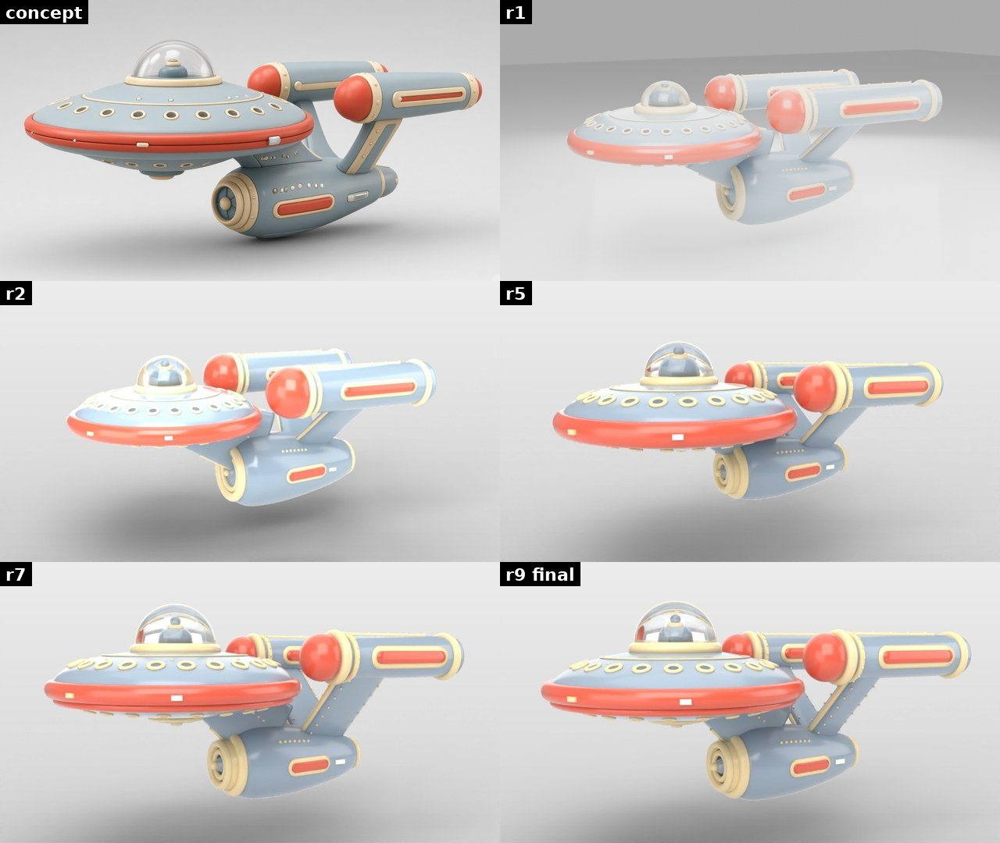

Full size: [compare/rounds_r1_to_r9_hero.jpg](compare/rounds_r1_to_r9_hero.jpg)

### Side vs blueprint (Grok Bot: 5/10)

The blueprint's layout survives (saucer forward, hull below and behind, nacelles high on a pylon), but on purpose everything is shorter and fatter; the long nacelles and hull of the blueprint are the biggest change.

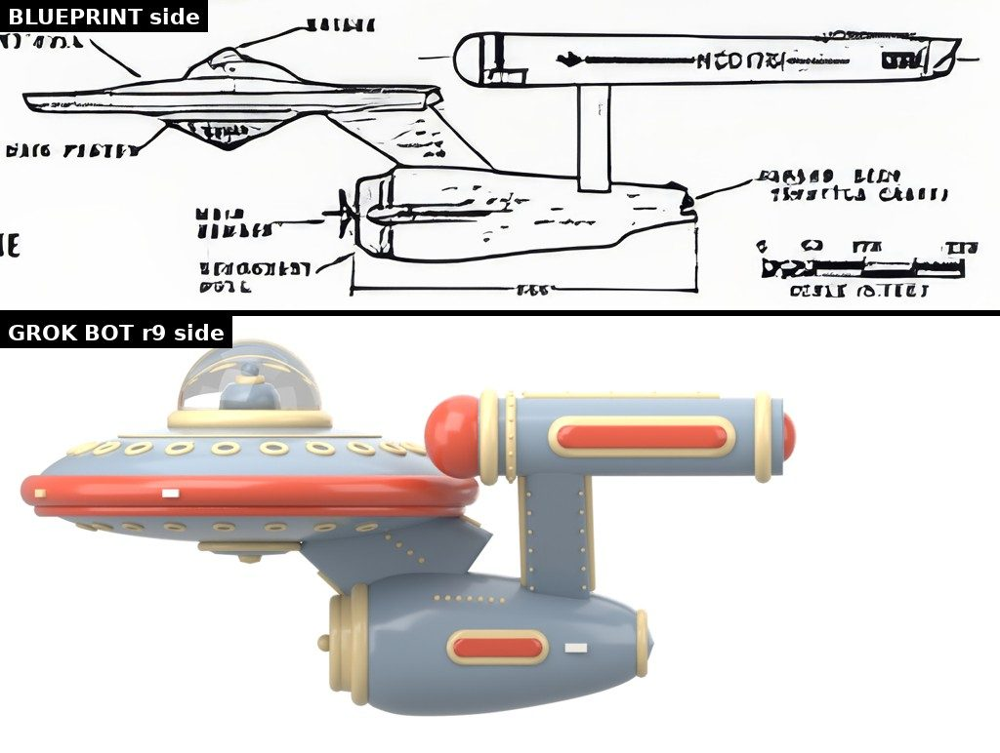

Full size: [compare/r9_side_vs_blueprint.jpg](compare/r9_side_vs_blueprint.jpg)

### Top vs blueprint (Grok Bot: 5/10)

The saucer and the two parallel nacelles read right; the toy nacelles are about half the blueprint's length, the pylons are wider and the hull is mostly hidden under the saucer.

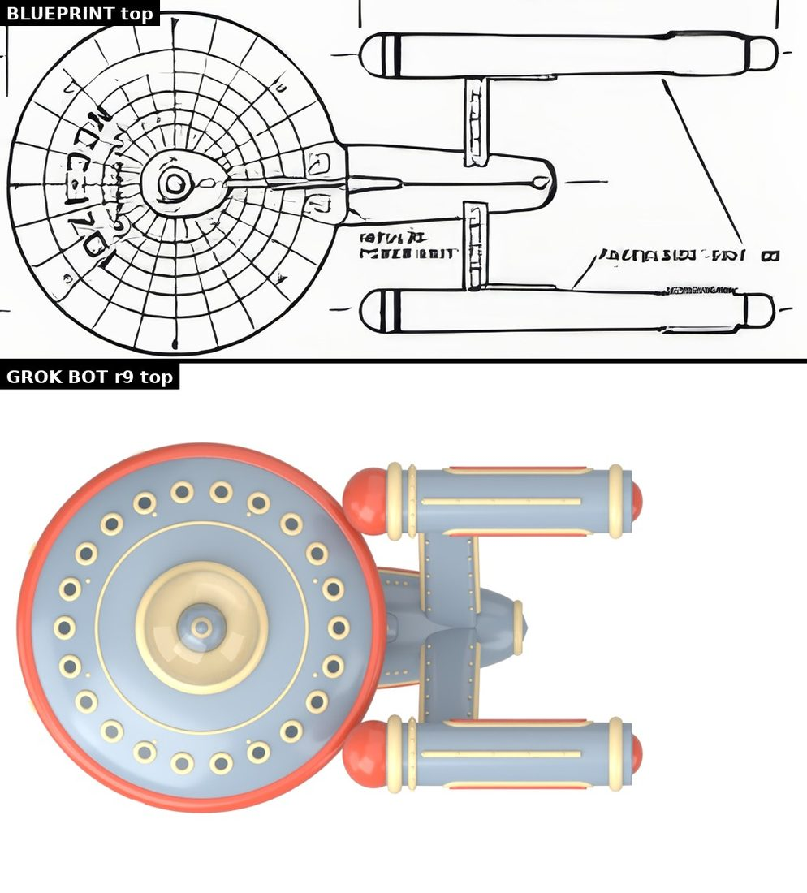

Full size: [compare/r9_top_vs_blueprint.jpg](compare/r9_top_vs_blueprint.jpg)

### Front vs blueprint (Grok Bot: 5/10)

The blueprint front view is drawn turned on its side. The deflector circle under the saucer and the nacelles above it are there, but the toy's nacelles sit closer in and far fatter.

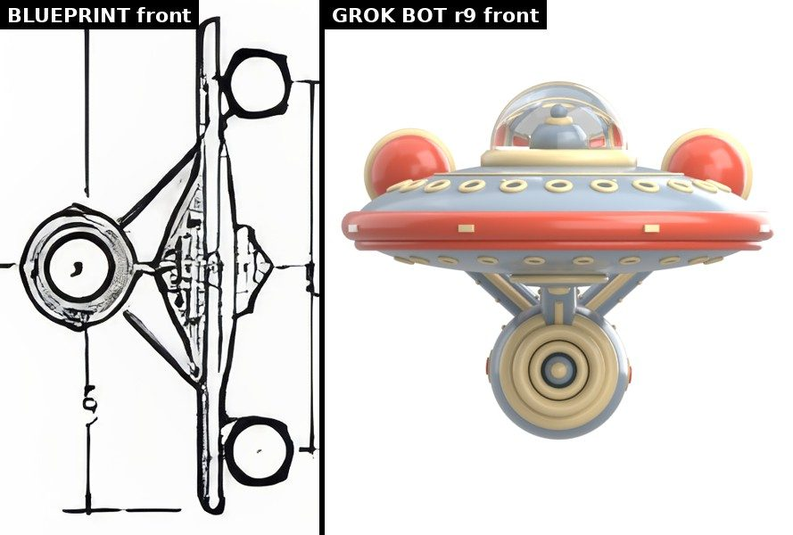

Full size: [compare/r9_front_vs_blueprint.jpg](compare/r9_front_vs_blueprint.jpg)

### The style concept

The Grok Bot concept image Professor Bear approved, used as the style target. It is an AI image, not a photo.

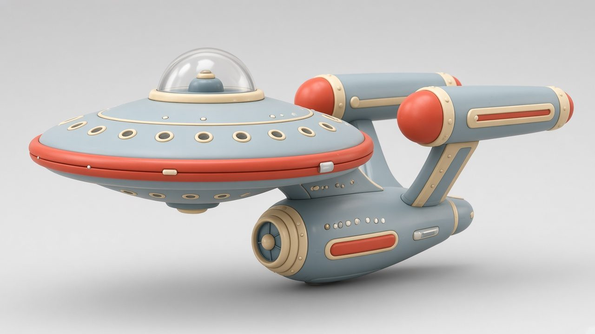

Full size: [compare/concept_grok_bot.jpg](compare/concept_grok_bot.jpg)

## Grok Bot's assessment and human review

**Grok Bot's assessment:** About 6/10 against the concept overall: hero three-quarter 6, side 5, top 5, front 5, details 6. It is clearly the same toy design: the red bumper saucer, the bubble bridge, the cream-rimmed portholes, the red-capped sausage nacelles and the stepped cream deflector are all there, in the right colours and places. But next to the concept it looks thinner and more computer-clean. The saucer is too slim and its top too flat, so it lacks the inflated, soft-vinyl puffiness. The secondary hull is too small and tucked too far under the saucer, so the concept's big, prominent pod is missing. The pylons are plain beams rather than the concept's framed panels, the neck is almost invisible, and the bumper lights look like stuck-on white tiles. The lighting is flatter than the concept's soft studio shading.

**Human review (Professor Bear):** Professor Bear approved the concept image ("I love it. It's fun. You definitely recognize the Enterprise, but it's not the Enterprise"). His verdict on this model is pending.

## Built by

- **Builder:** Grok Bot, an autonomous desktop assistant agent with its own Linux computer. Version: not exposed by the app.
- **Method:** Model generated entirely by Blender Python scripts written and run headless by Grok Bot, with iterative render-vs-reference comparison rounds.
- **Tools:** Blender 4.2.3 LTS (Cycles, CPU). Python with Pillow for the comparison images and the studio-grey composite; Intel Open Image Denoise in Cycles.
- **Human review:** Professor Bear approved the style concept, a Grok Bot concept image; the proportions come from his blueprint images. His verdict on this model is pending.
- **Build date:** October 2026. 9 build rounds (r1 to r9) compared against the concept image from a matched camera and against the blueprint side, top and front views, with a saved .blend per round.

## Download

Click a file name to download it directly. To get everything, clone the repo or use [Code → Download ZIP](https://github.com/nikbearbrown/csye-7270-building-virtual-environments/archive/refs/heads/main.zip).

| File | Size | What it is |
|---|---|---|
| [`enterprise_futurama_toy.blend`](https://github.com/nikbearbrown/csye-7270-building-virtual-environments/raw/main/blender/enterprise-futurama-toy-grok/enterprise_futurama_toy.blend) | 1.2 MB | Blender scene (round 9): the ship, materials, studio lights, shadow-catcher ground and camera. |
| [`enterprise_futurama_toy.glb`](https://github.com/nikbearbrown/csye-7270-building-virtual-environments/raw/main/blender/enterprise-futurama-toy-grok/enterprise_futurama_toy.glb) | 2.8 MB | glTF binary of the ship only, with curves converted and modifiers applied; flat glossy colours and a transmissive glass dome. |
| [`BUILD_NOTES.md`](https://github.com/nikbearbrown/csye-7270-building-virtual-environments/raw/main/blender/enterprise-futurama-toy-grok/BUILD_NOTES.md) | 4 KB | Round-by-round history, the concept measurements, scores and limitations. |
| [`scripts/build.py`](https://github.com/nikbearbrown/csye-7270-building-virtual-environments/raw/main/blender/enterprise-futurama-toy-grok/scripts/build.py) | 18 KB | The whole build (`blender -b -P build.py -- r9`); reads params.json. |
| [`scripts/params.json`](https://github.com/nikbearbrown/csye-7270-building-virtual-environments/raw/main/blender/enterprise-futurama-toy-grok/scripts/params.json) | 1 KB | All sizes, positions, colours and the hero camera. |
| [`scripts/render.py`](https://github.com/nikbearbrown/csye-7270-building-virtual-environments/raw/main/blender/enterprise-futurama-toy-grok/scripts/render.py) | 2 KB | Gallery and comparison cameras (`blender -b FILE.blend -P render.py -- OUTDIR view ...`). |

The `scripts/` folder also has `comp.py` (puts the transparent renders on the studio grey), `compare.py` (concept and blueprint side-by-sides) and `export.py` (GLB export and stats). Each script sets the project folder at the top (`HERE` or `H`, currently `/workspace/ships/enterprise-futurama`).

## How to import into Blender

1. **Native scene:** install Blender 4.2 or later and open the `.blend` file with **File → Open**. You get the model with its procedural materials, lights and comparison cameras.
2. **GLB:** in any Blender version with the glTF add-on (enabled by default), use **File → Import → glTF 2.0 (.glb/.gltf)** and pick the `.glb`. The GLB also works in game engines and web viewers.

The GLB carries flat glossy colours and a transmissive glass dome. The clear-coat gloss, lights, shadow-catcher ground and cameras exist only in the `.blend` file.

## Method

Every part is generated by one parametric Python script. The saucer, bridge dome, secondary hull and nacelles are lathed profiles (superellipse lens for the saucer, spline profiles for the hull and nacelles); the neck and pylons are lofted rounded-rectangle beams with cream tube piping; portholes, rivets and rings are placed on the analytic surfaces; the red stripe panels are curved stadium patches that follow the hull and nacelle surfaces. The layout started from the blueprint ratios, then in round 5 the sizes and positions were re-measured off the concept image (nacelle front, spacing, hull position and diameters), which made the ship much more compact. Each round was rendered from a camera matched to the concept and from orthographic side, top and front cameras beside the blueprints.

## Honest limitations

- **Saucer** is thinner and flatter-topped than the concept, so it reads less inflated.
- **Secondary hull** is smaller and less prominent than in the concept, and in the top view it is mostly hidden under the saucer.
- **Pylons and neck** are simple lofted beams with piping; the concept's framed pylon panels and visible wedge neck are simplified.
- **Proportions** follow the concept's compact toy layout, not the blueprint: the nacelles are about half the blueprint's length relative to the saucer.
- **Only one camera is matched:** the concept is a single AI image, so only the three-quarter hero can be compared directly; the blueprint compares are for layout only.
- **No panel lines or seams;** every part is a smooth separate shape, and many small parts (rivets, portholes) sit on the surface rather than being merged into it.
- **GLB:** flat colours only; the clear-coat gloss and the studio setup exist only in the .blend and the renders.
- **Generic design:** no registry number, logos or insignia, by design.

See [BUILD_NOTES.md](BUILD_NOTES.md) for the full technical record.
