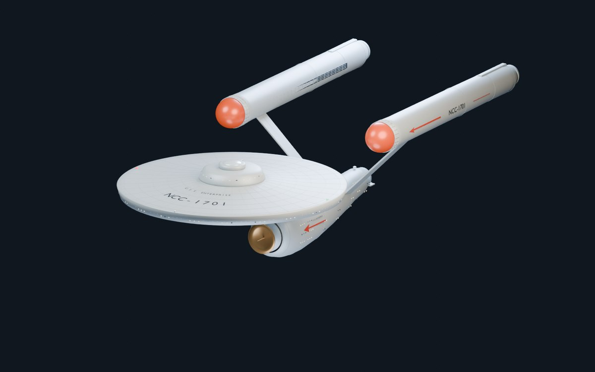
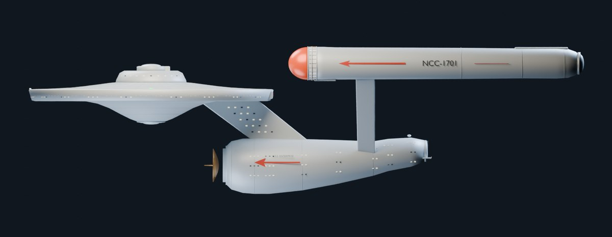
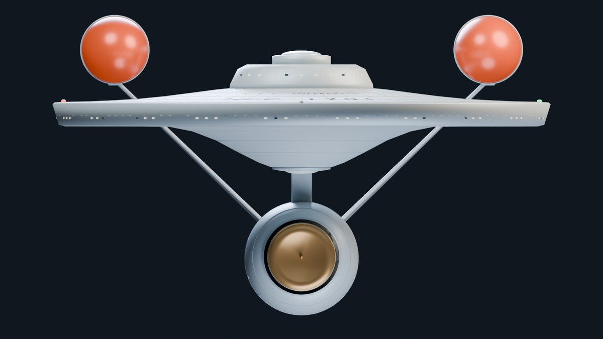
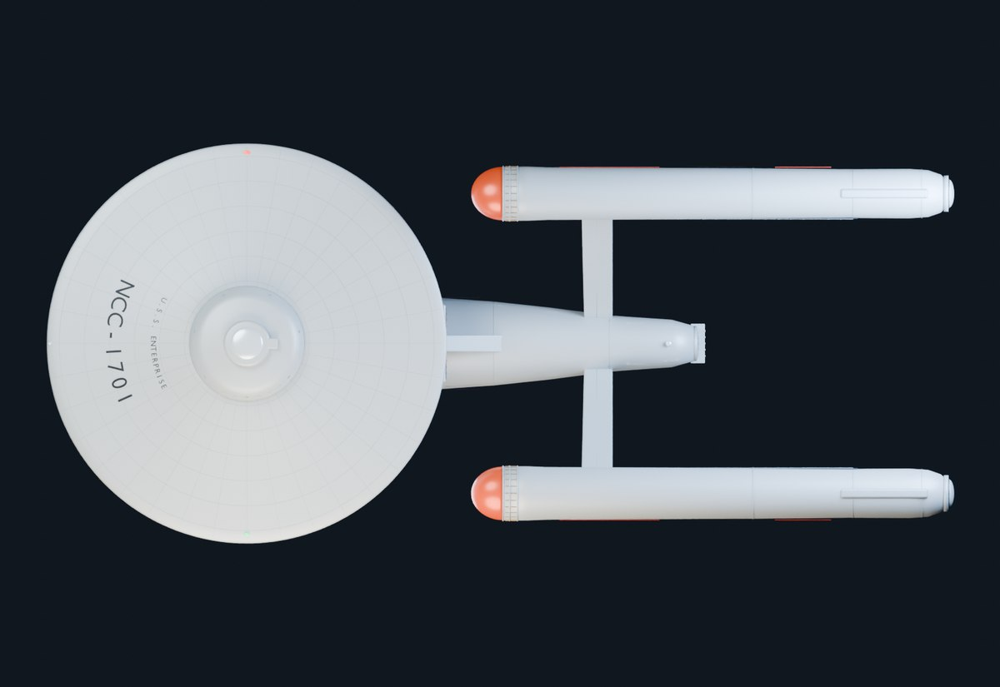
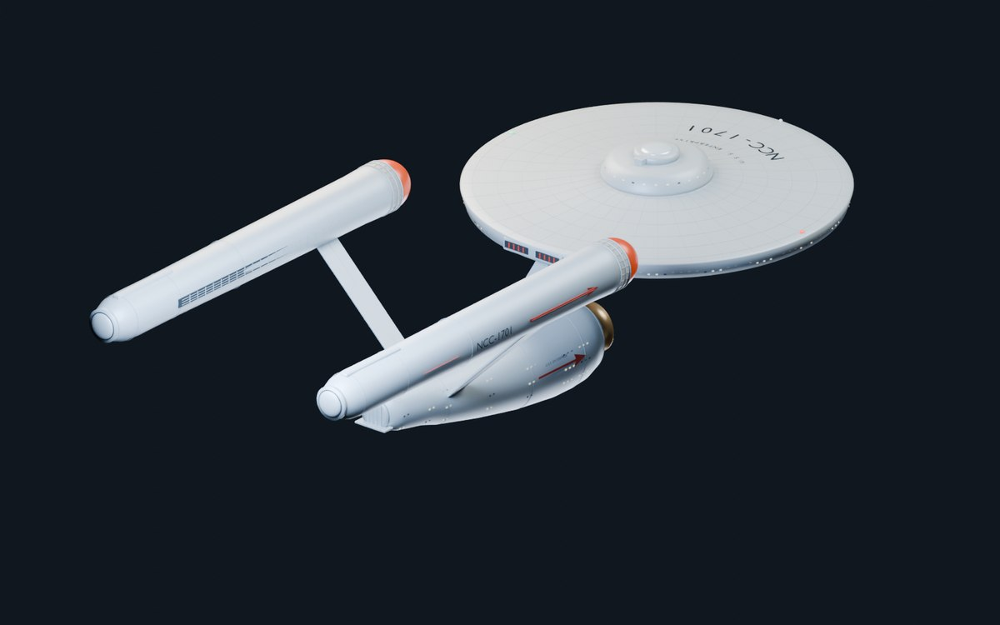
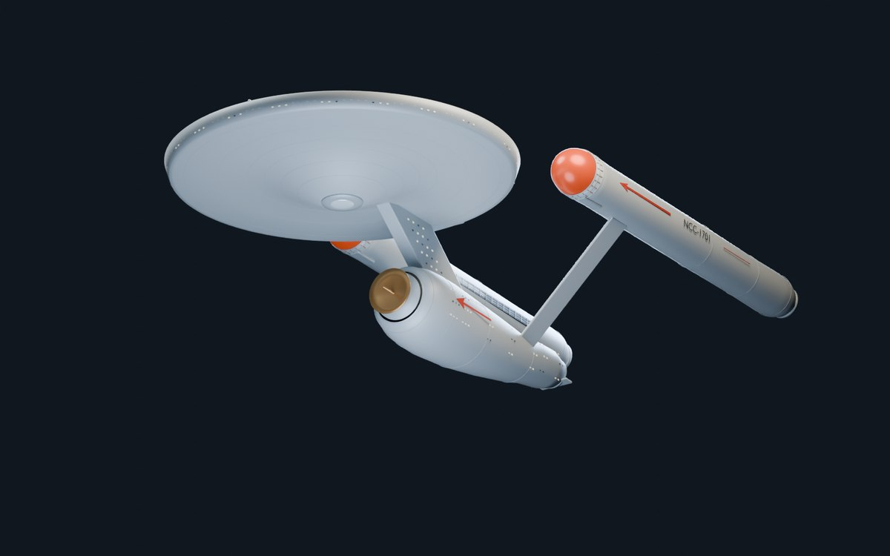
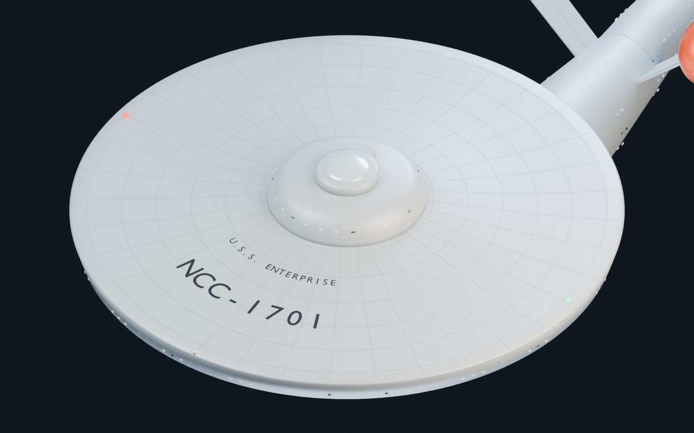
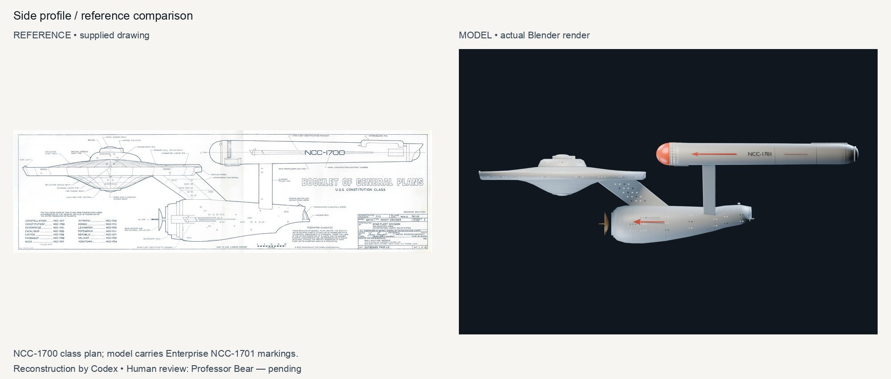
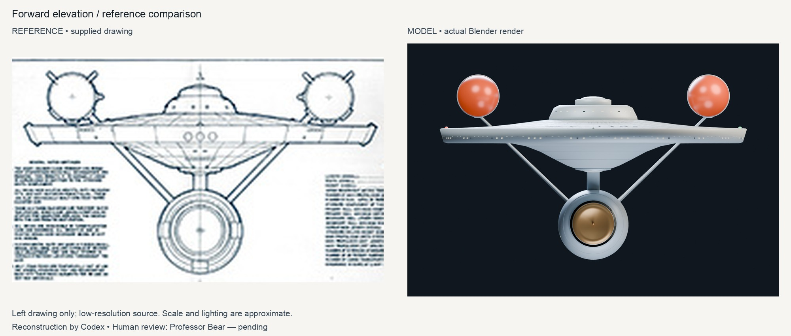
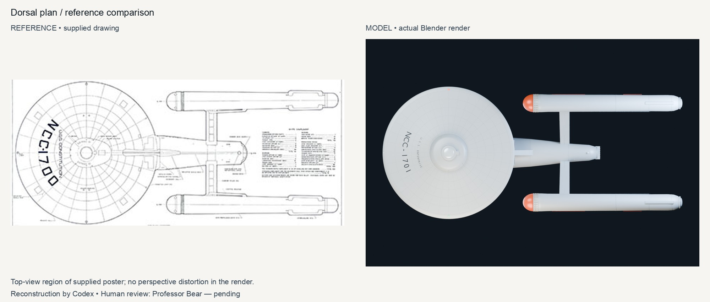

# U.S.S. Enterprise — NCC-1701

Classic Constitution-class exterior reconstructed from supplied plans, with Enterprise markings.

270 meshes · 163,798 triangles · 12 materials · 128.0 × 290.3 × 77.192 m (X/Y/Z) · Blender 4.2.0 · Codex

## Forward quarter

The saucer, copper deflector and red-orange Bussard collectors in a studio overview.

[Full-size render](renders/hero.png)

## Side profile

Orthographic side view for checking the swept neck, hull taper and nacelle placement.

[Full-size render](renders/side.png)

## Forward elevation

Orthographic front view showing the saucer dish and diagonal nacelle supports.

[Full-size render](renders/front.png)

## Dorsal plan

Orthographic plan with the bow at left, matching the supplied drawing orientation.

[Full-size render](renders/top.png)

## Aft quarter

Rear view of the nacelle endcaps, intercoolers, impulse exhaust and shuttle bay.

[Full-size render](renders/aft.png)

## Ventral quarter

The saucer underside, sensor dome, engineering hull and deflector assembly.

[Full-size render](renders/underside.png)

## Saucer detail

Curved registry lettering, bridge decks, navigation lights and modeled panel lines.

[Full-size render](renders/detail.png)

## Reference comparisons

The panels contain supplied reference pixels and actual Blender renders. Lighting is interpretive and framing is approximate. No comparison evidence was generated with an image model.

### Side profile comparison

The supplied high-resolution Constitution-class sheet is at left; the actual model render is at right. The class-sheet registry is NCC-1700; the model is marked NCC-1701.

[Full-size comparison](compare/side-comparison.jpg)

### Forward elevation comparison

The forward-view crop from the supplied low-resolution sheet is at left. Framing and source quality limit exact matching.

[Full-size comparison](compare/front-comparison.jpg)

### Dorsal plan comparison

The top-view crop from the supplied poster is at left; the actual orthographic render is at right.

[Full-size comparison](compare/top-comparison.jpg)

## Film

Companion film: coming soon
<!-- FILM_URL -->

## Downloads

| File | Size | Purpose | Download |
|---|---:|---|---|
| enterprise-ncc-1701.blend | 9.66 MiB | Full editable scene, cameras, lights and materials | [Download](https://github.com/nikbearbrown/csye-7270-building-virtual-environments/raw/main/blender/enterprise-ncc-1701-codex/enterprise-ncc-1701.blend) |
| enterprise-ncc-1701.glb | 3.79 MiB | Model with flat PBR colors and modeled details; no image textures | [Download](https://github.com/nikbearbrown/csye-7270-building-virtual-environments/raw/main/blender/enterprise-ncc-1701-codex/enterprise-ncc-1701.glb) |
| index.html | 0.64 MiB | Self-contained offline image review viewer | [Download](https://github.com/nikbearbrown/csye-7270-building-virtual-environments/raw/main/blender/enterprise-ncc-1701-codex/index.html) |

## Import

Open `enterprise-ncc-1701.blend` in Blender 4.2 or later. Reopening was verified in Blender 4.2.0. For the GLB, use **File → Import → glTF 2.0**. The GLB was reimported in Blender 4.2.0 with matching mesh count, triangle count, materials and bounds.

The GLB has **flat PBR material colors and no image textures**. Panel seams, windows, grilles and markings are geometry and survive export. Studio lighting, world, cameras and Blender render settings are excluded. Emissive strength uses `KHR_materials_emissive_strength`, so its appearance depends on the viewer.

## Viewer

[GitHub Pages viewer](https://nikbearbrown.github.io/csye-7270-building-virtual-environments/blender/enterprise-ncc-1701-codex/) · [HTML preview fallback](https://htmlpreview.github.io/?https://github.com/nikbearbrown/csye-7270-building-virtual-environments/raw/main/blender/enterprise-ncc-1701-codex/index.html)

The single HTML file works offline after download. External model/film links need connectivity. GitHub Pages availability is separate from the file delivery. The viewer navigates rendered views; it is not a live 3D orbit viewer.

## Built by

Builder: Codex. Created for Nik Bear Brown. Method: scripted Blender mesh construction through the MCP for Blender add-on socket bridge; 3 documented visual comparison/review rounds. Tools: Blender 4.2.0, MCP add-on bl_info 1.7 / protocol 11 (local archived add-on), Python 3.14.6 for packaging, Pillow 12.3.0. Build date: 2026-10-20 (America/New_York). Human review: Professor Bear — pending.

Reference provenance: drawings supplied by Nik Bear Brown. The main side sheet credits Franz Joseph Designs and ©1973 Paramount Pictures Corporation. Star Trek and the Enterprise are referenced here for a course modeling study; this is not an official asset.

## Limitations and human review

A blueprint-based exterior reconstruction, not a screen-exact studio miniature. Overall proportions were estimated from the supplied views; the 290.3 m length is the chosen working scale, not a verified canonical dimension. Small windows, pennants, grille slats, colors and surface finish are interpretations. The bridge is simplified, the engineering stern is smoother than the plan, and nacelle tail/intercooler details differ. No deck interiors, animated mechanisms, LODs, collision mesh or production rig are included. Separate components are parented to a master transform for rigid movement; this does not constitute animation validation. Human review: Professor Bear — pending.

[Build notes and reproduction](BUILD_NOTES.md) · [Audited statistics](audit.json) · [File validation](verification.json)
