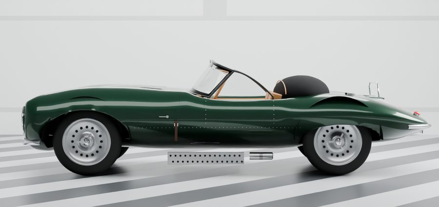
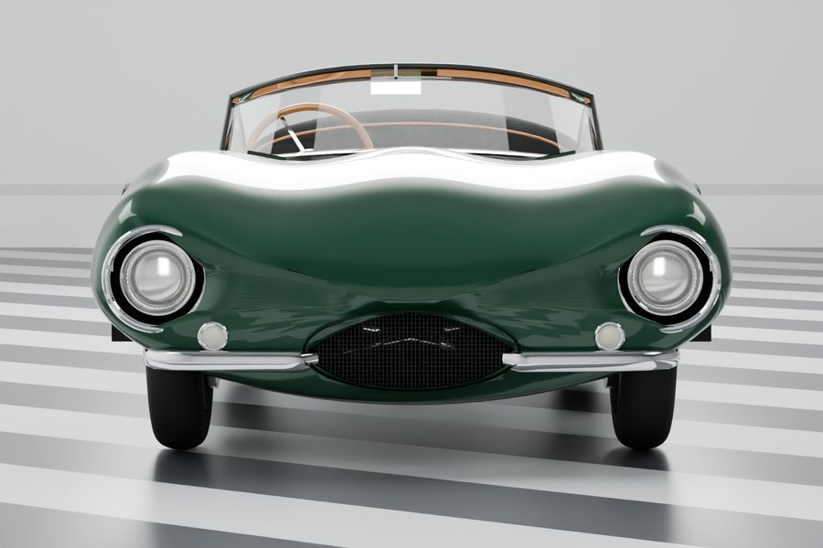
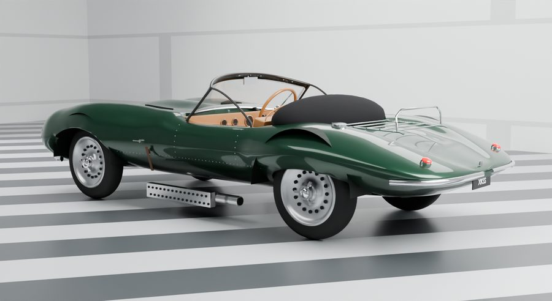
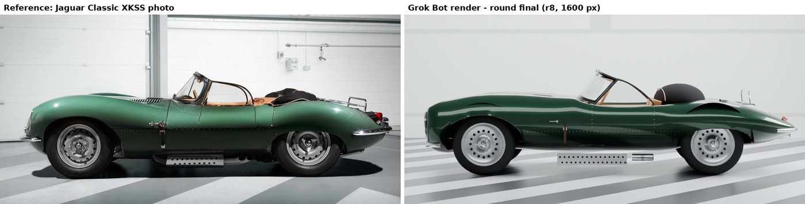
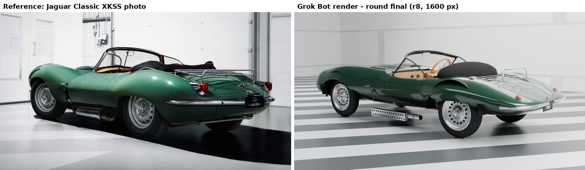
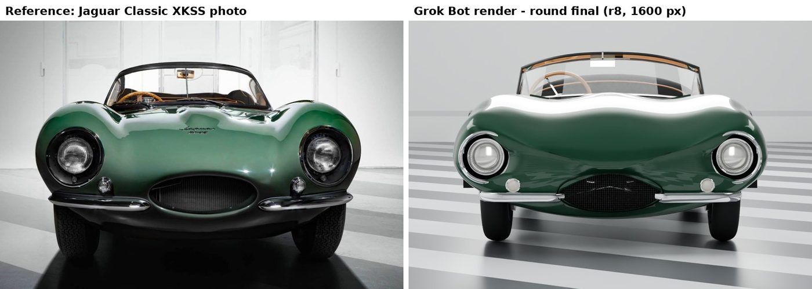

# 1957 Jaguar XKSS

A 1957 Jaguar XKSS, the road-going D-type, in British Racing Green, built by Grok Bot entirely in code with Blender's Python API from seven studio photos. This is the first pass, after 8 rounds of comparison against the photos from matched cameras. It is an interpretive model, not a scan.

**Interactive viewer:** [open the viewer](https://nikbearbrown.github.io/csye-7270-building-virtual-environments/blender/jaguar-xkss-1957-grok/) (GitHub Pages) · [htmlpreview fallback](https://htmlpreview.github.io/?https://github.com/nikbearbrown/csye-7270-building-virtual-environments/raw/main/blender/jaguar-xkss-1957-grok/index.html) · or download [`index.html`](https://github.com/nikbearbrown/csye-7270-building-virtual-environments/raw/main/blender/jaguar-xkss-1957-grok/index.html) and open it locally; it is self-contained.

## Stats

- **Mesh objects:** 293 in the car (including 112 instanced rivets)
- **Triangles:** about 361k at viewport subdivision (what the GLB carries); about 1.2M at render subdivision (estimate)
- **Wheelbase:** 2,300 mm, matching the published spec
- **Track (front / rear):** 1,270 / 1,220 mm (spec 1,270 / 1,219 mm)
- **Width:** 1,664 mm (spec 1,660 mm); **height:** 1,065 mm to the screen top (spec 1,120 mm)
- **Length:** 3,780 mm body plus about 90 mm of bumperettes, about 5% short of the published 3,990 mm, because the photo's proportions were kept over the spec number
- **Built with:** Blender 4.2.3, headless, Cycles CPU

## Views

### Hero, front three-quarter

The car from the front three-quarter: the long bonnet, the louvres, the wraparound screen and the folded hood.

Full size: [renders/xkss_hero.png](renders/xkss_hero.png)

### Side

The side profile traced from the reference photo: bonnet, wing, waist and haunch line, and the side exhausts under their heat shield.

Full size: [renders/xkss_side.png](renders/xkss_side.png)

### Front

The face of the car: the oval grille, the headlamps in their nacelles and the split bumperettes. Grok Bot rates this the weakest view.

Full size: [renders/xkss_front.png](renders/xkss_front.png)

### Rear three-quarter

The tail, the haunches, the chrome luggage rack and the red tail lamps.

Full size: [renders/xkss_rear34.png](renders/xkss_rear34.png)

## Compare with references

Left: Jaguar Classic XKSS reference photo (comparison only). Right: Grok Bot render, final round. The reference photos in the comparisons are Jaguar Classic XKSS press images, shown for comparison only.

### Side (Grok Bot: 6/10)

The closest view. The profile line tracks the photo well, but the paint is flat, the stance is a little high and thin, and the heat shield sits detached from the body.

Full size: [compare/rfinal_side_compare.jpg](compare/rfinal_side_compare.jpg)

### Rear three-quarter (Grok Bot: 3/10)

The tail is a skinny wedge where the real car has a fat, rounded rump, the haunches are deflated, and the exhaust heat shield floats away from the body.

Full size: [compare/rfinal_rear34_compare.jpg](compare/rfinal_rear34_compare.jpg)

### Front (Grok Bot: 2/10)

The least close view. The real car has a menacing, sculpted face with lamps buried in deep nacelles; the model looks surprised, with bug-eyed lamps and a bonnet blown out to white.

Full size: [compare/rfinal_front_compare.jpg](compare/rfinal_front_compare.jpg)

## Grok Bot's assessment and human review

**Grok Bot's assessment:** Slightly close overall, about 4 out of 10 for likeness: side 6/10, rear three-quarter 3/10, front 2/10. Someone who knows cars would recognise what it is going for, but would never take it for the car in the photos. The numbers (wheelbase, track) are right; the feel is not there yet.

**Human review:** Pending.

## Built by

- **Builder:** Grok Bot, an autonomous desktop assistant agent with its own Linux computer. Version: not exposed by the app.
- **Method:** Model generated entirely by Blender Python scripts written and run headless by Grok Bot, with iterative render-vs-reference comparison rounds.
- **Tools:** Blender 4.2.3 LTS (Cycles, CPU). Python with Pillow and NumPy for the profile tracing, overlays and comparison images; Intel Open Image Denoise in Cycles. Films are made with the brutalist.art toolkit and narrated by Liam (Kokoro voice).
- **Human review:** Professor Bear (verdict pending).
- **Build date:** October 2026. 8 render-vs-reference comparison rounds from matched cameras (PROGRESS.md), with a milestone save per round.

## Film

<!-- FILM_URL: paste the companion film link on the next line, replacing "coming soon" (also set FILM_URL at the top of the script in index.html). -->
**Companion film: coming soon.**

A build-breakdown film narrated by Liam: how the XKSS was built over 8 rounds, side by side with the reference photos.

## Download

Click a file name to download it directly. To get everything, clone the repo or use [Code → Download ZIP](https://github.com/nikbearbrown/csye-7270-building-virtual-environments/archive/refs/heads/main.zip).

| File | Size | What it is |
|---|---|---|
| [`xkss.blend`](https://github.com/nikbearbrown/csye-7270-building-virtual-environments/raw/main/blender/jaguar-xkss-1957-grok/xkss.blend) | 5.9 MB | Blender scene: final model, studio and the 4 fixed comparison cameras. |
| [`xkss.glb`](https://github.com/nikbearbrown/csye-7270-building-virtual-environments/raw/main/blender/jaguar-xkss-1957-grok/xkss.glb) | 9.0 MB | glTF binary of the car only, modifiers applied at viewport subdivision, flat PBR colours. |
| [`BUILD_NOTES.md`](https://github.com/nikbearbrown/csye-7270-building-virtual-environments/raw/main/blender/jaguar-xkss-1957-grok/BUILD_NOTES.md) | 4 KB | Full technical record: dimensions against the published spec, method, counts, limitations. |
| [`scripts/build_xkss.py`](https://github.com/nikbearbrown/csye-7270-building-virtual-environments/raw/main/blender/jaguar-xkss-1957-grok/scripts/build_xkss.py) | 42 KB | The whole build in one script (`blender -b -P build_xkss.py -- --round N --res 640 --samples 10`). |
| [`scripts/compare.py`](https://github.com/nikbearbrown/csye-7270-building-virtual-environments/raw/main/blender/jaguar-xkss-1957-grok/scripts/compare.py) | 1 KB | Makes the reference-vs-render side-by-sides. |

## How to import into Blender

1. **Native scene:** install Blender 4.2 or later and open the `.blend` file with **File → Open**. You get the model with its procedural materials, lights and comparison cameras.
2. **GLB:** in any Blender version with the glTF add-on (enabled by default), use **File → Import → glTF 2.0 (.glb/.gltf)** and pick the `.glb`. The GLB also works in game engines and web viewers.

The GLB carries **flat colours only** (base colour, metallic/roughness). The worn finish and panel detail are procedural shaders that exist only in the `.blend` files and the renders.

## Method

The body is one smooth lofted quad mesh (about 148 stations × 118 points) generated from profile tables traced off the side photo, calibrated to the wheelbase, plus widths and crowns from the front view. The cockpit, wheel arches, grille mouth and headlamp holes are cut from the same mesh. The side and front cameras were solved from reference pixels (hub centres, headlamp spacing) so the renders register on the photos. Smaller parts (lamps, grille, bumpers, louvres, rivets, screens, interior, wheels, rack) are ray-cast onto the body.

## Honest limitations

- **Front:** the bonnet reads too bright and white at the reference's grazing camera angle, the wing crowns over the headlamps are softer than the photo's distinct humps, and the chrome lamp rings look frog-eyed rather than recessed.
- **Surface flow** is a parametric loft, not hand-sculpted: no subtle S-curve under the doors, no sharp crease at the rear wing seam, and the haunches are less voluminous than in the photos.
- **Rear:** the tail is thinner and more wedge-shaped than the real car's rounded rump.
- **Exhaust heat shield** sits proud of and low against the body compared with the photo.
- **Wheels:** the perforations are dark inset discs, not real holes; there is no tread pattern, and the spinners are simplified.
- **Simplified details:** interior, hood bundle and rack; no Jaguar script badge on the bonnet; no wipers.
- **Studio** is generic, and the paint is a touch lighter and flatter than in the photos.
- **GLB:** flat materials only; the shader panel lines exist only in the .blend file and renders.

See [BUILD_NOTES.md](BUILD_NOTES.md) for the full technical record.
