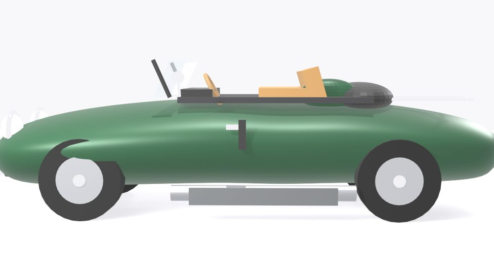
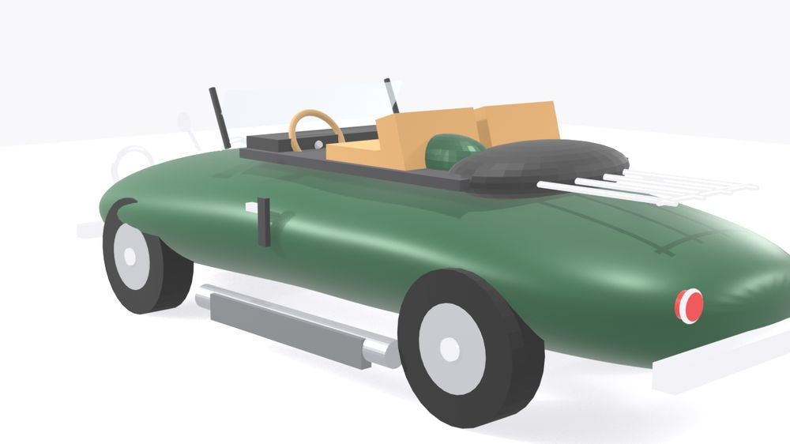
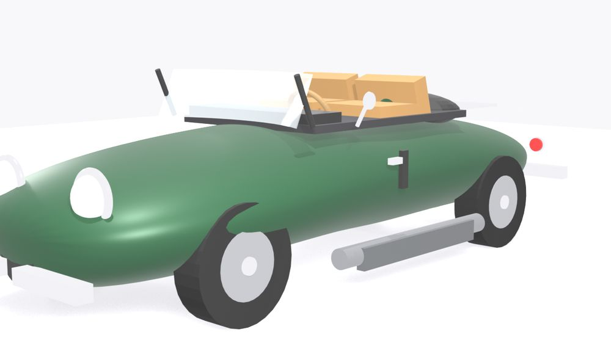
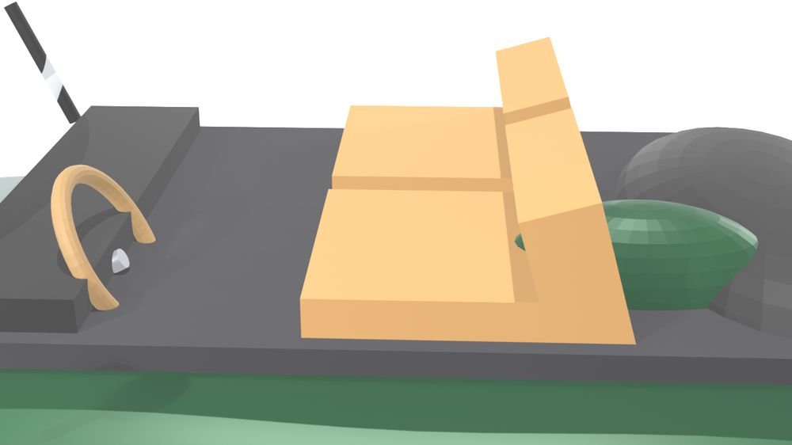
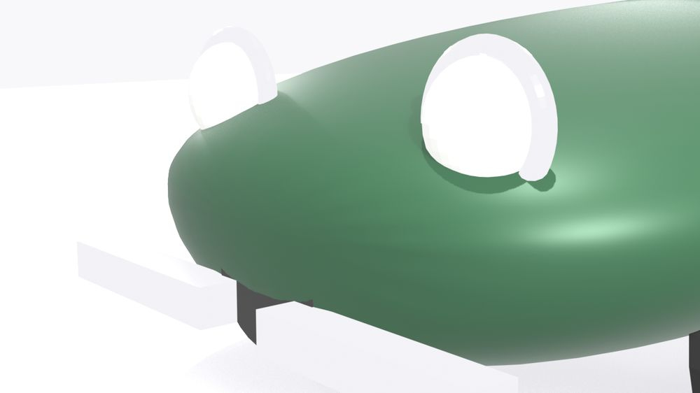
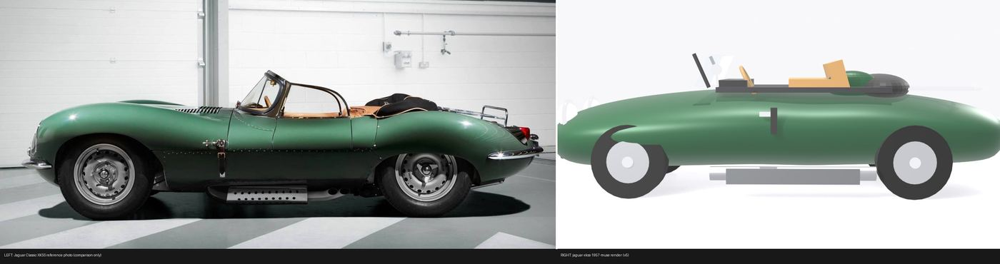
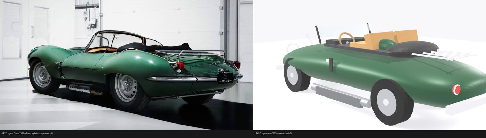
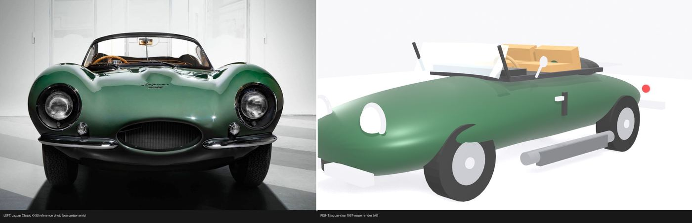

# 1957 Jaguar XKSS

A stylized 1957 Jaguar XKSS roadster in Sherwood Green, scripted end-to-end with the Blender Python API from seven Jaguar Classic press photos. An interpretive model, not a scan — recognisably an XKSS from the side, weakest at the front.

**Stats:** 51 meshes, 21,242 triangles, 15 materials, 4.64 × 1.85 × 1.33 m (stylized, not to scale), Blender 4.5.9 LTS. Built by Muse (Muse Spark).

**Interactive viewer:** [open the viewer](https://nikbearbrown.github.io/csye-7270-building-virtual-environments/blender/jaguar-xkss-1957-muse/) (GitHub Pages) · [htmlpreview fallback](https://htmlpreview.github.io/?https://github.com/nikbearbrown/csye-7270-building-virtual-environments/raw/main/blender/jaguar-xkss-1957-muse/index.html) · or download [`index.html`](https://github.com/nikbearbrown/csye-7270-building-virtual-environments/raw/main/blender/jaguar-xkss-1957-muse/index.html) and open it locally; it is self-contained.

## Views

### Side

The long-bonnet XKSS silhouette in Sherwood Green: side exhaust with heat shield, Dunlop-style disc wheels, tan cockpit and folded soft-top boot.

Full size: [renders/xkss_side.png](renders/xkss_side.png)

### Rear three-quarter

Tail, haunches, chrome luggage rack on the rear deck and red tail lamps.

Full size: [renders/xkss_rear34.png](renders/xkss_rear34.png)

### Front three-quarter

Oval grille mouth, faired-in headlamps with chrome rings and split front bumperettes.

Full size: [renders/xkss_front34.png](renders/xkss_front34.png)

### Cockpit detail

Tan leather seats, wood-rim steering wheel, wraparound screen and the folded soft-top boot behind the seats.

Full size: [renders/xkss_detail_cockpit.png](renders/xkss_detail_cockpit.png)

### Front detail

Headlamp nacelles, oval grille and chrome brightwork up close.

Full size: [renders/xkss_detail_front.png](renders/xkss_detail_front.png)

## Compare with references

Left: Jaguar Classic XKSS reference photo (comparison only). Right: jaguar-xkss-1957-muse render, final round (v5).

### Side

The closest view. The profile line tracks the photo: long bonnet, low waist, tapered tail. The paint is flatter than the photo's deep Sherwood Green and the wheels read as plain discs.

Full size: [compare/compare_side.jpg](compare/compare_side.jpg)

### Rear three-quarter

Tail shape and rack placement track the photo; the haunches are less voluminous and the heat shield sits lower and more detached than in the reference.

Full size: [compare/compare_rear34.jpg](compare/compare_rear34.jpg)

### Front three-quarter

The weakest view. The reference has deeply nacelled lamps and a menacing sculpted face; the model's lamps read flat and the grille is a plain dark oval.

Full size: [compare/compare_front34.jpg](compare/compare_front34.jpg)

## Film

<!-- FILM_URL -->

**Companion film: coming soon.**

## Download

Click a file name to download it directly. To get everything, clone the repo or use [Code → Download ZIP](https://github.com/nikbearbrown/csye-7270-building-virtual-environments/archive/refs/heads/main.zip).

| File | Size | What it is |
|---|---|---|
| [`jaguar-xkss-1957-muse.blend`](https://github.com/nikbearbrown/csye-7270-building-virtual-environments/raw/main/blender/jaguar-xkss-1957-muse/jaguar-xkss-1957-muse.blend) | 1.7 MB | Blender scene: final model, studio lights and the comparison cameras. |
| [`jaguar-xkss-1957-muse.glb`](https://github.com/nikbearbrown/csye-7270-building-virtual-environments/raw/main/blender/jaguar-xkss-1957-muse/jaguar-xkss-1957-muse.glb) | 0.9 MB | glTF binary of the car, flat colours only, no textures. |
| [`BUILD_NOTES.md`](https://github.com/nikbearbrown/csye-7270-building-virtual-environments/raw/main/blender/jaguar-xkss-1957-muse/BUILD_NOTES.md) | 4 KB | Full technical record: audited counts, method, 5 comparison rounds, limitations. |
| [`scripts/xkss.py`](https://github.com/nikbearbrown/csye-7270-building-virtual-environments/raw/main/blender/jaguar-xkss-1957-muse/scripts/xkss.py) | 13 KB | The build script: the whole model in one Blender Python file. |
| [`index.html`](https://github.com/nikbearbrown/csye-7270-building-virtual-environments/raw/main/blender/jaguar-xkss-1957-muse/index.html) | — | Self-contained interactive viewer (images embedded). |

## How to import into Blender

1. **Native scene:** install Blender 4.2 or later and open the `.blend` file with **File → Open**. You get the model with its materials, lights and comparison cameras.
2. **GLB:** in any Blender version with the glTF add-on (enabled by default), use **File → Import → glTF 2.0 (.glb/.gltf)** and pick the `.glb`. The GLB also works in game engines and web viewers.

The GLB carries **flat colours only** (base colour, metallic/roughness). There are no textures anywhere in this build.

## Viewer

- [GitHub Pages viewer](https://nikbearbrown.github.io/csye-7270-building-virtual-environments/blender/jaguar-xkss-1957-muse/)
- [htmlpreview fallback](https://htmlpreview.github.io/?https://github.com/nikbearbrown/csye-7270-building-virtual-environments/raw/main/blender/jaguar-xkss-1957-muse/index.html)

## Built by

- **Builder:** Muse (Muse Spark).
- **Method:** fully scripted with the Blender Python API (bpy); 5 render-vs-reference comparison rounds.
- **Tools:** Blender 4.5.9 LTS headless (EEVEE-Next), Python/bpy, PIL for composites.
- **Build date:** 2026-10-18.
- **Human review:** by Professor Bear — PENDING, he has not reviewed it.

## Honest limitations

- Stylized, subdivision-smoothed lofted body — not true XKSS surfacing; proportions approximate, **not built to real scale** (real car: 3,990 mm long, 2,300 mm wheelbase; the model is 4.64 m nose to tail).
- No bonnet louvers, no panel gaps or shut lines.
- Seats, dashboard and interior are box-built; instruments omitted.
- Wheels are plain discs: no perforations, no tread, simplified center-lock spinners. (The real car also wears solid Dunlop discs, not wires — but with perforations the model lacks.)
- Brightwork simplified: bumpers, luggage rack, heat shield and exhaust are plain chrome/steel shapes; no Jaguar script badge, no wipers.
- Glass is a single tinted panel; trim minimal.
- Colours approximate.
- Judged harshly on overall look and feel: recognisably an XKSS from the side; weakest at the front, where the lamps read flat rather than deeply nacelled.

See [BUILD_NOTES.md](BUILD_NOTES.md) for the full technical record.
