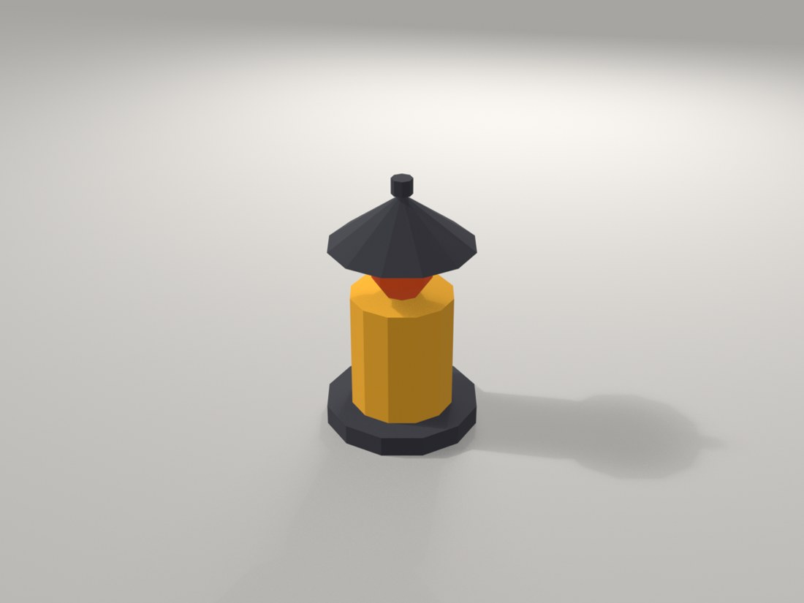
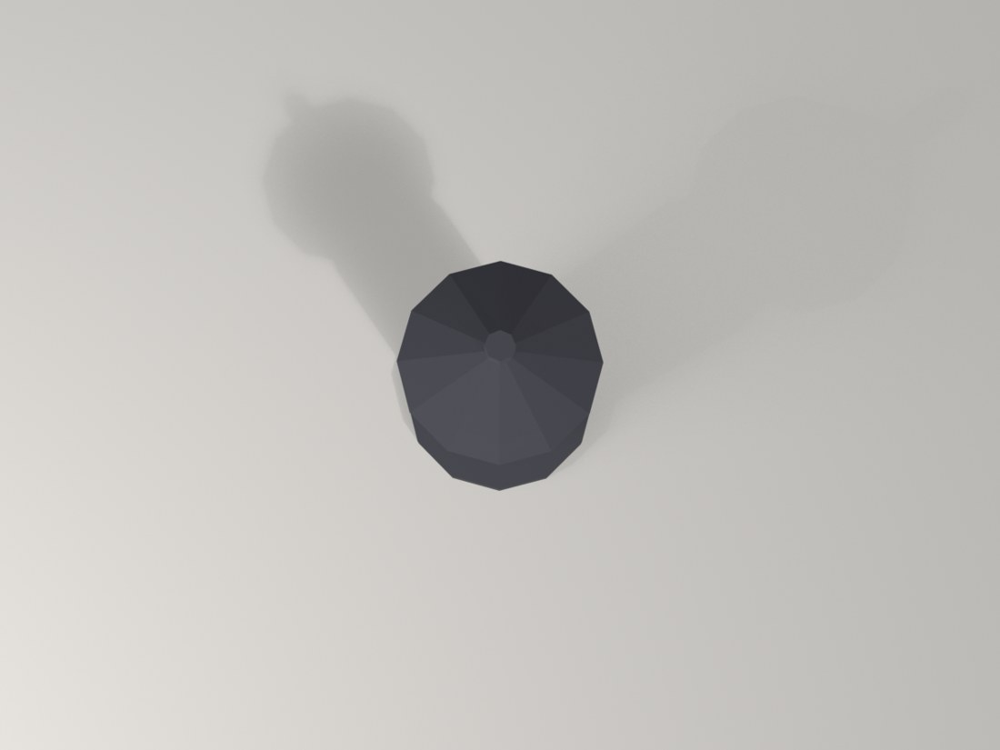
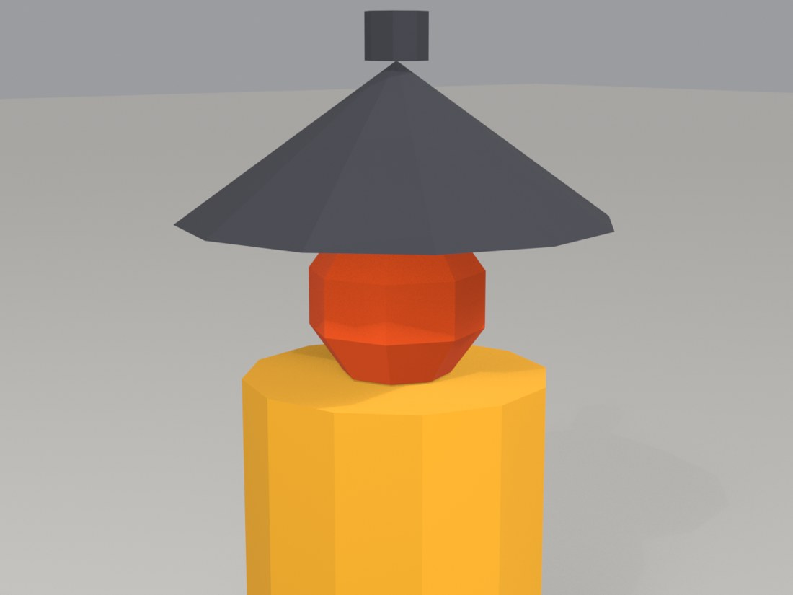

# Lantern (teaching prop), built by Claude

*A teaching prop for CSYE 7270: a lantern: iron base, a glass cylinder, a flame sphere, a cone roof and a finial, from basic shapes only.*

`5 basic shapes · 202 triangles · 3 materials · 0.30 x 0.30 x 0.50 m · Blender 5.1.2`

One of three tiny assets made for Assignment 3 of CSYE 7270 (course limits: at most 6 shapes, at most 500 triangles). It is a lantern: iron base, a glass cylinder, a flame sphere, a cone roof and a finial. Flat colours only, joined into one object, origin at the centre of the underside, lowest point at z = 0. These are teaching primitives, not likenesses of any real object.

## Views

### Front three-quarter

From front-left and above, the main view.

[Full-size file](renders/lantern_front34.png)

### Back three-quarter

From back-right and above, to check the far sides.

[Full-size file](renders/lantern_back34.png)

### Side, low

Almost level with the floor, to check proportions and that the prop sits on z = 0.

[Full-size file](renders/lantern_side.png)

### Top

Straight down, to check the footprint.

[Full-size file](renders/lantern_top.png)

### Close-up, roof and flame

The cone roof, the flame sphere in the open gap under it and the top of the glass cylinder. The glass is an opaque flat colour, so the flame sits in a gap instead of inside the glass.

[Full-size file](renders/lantern_close.png)

## Compare with references

No photo or drawing reference exists for this prop: it is a primitives-only teaching asset made to the course limits, not a copy of a real object. There is nothing to compare it against.

## Film

Companion film: coming soon

<!-- FILM_URL -->

## Download

| File | Size | What it is | Download |
|---|---|---|---|
| `lantern.blend` | 97 KB | Blender scene: one joined mesh, flat-colour materials. No camera or light is stored in it. | [download](https://github.com/nikbearbrown/csye-7270-building-virtual-environments/raw/main/blender/lantern-prop-claude/lantern.blend) |
| `lantern.glb` | 17 KB | glTF binary, exported with +Y Up on; flat base colours, no textures. | [download](https://github.com/nikbearbrown/csye-7270-building-virtual-environments/raw/main/blender/lantern-prop-claude/lantern.glb) |
| `scripts/build_lantern.py` | 5 KB | The script that built the prop (run in background Blender). | [download](https://github.com/nikbearbrown/csye-7270-building-virtual-environments/raw/main/blender/lantern-prop-claude/scripts/build_lantern.py) |
| `scripts/build_lantern.log` | 1 KB | Terminal output of that run, as recorded. | [download](https://github.com/nikbearbrown/csye-7270-building-virtual-environments/raw/main/blender/lantern-prop-claude/scripts/build_lantern.log) |
| `scripts/render_props.py` | 4 KB | Renders the five views in renders/ (EEVEE). | [download](https://github.com/nikbearbrown/csye-7270-building-virtual-environments/raw/main/blender/lantern-prop-claude/scripts/render_props.py) |
| `scripts/ASSETS-source.md` | 6 KB | The source folder's ASSETS.md for all three props, copied unchanged. | [download](https://github.com/nikbearbrown/csye-7270-building-virtual-environments/raw/main/blender/lantern-prop-claude/scripts/ASSETS-source.md) |
| `scripts/count_scene.py` | 1 KB | Counts meshes, triangles, materials and size from the .blend. | [download](https://github.com/nikbearbrown/csye-7270-building-virtual-environments/raw/main/blender/lantern-prop-claude/scripts/count_scene.py) |
| `scripts/make_pages.py` | 11 KB | Generates README.md, BUILD_NOTES.md and index.html. | [download](https://github.com/nikbearbrown/csye-7270-building-virtual-environments/raw/main/blender/lantern-prop-claude/scripts/make_pages.py) |
| `BUILD_NOTES.md` | 4 KB | How it was built and what is unverified. | [download](https://github.com/nikbearbrown/csye-7270-building-virtual-environments/raw/main/blender/lantern-prop-claude/BUILD_NOTES.md) |
| `index.html` | 138 KB | Self-contained viewer with the renders. | [download](https://github.com/nikbearbrown/csye-7270-building-virtual-environments/raw/main/blender/lantern-prop-claude/index.html) |

lantern.glb carries flat base colours only: no textures, no UVs of note. The source's Godot import check reported identical colours after import (per ASSETS.md; not re-run here).

## How to import into Blender

- **`.blend`:** open it in Blender 4.2 or later (File > Open). 
- **`.glb`:** in Blender, File > Import > glTF 2.0 (.glb/.gltf), or drop it into a game engine or a web viewer.

## Viewer

A self-contained interactive viewer is in [`index.html`](index.html) (images embedded, works offline once downloaded):

- GitHub Pages: https://nikbearbrown.github.io/csye-7270-building-virtual-environments/blender/lantern-prop-claude/ (works once Pages is enabled for the repo)
- Fallback through htmlpreview: https://htmlpreview.github.io/?https://github.com/nikbearbrown/csye-7270-building-virtual-environments/raw/main/blender/lantern-prop-claude/index.html

## Built by

- **Builder:** Claude (no model version is recorded in the source files)
- **Method:** Scripted: build_lantern.py was run once in background Blender (`Blender -b --factory-startup --python-exit-code 1 --python build_lantern.py`), as ASSETS.md and build_lantern.log record. It was NOT built through the Blender MCP: the lecture's BUILD-LOG.md says 'The three assets in the film were built by a Blender script (the assignment's fallback route)' and that nobody has run the MCP route. No render-versus-reference rounds and no hand-modelling rounds: one scripted build, no references. The five renders here were made on 2026-10-18 by scripts/render_props.py (one pass, plus two layout adjustments of the cameras).
- **Tools:** Blender 5.1.2 (read from the .blend by count_scene.py and from the build log); glTF exporter bundled with Blender; Godot 4.7.2 was used by the source film for an import check (evidence/godot logs, not copied here).
- **Build date:** 2026-10-06 (build logs at 12:59, .blend saved 13:27); renders 2026-10-18
- **Human review:** Professor Bear: pending (no verdict is recorded in the source folder).

## Honest limitations

- The glass is opaque, not transparent, and the flame is a sphere floating in a gap between glass and roof; there is no handle, no frame bars and no light source in the file.
- The 12-sided cylinders and 8-segment sphere are visibly faceted by design (budget 500 triangles).
- The .blend was saved by Blender 5.1.2 (save_blend_demo.py) and has never been opened in Blender 4.2; Blender 4.2 may refuse or warn.
- The .blend has no camera and no light; the renders use a stage (floor and lights) added at render time, which is not in the file.
- The source folder's own note: the glass, flame and colours are flat Principled base colours, not textured; the .glb is small because there are no textures.
