# Planet Express ship (Futurama)

The Planet Express ship from Futurama, built by Grok Bot entirely in code with Blender's Python API. It was matched over 15 rounds against 12 photos of a toy model, from cameras set up to match each photo. In round 15 the hull proportions were refit to a 3D-printable STL kit of the ship that Professor Bear supplied (used as measurement data only; the STL files are not included). It is an interpretive model, not a scan.

**Interactive viewer:** [open the viewer](https://nikbearbrown.github.io/csye-7270-building-virtual-environments/blender/planet-express-ship-grok/) (GitHub Pages) · [htmlpreview fallback](https://htmlpreview.github.io/?https://github.com/nikbearbrown/csye-7270-building-virtual-environments/raw/main/blender/planet-express-ship-grok/index.html) · or download [`index.html`](https://github.com/nikbearbrown/csye-7270-building-virtual-environments/raw/main/blender/planet-express-ship-grok/index.html) and open it locally; it is self-contained.

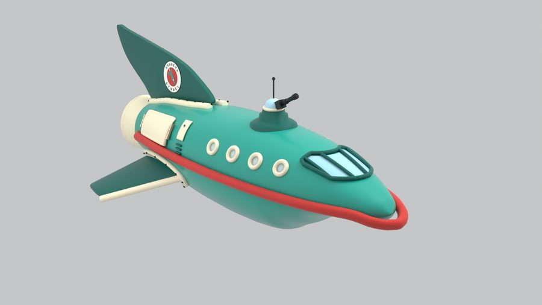

## Stats

- **Objects:** 206 mesh and curve objects (instanced rivets included)
- **Triangles:** 109,004
- **Materials:** 13 (glossy toy-plastic teal, dark teal, cream, red, light-blue glass, the logo decal and others)
- **Size:** 14.5 long x 6.4 wide x 5.1 high in model units, including fin, wings and antenna; the hull is 11.8 long, 3.3 wide and 3.2 high (refit to the STL kit's 178.6 x 49.4 x 48.3 mm hull at 0.066 units/mm)
- **Built with:** Blender 4.2.3, headless, Cycles CPU

## Views

### Front three-quarter

The ship from the front three-quarter: the pointed teal nose, the red rubber lip, the dark-teal cockpit visor and the row of cream portholes.

Full size: [renders/front34.png](renders/front34.png)

### Side

The right side: the turret, four portholes, the hatch and ladder, the ribbed cream vent, the swept fin with the mirrored logo, the wing and the engine.

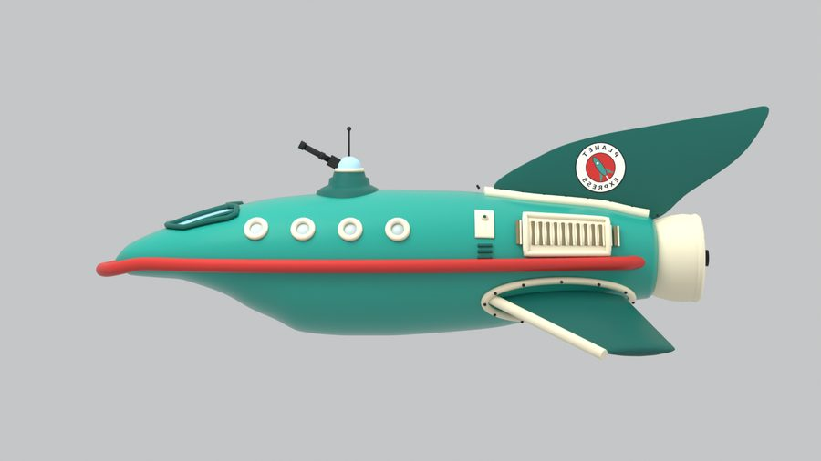

Full size: [renders/side.png](renders/side.png)

### Side, left

The left side, where the logo reads the right way round, as on the toy.

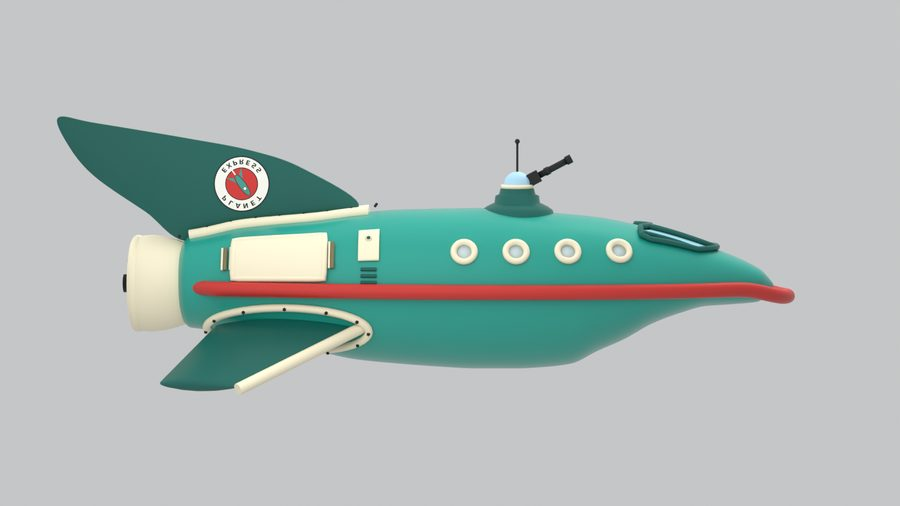

Full size: [renders/side_left.png](renders/side_left.png)

### Front

The face: the visor sitting above the lip, the beak at the centre of the lip and the wings reaching out below.

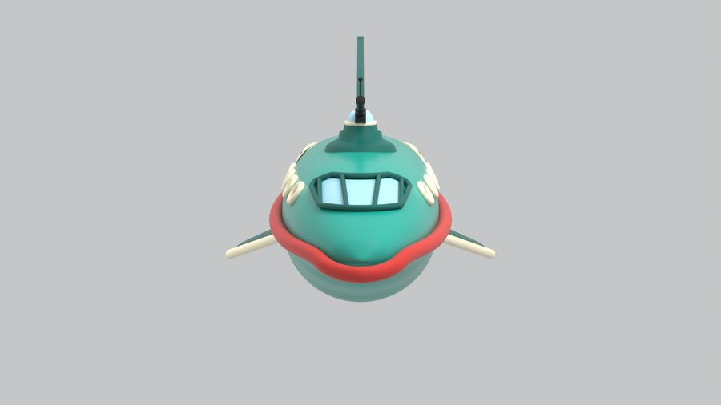

Full size: [renders/front.png](renders/front.png)

### Rear three-quarter

The tail: the cream engine bell with the dark cluster of exhaust lugs, the fin and the wings.

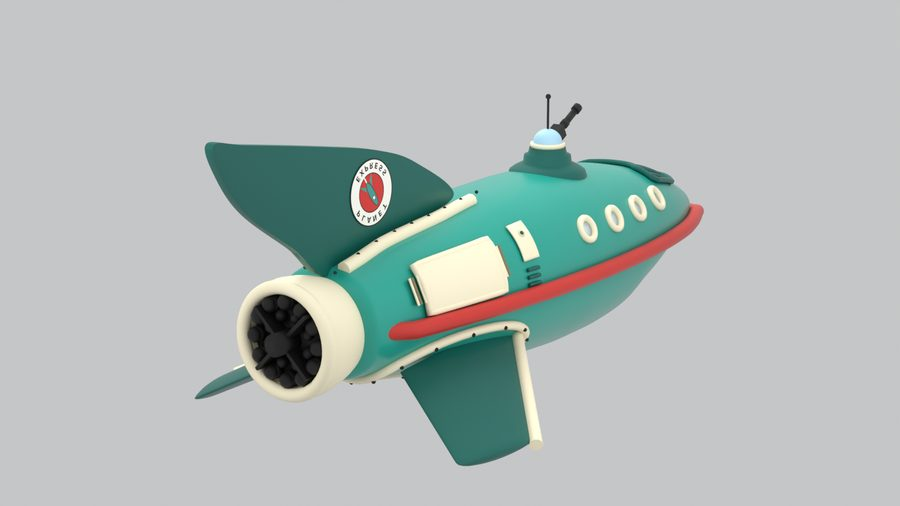

Full size: [renders/rear34.png](renders/rear34.png)

### Top

From above: the turret, the fin root strip, the vents, the hatches and the wings.

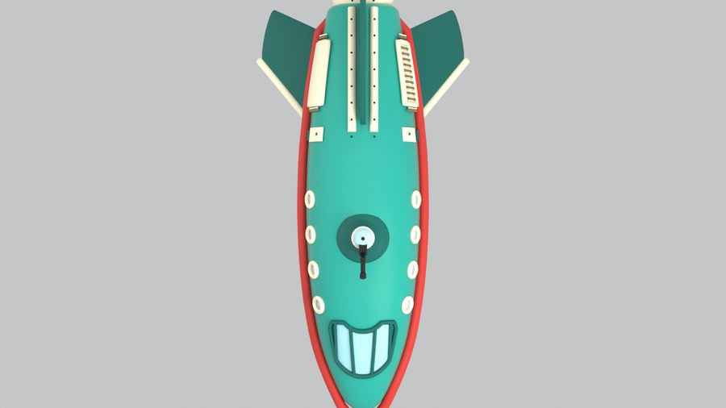

Full size: [renders/top.png](renders/top.png)

### Cockpit close-up

The cockpit visor: a dark-teal frame around three light-blue panes, set into the nose above the lip.

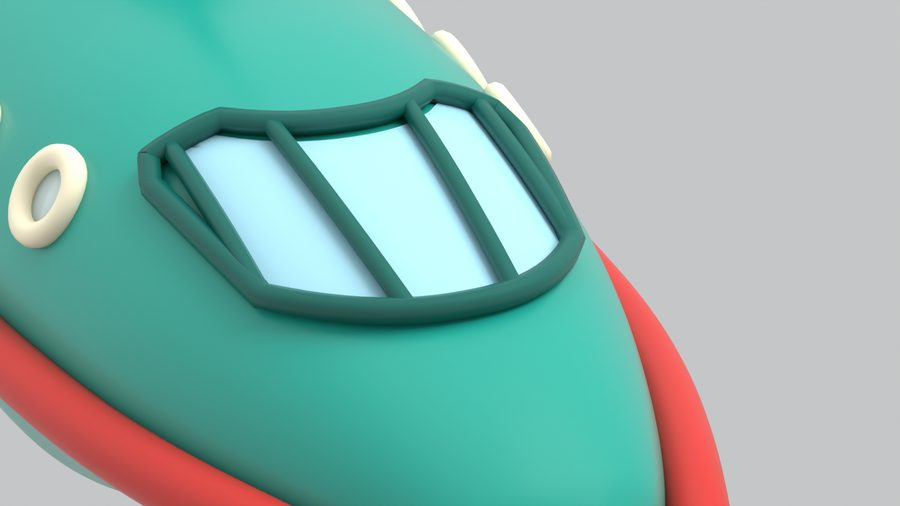

Full size: [renders/detail_cockpit.png](renders/detail_cockpit.png)

### Turret close-up

The stepped turret: dark-teal skirt, cream ring, light-blue dome, antenna and black gun.

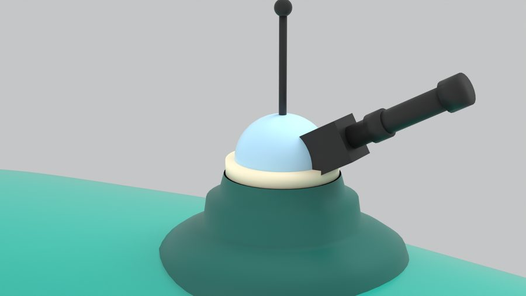

Full size: [renders/detail_turret.png](renders/detail_turret.png)

### Engine close-up

The engine bell: a thick cream rim around 12 large black lugs, an inner ring of 8, and a cross-shaped hub.

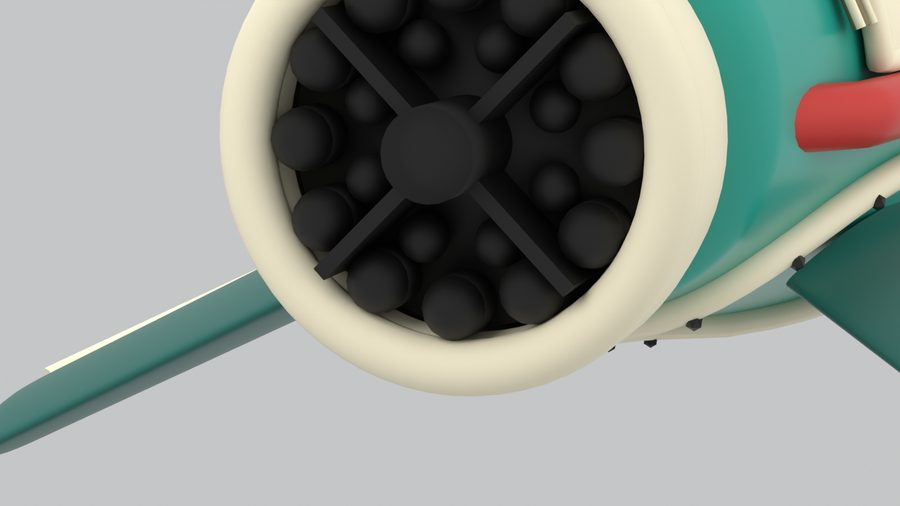

Full size: [renders/detail_engine.png](renders/detail_engine.png)

### Fin and logo close-up

The fin with the round rocket logo (an original drawn approximation, not the real artwork) and the riveted cream root strip.

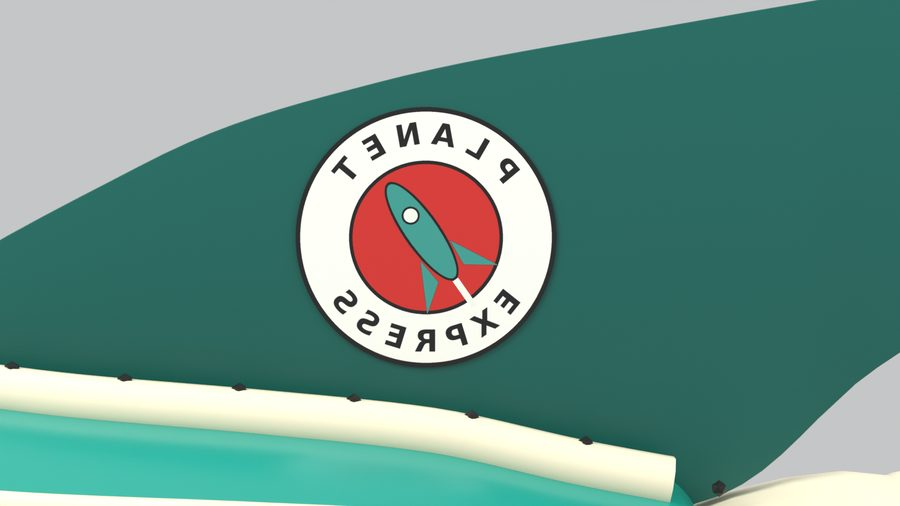

Full size: [renders/detail_fin_logo.png](renders/detail_fin_logo.png)

### Vent and wing close-up

The cream hatch panel, three small vent slots and the riveted wing root ring, seen from above.

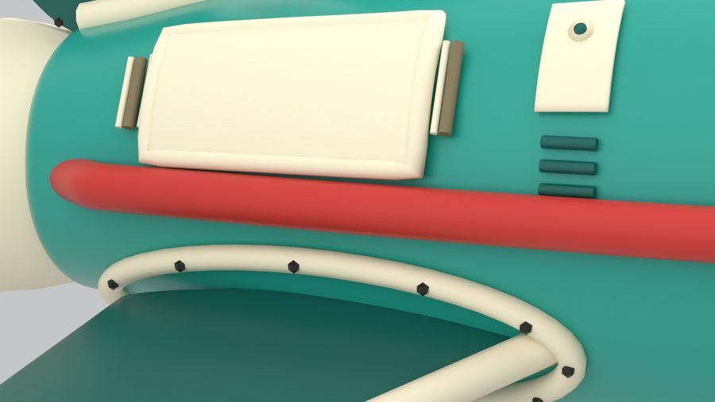

Full size: [renders/detail_vent_wing.png](renders/detail_vent_wing.png)

## Compare with references

Top: Professor Bear's reference photo of a toy model (comparison only). Bottom: Grok Bot render. The reference photos are Professor Bear's images of a toy model, shown for comparison only.

### Before and after: rounds 12 to 15

The side, front and rear three-quarter views for rounds 12, 13, 14 and 15 under the reference photo. Round 13 fixed the cockpit, lip and engine; round 14 made the hull fuller; round 15 refit the hull to the STL kit.

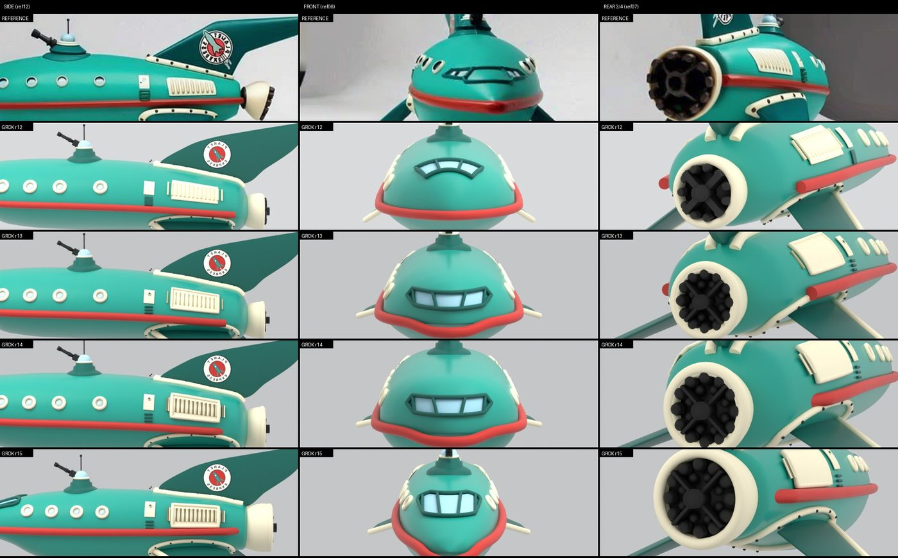

Full size: [compare/before_after_r12_to_r15.jpg](compare/before_after_r12_to_r15.jpg)

### Side (photo 12)

The closest match: the turret, portholes, hatch, vent, fin and engine sit where the photo has them.

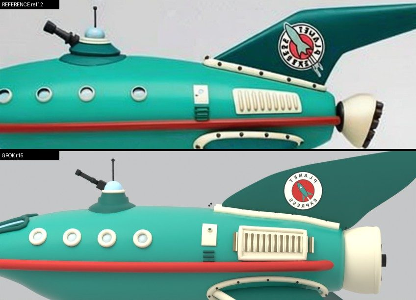

Full size: [compare/r15_ref12.jpg](compare/r15_ref12.jpg)

### Side (photo 5)

A second side photo. The layout matches; the toy's vent and hatch are more sculpted.

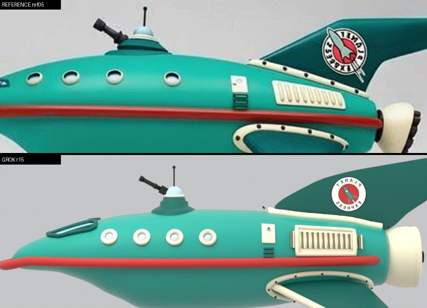

Full size: [compare/r15_ref05.jpg](compare/r15_ref05.jpg)

### Side front (photo 11)

Since round 15 the nose comes to a point at the lip like the photo, though the camera angle is not exactly matched.

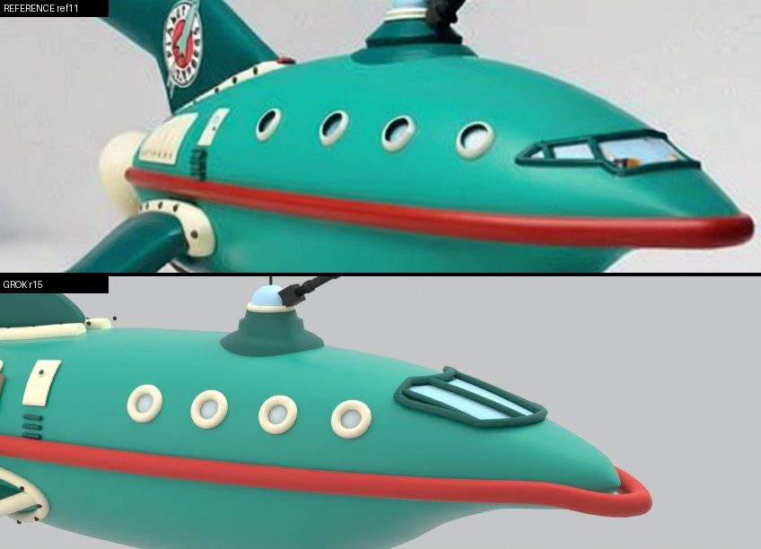

Full size: [compare/r15_ref11.jpg](compare/r15_ref11.jpg)

### Front three-quarter (photo 1)

The visor and lip read right; the photo's nose looks fuller from this low, close angle.

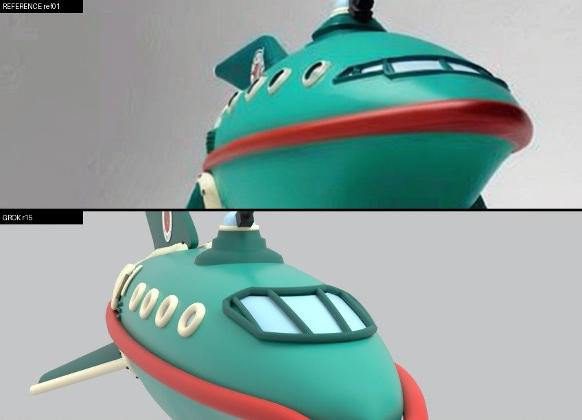

Full size: [compare/r15_ref01.jpg](compare/r15_ref01.jpg)

### Front (photo 6)

The visor and lip beak are close; the model's dome is a little narrower than the photo.

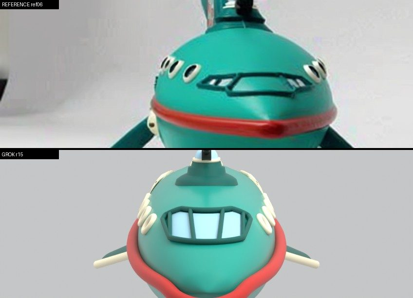

Full size: [compare/r15_ref06.jpg](compare/r15_ref06.jpg)

### Front, low (photo 10)

From below: the lip and the narrower chin under it.

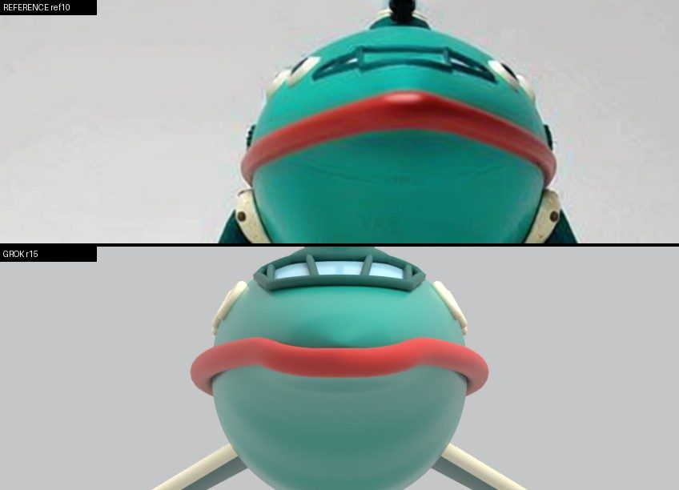

Full size: [compare/r15_ref10.jpg](compare/r15_ref10.jpg)

### Rear three-quarter (photo 7)

The engine reads as a lug cluster in a cream rim, but the camera and the tail framing are only roughly matched.

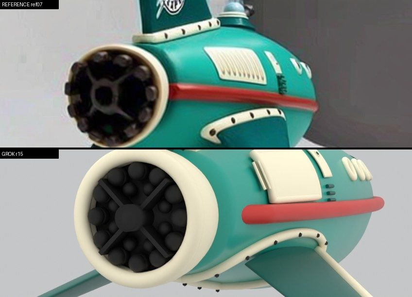

Full size: [compare/r15_ref07.jpg](compare/r15_ref07.jpg)

### Rear three-quarter (photo 9)

A higher rear view. The rear hull and fin root are roughly right; the camera is not well matched.

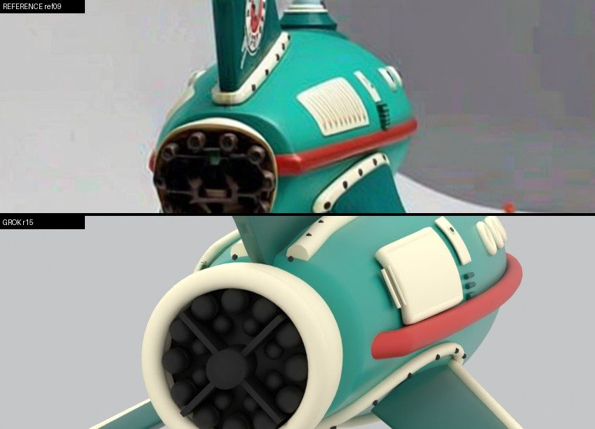

Full size: [compare/r15_ref09.jpg](compare/r15_ref09.jpg)

### Top (photo 4)

The angled top view: wings, vents and hatches compose like the photo.

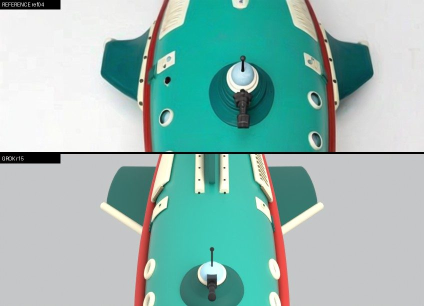

Full size: [compare/r15_ref04.jpg](compare/r15_ref04.jpg)

### Top, diagonal (photo 2)

A diagonal top view; the camera is only roughly matched.

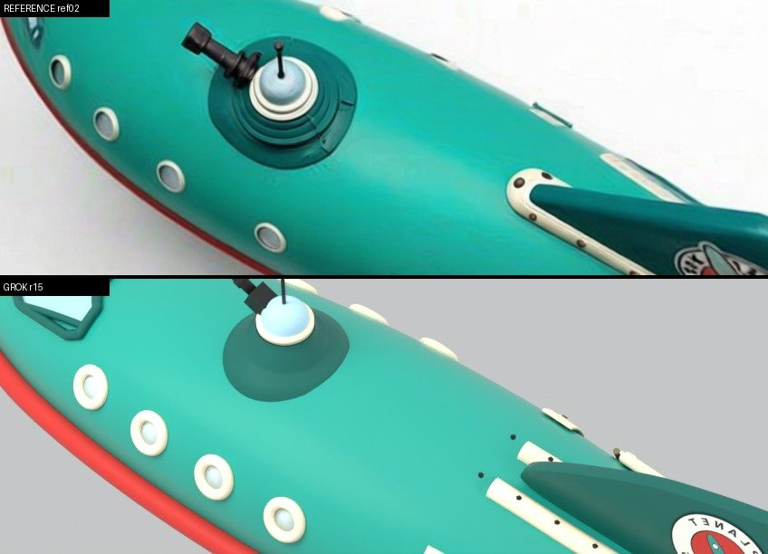

Full size: [compare/r15_ref02.jpg](compare/r15_ref02.jpg)

### Top, rear (photo 3)

The fin and turret from above; the camera is only roughly matched.

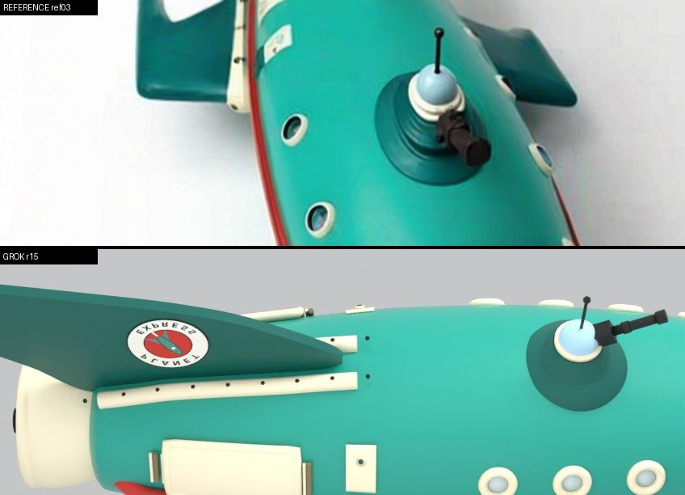

Full size: [compare/r15_ref03.jpg](compare/r15_ref03.jpg)

### Top three-quarter (photo 8)

The upper hull and portholes from above; the camera is only roughly matched.

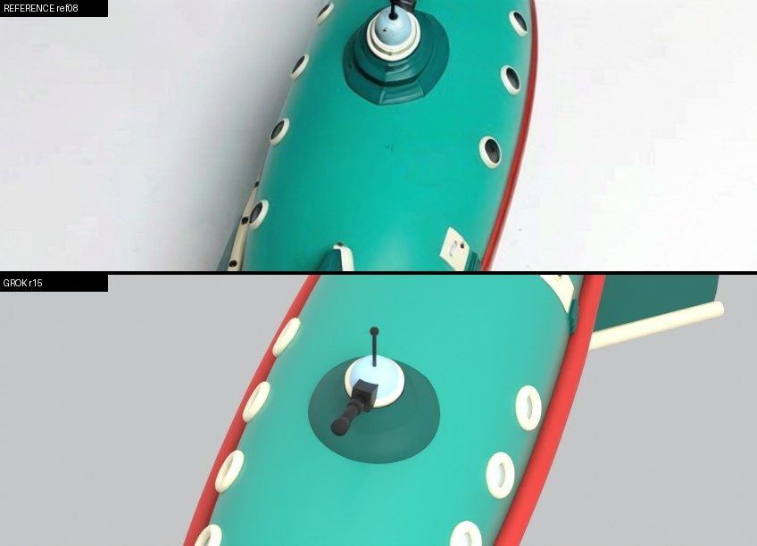

Full size: [compare/r15_ref08.jpg](compare/r15_ref08.jpg)

## Grok Bot's assessment and human review

**Grok Bot's assessment:** Round 15, about 5.5/10: side 6, front 5, rear 4, top 5.5. Refitting the hull to the STL kit gave it true proportions: narrower, nearly round in section, and with a nose that comes to a point at the lip over a shallow chin (photo 11 is now close). But in the side photos the toy's upper hull still looks taller and heavier than the model (partly the photos' close, wide-angle cameras, which are matched only by eye). The engine bell sticks out too far and looks too big in the rear views. The visor reads slightly too large from the front. It is clearly the Planet Express ship, but it would not pass for the toy: the details are clean and simplified, and the lighting is even and computer-clean rather than soft toy plastic.

**Human review (Professor Bear):** On round 12: "pretty good, maybe 6/10, could use another round." His notes led to round 13 (cockpit, lip, engine) and round 14 (a fuller hull), and he supplied the STL kit used in round 15. His verdict on round 15 is pending.

## Built by

- **Builder:** Grok Bot, an autonomous desktop assistant agent with its own Linux computer. Version: not exposed by the app.
- **Method:** Model generated entirely by Blender Python scripts written and run headless by Grok Bot, with iterative render-vs-reference comparison rounds.
- **Tools:** Blender 4.2.3 LTS (Cycles, CPU). Python with NumPy and Pillow for the STL measurements, overlays and comparison images; Intel Open Image Denoise in Cycles.
- **Human review:** Professor Bear: about 6/10 on round 12; directed rounds 13 to 15 and supplied the STL kit; verdict on round 15 pending.
- **Build date:** October 2026. 15 render-vs-reference comparison rounds from 12 matched cameras, with a saved .blend per round. Round 15 used Professor Bear's STL kit for the hull proportions.

## Download

Click a file name to download it directly. To get everything, clone the repo or use [Code → Download ZIP](https://github.com/nikbearbrown/csye-7270-building-virtual-environments/archive/refs/heads/main.zip).

| File | Size | What it is |
|---|---|---|
| [`planet_express.blend`](https://github.com/nikbearbrown/csye-7270-building-virtual-environments/raw/main/blender/planet-express-ship-grok/planet_express.blend) | 1.3 MB | Blender scene (round 15) with materials, lights, the logo texture packed in, and the 12 comparison cameras. |
| [`planet_express.glb`](https://github.com/nikbearbrown/csye-7270-building-virtual-environments/raw/main/blender/planet-express-ship-grok/planet_express.glb) | 2.6 MB | glTF binary of the ship, modifiers applied, with the logo texture embedded. |
| [`BUILD_NOTES.md`](https://github.com/nikbearbrown/csye-7270-building-virtual-environments/raw/main/blender/planet-express-ship-grok/BUILD_NOTES.md) | 5 KB | Round-by-round history r1 to r15, scores, Professor Bear's verdict, the STL measurements and limitations. |
| [`scripts/build_pe.py`](https://github.com/nikbearbrown/csye-7270-building-virtual-environments/raw/main/blender/planet-express-ship-grok/scripts/build_pe.py) | 22 KB | The whole build (`blender -b -P build_pe.py -- r15`); reads params.json. |
| [`scripts/params.json`](https://github.com/nikbearbrown/csye-7270-building-virtual-environments/raw/main/blender/planet-express-ship-grok/scripts/params.json) | 7 KB | All shape tables, part placements, colours, lights and the 12 comparison cameras. |
| [`scripts/make_logo.py`](https://github.com/nikbearbrown/csye-7270-building-virtual-environments/raw/main/blender/planet-express-ship-grok/scripts/make_logo.py) | 2 KB | Draws the original logo approximation (logo.png / logo_m.png). |

The `scripts/` folder also has `compare.py` (reference-over-render compares), `overlay.py` (silhouette overlays), `final.py` (gallery renders, GLB export, stats) and `stl/` (the scripts used to render, assemble and measure the STL kit, plus `parts.md`, the parts list). Each script sets the project folder at the top (`HERE` or `H`, currently `/workspace/ships/planet-express`); point it at a folder holding `params.json` and the logo images.

## How to import into Blender

1. **Native scene:** install Blender 4.2 or later and open the `.blend` file with **File → Open**. You get the model with its procedural materials, lights and comparison cameras.
2. **GLB:** in any Blender version with the glTF add-on (enabled by default), use **File → Import → glTF 2.0 (.glb/.gltf)** and pick the `.glb`. The GLB also works in game engines and web viewers.

The GLB carries flat glossy colours plus the embedded logo texture. Lights, cameras and the render setup exist only in the `.blend` file.

## Method

The hull is one lofted quad mesh of superellipse cross-sections driven by profile tables. In rounds 1 to 14 those tables were traced from the photos; in round 15 they were refit to Professor Bear's STL kit, after the kit's nose and rear hull sections were rotated into place and measured slice by slice. Every detail is placed exactly on that surface, so the lip, portholes, cockpit visor, turret, fin strip, vents, hatches and wing rings follow the hull when it changes. Each round was rendered from 12 cameras matched to the photos and judged against them.

## Honest limitations

- **Details are simplified:** the vent, hatch, wing root rings and engine lugs are clean primitive shapes, not the toy's sculpted parts. The STL kit's small parts were identified, but only the hull and the engine bell size were used.
- **Wings** are placed by eye from the photos; the kit's wing pieces were not fitted.
- **Logo** is an original drawn approximation, not the real artwork.
- **Cameras** are matched by eye; the rear and top-diagonal photos are only roughly matched.
- **Engine bell** sticks out too far and is too large in the rear views; the upper hull reads lower than in the side photos.
- **Lighting and materials** are even and clean, not the photos' softly shaded, saturated toy plastic.
- **No panel lines:** the hull is a single smooth surface.
- **STL source:** the STL kit is Professor Bear's data with no stated licence, so it was used for measurement only and is not included here.

**Film:** the [`film/`](film/) folder has a Brutalist beat sheet ([`beat_sheet.md`](film/beat_sheet.md), machine file `beat_sheet.json`) for a film that shows the model, then how a person would build it by hand in Blender; the film itself is not in the repo.

See [BUILD_NOTES.md](BUILD_NOTES.md) for the full technical record.
