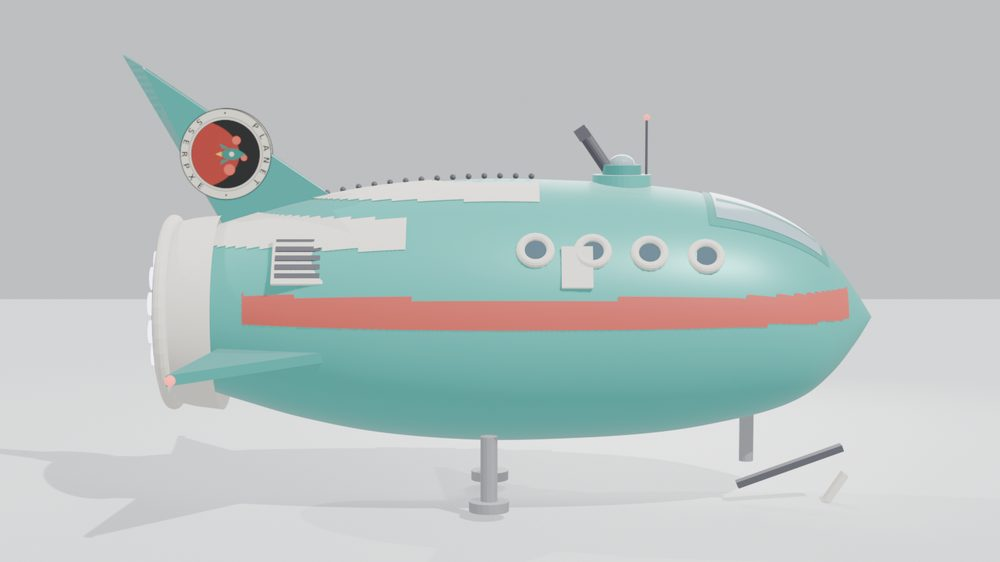
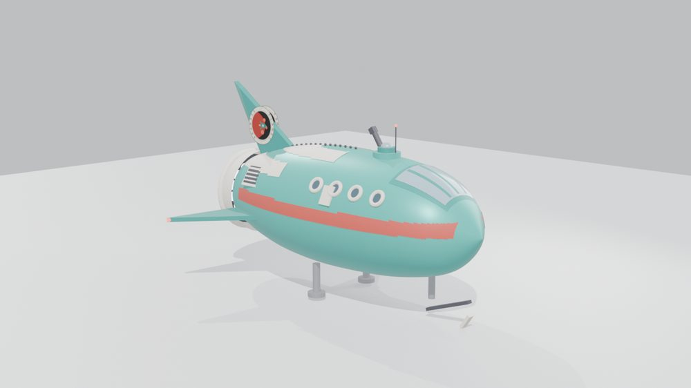
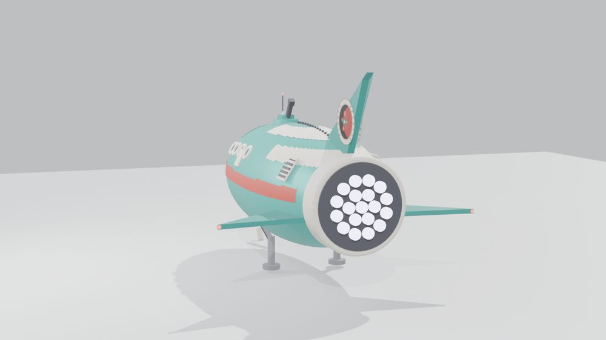
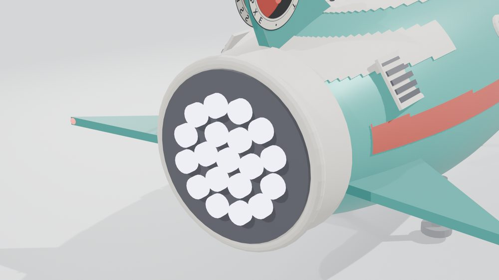
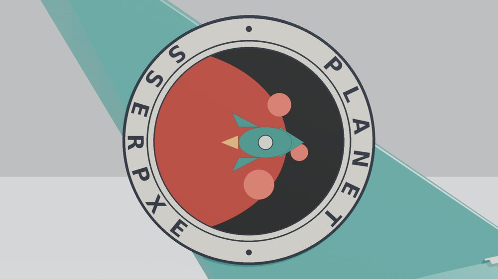
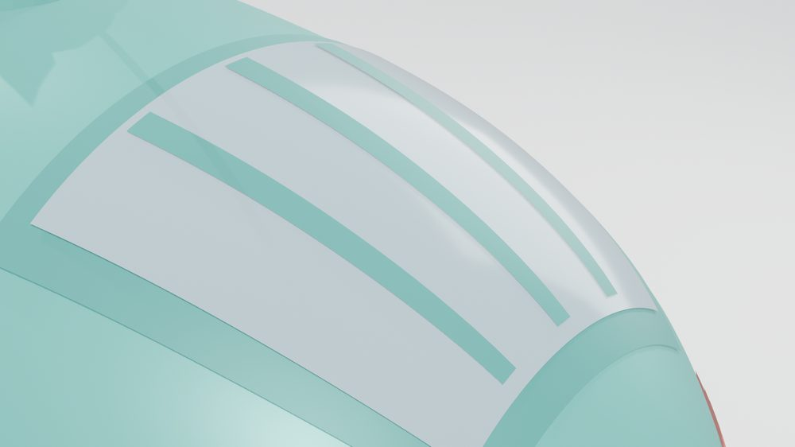
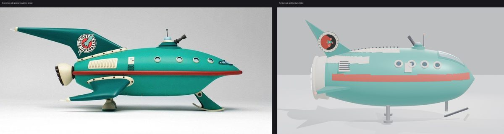
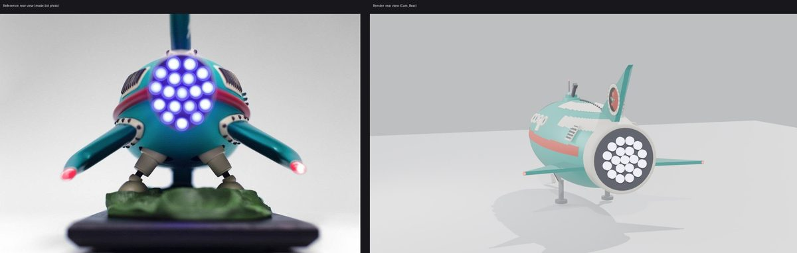
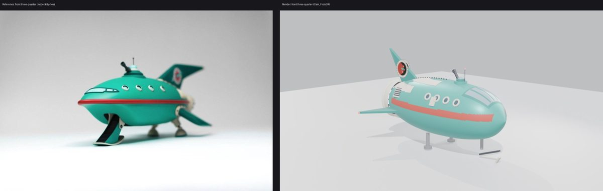

# Planet Express Ship

A Planet Express ship (Futurama) built by Muse entirely in code with Blender's Python API from five photos of a physical model kit. This is the first pass, after 1 render-vs-reference comparison round from matched cameras. It is an interpretive model, not a scan.

**Interactive viewer:** [open the viewer](https://nikbearbrown.github.io/csye-7270-building-virtual-environments/blender/planet-express-ship-muse/) (GitHub Pages) · [htmlpreview fallback](https://htmlpreview.github.io/?https://github.com/nikbearbrown/csye-7270-building-virtual-environments/raw/main/blender/planet-express-ship-muse/index.html) · or download [`index.html`](https://github.com/nikbearbrown/csye-7270-building-virtual-environments/raw/main/blender/planet-express-ship-muse/index.html) and open it locally; it is self-contained.

## Stats

- **Mesh objects:** 96
- **Triangles:** 51,416 (evaluated, modifiers applied)
- **Materials:** 11 (HullTeal, StripeRed, Cream, Glass, DarkGlass, DarkTeal, DarkMetal, MetalGray, LogoMat, ThrusterGlow, TipGlow)
- **Dimensions:** 5.54 × 7.62 × 4.60 Blender units (nose +Y, up +Z); the fin logo texture is packed in the .blend
- **Built with:** Blender 4.2.3 LTS, headless, EEVEE

## Views

### Hero, front three-quarter

The ship from the front three-quarter: teal hull, red cheatline, portholes, cockpit glass, fin with the Planet Express roundel, and the landing gear.

Full size: [renders/hero.png](renders/hero.png)

### Side

The side profile: the cheatline stripe running the length of the hull, the porthole row, the tail fin and the engine pod.

Full size: [renders/side.png](renders/side.png)

### Front three-quarter

The nose and cockpit: wraparound glass with mullions, roof dome, periscope and antenna.

Full size: [renders/front34.png](renders/front34.png)

### Rear

The business end: cream engine pod, dark face, 19 glowing thruster cells, and the fin rising above.

Full size: [renders/rear.png](renders/rear.png)

### Detail: engine cluster

Close-up of the rear engine: the 19 glowing thruster cells in the dark face, the cream rim, and the side strake with its red tip light.

Full size: [renders/detail_engine.png](renders/detail_engine.png)

### Detail: fin logo

Close-up of the tail-fin roundel: the Pillow-generated PLANET EXPRESS decal with the red planet and rocket.

Full size: [renders/detail_logo.png](renders/detail_logo.png)

### Detail: cockpit

Close-up of the nose: the wraparound cockpit glass, frame, mullions, dome and periscope.

Full size: [renders/detail_cockpit.png](renders/detail_cockpit.png)

## Compare with references

Left: model-kit reference photo (comparison only). Right: Muse render, final round. The reference photos are of a physical Planet Express model kit, shown for comparison only.

### Side (Muse: 6/10)

The profile tracks the kit well — stripe, portholes, fin and engine pod all land in the right places. But the kit's fin sweeps much farther back, its stripe is a deeper red, and the model's spine trim reads as a draped sheet where the kit has paneled plating.

Full size: [compare/side_compare.jpg](compare/side_compare.jpg)

### Rear (Muse: 7/10)

The closest view. The glowing thruster cluster, cream pod and rising fin all read correctly against the kit photo; the model's cells glow white where the kit's glow blue-purple, and the kit sits on a display stand the model does not have.

Full size: [compare/rear_compare.jpg](compare/rear_compare.jpg)

### Front three-quarter (Muse: 6/10)

The cockpit glass, dome and periscope match up, but the model's nose is blunter and the hull a touch blimp-like next to the kit's sharper teardrop.

Full size: [compare/front34_compare.jpg](compare/front34_compare.jpg)

## Muse's assessment and human review

**Muse's assessment:** Close on features, about 6 out of 10 for likeness: side 6/10, rear 7/10, front three-quarter 6/10. Anyone who knows the ship would recognise it instantly, but the stripe colour, the draped spine trim and the stubbier fin keep it from passing as the kit.

**Human review:** by Professor Bear (verdict pending).

## Built by

- **Builder:** Muse (Muse Spark).
- **Method:** Model generated entirely by Blender Python scripts written and run headless by Muse, with 1 render-vs-reference comparison round from matched cameras. The fin logo texture was generated with Pillow and packed into the .blend.
- **Tools:** Blender 4.2.3 LTS (EEVEE, CPU). Python with Pillow for the logo texture and comparison images.
- **Human review:** Professor Bear (verdict pending).
- **Build date:** October 18, 2026.

## Film

<!-- FILM_URL: paste the companion film link on the next line, replacing "coming soon" (also set FILM_URL at the top of the script in index.html). -->
**Companion film: coming soon.**

## Download

Click a file name to download it directly. To get everything, clone the repo or use [Code → Download ZIP](https://github.com/nikbearbrown/csye-7270-building-virtual-environments/archive/refs/heads/main.zip).

| File | Size | What it is |
|---|---|---|
| [`planet-express-ship.blend`](https://github.com/nikbearbrown/csye-7270-building-virtual-environments/raw/main/blender/planet-express-ship-muse/planet-express-ship.blend) | 4.8 MB | Blender scene: final model, studio lights and the 7 fixed comparison cameras. Logo texture packed. |
| [`planet-express-ship.glb`](https://github.com/nikbearbrown/csye-7270-building-virtual-environments/raw/main/blender/planet-express-ship-muse/planet-express-ship.glb) | 1.4 MB | glTF binary of the ship, modifiers applied, flat PBR colours plus the embedded fin-logo texture. |
| [`BUILD_NOTES.md`](https://github.com/nikbearbrown/csye-7270-building-virtual-environments/raw/main/blender/planet-express-ship-muse/BUILD_NOTES.md) | 3.0 KB | Full technical record: audit counts, method, comparison rounds, known limitations. |
| [`scripts/planet_express.py`](https://github.com/nikbearbrown/csye-7270-building-virtual-environments/raw/main/blender/planet-express-ship-muse/scripts/planet_express.py) | 22 KB | The Blender Python script that builds the whole model. |
| [`scripts/gen_logo.py`](https://github.com/nikbearbrown/csye-7270-building-virtual-environments/raw/main/blender/planet-express-ship-muse/scripts/gen_logo.py) | 3.4 KB | Generates the circular PLANET EXPRESS fin decal with Pillow. |

## How to import into Blender

Open `planet-express-ship.blend` in Blender 4.2 or later — everything (model, materials, lights, cameras) is in the scene. Or use File > Import > glTF 2.0 for the `.glb`.

## Viewer

[Open the interactive viewer](https://nikbearbrown.github.io/csye-7270-building-virtual-environments/blender/planet-express-ship-muse/) (GitHub Pages), or the [htmlpreview fallback](https://htmlpreview.github.io/?https://github.com/nikbearbrown/csye-7270-building-virtual-environments/raw/main/blender/planet-express-ship-muse/index.html).

## Honest limitations

- The red cheatline renders salmon-pink under the studio lights; the kit's stripe is a deeper red.
- The cream spine trim looks like a draped sheet rather than paneled plating.
- The tail fin is stubbier and sweeps less far back than the kit's long fin.
- The hull reads slightly blimp-like next to the kit's sharper teardrop.
- The thruster cells glow white; the kit's glow blue-purple.
- The kit sits on a display stand; the model has simplified tricycle landing gear instead.
- The fin logo is a flat decal, not raised paint. No interior; the cockpit glass is opaque.
