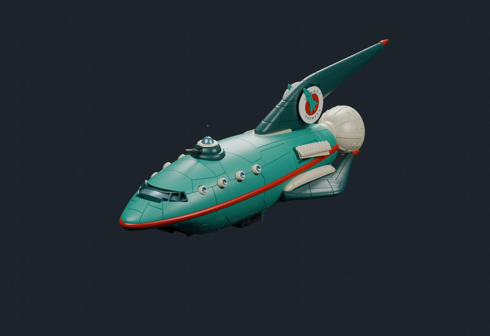
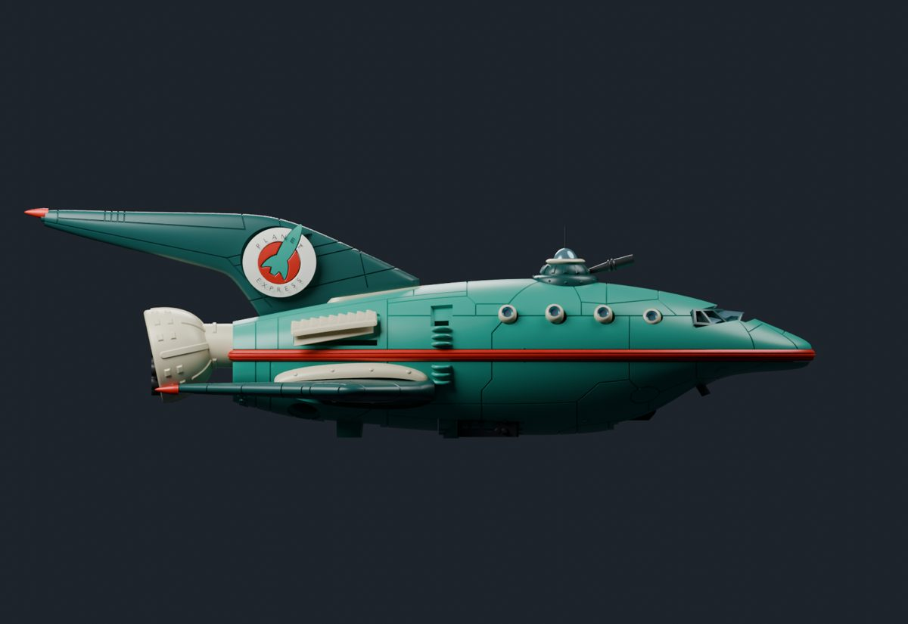
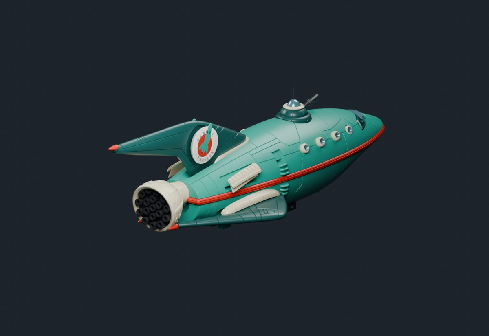
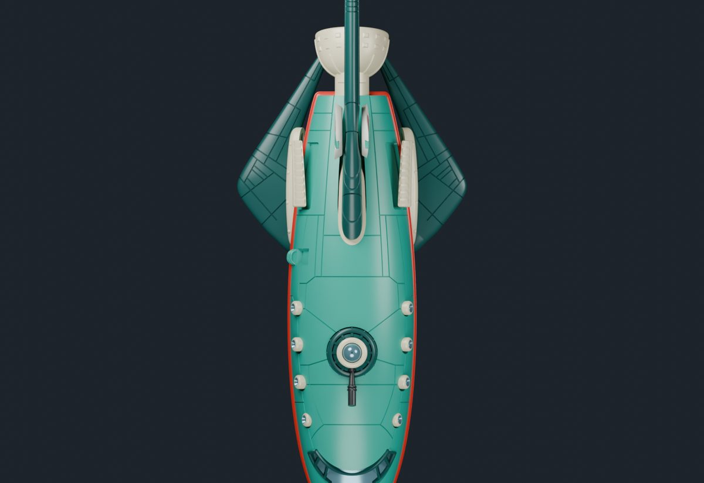
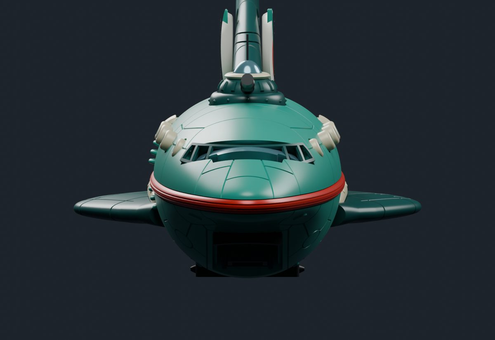
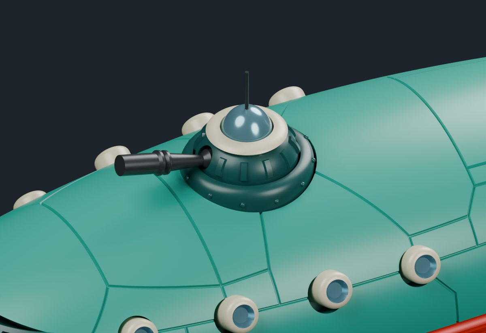
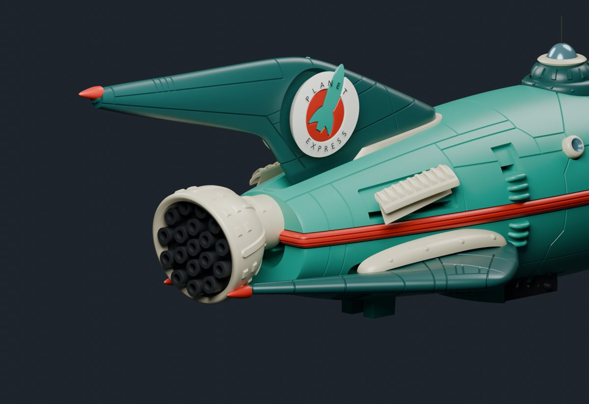
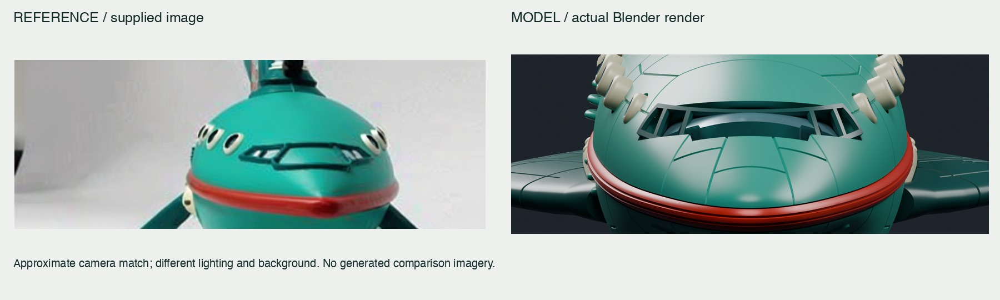
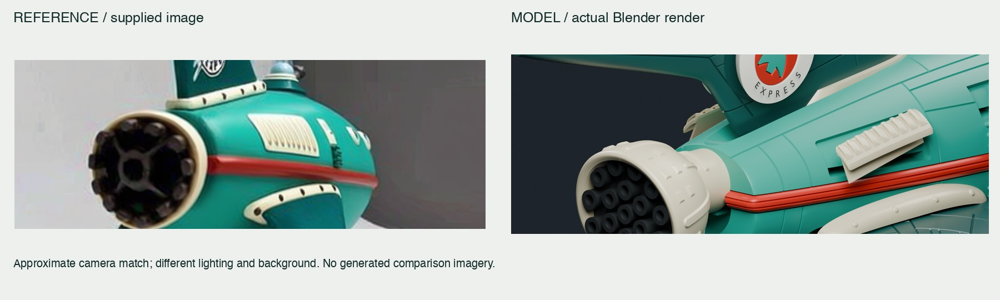
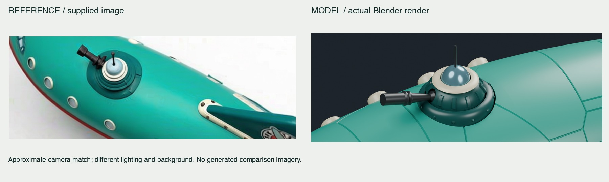

# Planet Express — STL assembly

GOODesign’s Planet Express kit assembled and colored by Codex from 26 supplied STL files and 12 reference images.

70 visible meshes · 694,382 triangles · 7 materials · 91.39 × 243.94 × 70.97 mm (X/Y/Z) · Blender 4.2.0 · Codex

## Forward quarter

The assembled STL kit in turquoise, dark teal, ivory and red.

[Full-size render](renders/hero.png)

## Side profile

A side view of the long dorsal fin, engine bell and hull proportions.

[Full-size render](renders/port.png)

## Rear quarter

The engine nozzle cluster and fitted aft components.

[Full-size render](renders/rear.png)

## Top view

The wing arrangement, turret and closed flight configuration.

[Full-size render](renders/top.png)

## Front view

The cockpit frame, projecting portholes and red hull trim.

[Full-size render](renders/front.png)

## Turret detail

The assembled cannon, blue dome and added antenna.

[Full-size render](renders/turret.png)

## Engine detail

The original kit engine geometry with ivory and graphite materials.

[Full-size render](renders/engine.png)

## Reference comparisons

Supplied reference pixels at left, actual Blender renders at right. Camera match is approximate; lighting and backgrounds differ. No comparison image was synthesized.

### Front comparison

The kit has deeper panel grooves, more prominent portholes and a different cockpit shape.

[Full-size comparison](compare/front-comparison.jpg)

### Rear comparison

The kit engine has more nozzle openings, while the vent and trim seating remain approximate.

[Full-size comparison](compare/rear-comparison.jpg)

### Turret comparison

The kit turret and folded cannon differ from the smooth reference; the thin antenna was added.

[Full-size comparison](compare/turret-comparison.jpg)

## Film

Companion film: coming soon
<!-- FILM_URL -->

## Downloads

| File | Size | Purpose | Download |
|---|---:|---|---|
| planet-express-ship.blend | 15.27 MiB | Editable scene, materials, lights, cameras and hidden accessories | [Download](https://github.com/nikbearbrown/csye-7270-building-virtual-environments/raw/main/blender/planet-express-stl-codex/planet-express-ship.blend) |
| planet-express-ship.glb | 14.57 MiB | Static flight assembly with flat PBR colors | [Download](https://github.com/nikbearbrown/csye-7270-building-virtual-environments/raw/main/blender/planet-express-stl-codex/planet-express-ship.glb) |
| index.html | 0.74 MiB | Self-contained offline rendered-view gallery | [Download](https://github.com/nikbearbrown/csye-7270-building-virtual-environments/raw/main/blender/planet-express-stl-codex/index.html) |

## Import

Open `planet-express-ship.blend` in Blender 4.2 or later. For the GLB use **File → Import → glTF 2.0**. Independent reopening and reimport in Blender 4.2.0 confirmed matching mesh counts, triangle counts, material counts and dimensions.

The GLB contains 7 flat PBR materials and no image textures. Panel grooves, emblems and lettering are mesh geometry and survive export. Cameras, studio lights, world and render settings are excluded. GLB units are meters; the native scene displays millimeters. The master transform supports rigid placement only.

## Viewer

[GitHub Pages viewer](https://nikbearbrown.github.io/csye-7270-building-virtual-environments/blender/planet-express-stl-codex/) · [HTML preview fallback](https://htmlpreview.github.io/?https://github.com/nikbearbrown/csye-7270-building-virtual-environments/raw/main/blender/planet-express-stl-codex/index.html)

Download `index.html` to use the gallery offline. It shows rendered views, not live 3D orbit controls. Model downloads require connectivity. GitHub Pages availability is separate from this delivery.

## Built by

Builder: Codex, for Nik Bear Brown. Original mesh geometry: GOODesign / GOODesignLabs. Method: scripted STL assembly and material assignment through the Blender MCP add-on socket bridge, with added antenna and mesh lettering; 3 documented comparison rounds. Tools: Blender 4.2.0, MCP add-on bl_info 1.7 / protocol 11, Python 3.14.6, Pillow 12.3.0. Build date: 2026-10-20 (America/New_York). Human review: Professor Bear — pending.

Original kit: GOODesign / GOODesignLabs, Planet Express Ship – FUTURAMA. Reference images supplied by Nik Bear Brown. This is an assembly study of that kit, not original geometry authored entirely by Codex or an official Futurama asset.

[Creator listing](https://thangs.com/designer/GOODesign/3d-model/Planet%20Express%20Ship%20-%20FUTURAMA-1510142) · [Creator assembly video](https://www.youtube.com/watch?v=Jqm8zHlQoqY)

## Limitations and human review

This is a static flight assembly of the supplied kit, with approximate fitting of several parts. The creator confirms that the engraved panel lines are intentional kit details. Its long fins, cockpit and multi-nozzle engine still differ visibly from the smoother reference ship. The physical kit is designed for folding stairs, an opening hangar and a rotating turret; these motions have not been implemented or validated in this digital assembly. The vents and portholes protrude more, and some trim and canopy seams remain imperfect. It is recognizable as Planet Express, but is not an exact match to the reference. Twelve accessory meshes, including unused landing and stand parts, remain hidden in the native scene and are excluded from the GLB. No mechanism rig, animation, collision mesh, LOD or print-fit certification is included. Human review: Professor Bear — pending.

[Build notes](BUILD_NOTES.md) · [Statistics](audit.json) · [File verification](verification.json)
