# SEIS Bot (v4)

SEIS Bot is an armoured humanoid robot with a white 6 on the chest and a worn, distressed finish, built by Grok Bot entirely in code with Blender's Python API from AI-generated reference images. This is version 4 of 4: v4 refined the face and the shoulders on top of v3. It is an interpretive model, not a scan.

**Interactive viewer:** [open the viewer](https://nikbearbrown.github.io/csye-7270-building-virtual-environments/blender/seis-bot-grok/) (GitHub Pages) · [htmlpreview fallback](https://htmlpreview.github.io/?https://github.com/nikbearbrown/csye-7270-building-virtual-environments/raw/main/blender/seis-bot-grok/index.html) · or download [`index.html`](https://github.com/nikbearbrown/csye-7270-building-virtual-environments/raw/main/blender/seis-bot-grok/index.html) and open it locally; it is self-contained.

## Stats

- **Meshes:** 1,179 separately named mesh parts
- **Triangles:** 1,481,252 (same in both poses)
- **Rig:** 50-bone FK armature including finger and thumb bones; parts are rigidly bone-parented
- **Size:** 2.21 m tall standing; metric units, Z up, front is -Y
- **Materials:** 14 procedural materials plus the plinth stone, with a distressed finish (edge wear, scratches, grime, dents, chipped paint)
- **Audit:** PASS for both .blend files (naming, materials, non-manifold, zero-area faces, parenting)
- **Built with:** Blender 4.2.3, headless, Cycles CPU

## Views

### Front, seated (Thinker)

The Thinker pose on the stepped stone plinth, seen straight on: the overall silhouette, the colour scheme and the white 6.

Full size: [renders/02_seated_front.png](renders/02_seated_front.png)

### Three-quarter, seated

The seated pose from the front three-quarter, showing how the shoulder hoods and chest plates wrap the torso.

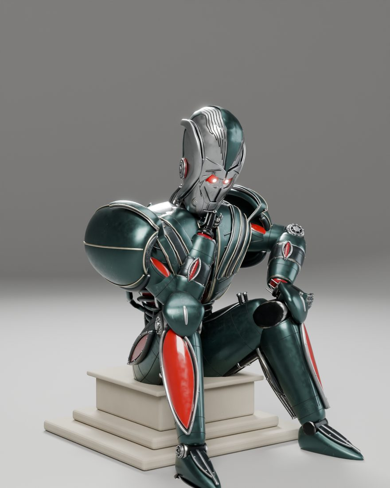

Full size: [renders/03_seated_three_quarter.png](renders/03_seated_three_quarter.png)

### Side, seated

The seated pose in profile: the forward lean of the Thinker pose, the outer shoulder hood and the leg armour.

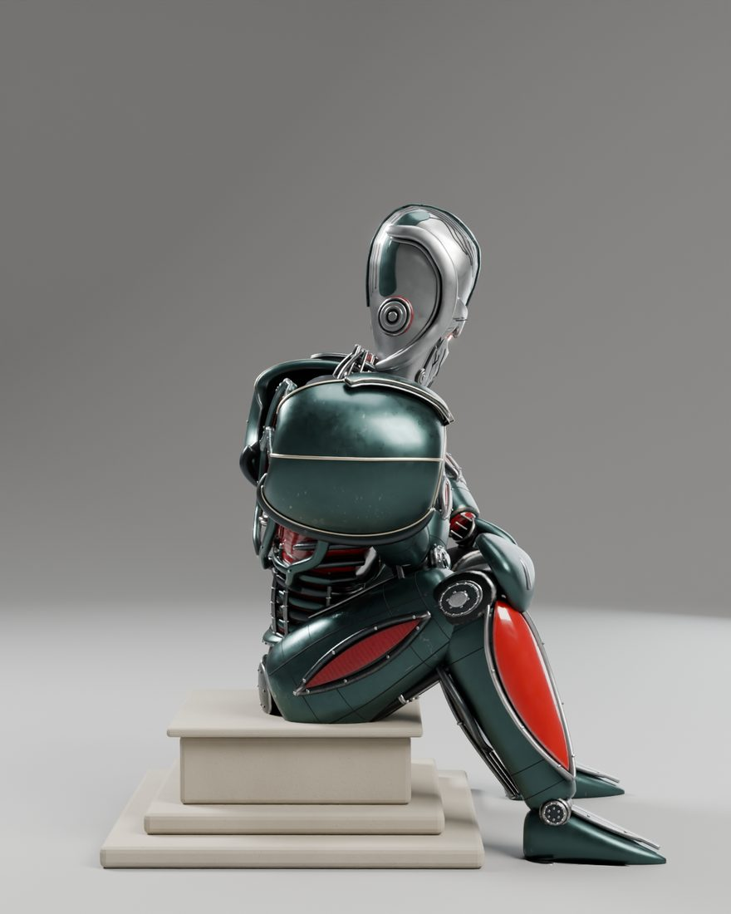

Full size: [renders/04_seated_side.png](renders/04_seated_side.png)

### Back three-quarter, seated

The seated robot from behind, showing the back of the torso and shoulder hoods.

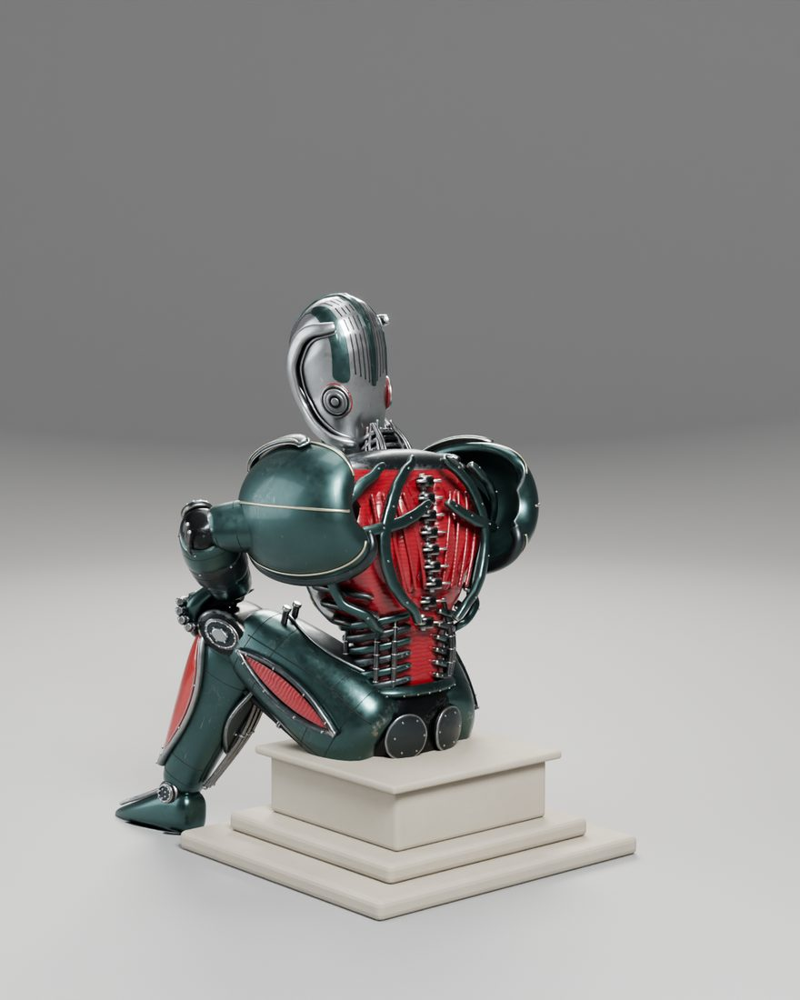

Full size: [renders/05_seated_back_three_quarter.png](renders/05_seated_back_three_quarter.png)

### Front, standing

The standing pose straight on, showing the full 2.21 m height and the leg armour.

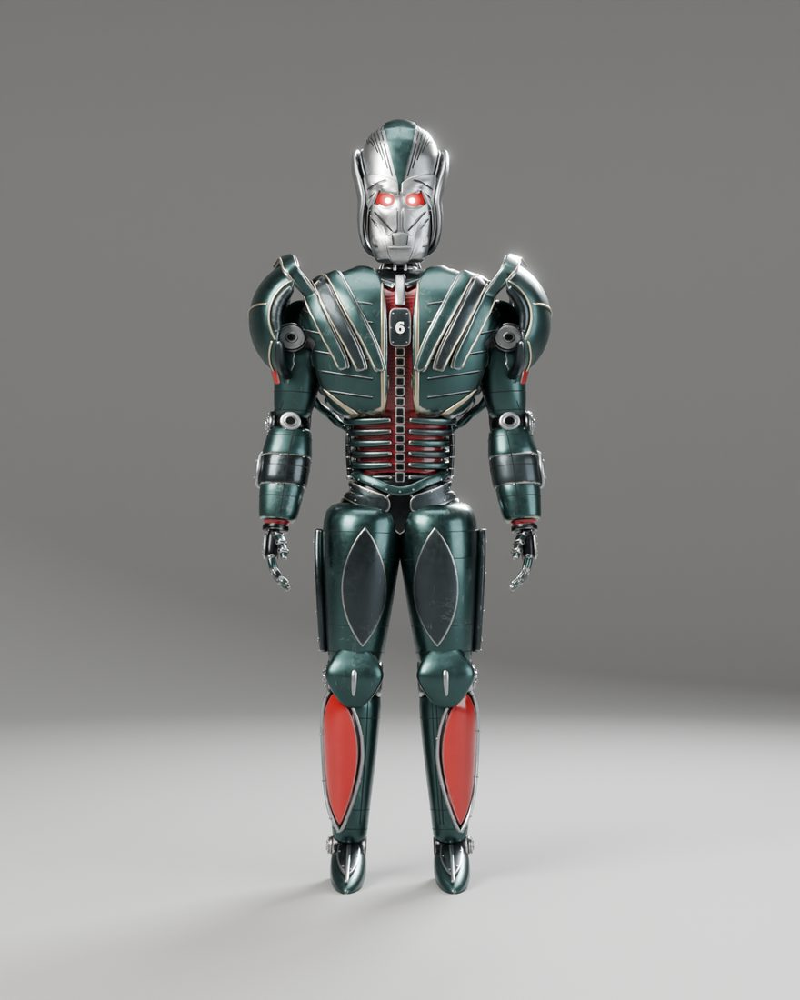

Full size: [renders/06_standing_front.png](renders/06_standing_front.png)

### Three-quarter, standing

The standing pose from the front three-quarter.

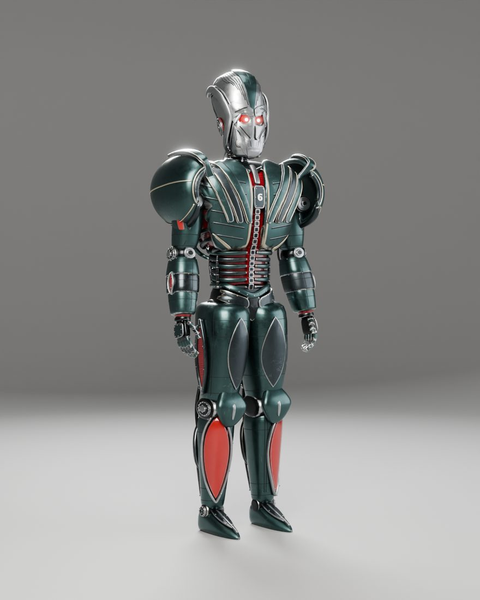

Full size: [renders/07_standing_three_quarter.png](renders/07_standing_three_quarter.png)

### Head close-up, front

The v4 face: layered silver plates with dark gaps, sweeping grooves, glowing red eyes and a square jaw. A human reviewer judged this face badly off (see Limitations).

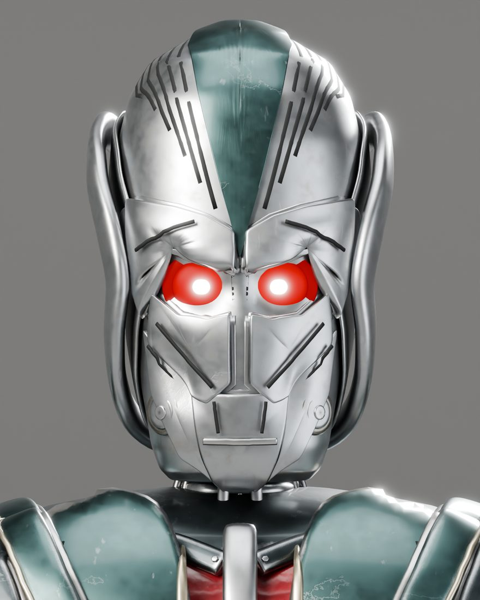

Full size: [renders/08_head_closeup_front.png](renders/08_head_closeup_front.png)

### Head close-up, side

The head in profile, with the C-frames standing off the skull and the round hinge discs at the jaw.

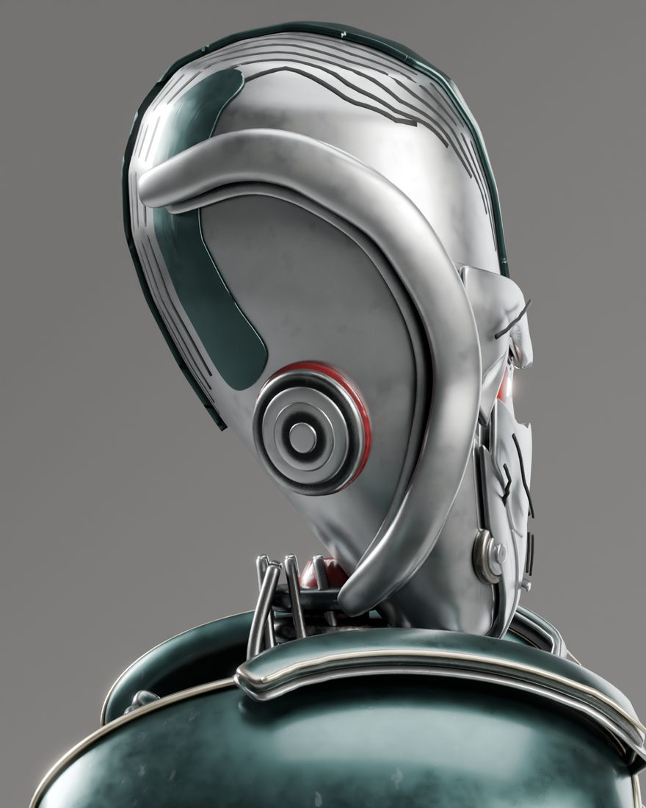

Full size: [renders/09_head_closeup_side.png](renders/09_head_closeup_side.png)

### Chest 6 close-up

The white 6 on the sternum plate and the distressed finish: edge wear, scratches, grime and chipped paint.

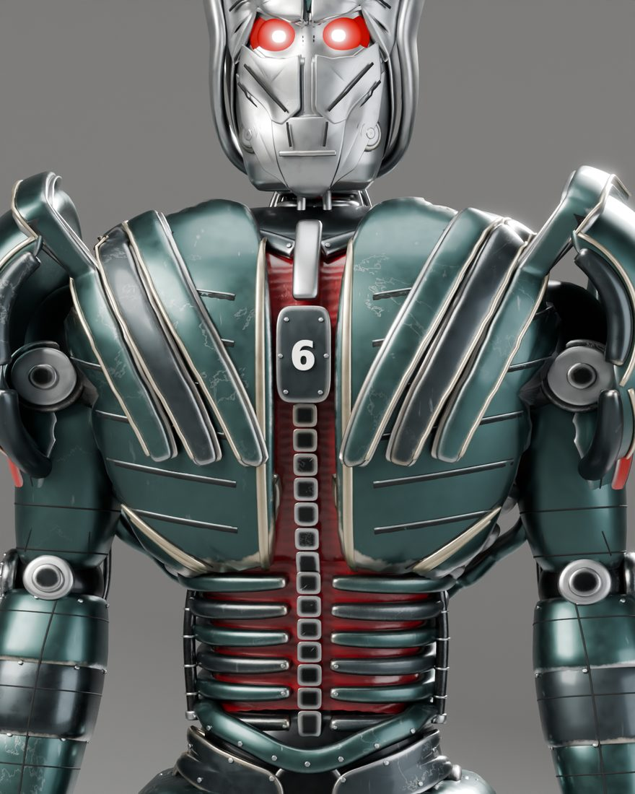

Full size: [renders/10_chest_six_closeup.png](renders/10_chest_six_closeup.png)

### Shoulder close-up, three-quarter

The v4 shoulder hood with its rolled lip and bronze trims, and the inner arcs running onto the chest plates.

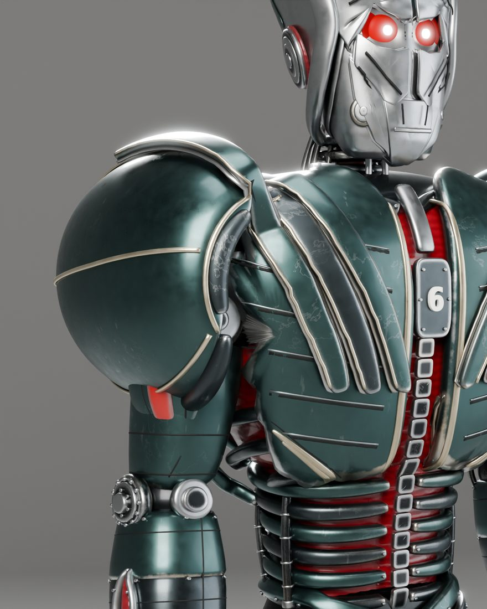

Full size: [renders/12_shoulder_three_quarter.png](renders/12_shoulder_three_quarter.png)

## Compare with references

Left: Grok Bot v4 render. Right: reference image.

### Head, front

Grok Bot render (left) and the reference (right). Grok Bot called this face "fairly close" from a feature checklist; the human reviewer called it the least close part of the model.

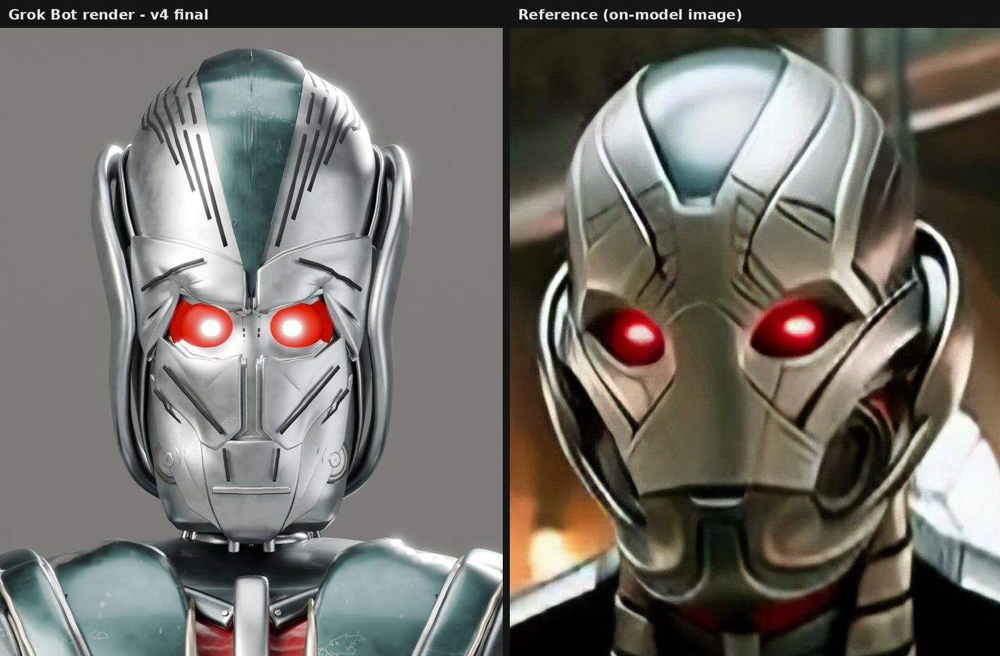

Full size: [compare/v4final_HeadFront.png](compare/v4final_HeadFront.png)

### Head, side

The head in profile next to the reference. The camera angles of this pair are not perfectly matched.

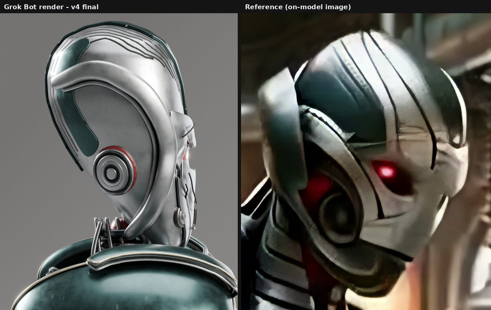

Full size: [compare/v4final_HeadSide.png](compare/v4final_HeadSide.png)

### Seated front

The full seated pose next to the reference. Silhouette, colours and the chest 6 are the closest match.

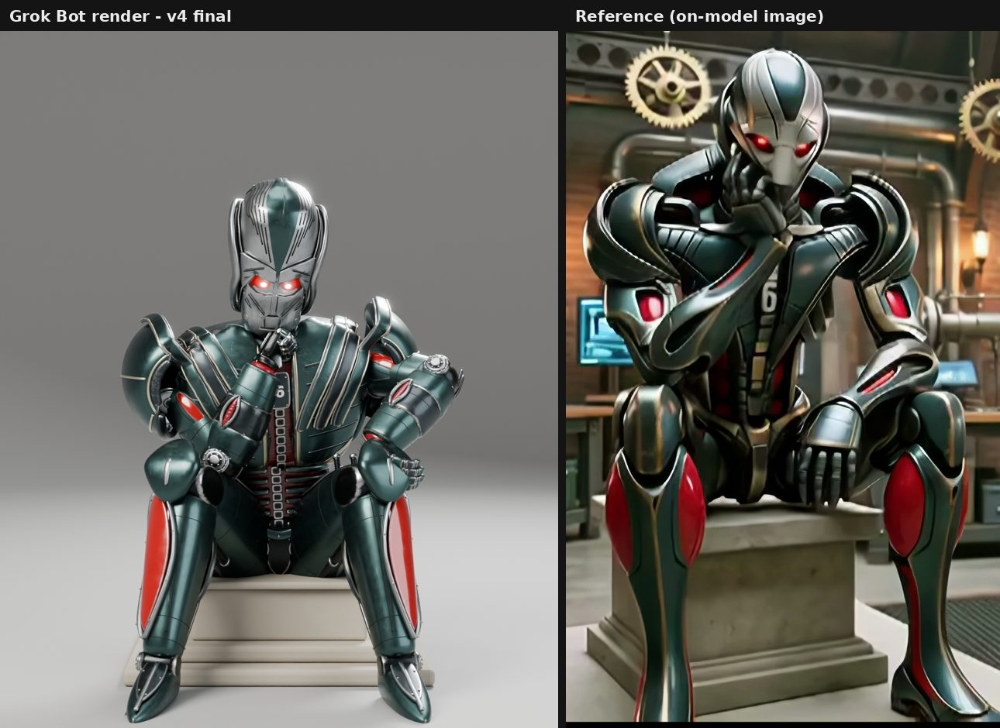

Full size: [compare/v4final_SeatedFront.png](compare/v4final_SeatedFront.png)

### Shoulder, three-quarter

The reference shoulder is a long, sculpted, overlapping shell; the v4 hood still reads as a round dome, and the inner arcs are flat bands.

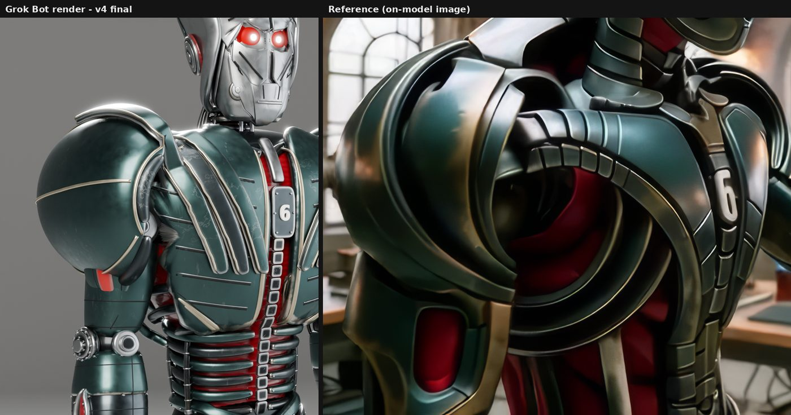

Full size: [compare/v4final_Shoulder34.png](compare/v4final_Shoulder34.png)

## Grok Bot's assessment and human review

**Grok Bot's assessment:** Moderately close overall: a recognisable cousin of the robot in the references rather than the same robot. Close on silhouette, proportions, colour scheme, the white 6, the red eyes, the seated pose and the worn finish. "Fairly close" on the face after v4. Not close on the shoulders and chest armour, the hands and much of the fine mechanical detail.

**Human review (Professor Bear):** The face is badly off, and the least close part of the model: "it looks like somebody took a grape and pinched it with their thumbs." Grok Bot judged the face by a checklist of features and missed how it feels. That gap is why a human needs to stay in the loop. Look at the comparisons and judge for yourself.

## Built by

- **Builder:** Grok Bot, an autonomous desktop assistant agent with its own Linux computer. Version: not exposed by the app.
- **Method:** Model generated entirely by Blender Python scripts written and run headless by Grok Bot, with iterative render-vs-reference comparison rounds.
- **Tools:** Blender 4.2.3 LTS (Cycles, CPU). Python with Pillow and NumPy for the comparison images; Intel Open Image Denoise in Cycles; Draco compression for the GLB.
- **Human review:** Professor Bear (verdict: the face is badly off; see the assessment above).
- **Build date:** October 2026. Fixed-camera render-vs-reference comparison rounds across versions: v2 rounds 1–17, v3 rounds 1–26 and v4 rounds 1–5 (from the saved comparison images and PROGRESS logs). v1 had no fixed comparison cameras.

## Download

Click a file name to download it directly. To get everything, clone the repo or use [Code → Download ZIP](https://github.com/nikbearbrown/csye-7270-building-virtual-environments/archive/refs/heads/main.zip).

| File | Size | What it is |
|---|---|---|
| [`robot_seated.blend`](https://github.com/nikbearbrown/csye-7270-building-virtual-environments/raw/main/blender/seis-bot-grok/robot_seated.blend) | 25.3 MB | Blender scene in the seated Thinker pose on the stone plinth, with materials, lights and comparison cameras. |
| [`robot_standing.blend`](https://github.com/nikbearbrown/csye-7270-building-virtual-environments/raw/main/blender/seis-bot-grok/robot_standing.blend) | 25.3 MB | Blender scene in the standing pose, no plinth. |
| [`robot_v4.glb`](https://github.com/nikbearbrown/csye-7270-building-virtual-environments/raw/main/blender/seis-bot-grok/robot_v4.glb) | 4.1 MB | glTF binary for game engines and web viewers: full geometry, 50-joint skinned rig, Standing and Thinker actions, Draco compressed, flat PBR colours. |
| [`BUILD_NOTES.md`](https://github.com/nikbearbrown/csye-7270-building-virtual-environments/raw/main/blender/seis-bot-grok/BUILD_NOTES.md) | 6 KB | Full technical record: what changed in v4, counts, materials, scripts, limitations. |
| [`scripts/build_v4.py`](https://github.com/nikbearbrown/csye-7270-building-virtual-environments/raw/main/blender/seis-bot-grok/scripts/build_v4.py) | 64 KB | The main build script that generates the whole model (about 40 s headless). |
| [`scripts/lib.py`](https://github.com/nikbearbrown/csye-7270-building-virtual-environments/raw/main/blender/seis-bot-grok/scripts/lib.py) | 17 KB | Shared geometry helpers used by the build. |
| [`scripts/materials.py`](https://github.com/nikbearbrown/csye-7270-building-virtual-environments/raw/main/blender/seis-bot-grok/scripts/materials.py) | 13 KB | The procedural distressed materials. |
| [`scripts/poses.py`](https://github.com/nikbearbrown/csye-7270-building-virtual-environments/raw/main/blender/seis-bot-grok/scripts/poses.py) | 7 KB | The standing and Thinker poses (FK, with IK baked to FK). |
| [`scripts/audit.py`](https://github.com/nikbearbrown/csye-7270-building-virtual-environments/raw/main/blender/seis-bot-grok/scripts/audit.py) | 3 KB | The audit: naming, materials, non-manifold edges, zero-area faces, parenting. |
| [`scripts/export_glb.py`](https://github.com/nikbearbrown/csye-7270-building-virtual-environments/raw/main/blender/seis-bot-grok/scripts/export_glb.py) | 2 KB | GLB export. |

The `scripts/` folder also has the render, compare, bake, export and test helpers (`render.py`, `compare.py`, `bake.py`, `export_flat.py`, `save_variants.py`, `glbinfo.py`, `eye_test.py`, `pose_test.py`) and the previous version's `build_v3.py`.

## How to import into Blender

1. **Native scene:** install Blender 4.2 or later and open the `.blend` file with **File → Open**. You get the model with its procedural materials, lights and comparison cameras.
2. **GLB:** in any Blender version with the glTF add-on (enabled by default), use **File → Import → glTF 2.0 (.glb/.gltf)** and pick the `.glb`. The GLB also works in game engines and web viewers.

The GLB carries **flat colours only** (base colour, metallic/roughness, emissive eyes). The worn finish and panel detail are procedural shaders that exist only in the `.blend` files and the renders.

## Method

Every part is generated by Python scripts in Blender: primitive and swept shapes, projected face-plate shells with thickness, procedural shader materials and a text-mesh 6. Each round was judged against the reference images from fixed comparison cameras, and v1 to v4 refined the design in turn. The Thinker pose comes from a torso grid search plus two-bone IK baked to FK.

## Honest limitations

- **Face:** judged badly off by the human reviewer (above). The plates are projected shells of uniform thickness, not hand-sculpted forms, and the plate pattern is simpler than the reference.
- **Shoulders:** the hood still reads as a fairly round dome in three-quarter view; the reference hood is a longer, more sculpted curved plate. The inner arcs are swept bands, not overlapping solid shells, and do not continue down the back.
- **Plate gaps** are black strips under the plate edges, not true cut-throughs.
- **GLB:** flat PBR colours only, no baked textures. The distressed finish exists only in the .blend files and renders, and the eye bloom is a compositor effect that a glTF viewer will not show.
- **Mesh count** is 1,179, below the original target of about 1,500.
- **Studio:** plain grey, no environment.

See [BUILD_NOTES.md](BUILD_NOTES.md) for the full technical record.
