# SEIS Bot v005 (Codex rebuild)

*A rebuild of the SEIS bot from Bear's video frames, by Codex. This is Codex's own model, separate from the Grok Bot model in seis-bot-grok.*

`1295 mesh objects in the scene (1287 in the source audit) | 2.35 M triangles (scene count) | 14 materials | 49 bones | 8 cameras | 4 lights | about 1.04 x 0.48 x 2.14 m (source audit; the scene also holds a 200 m ground plane) | Blender 5.1.2`

A heavy, hard-surface humanoid robot in petrol-teal armour with silver/champagne framing, red recessed panels, a centred Lato Bold number 6 on the chest, and red lenses, rebuilt by script from the 18 workshop video frames Bear supplied on 2026-10-18. Cycles with procedural PBR materials, an FK rig for posing, and a separate seated 'thinker' pose study. This folder is the Codex model; the Grok Bot model lives in its own folder (seis-bot-grok) and was not touched.

## Views

### Hero

Three-quarter standing view; the cleanest overall impression of the model.

[Full-size file](renders/hero.jpg)

### Front

Front elevation; the chest plate, centred 6 and red shin panels are visible.

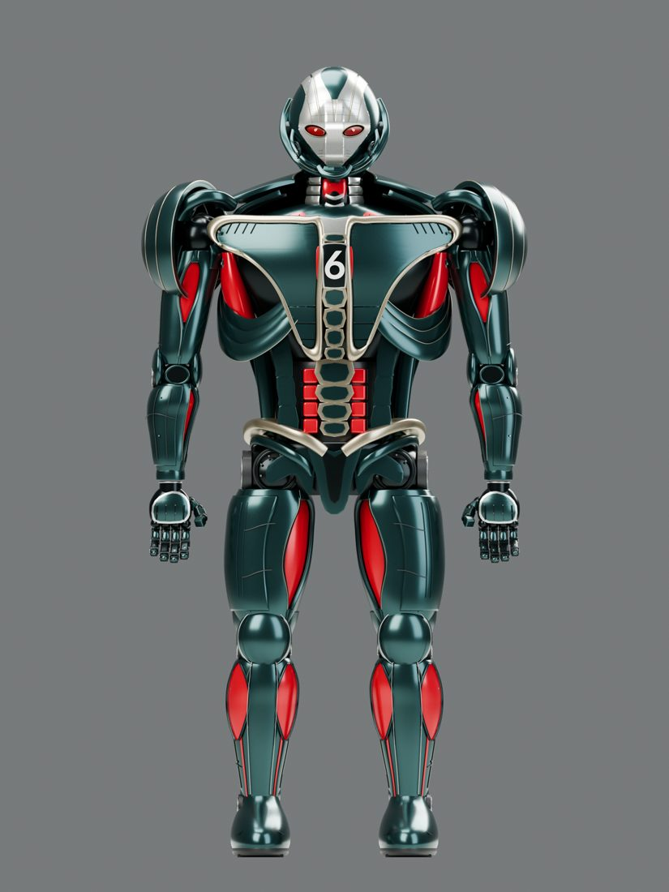

[Full-size file](renders/front.jpg)

### Side

Side elevation; shows the slab-like profile and the very flat shoulder cup.

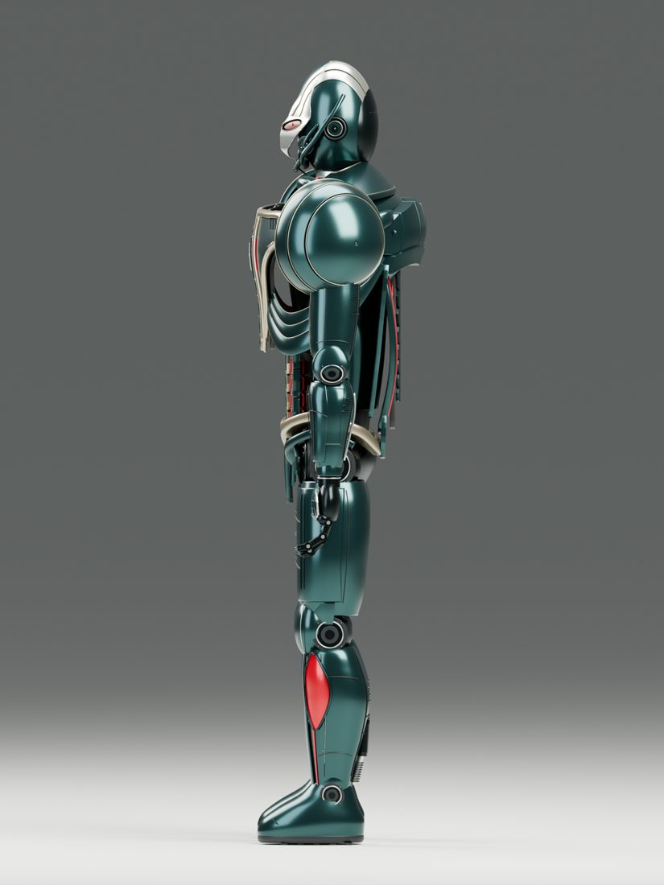

[Full-size file](renders/side.jpg)

### Back

Back view with the red back panels.

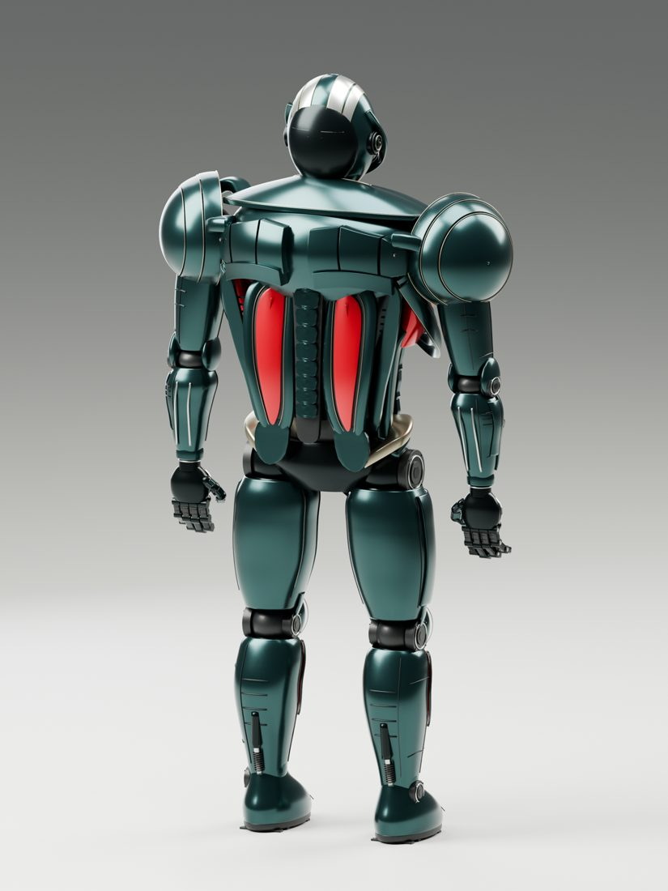

[Full-size file](renders/back.jpg)

### Portrait

Head close-up: silver mask, red lenses, neck rings.

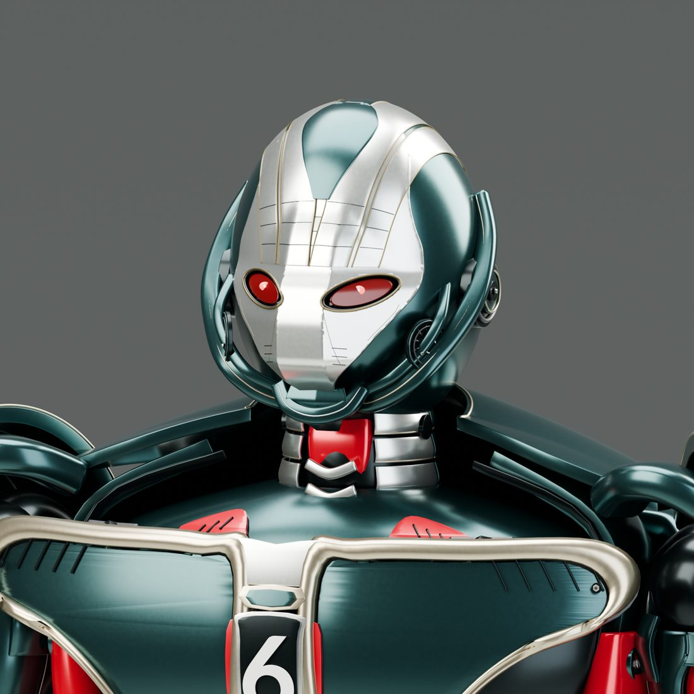

[Full-size file](renders/portrait.jpg)

### Torso detail

Chest plate with the 6, segmented spine plates and abdominal rings.

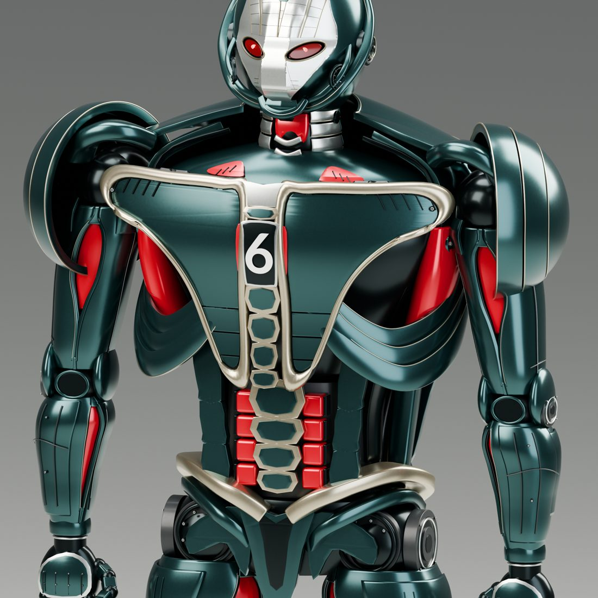

[Full-size file](renders/torso-detail.jpg)

### Hand detail

Back of the hand and finger segments.

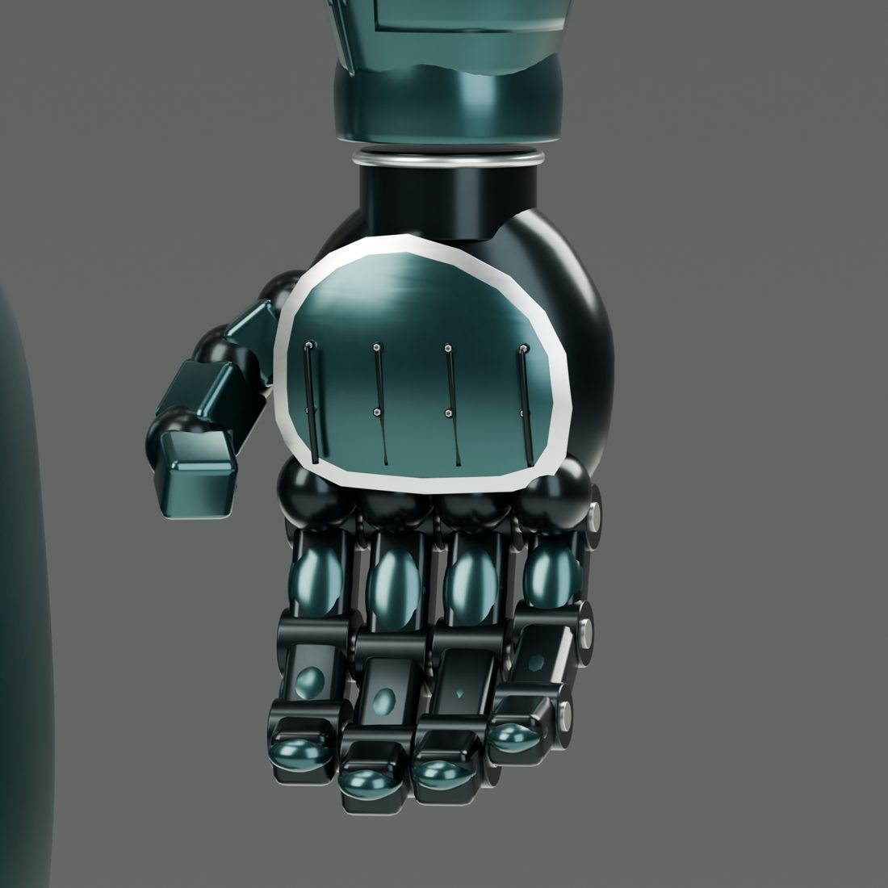

[Full-size file](renders/hand-detail.jpg)

### Back detail

Shoulders and scapular shells from behind.

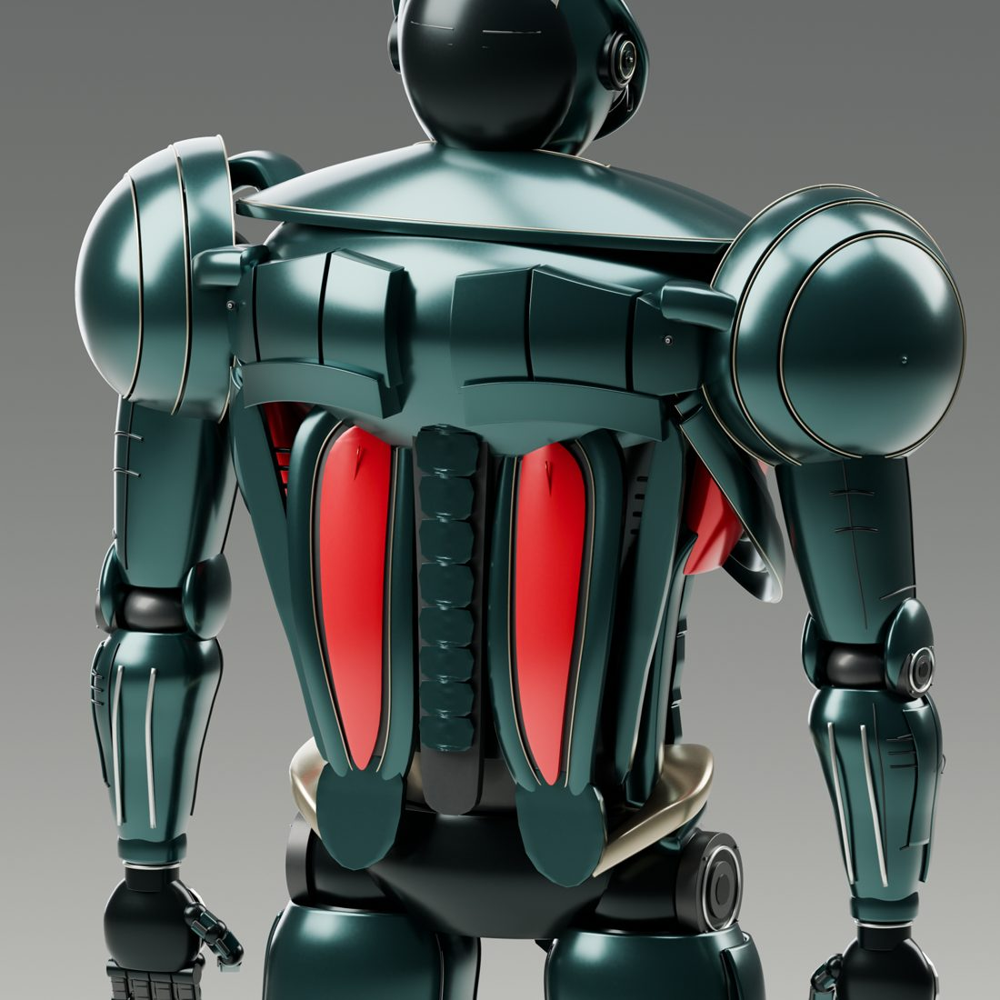

[Full-size file](renders/back-detail.jpg)

### Seated thinker pose

Separate FK pose study (second .blend in the source, pose only; not included here).

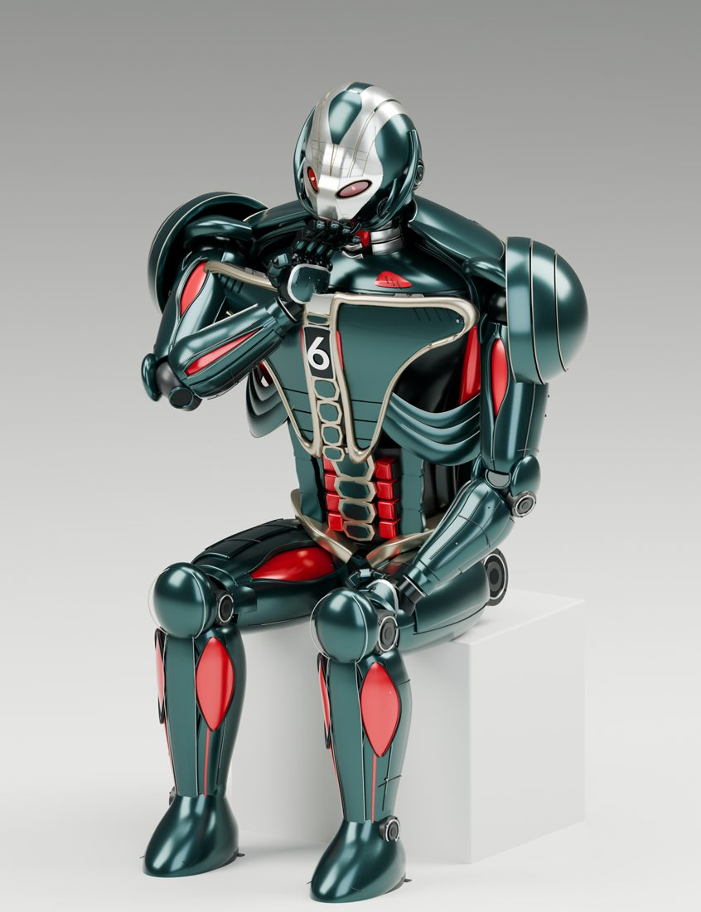

[Full-size file](renders/thinker.jpg)

## Compare with references

### Front: reference 000360 vs front render

Colour family and the centred 6 are right, and the red shin and torso insets are in roughly the right places. The form is not: the reference has a sculpted, enveloping chest and shoulder shell flowing into the arms, while the render is a flat triangular plate on a tube torso with disc shoulders. Also a very different camera: the reference is a close upper-body shot, the render a full-length elevation. Likeness of the overall look: weak.

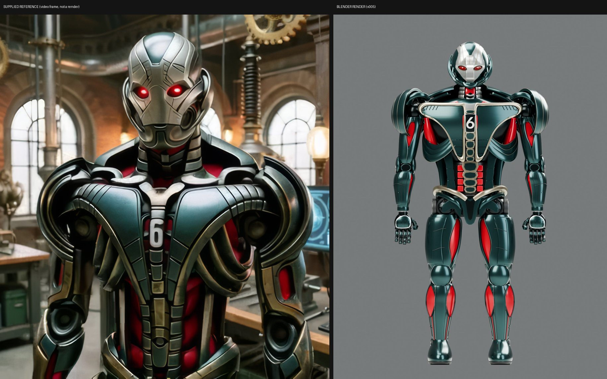

[Full-size file](compare/front.jpg)

### Seated: reference 000000 vs thinker pose

The pose idea (seated, hand to chin, red shin panels) carries over and this is the closest match of the set. Still, the reference is a heavy, layered, bronze-edged cast armour with a pedestal; the render is smooth glossy plastic on a white block, and the arms and shoulders are simpler. Likeness: moderate on pose, weak on surface.

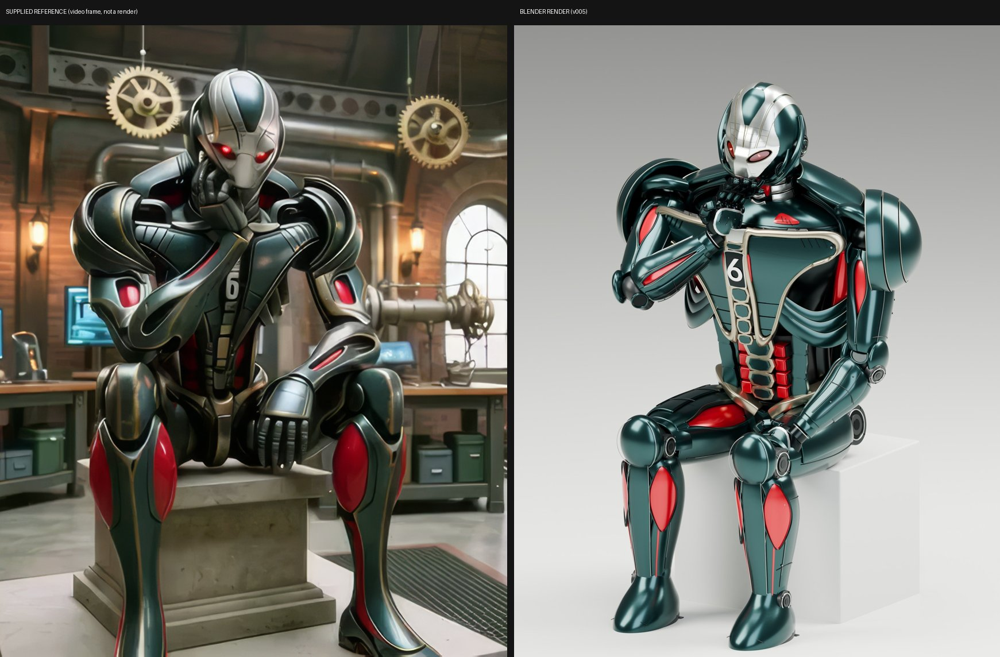

[Full-size file](compare/seated.jpg)

### Chest: reference 000120 vs torso detail

Both show a 6 on a sternum, but this is a poor match. The reference has overlapping curved ribbed shells with gold edging and a dark mechanical chest; the render has a smooth cream-trimmed triangle plate and a clean ladder of rings. Angles and crop also differ (the reference is turned and seated). Likeness: poor.

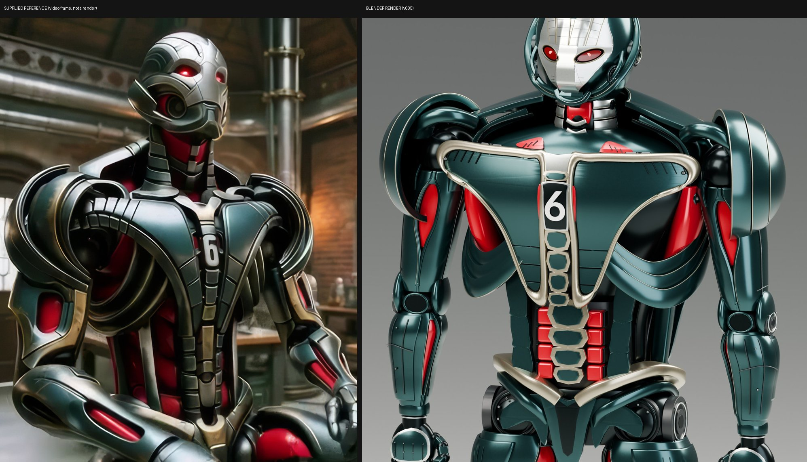

[Full-size file](compare/chest.jpg)

### Profile: reference 000240 vs side render

Not a like-for-like pair: the reference is a three-quarter shot with the arm pointing at a monitor, the render a strict side elevation in a stiff A-pose. It shows what is missing rather than what matches: the reference helmet has ribbed lamellae and a deep shoulder shell that the render lacks, and the render is far thinner front to back. Likeness: poor.

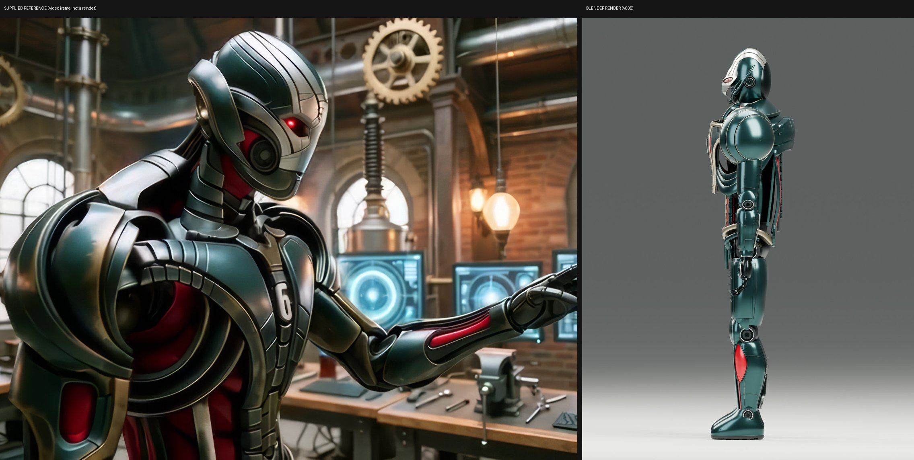

[Full-size file](compare/profile.jpg)

### Hands: reference 000480 vs hand render

The pairing is weak: the reference shows a working hand at a keyboard inside the scene, the render an isolated back-of-hand close-up from above. The render's hand is cleanly articulated with finger segments, but nothing here proves it matches the reference hand. Likeness: cannot be judged from these images, probably loose.

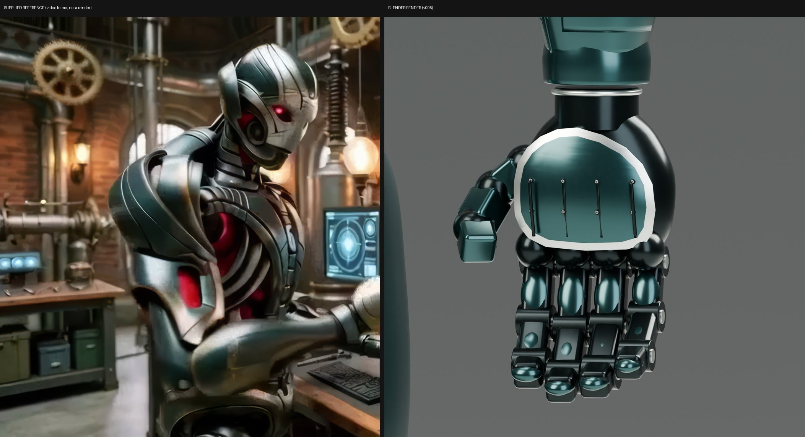

[Full-size file](compare/hands.jpg)

## Film

Companion film: coming soon

<!-- FILM_URL -->

## Download

| File | Size | What it is | Download |
|---|---|---|---|
| `seis-bot-v005-codex.blend` | 21.9 MB | Full scene: model, procedural materials, rig, cameras, lights (Blender 5.1.2) | [download](https://github.com/nikbearbrown/csye-7270-building-virtual-environments/raw/main/blender/seis-bot-v005-codex/seis-bot-v005-codex.blend) |
| `seis-bot-v005-codex.glb` | 61.0 MB | Exported from the .blend for this package: visible meshes + armature, flat base colours only | [download](https://github.com/nikbearbrown/csye-7270-building-virtual-environments/raw/main/blender/seis-bot-v005-codex/seis-bot-v005-codex.glb) |
| `renders/` | 1 KB | Full-size views (JPEG, up to 1600 px); web copies in renders/web/ | [download](https://github.com/nikbearbrown/csye-7270-building-virtual-environments/raw/main/blender/seis-bot-v005-codex/renders/) |
| `compare/` | 1 KB | Five supplied-reference vs render side-by-sides | [download](https://github.com/nikbearbrown/csye-7270-building-virtual-environments/raw/main/blender/seis-bot-v005-codex/compare/) |
| `scripts/` | 1 KB | The Blender scripts that built, posed, rendered and audited the model, plus count/export/page tools | [download](https://github.com/nikbearbrown/csye-7270-building-virtual-environments/raw/main/blender/seis-bot-v005-codex/scripts/) |
| `BUILD_NOTES.md` | 5 KB | Method, provenance, measured counts | [download](https://github.com/nikbearbrown/csye-7270-building-virtual-environments/raw/main/blender/seis-bot-v005-codex/BUILD_NOTES.md) |
| `README.md` | 11 KB | This page | [download](https://github.com/nikbearbrown/csye-7270-building-virtual-environments/raw/main/blender/seis-bot-v005-codex/README.md) |
| `index.html` | 1.6 MB | Self-contained viewer | [download](https://github.com/nikbearbrown/csye-7270-building-virtual-environments/raw/main/blender/seis-bot-v005-codex/index.html) |

## How to import into Blender

- **`.blend`:** open it in Blender 4.2 or later (File > Open). 
- **`.glb`:** in Blender, File > Import > glTF 2.0 (.glb/.gltf), or drop it into a game engine or a web viewer.

## Viewer

A self-contained interactive viewer is in [`index.html`](index.html) (images embedded, works offline once downloaded):

- GitHub Pages: https://nikbearbrown.github.io/csye-7270-building-virtual-environments/blender/seis-bot-v005-codex/ (works once Pages is enabled for the repo)
- Fallback through htmlpreview: https://htmlpreview.github.io/?https://github.com/nikbearbrown/csye-7270-building-virtual-environments/raw/main/blender/seis-bot-v005-codex/index.html

## Built by

- **Builder:** Codex (OpenAI)
- **Method:** Scripted in Blender Python (scripts/build.py plus head, torso, limbs, shoulders, pose, audit modules), rebuilt from Bear's supplied video frames. The source's design report says four integrated on-model rebuilds were rendered and inspected against the frames and repaired; I found no per-round logs, so that count is the source's own claim and I did not verify it. Reference images are not projected onto the model. The builder is identified as Codex from Codex session logs on this machine dated 2026-10-18, not from a label in the source folder.
- **Tools:** Blender 5.1.2 (Cycles, Apple Metal, AgX Medium High Contrast; confirmed by my count_scene.py run and the source's integrity report); Lato font (OFL); Python/Pillow for packaging.
- **Build date:** 2026-10-18 (the .blend was saved 2026-10-18 02:30 local; source manifest 2026-10-18 06:40 UTC)
- **Human review:** Professor Bear: pending. No human verdict is recorded anywhere in the source folder (searched README.txt, reports/, manifest.json, review.html and scripts). The source's own wording is that this is a reconstruction study where visual differences remain.

## Honest limitations

- Not a close likeness of the references. The supplied frames show sculpted, layered, enveloping armour with gold edging; this model has flat plates, disc shoulders and smooth glossy surfaces. The source's own report lists the same gaps: shoulders more open and disk-like, face planes more angular with lenses larger than the reference, abdomen with more distinct plates than the flowing reference.
- The .glb has flat base colours only. Procedural Cycles materials (the whole look of the renders) do not export, so it will look plainer than every render here. It was exported for this package with Blender 5.1.2, visible objects only; I re-imported it once to check it opens (1290 meshes, 1 armature).
- The .blend was saved in Blender 5.1.2 and has never been opened in Blender 4.2; it may not open correctly there. Use 5.1 or later.
- Heavy: about 2.35 million triangles in the scene count (the source audit reports 2.30 M evaluated, 1287 meshes; my count includes extra scene objects such as the ground plane and hidden source geometry).
- The scene includes a 200 m ground plane, so the raw bounding box is meaningless; the figure itself is about 2.14 m tall.
- The rig is an FK posing study, not a production animation rig: no IK, facial animation or collision solver. The seated pose lives in a second .blend in the source that is not included here.
- Only five comparison pairs, and angles do not match well; two of them (profile, hands) are poor pairings. Reference frames are AI-generated video frames supplied by Bear, not photographs of a real object.
- Renders are the source's own, not re-rendered for this package.
