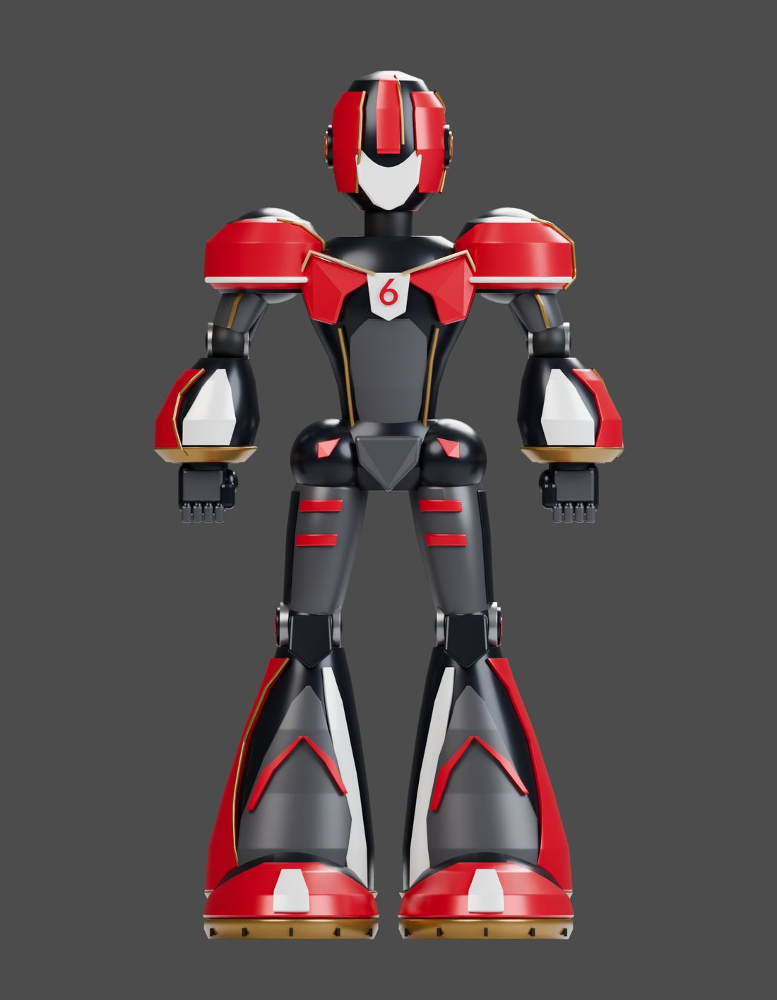
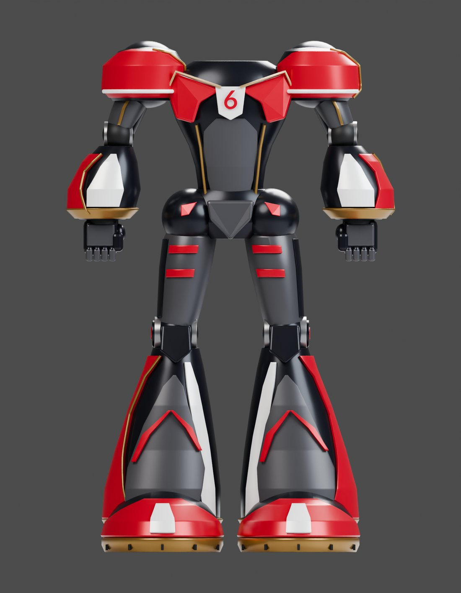
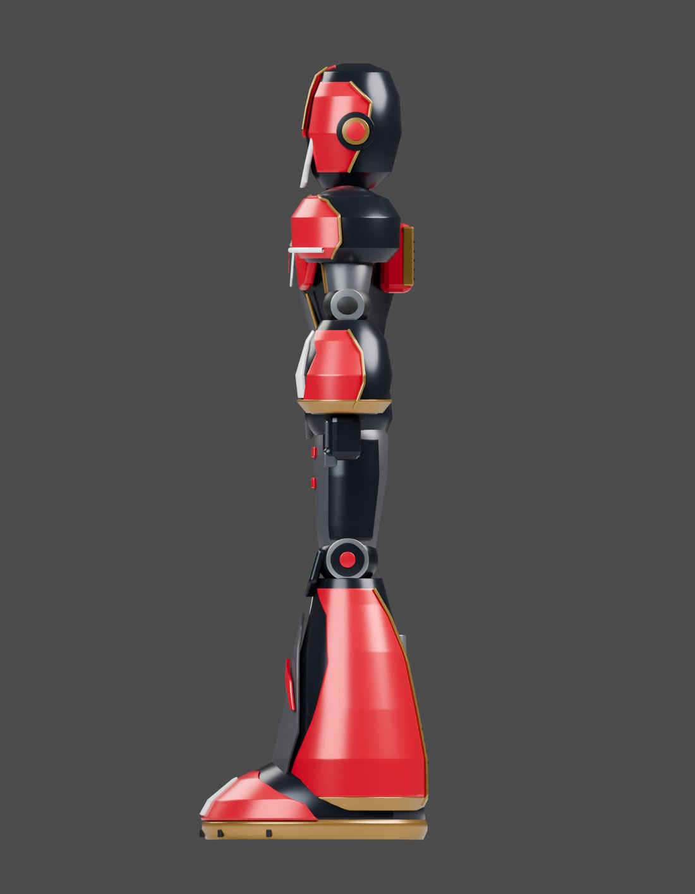
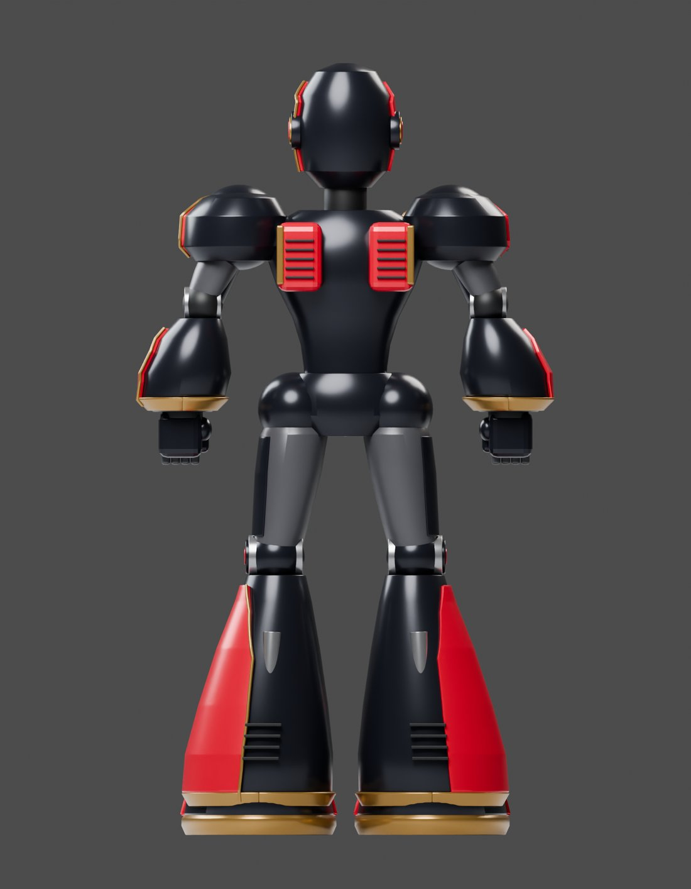
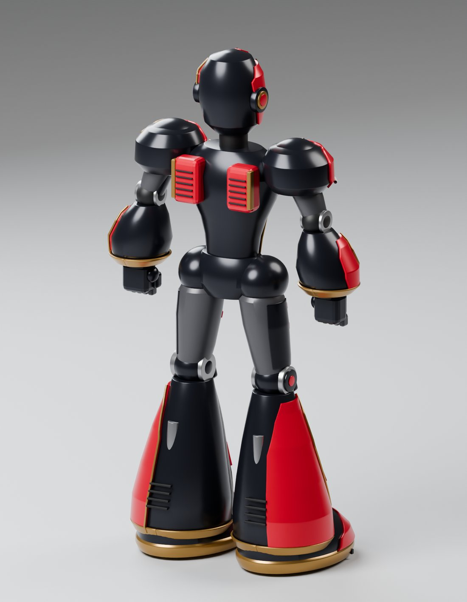
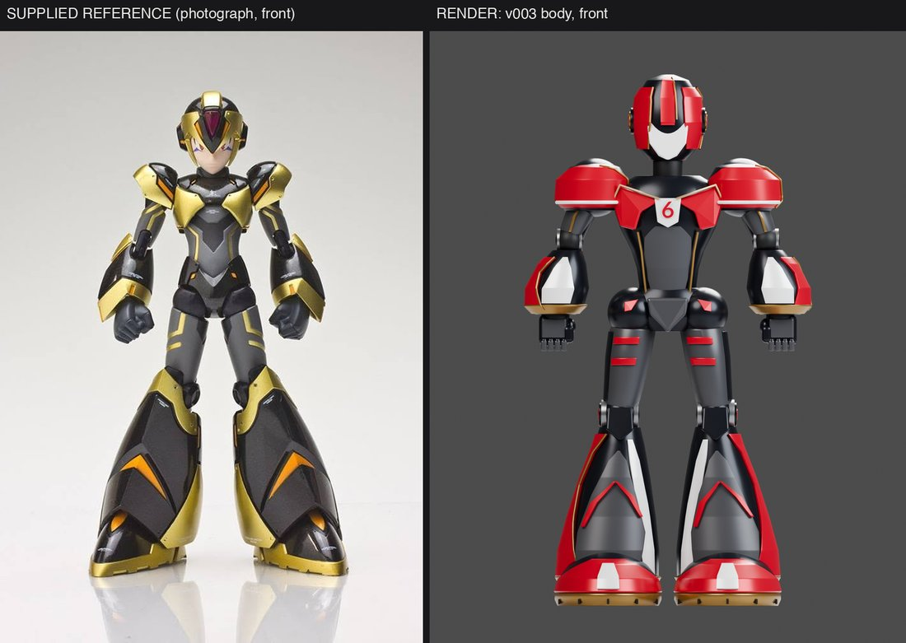
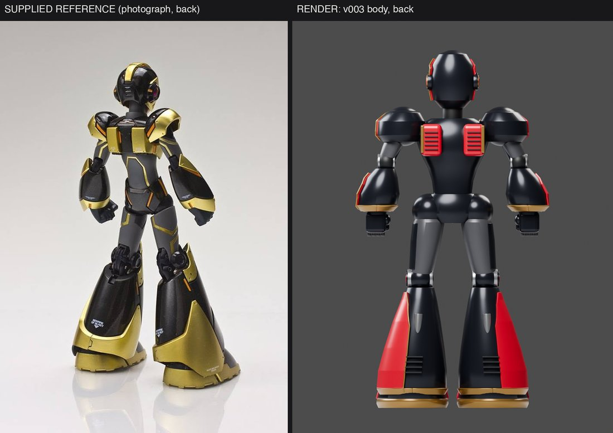
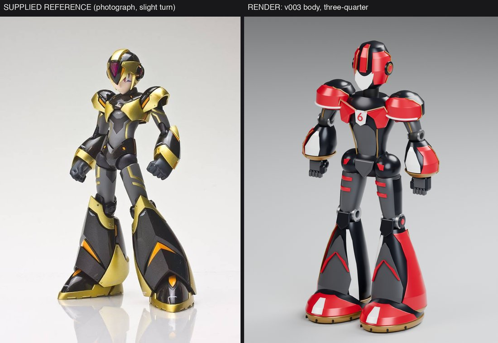

# SEIS AI Lab reference body, study v003

*A static armoured robot body in Northeastern red, gold, gray, white and black, rebuilt around seven supplied photographs. A design study with a placeholder head, not a final model.*

`163 meshes · 410,800 triangles · 8 materials in the GLB · no rig · about 1.9 m tall · Blender 5.1.2`

A new body built from scratch around seven supplied photographs of an armoured black-and-gold robot figure: an hourglass torso, rounded shoulder shells, large gauntlets, slim long thighs, visible knee joints and flared shin armour, with two ordinary hands and a small red Lato 6 on a white chest badge. The helmet is a temporary blank placeholder, not the proposed SEIS face: the final box head, broken antenna, waveform mouth, connector arm, six-spool housing and wrist readout are deferred to a later pass. It is a static model with no skeleton, no pose controls and no animation. This is a design study, not a final model.

## Views

### Three-quarter

The hero view. Red-and-black armour with a white-faced blank helmet: huge rounded shoulder shells, narrow waist, thin thighs, enormous flared red boots. The look is bold and toy-like, and the boots and shoulders are exaggerated.

[Full-size file](renders/body-three-quarter.png)

### Front

The front with the placeholder helmet and the small red 6 on the chest badge. The 6 is tiny and nearly lost against the red shoulder pieces.

[Full-size file](renders/body-front.png)

### Body only, front

The same body without the helmet, showing the neck opening and the torso/leg split. The head is a separate group (body_group=head_placeholder).

[Full-size file](renders/body-only-front.png)

### Side

A narrow side profile with a massive red boot and calf block. Torso and arms are thin; the proportion is top-heavy at the shoulders and bottom-heavy at the boots.

[Full-size file](renders/body-side.png)

### Back

Two red vent panels between the shoulders, a rounded hip block and calf vents. The source's own check moved the raised calf vents after inspecting this view.

[Full-size file](renders/body-back.png)

### Rear three-quarter

Shows the armour depth: deep shoulder shells, the hip block, and the boot toe-caps with gold trim.

[Full-size file](renders/body-rear-three-quarter.png)

## Compare with references

### Supplied photograph vs v003 (front)

Left: the front photograph (a black-and-gold armoured figure). Right: the v003 front render. This is the closest match in the folder: broad rounded shoulder shells, a narrow waist, slim thighs and long tapered greaves ending in big boots are all present. What does not match: the greaves are shorter and wider with a blunter tip; the red boots are much bigger than the photograph's gold feet; the shoulder shells are larger and rounder; the torso is plainer, without the photograph's layered chest panels; the arms are stubbier with small blocky hands; the helmet is a blank placeholder with a white face; and the palette is red and black instead of black and gold, as specified. Overall likeness: same family of shape, but cruder, more toy-like and more exaggerated.

[Full-size file](compare/front-photo_vs_body-front.jpg)

### Supplied photograph vs v003 (back)

Left: the back photograph, turned slightly. Right: the v003 back render. Both have shoulder shells, a back plate and tall flared boots. The photograph's back is layered with fine panel lines and gold trim that wraps the greaves; the render is mostly smooth black with two red vent plates. The render's hip block and rounded thighs are a different look from the photograph's slimmer, more angular back. Likeness: moderate in silhouette, low in detail.

[Full-size file](compare/back-photo_vs_body-back.jpg)

### Supplied photograph vs v003 (three-quarter)

Left: a supplied photograph from a slight turn. Right: the v003 three-quarter. The pose and angle are close. The proportions differ: the render is wider across the shoulders, shorter in the thigh and has a larger boot and a plainer torso. The helmet is not a match by design. Likeness: moderate, with the exaggeration noted above.

[Full-size file](compare/three-quarter-photo_vs_body-three-quarter.jpg)

## Film

Companion film: coming soon

<!-- FILM_URL -->

## Download

| File | Size | What it is | Download |
|---|---|---|---|
| `seis_robot_reference_body_v003.blend` | 4.0 MB | Full scene: static body parts, materials, camera and lights | [download](https://github.com/nikbearbrown/csye-7270-building-virtual-environments/raw/main/blender/seis-robot-reference-body-v003-codex/seis_robot_reference_body_v003.blend) |
| `seis_robot_reference_body_v003.glb` | 8.0 MB | Static portable model, flat colours, no rig | [download](https://github.com/nikbearbrown/csye-7270-building-virtual-environments/raw/main/blender/seis-robot-reference-body-v003-codex/seis_robot_reference_body_v003.glb) |
| `SOURCE-README.txt` | 3 KB | The original README that shipped with the model (copied unchanged) | [download](https://github.com/nikbearbrown/csye-7270-building-virtual-environments/raw/main/blender/seis-robot-reference-body-v003-codex/SOURCE-README.txt) |

The GLB uses flat material colours only: no textures or images are embedded (0 textures, 8 materials). It is static: no skeleton, no morph targets, no animation. The camera, lights and floor are not in the GLB.

## How to import into Blender

- **`.blend`:** open it in Blender 4.2 or later (File > Open). Saved by Blender 5.1.2; it has never been opened in Blender 4.2, so 4.2 compatibility is untested (use Blender 5.1 or later to match the build).
- **`.glb`:** in Blender, File > Import > glTF 2.0 (.glb/.gltf), or drop it into a game engine or a web viewer.

## Viewer

A self-contained interactive viewer is in [`index.html`](index.html) (images embedded, works offline once downloaded):

- GitHub Pages: https://nikbearbrown.github.io/csye-7270-building-virtual-environments/blender/seis-robot-reference-body-v003-codex/ (works once Pages is enabled for the repo)
- Fallback through htmlpreview: https://htmlpreview.github.io/?https://github.com/nikbearbrown/csye-7270-building-virtual-environments/raw/main/blender/seis-robot-reference-body-v003-codex/index.html

## Built by

- **Builder:** Codex (OpenAI). Builder identified from Codex session logs on this machine dated 2026-10-18, not from a label in the folder; no product or model version is stated in the files.
- **Method:** Scripted: Blender Python (scripts/build_body.py), built from scratch; the source says no geometry from v001 or v002 was reused and no MCP invocation or paid API was used. The source records one inspect-and-fix pass on the rendered views (the raised calf vent positions were corrected) and a six-view render pass; it does not log numbered render-versus-reference rounds. review.html in the source puts the front photograph beside the render for human judgment. The compare images in this folder were made afterwards for this page, by eye.
- **Tools:** Blender 5.1.2 (confirmed by my scene count); Lato Bold for the 6; the source's GLB re-import check in Blender (163 meshes, 410,800 triangles and dimensions match). No game-engine import or animation test.
- **Build date:** 2026-10-17 (file times 18:13 for the .blend and 18:15 for the GLB; delivery.json is dated 2026-10-17)
- **Human review:** Professor Bear: pending. The source README.txt says: "The body is the current review decision." and "The previous v002 body was rejected as too similar to the original robot." delivery.json says: "Awaiting Bear review; static body study; final head and wrist deferred", and README.txt says: "Technical checks do not establish Bear's approval of the design." The files do not say who rejected v002 or when.

## Honest limitations

- This is a design study, not a final model.
- The helmet is a temporary placeholder, not the proposed SEIS face; the box head, antenna, waveform mouth, engineer connector, spool housing and wrist display are deferred.
- Static: no animation rig, no pose controls, no speech sync, no working tools. The source says it is a high-resolution visual study, not game-optimised geometry.
- At 410,800 triangles it is about eight times heavier than the v001 robots and not a game-ready asset.
- The photographs are of a black-and-gold figure; the model is deliberately red, gold, gray, white and black in Northeastern colours, so colour is not comparable. Shape likeness is moderate and cruder; see Compare.
- No reference photograph shows a true side view, so there is no side comparison.
- Counts: my count_scene run reports 164 mesh objects and 410,802 triangles, which is the source's 163 meshes and 410,800 triangles plus a 2-triangle floor plane; 10 materials in the .blend against 8 in the GLB. Height about 1.9 m (the source's audit says about 1.89 m; my count gives 1.905 m including the floor plane's offset).
