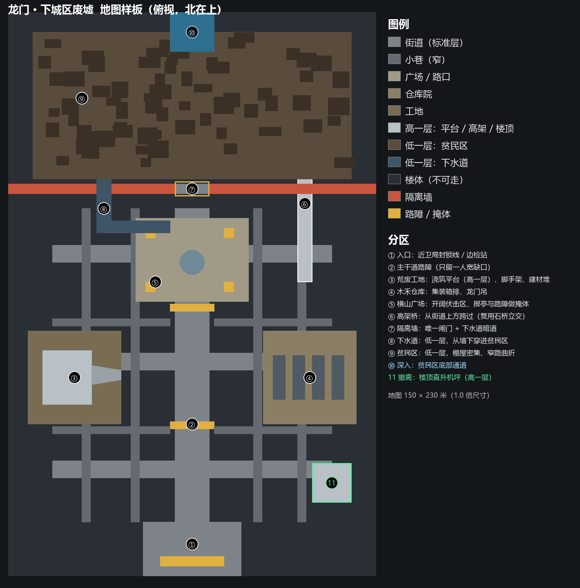

# 城市地图调研与方案 v1（龙门 · 下城区废墟）

2026-10-14。用户要求：「开始改城市图，PRTS 看地图相关背景，设计地图样板」。矿洞和雪原已经改成有机的洞穴式布局、台地、石桥和路堤坡道；城市一直沿用旧的方块房间。本文先整理龙门的背景，再给一张地图样板（`城市地图样板_v1.png`），确认后再动生成器和建模。

## 1. PRTS 调研

| 来源 | 要点 |
|---|---|
| [泰拉大典：龙门](https://prts.wiki/w/泰拉大典:地理/龙门) | 炎国移动城邦、商业和文化中心，和切尔诺伯格接壤。**感染者必须登记，大多住在地下贫民窟**，贫民窟由鼠王（林舸瑞）的黑道掌控。地标：近卫局大楼、大古广场（诗怀雅家的商业区）、中央公园、边检站、街区 |
| [4-1 免费拥抱](https://prts.wiki/w/4-1_免费拥抱) | 「龙门外围的贫民区」：贫民区在城市外围 |
| [4-7 各取所需](https://prts.wiki/w/4-7_各取所需)、[4-8](https://prts.wiki/w/4-8_应激反应)、[4-10](https://prts.wiki/w/4-10_灯火将熄) | 「贫民区东入口」会合；爆炸留下的废墟；广场上的遭遇战；整合运动「强行打开**贫民区与外城的通路**」 |
| [5-2 有口难言](https://prts.wiki/w/5-2_有口难言)、[5-3 义胆凡躯](https://prts.wiki/w/5-3_义胆凡躯)、[5-4 没人在家](https://prts.wiki/w/5-4_没人在家) | 整合运动「**封锁了接驳区域的主干道**」，近卫局要「打开一个缺口」；「龙门中城区，三窗仔，**木禾仓库**」；「大量堆砌的建材，**荒废的建筑工地**」；整合运动「围绕着整座街区搭建」工事 |
| [5-6 疑兵之计](https://prts.wiki/w/5-6_疑兵之计)、[5-7 生死与共](https://prts.wiki/w/5-7_生死与共) | **大古广场**：大楼与商铺都空了，被整合运动改成据点，「广场东 L3 平面图」，近卫局「从广场高层突袭」；「两层楼的废墟」压在盾上；茶餐厅门口 |
| [5-9 孽生恶物](https://prts.wiki/w/5-9_孽生恶物)、[5-11 棋胜后着](https://prts.wiki/w/5-11_棋胜后着) | 上城区的近卫局大楼：整合运动把指挥部设在**天台**，近卫局「借助视野优势」占顶楼援护 |
| [6-1 僵局](https://prts.wiki/w/6-1_僵局)、[6-2 一些误会](https://prts.wiki/w/6-2_一些误会)、[6-3 同时走失](https://prts.wiki/w/6-3_同时走失) | 「**避开主干道**」；整合运动「穿**小巷**」；「十六区的**横山广场**……想要突破防线的话，那里是必经之道」；通往贫民区的**秘密通道** |
| [6-4 溃烂的疮疤](https://prts.wiki/w/6-4_溃烂的疮疤)、[6-5 解决谁？](https://prts.wiki/w/6-5_解决谁？) | 在**楼顶**上行动的影卫；贫民区房间的**地下室**；隔离区与**隔离墙**；「半个街区里的居民全部失踪」「大多数可居住的独立建筑都变成了**废墟**」；「龙门贫民区的**地形很复杂**」；「**下水道**生物」 |
| [6-7 断弦](https://prts.wiki/w/6-7_断弦)、[6-9 换一个角度](https://prts.wiki/w/6-9_换一个角度)、[6-11 “这种事”](https://prts.wiki/w/6-11_“这种事”)、[6-18 只有你知道](https://prts.wiki/w/6-18_只有你知道) | 「贫民区**底部通道**」「从贫民区**下层**过来」；「贫民区四街十号建筑的废墟」；最终战在一座**断桥**边 |

归纳出五条原则：
1. **城市是直角的**：和矿洞、雪原的有机洞穴相反，楼体是方的，街道笔直，路口是十字。凌乱感来自废墟、路障和坍塌缺口，不来自弯曲的通道。
2. **三层高低**：贫民区和下水道低一层（「贫民区下层」「底部通道」）；街道是标准层；工地平台、高架、楼顶高一层。
3. **主干道被封锁**：主干道被路障截成几段、只留窄缺口，逼玩家钻小巷，对应地区简介里的「曲折街区 / 近战伏击」。
4. **隔离墙分开外城和贫民区**：只有一道闸门，外加一条下水道暗道，两条路一明一暗。
5. **废墟打开回路**：坍塌的楼体在街区之间开出缺口，成为捷径和回路；碎石堆和半塌的墙做掩体。

## 2. 地图样板

整张图从南（入口）往北（深入）推进，分外城和贫民区两半，中间隔着隔离墙。1.0 倍尺寸约 150 × 230 米，和其他地区一样按 1.0～1.5 倍随机放大。

| 编号 | 分区 | 地形 | 玩法作用 | 兴趣点 / 敌人 |
|---|---|---|---|---|
| ① | 入口：近卫局封锁线 / 边检站 | 标准层，宽 | 出发点，安全 | 无 |
| ② | 主干道路障 | 标准层，宽 8～10 米，两道路障只留一人宽缺口 | 正面推进很难，弓弩手守在缺口后 | 弩手组长、燃烧瓶投掷者 |
| ③ | 荒废工地 | 浇筑平台高一层，坡道上去；脚手架、建材堆 | 高处射击位；建材堆是兴趣点 | 建材堆、工具箱；燃烧瓶投掷者 |
| ④ | 木禾仓库 | 标准层，仓库院里集装箱成排 | 集装箱之间是窄道，近战伏击 | 物资仓、武器箱；拳刃武士、灰尾 |
| ⑤ | 横山广场 | 标准层，开阔大场地，报亭和路障做掩体 | 精英战场，必经之路 | 精英（寻仇者、粉碎攻坚手）；电子柜 |
| ⑥ | 高架桥 | 高一层，跨过街道 | 立交，复用雪图石桥系统（换成混凝土高架模型） | 桥下藏补给 |
| ⑦ | 隔离墙闸门 | 墙不可通过，只有一道闸门 | 外城和贫民区的分界，守卫点 | 守卫小队（欺凌者） |
| ⑧ | 下水道 | 低一层，从墙下穿过 | 闸门的替代路线，窄、暗 | 医疗柜；灰尾（伏击） |
| ⑨ | 贫民区 | 低一层，棚屋密集，窄路曲折 | 迷宫感最强，回路多 | 保险柜、医疗柜；灰尾香主 |
| ⑩ | 深入：贫民区底部通道 | 低一层 | 去下一层的出口 | 路线标记 |
| 11 | 撤离：楼顶直升机坪 | 高一层，楼顶 | 撤离点在高处，要先找到上楼的坡道 | 撤离信号 |

分区的位置每层随机：样板只规定**南外城、北贫民区、中间隔离墙**这个大结构，以及每种分区各出现几次。路口、广场、仓库院、工地按现在的房间预算随机分布在外城，贫民区内部的棚屋和窄路随机生成。

## 3. 和生成器的对应

| 样板元素 | 实现方式 |
|---|---|
| 街区格局 | 城市的房间改成矩形（路口、广场、仓库院、工地四种），通道只走横平竖直；街道宽、小巷窄 |
| 楼体 | 路外的岩体在城市换成楼体：直立的楼面，顶部平，按街区切块；楼高按镜头视线压低（同雪山的做法），不挡角色 |
| 主干道路障 | 主路上随机放 1～2 道路障，只留窄缺口；路障有碰撞，挡子弹 |
| 隔离墙 | 地图中段一条横贯的墙，只开一道闸门；守卫点放在闸门内侧 |
| 下水道暗道 | 低一层的窄通道，从墙下穿过；复用石桥的上下层系统（墙在上，暗道在下） |
| 高架桥 | 石桥系统换模型：混凝土高架，桥面有护栏 |
| 贫民区 | 低一层；棚屋按网格密排后随机删去一部分，删出来的空地连成窄路，回路自然出现 |
| 坍塌缺口 | 相邻街区之间随机打通一段，地上铺碎石，成为捷径 |

需要通过 MCP 新建的模型（第一批）：楼体立面（三种层高）、棚屋（三种）、集装箱、脚手架、路障（水马、拒马、沙袋）、报亭、龙门吊、隔离墙段与闸门、混凝土高架段、下水道入口、楼顶直升机坪。

## 4. 待拍板

1. **大结构**：每层固定「南外城 → 隔离墙 → 北贫民区」，还是允许整层都是外城、或整层都是贫民区？
2. **直角还是有机**：城市按第一条原则做成直角格局。这和你之前「模糊道路和房间的区别」的要求有点冲突。我的理解是城市靠广场、路口加宽和坍塌缺口来模糊，不做弯曲的洞穴边。可以吗？
3. **楼体高度**：楼体做成实际的楼（6～10 米高、看得出窗户），还是像现在的岩体一样只高出路面一点？做成真楼更像城市，但俯视镜头下会挡住角色，需要按视线压低南侧的楼。
4. **建模顺序**：第一批先做哪几样？建议先做楼体立面、路障、棚屋和高架，这四样决定城市整体的观感。

## 5. 霓虹灯（2026-10-16）

用户："比龙门做的好，我觉得龙门还可以优化，比如城区加霓虹灯。"

**模型**：通过 Blender MCP 建，脚本 `tools/blender/kit/build_city_neon.py`。

| 模型 | 内容 |
|---|---|
| `city_neon_blade_a` | 竖招，伸出墙 1.1 m、高 2.8 m，三个字 |
| `city_neon_blade_b` | 竖招，伸出 1.4 m、高 1.9 m，两个字；一层平房挂在檐下 |
| `city_neon_board` | 店招，3.4 m 宽，贴在楼面上，前倾 15° 让镜头看得到，四个字 |
| `city_neon_roof` | 天台大招，4.6 m 宽，立在屋顶边缘后仰 20°，隔着半张图也能看到 |

- 每块招牌都是深色钢框加底板，上面是灯管。灯管模型是白色的，进游戏后每块按实例单独上色，从粉、青、红、绿、琥珀、紫里随机挑。
- 招牌上的字是 3×3 网格里的几笔，不是真字，远看像中文招牌。

**摆放**：`CityDressing._place_neon`
- 沿街楼面在排楼时记录下来（`fronts`），之后按分区概率挂招牌。
  - 外城街道：竖招 80%、店招 45%、天台招 35%。
  - 贫民区：不挂（用户 2026-10-16："贫民窟不做霓虹"）。
  - 工地：极少。
  - 仓库区：不挂。
- 每块招牌在街上投一圈同色光（场地光照贴图），所以路面会有粉、青、紫的光斑。
- 龙门的夜色调暗了一档（环境光 0.96 → 0.84），让霓虹和窗光成为街面的主光。

**顺带修的 bug**：在 Blender 里重新导出的模型，发光材质会带上 `.001` 后缀，于是游戏不再把它当发光件，灯管显示成白色。现在识别发光件时会先去掉后缀（`TerraceDressing.kit_mesh`）。

**验证**
- 每层约 230–470 块招牌。
- `test_siracusa` 末尾新增两项检查：龙门有带颜色的霓虹；叙拉古没有霓虹。
- 截图 `../evidence/city-*-neon*.png`、`city-*-wide.png`。
- 全量回归里只有交易所"止损平掉空单"一项失败，和上次一样，并行跑偶发，单独跑是通过的。

## 6. 外城的楼不斑驳，贫民区的才斑驳（2026-10-16）

用户："城区里的房子不应该是斑驳的，贫民窟应该是。"

**原因**：所有楼都用 Sol 的 C6 抹灰（雨渍、剥落露砖）和 C5 屋面（补丁、锈），混凝土线脚也是高对比的噪声，所以外城的楼看起来和贫民区一样旧。

**改法**

- **干净版贴图**：`art/kit/textures/painted/build_city_clean.py` 从 Sol 的原图做两张干净版。
  - `city_plaster_clean.png`：去掉雨渍、剥落和露砖，只留抹灰底色和少量亮点。
  - `city_roof_clean.png`：去掉补丁和锈，只留一种屋面色和接缝线。
  - 颜色都取自原图的调色板。
- **建模**：`build_city_kit.py` 加了 `CLEAN` 开关，打开时用干净贴图，混凝土线脚改成低对比。
  - 通过 Blender MCP 的 `rebuild_clean()` 重建外城的 6 栋楼：塔楼、商住楼、茶餐厅、窄楼、两种临街平房。
  - 另外按旧样式导出两栋 `_worn` 副本：`city_row_low_a_worn`、`city_row_low_b_worn`。
- **摆放**
  - 贫民区的沿街楼改用 `_worn` 副本和棚屋，保持斑驳。
  - 外城街道、仓库区、工地都用干净版。坍塌楼本身就是废墟，不改。

截图：
- `../evidence/city-2026-neon0.png`：外城墙面和屋顶是干净的。
- `../evidence/city-2026-slum.png`：贫民区仍然破旧。
