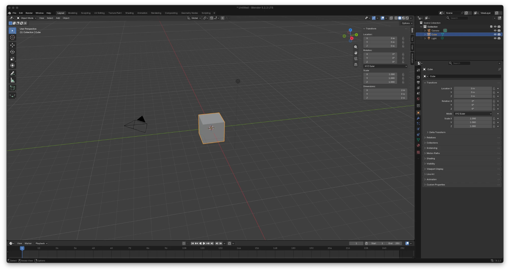

# Blender Interface Notes

1. **3D Viewport:** The main area where I view and work with objects in the 3D scene.

2. **Toolbar:** The vertical set of tools on the left side of the viewport. It lets me select, move, rotate, and scale objects.

3. **Outliner:** The panel at the top right that lists the scene's objects. I use it to find, select, and organize objects.

4. **Properties Editor:** The panel below the Outliner where I adjust settings for objects, materials, rendering, and other parts of the scene.

5. **Sidebar:** A panel on the right side inside the viewport, toggled with N. Its Item tab shows the active object's location, rotation, scale, and dimensions.

6. **Mode Selector:** The dropdown in the viewport header that switches between Object Mode and Edit Mode. Object Mode lets me work with whole objects, while Edit Mode lets me change their vertices, edges, and faces.

## Screenshot

My own Blender 5.2.2 LTS session, with the default Cube selected and the sidebar open on its Item tab.

