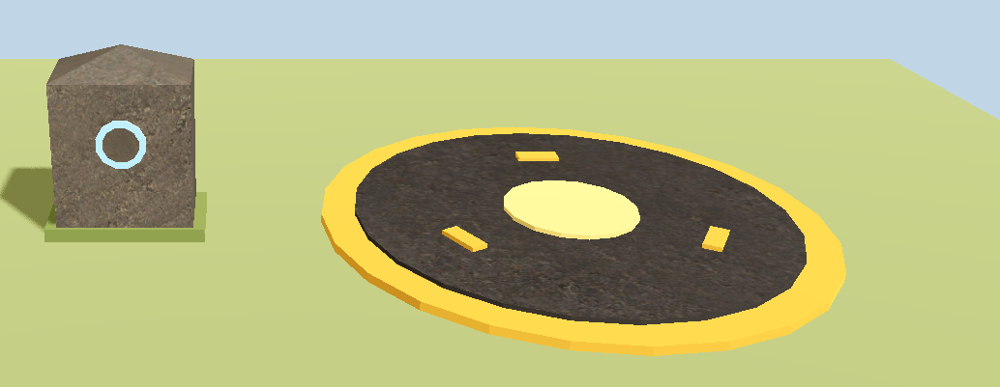
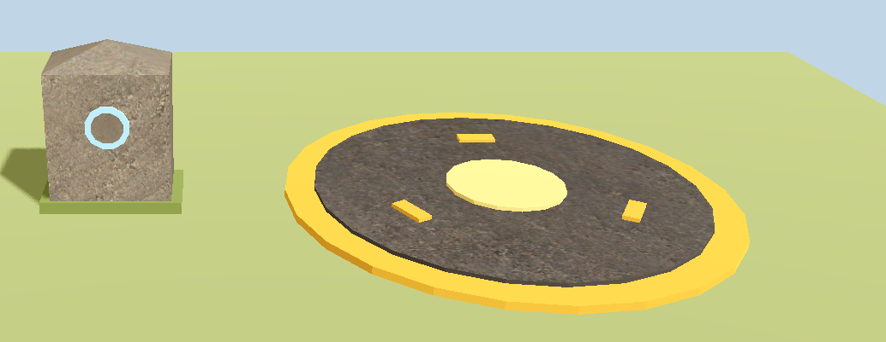
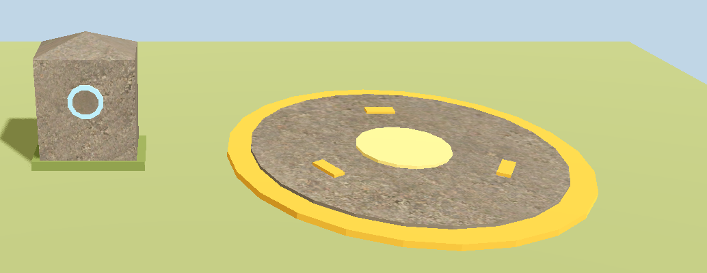

# TEST-REPORT — Assignment 5, walker-rudy

The actual results of the assignment's Use It checks: what ran, on what, what it showed, and who checked it.

**How this report was made.** Claude Code (Claude Opus 5.5) drafted it on 2026-10-27 from the logs, the captures and our conversation. On 2026-10-28 Claude added the curl threshold I chose, and my answers on the fade-in, the three edge cases and a hand check. Three checks were done by Claude, at my request, from in-engine captures: the interface sweep, the two materials and the OS screenshot. Each says so. The captures for the controlled values and the hint experiment were also made by Claude's tools, with my approval. The dated record of every step is [FRICTIONAL.md](FRICTIONAL.md).

**My review.** On 2026-10-27, before this report was committed, I reviewed Claude's results and looked at the captures. In my words: "我审核了你的结果，截图也看过了，没有问题。" ("I reviewed your results and looked at the screenshots too; there is no problem.") On 2026-10-28 I reviewed that day's changes: "审核完了，没问题" ("I've finished the review; no problems").

## What it ran on

- **Source revision.** Every result below comes from the game source as of `bd797945` and the props source as of `fe795908`. Nothing in `game/` outside `game/tests/`, or in `godot/` outside `godot/tests/` and `godot/tools/`, has changed since. `fe795908` added only `godot/shaders/standard_generated.gdshader`, which nothing uses.
  - The headless tests were last run at `5db11399`, on 2026-10-27 at 23:12 EDT. The calibration ran again on 2026-10-28, with the threshold's two new checks (section 10).
  - The windowed captures ran at `fe795908` (the hearts and the hint experiment, 22:00) and at `5db11399` (the OS screenshot at 23:06, the sweep and the two materials at 23:19). The last two tools, `godot/tests/capture_sweep.gd` and `godot/tests/capture_hint_vs_os.gd`, were not yet committed.
- **Engine.** Godot 4.7.2.stable.official.ed1daf0bf, on macOS 15.1 on an Apple M3.
- **Renderers.**
  - `game/`: GL Compatibility (`game/project.godot:95-96`). A windowed run reports `OpenGL API 4.1 Metal - 89.3 - Compatibility` (`logs/capture_tint.log:2`).
  - `godot/`: Forward+ (`godot/project.godot:16`). A windowed run reports `Metal 3.2 - Forward+` (`logs/capture_hint.log:2`).
  - The headless tests use the dummy renderer, which parses shaders but draws nothing (CLAUDE.md, "Headless facts"). So no headless result says how a shader looks. Every look below comes from a windowed capture.
- **Frame rates.** Each headless test runs through `scripts/run-test.sh` with `--fixed-fps`. A capture reads single frames, so its frame rate is not pinned.

## Summary

| Check | Result | Checked by |
|---|---|---|
| Baseline | `checks.tscn` 141 of 141 and `check_props.gd` 44 of 44 at 60 fps, before and after | the tests |
| Shaders parse | The uniform lists of all three shaders asserted; no `SHADER ERROR` in any clean run's log; both shader mutations exit 1 | the tests; I made the mutations |
| Driver | 15 of 15 at 30, 60 and 144 fps, through real input | the test |
| Controlled values (HUMAN CHECK) | P1 and P2 exactly as predicted at 0.0, 0.5 and 1.0. At 2.0 they are within one step of the unclamped prediction, so `hint_range` does not clamp | Claude's capture tool, run with my approval; Claude looked at the captures. Afterwards I recomputed one prediction by hand |
| In play (HUMAN CHECK) | The hearts tint on a hit and fade back, and still fade in when play starts; the three boundary cases behave as the brief says | me |
| Hint experiment (HUMAN CHECK) | All six bands exactly as predicted | Claude's capture tool, run with my approval; I looked at the scene in the editor |
| Interface sweep (HUMAN CHECK) | `albedo_tint` and `uv_scale` change the look; `normal_strength` and `roughness_offset` change it by about 3 steps, too little to see. `uv_scale` breaks the look at both ends | Claude, at my request; I reviewed the results and the captures |
| One shader, two materials (HUMAN CHECK) | One line of the shader changes both stones; one value in one material changes only that stone | Claude, at my request; I reviewed the results and the captures |
| Material wiring | 125 of 125 after a fresh import; the `source_color` mutation exits 1 | the test; I made the mutation |
| Texture data | `_nor_gl` 0.1444 and 1.8556, `_nor_dx` 1.8556 and 0.1444. Each, in its own convention, is under the threshold, 0.5, which I chose | the tests |
| Import settings | No `.import` file was rewritten, so there is no diff to explain | Claude, after each of five editor sessions |
| OS screenshot | 4 to 11 steps darker than the engine capture, because of the display's colour profile. The engine capture is the one to trust | Claude, at my request; I reviewed the results and the captures |

## 1. Baseline

| Test | fps | Before: step 0, `cca08046` | After: `5db11399` |
|---|---|---|---|
| `game/tests/checks.tscn` | 60 | 141 PASS, `all checks passed` | 141 PASS, `all checks passed` |
| `godot/tests/check_props.gd` | 60 | 44 `ok`, `PASS: 0 failed check(s)` | 44 `ok`, `PASS: 0 failed check(s)` |

The logs: before, `logs/game_checks_60fps.log` and `logs/godot_check_props_60fps.log` as committed in `cca08046`; after, the same files now.

The tests this assignment added, at the same revision, for Verify to compare against:

| Test | fps | Result |
|---|---|---|
| `game/tests/invulnerable_tint_checks.tscn` | 30, 60, 144 | 15 PASS at each, `all checks passed` |
| `godot/tests/test_materials.gd` | 60 | 125 PASS, `all checks passed` |
| `godot/tests/calibrate_normal_map_check.gd` | 60 | 4 PASS, `all checks passed` (2 until the threshold's checks were added on 2026-10-28, section 10) |

- Every wrapper run exited 0, and none of the seven logs has a `SHADER ERROR` or `SCRIPT ERROR` line.
- **What the rerun changed.** Six of the seven logs came out byte for byte as committed. `logs/game_checks_60fps.log` differs in two lines, neither a check's result:
  - the camera shake's offset, which is random (`game/app/main.gd:97`);
  - the number of `res://` paths the last check found: 81, not 79. `game/tests/capture_tint.gd` and `capture_tint.tscn`, added in `1868dc08`, name each other. It was 75 at step 0.
- The count of leaked ObjectDB instances at exit varies from run to run, with no change to the game: 41, 30 and 42 in the three committed versions of that log, and 34, 33 and 42 in three runs today.

## 2. Shaders parse

- **`game/shaders/invulnerable_tint.gdshader`.** A1 asserts that the engine reports exactly `tint_amount` (float), `tint_color` (Color) and `tint_strength` (float), with both floats `hint_range(0.0, 1.0)`. A2 reads the defaults, `shader_type canvas_item` and the absence of a `render_mode` from the source. Both pass at 30, 60 and 144 fps.
- **`godot/shaders/weathered_stone.gdshader` and `hint_experiment.gdshader`.** The first part of `test_materials.gd` asserts each shader's entries in order (9 and 3), with their types and ranges. It also asserts exactly which samplers each declares, and each sampler's hints. The hints are read from the source, because the engine reports none (CLAUDE.md). All 25 of these checks pass.
- **`godot/shaders/standard_generated.gdshader`,** which nothing uses: a probe only. It compiles, and the engine reports 16 uniforms (`logs/probe_standard_generated.log`).

The mutations. I made each one; Claude ran the test through the wrapper at 60 fps.

| Mutation | Log | Exit | What failed |
|---|---|---|---|
| The semicolon after `shader_type canvas_item` deleted, `invulnerable_tint.gdshader` line 1 | `logs/game_invulnerable_tint_checks_60fps_no_semicolon.log` | 1 | `SHADER ERROR: Expected a ';' after 'shader_type canvas_item'`; A1 and A2 failed, 13 passed |
| `tint_amount` renamed `tint_amt` on lines 3 and 8, so the shader still parses | `logs/game_invulnerable_tint_checks_60fps_renamed.log` | 1 | No `SHADER ERROR`; A1 and A2 failed, 13 passed |
| `source_color` deleted from `albedo_tex`, `weathered_stone.gdshader` line 3 | `logs/godot_test_materials_60fps_no_source_color.log` | 1 | No `SHADER ERROR`; the check of `albedo_tex`'s hints failed, 124 passed |

- The exit codes are the wrapper's; FRICTIONAL.md records each run ("The shader mutations", and "The fresh cache and the `source_color` mutation").
- After the mutations I restored both shaders, and Claude checked each against its commit, byte for byte. The clean tests then passed again.
- In the second and third, the shader still parses. Only the checks that read names and hints catch them.

## 3. Driver

`game/tests/invulnerable_tint_checks.tscn` plays through real input:
- Enter on the title, then `move_right` into the first spikes, with `Input.action_press()`;
- a sampler node with a high `process_priority` records `tint_amount` once per frame, after every other `_process()`.

It has five windows:
- hit 1, with Rudy walking back onto the spikes inside it;
- hit 2, at `Engine.time_scale` 0.5;
- hit 3, which takes his last heart, and the respawn after it;
- hit 4, paused in mid-window, then the level reloaded.

| | 30 fps | 60 fps | 144 fps |
|---|---|---|---|
| First value, hit 1 (A6) | 0.986111 (71/72) | 0.986111 | 0.986111 |
| Lowest first value of the five windows (A6) | 0.972222 (70/72), hit 3 and the respawn | 0.986111 | 0.986111 |
| Last value: on the first frame he is not invulnerable (A8) | 0.000000 in each window | 0.000000 | 0.000000 |
| Shown for, hit 1 (A9) | 1.2000 s; expected 1.1833 s ± 0.0333 | 1.1833 s; ± 0.0167 | 1.1806 s; ± 0.0069 |
| Shown for, at time scale 0.5, in real time (A9) | 2.4000 s; expected 2.4000 s ± 0.0333 | 2.4000 s; ± 0.0167 | 2.4028 s; ± 0.0069 |
| Back on the spikes in the window (A10) | 9 frames on them, no rise, hearts stay at 2 | 18 frames, no rise | 42 frames, no rise |
| Respawn (A11) | jumps from 0.027778 to 0.972222 | from 0.055556 to 0.986111 | from 0.027778 to 1.000000 |
| Pause (A12) | holds at 0.680556 for 30 frames, and resumes from it | 0.694444, 31 frames | 0.694444, 34 frames |
| Reload (A13) | the new hearts are at 0.0 on their first frame | the same | the same |

- **In game time,** the window is 72 physics ticks, 1.2 s, and the tint shows for 71 of them, 1.183 s, at every rate (rule 4). At time scale 0.5 the same window takes 2.4 s of real time (rule 6).
- **The respawn at 144 fps** starts at exactly 1.0, because it falls in a frame with no physics tick after it. That meets rule 1's "at least 70/72".
- **The frame rate matters to this test.** In the driver's session, a frame-counting `hud.gd` failed A9, among others, at 30 and 144 fps. A driver that ran while paused, on its own clock, failed A12, among others, at 60. The test calls none of `take_hit()`, `respawn_at()` or `set_shader_parameter()`, and assigns none of Rudy's state (FRICTIONAL.md, "The driver and its test: the implementation").
- Logs: `logs/game_invulnerable_tint_checks_30fps.log`, `_60fps.log` and `_144fps.log`.

## 4. Controlled values (HUMAN CHECK)

**The capture.** `game/tests/capture_tint.tscn` is a scripted run in a window, not a debug key:
- `move_right` walks Rudy into the first spikes;
- once that window has run out, with two hearts full and one empty, it stops the driver with `hud.set_process(false)` and sets `tint_amount` from code;
- it waits for `RenderingServer.frame_post_draw` and saves `get_viewport().get_texture().get_image()`, 1920 × 1080, as drawn;
- then it takes the material off the hearts and captures once more, for rule 7.

Claude wrote it, and it ran with my approval (`logs/capture_tint.log`).

| `tint_amount` | P1 (54, 58): predicted, captured | P2 (77, 56): predicted, captured | P3 (183, 49) | B (222, 52) | Capture |
|---|---|---|---|---|---|
| 0.0 | `#C84035`, `#C84035` | `#992323`, `#992323` | `#C8C6CB` | `#D0CCC9` | `evidence/use-it/hearts-tint-0.0.png` |
| 0.5 | `#BF605D`, `#BF605D` | `#99494F`, `#99494F` | `#C8C6CB` | `#D0CCC9` | `evidence/use-it/hearts-tint-0.5.png` |
| 1.0 | `#B58086`, `#B58086` | `#996F7B`, `#996F7B` | `#C8C6CB` | `#D0CCC9` | `evidence/use-it/hearts-tint-1.0.png` |
| 2.0, from code | `#A2C0D7`, `#A3C1D7`, one step off | `#99BBD3`, `#99BBD3` | `#C8C6CB` | `#D0CCC9` | `evidence/use-it/hearts-tint-2.0.png` |

- **`hint_range` does not clamp a value set from code** (the brief's short answer 7). The material reads back 2.0, and P1 and P2 land within one step of the unclamped prediction. The clamped values, `#B58086` and `#996F7B`, are 81 and 88 steps away.
- **Rule 7, at 0.0.** Against the capture with no material (`evidence/use-it/hearts-no-material.png`), 1 of the 11,200 pixels under the hearts differs: the edge pixel (51, 67), by one step in green. That is within the assignment's "a step or two", so it is not a finding. I have not found out why.
- **Rule 8, alpha.** P3, inside the empty heart where the texture's alpha is 0, stays the sky's `#C8C6CB` at every value. The fade-in when play starts was not captured; I checked it by eye on 2026-10-28. Claude asked me to run `game/` in the editor, press Enter on the title, and watch whether the hearts fade in as before and whether they look blue. I answered "看过了没问题" ("I looked; no problem").
- **Rule 9, at 1.0.** Heart 1's outline at (40, 41) is `#39150C` at 0.0 and `#5F666D` at 1.0. Against B, that is 10.23:1 and 3.65:1, so it stays above 3:1.
  - The brief predicted 9.77:1 and 3.51:1 from the texel. The drawn pixel is slightly darker.
  - Claude computed these from the two captures with Pillow.
- **B** is `#D0CCC9`. The brief's estimate, from a JPEG, was about `#D1CBC9`.
- **By hand, after the captures.** Claude's script computed the brief's predictions. On 2026-10-28 I recomputed two of them by hand, from the brief's inputs and formulas: P1 at 0.5, and quad B's left band in the hint experiment (section 6). I said "手算复核完了，没问题" ("I've done the hand check; no problem").
- Claude looked at the hearts in the captures; the pixel values are the tool's.

## 5. In play (HUMAN CHECK)

**Me, on 2026-10-27, after `5db11399`.** I opened `game/` in the editor and played it. I set off the tint several times: losing all three hearts alone takes three hits.

What I said, in my words, with a translation:
- "确实像你说的，受伤时红心颜色变淡，然后逐渐恢复。其他都没改变" ("It is as you said: when I'm hit, the hearts turn pale, then gradually recover. Nothing else changed.")
- Claude then asked about three cases: walking back into the spikes in the window, losing all three hearts, and pausing in the window. I answered: "都试过了" ("I tried them all.")

I said only that I had tried them, so they are recorded as behaving as the brief says:
- back on the spikes in the window, no heart is lost, and the tint does not jump back up (rule 5);
- after the last heart, the respawn starts the tint again from its strongest (rule 5);
- Esc in the window holds the tint, and it continues on resume (rule 6).

On 2026-10-28 Claude asked me for a sentence on each. I answered "都没问题" ("none of them had a problem").

"Nothing else changed" answers the list Claude gave me before I played: Rudy's flicker and outline, the goblins, the spikes, the title and the rest of the HUD. After the session, `git status` showed no file changed. No one else has played it.

## 6. Hint experiment (HUMAN CHECK)

**The capture.** `godot/tests/capture_hint.gd`:
- renders `godot/scenes/hint_experiment.tscn` in a window, in Forward+;
- saves the frame, 1920 × 1080, as drawn (`evidence/use-it/hint-experiment.png`);
- reads each band's centre, found through the camera's `unproject_position()` (`logs/capture_hint.log`).

Claude wrote it, and it ran with my approval.

| Band | File value | Quad A, `source_color`: predicted, captured | Quad B, no hint: predicted, captured |
|---|---|---|---|
| left | 64 | 64, 64 | 137, 137 |
| middle | 128 | 128, 128 | 188, 188 |
| right | 192 | 192, 192 | 225, 225 |

- Every band is flat: the 9 × 9 pixels around each centre all hold the one value.
- The values are the ones the brief's section 4 predicted. With `source_color` the texels come out as stored; without it they come out lighter, encoded once on the way out.
- In the editor, I saw each band of B lighter than the band of A above it, with sharp edges.

## 7. Interface sweep (HUMAN CHECK)

**Claude did this check, at my request,** with `godot/tests/capture_sweep.gd` in a window, and judged the captures (`logs/capture_sweep.log`). I reviewed the results and looked at the captures afterwards, and found no problems.

- **What changed.** On the waystone's material, `waystone_stone.tres`, each uniform of `weathered_stone.gdshader` was set to its minimum, its default and its maximum, then restored.
  - Every change was made to the loaded material, in memory, and never saved. Afterwards `git status` showed the material unchanged.
  - `albedo_tint` has no range, so the sweep used black as its minimum, and its default, white, as its maximum. At white the multiplier leaves the photo as it is.
- **Lighting.** `props_room.tscn` as it is, which is what the brief's section 5 says to judge under:
  - the `Sun` at energy 1.1, with shadows;
  - ambient light from a colour, at 0.45;
  - the Filmic tonemap;
  - no SSAO, SSIL, SSR, SDFGI, glow or fog.
- **Two views.**
  - The scene's `Camera`, where the waystone is a 198 × 235 crop.
  - The same camera moved, in memory, to (−0.1, 0.97, 1.8), about 2 m from the waystone's centre, where it is 505 × 586.
  - The brief planned to orbit; these two fixed views stand in for that.
- **The measure.** Each capture is compared with the default frame of the same view, over the waystone's part of the frame: its bounding box seen through the camera, plus 8 px.
  - The first number is the mean of each pixel's largest channel difference, in 8-bit steps.
  - The second is the share of pixels that moved by more than 2 steps.
  - Two default frames in a row differ by 0.00. Through the whole sweep from the scene's Camera, the circle's part of the frame stayed at 0.00.
- **The crops.** In `evidence/use-it/sweep/`: `waystone-<uniform>-<min|default|max>.png` from the scene's Camera, and `close-<uniform>-<min|default|max>.png` from close up.

| Uniform | Value | Scene camera: mean, share | Close up: mean, share | What Claude saw |
|---|---|---|---|---|
| `albedo_tint` | black (min) | 72.26, 55.9% | 73.51, 57.3% | The photo's colour is gone, and the stone is near-black. Up close the relief shows more plainly than at white, because the photo's own shading no longer hides the light. The cap keeps a grey sheen |
| | white (default, max) | 0.00, 0.0% | 0.00, 0.0% | The photo as taken |
| `uv_scale` | 0.25 (min) | 10.86, 54.6% | 12.51, 56.3% | The photo, magnified four times: large, soft blotches, and up close the texels blur. It reads as coarse gravel. The disc inside the ring keeps a finer grain than the face, so its UVs give it a different scale |
| | 1.0 (default) | 0.00, 0.0% | 0.00, 0.0% | |
| | 4.0 (max) | 7.02, 52.9% | 9.20, 55.3% | The grain is four times finer. From the scene's Camera it averages out: the front face reads smooth, like plaster, with a faint diagonal band. Up close it reads as fine-grained stone, and the disc blurs |
| `normal_strength` | 0.0 (min) | 1.99, 31.2% | 2.62, 37.2% | No change Claude could see |
| | 1.0 (default) | 0.00, 0.0% | 0.00, 0.0% | |
| | 2.0 (max) | 2.26, 32.9% | 2.93, 38.6% | No change Claude could see |
| `roughness_offset` | −0.5 (min) | 2.71, 55.1% | 2.64, 54.9% | No change Claude could see |
| | 0.0 (default) | 0.00, 0.0% | 0.00, 0.0% | |
| | 0.5 (max) | 0.85, 9.6% | 0.90, 8.4% | No change Claude could see |

**What breaks the look, in Claude's judgement:**
- `uv_scale`, at both ends. At 0.25 the 1k photo is stretched until its texels blur. At 4.0 the grain is too fine to read from the scene's Camera, and the stone looks smooth.
- Not `albedo_tint` at black. It removes the photo's colour, which is what a multiplier at zero does, and the stone still reads as stone by its relief.
- Neither end of `normal_strength` or `roughness_offset`. Neither shows an artefact.

**Why `normal_strength` and `roughness_offset` barely show.** Claude measured three things, with scripts kept outside the repository:
- **The normal map is gentle.** In `rock_01_nor_gl_1k.png`, the normals tilt 7.7° from flat on average, and 15.5° at the 95th percentile.
  - Up close, 0.0 against 2.0 differs by 5.41 steps on average, and at most 64.
  - In a difference image, scaled 16 times, the change follows the rock's relief over the whole Stone surface and appears nowhere else. It is strongest on the right face, which the light reaches 67.4° from its normal.
- **The roughness map is nearly flat.** `rock_01_rough_1k.png`, 16-bit, has a mean of 0.516, with 90% of its texels between 0.474 and 0.571. So −0.5 takes it to about 0.0 to 0.07, nearly mirror-smooth, and +0.5 to about 1.0.
- **No Sun highlight can fall on the waystone's sides.** The Sun is 50.2° above the horizon. Its mirror direction off the front (+Z) and right (+X) faces points down, below the floor. So no camera above the floor can see the highlight there, from any orbit. Between −0.5 and the default, the change is strongest on the cap.

So under the scene's lighting, the brief's section 5 effects for these two uniforms do not show. Those effects are "at 2 the cracks and bumps are exaggerated" and "a tighter highlight from the Sun". The numbers show that both uniforms reach the shader. The brief says to judge under this lighting and leave it unchanged, so I have not tried another light.

## 8. One shader, two materials (HUMAN CHECK)

**Claude did this check, at my request,** in the same run, from the scene's `Camera`, under the scene's lighting (`logs/capture_sweep.log`).

- **One shader object.** The two materials use one `Shader` object, `res://shaders/weathered_stone.gdshader`: the run prints `SHARED the two materials use one Shader object: true`.
- **One line of the shader.** In the loaded shader's code, line 18 became `ALBEDO = texture(albedo_tex, scaled_uv).rgb * albedo_tint.rgb * 0.5;`, in memory only.
  - The Ownership rule in CLAUDE.md keeps agents out of `godot/shaders/`, so the file was never edited, and `git status` showed it unchanged.
  - Both stones changed: the waystone by 22.54 steps on average, over 55.9% of its pixels, and the circle by 10.52, over 33.9%.
  - Both are visibly darker. The gold, the rune and the moss are not.
- **One value in one material,** in `circle_darkstone.tres`, each restored after its capture:
  - first `normal_strength`, from 0.35 to 2.0: the circle changed by 0.76 steps, over 9.9% of its pixels, and the waystone by 0.00. Only the circle changed, but too little to see;
  - so then `albedo_tint`, from `#A4A7B4` to the waystone's `#FFFFFF`: the circle changed by 19.97 steps, over 33.9%, and the waystone by 0.00. The circle's disc turns the waystone's colour, and the waystone does not change.

The defaults:

Line 18 of the shader with `ALBEDO` halved: both stones darken.

The circle's `normal_strength` at 2.0: only the circle changes, by less than a step on average.

The circle's `albedo_tint` at white: only the circle changes.

## 9. Material wiring

- **After a fresh import,** on 2026-10-27, Claude moved `godot/.godot` aside and imported from empty. That run exited 0 with no error (`logs/godot_import_fresh_cache.log`).
  - Then `test_materials.gd` passed 125 of 125, `check_props.gd` 44 of 44, and the calibration passed.
  - Their logs matched the committed ones byte for byte, and no `.import` or `.uid` file changed. FRICTIONAL.md has the run, under "The fresh cache and the `source_color` mutation".
- **The `source_color` mutation exits 1** (section 2).
- At `5db11399`, `test_materials.gd` passed 125 of 125 again.

## 10. Texture data

The curl ratio of each normal-map file, read from the source PNG with `godot/tests/normal_map_check.gd`, which is the assignment's check, unchanged:

| Map | Bound to | `directx = false` | `directx = true` |
|---|---|---|---|
| `rock_01_nor_gl_1k.png` | both stone materials | 0.1444 | 1.8556 |
| `rock_01_nor_dx_1k.png` | nothing: the calibration pair only | 1.8556 | 0.1444 |

- The GL file comes out low with `directx = false` and near 2 with `true`, as the assignment says it should. So the sign convention is not reversed, and `s` was not flipped.
- Logs: `logs/godot_calibrate_normal_map_check_60fps.log`, and the "Normal maps" part of `logs/godot_test_materials_60fps.log`.
- **The threshold is 0.5.** Claude proposed it, and I chose it on 2026-10-28. It lies between this pair's 0.1444 and the 1 the assignment gives for a map with no surface behind it. A map's two ratios always sum to 2 (FRICTIONAL.md, "The normal-map check"), so a map under 0.5 in one convention is over 1.5 in the other.
  - `calibrate_normal_map_check.gd` has two more checks: each file, read in its own convention, is under 0.5 (lines 38–41). It passes 4 of 4 (`logs/godot_calibrate_normal_map_check_60fps.log`).
  - With the threshold set to 0.1, below 0.1444, those two checks fail and the test exits 1 (`logs/godot_calibrate_normal_map_check_60fps_threshold_0.1.log`). Claude made that change, then restored the script byte for byte.
  - `rock_01_nor_gl_1k.png` is the map both stone materials bind, so the map in use meets the threshold. `test_materials.gd` checks that this bound map is lower read as OpenGL than as DirectX; it does not use the threshold.

## 11. Import settings

**No `.import` file was rewritten, so there is no diff to explain.**

- Every `.import` file in both projects is unchanged since the commit that added it:
  - the 39 in `game/` and the three `.glb` imports in `godot/`, since `84658acf`;
  - Rock 01's four, since `e0e14c17`;
  - the grey strip's, since `143e9055`.
- After each of the five editor sessions, Claude checked for changes:
  1. the stone materials, before `6d71a4f4`: the `.import` and `.glb` files untouched;
  2. the circle's new tint, before `6d71a4f4`: the same;
  3. the hint scene, before `143e9055`: all 237 files hashed before and after, and none changed;
  4. the conversion for the generated shader, before `fe795908`, which drew Rock 01's three textures in a StandardMaterial3D: only the two new files appeared. This is the case the brief's predicted failure 8 is about;
  5. my playtest in `game/`: nothing changed.
- The brief set every value the editor would otherwise detect (section 5), and the editor left them alone.

## 12. OS screenshot against the engine capture

**Claude did this check, at my request,** with `godot/tests/capture_hint_vs_os.gd` (`logs/capture_hint_vs_os.log`).

- It renders the hint scene in a window on the primary display and saves the engine's frame (`evidence/use-it/os-compare/engine.png`).
- Then it has macOS capture the window's client area only, with `screencapture -x -t png -R 32,64,960,540`, in points (`os-screenshot.png`). The display's scale is 2.0, so both images are 1920 × 1080, and the gap below is not scaling.

| Band | Predicted | Engine capture | OS screenshot | OS screenshot, converted to sRGB |
|---|---|---|---|---|
| A, left | 64 | 64 | 56 | 64 |
| A, middle | 128 | 128 | 117 | 128 |
| A, right | 192 | 192 | 184 | 192 |
| B, left | 137 | 137 | 126 | 137 |
| B, middle | 188 | 188 | 180 | 188 |
| B, right | 225 | 225 | 221 | 225 |

- **Why they differ.** The screenshot embeds the display's colour profile, "Q27q-1L"; the engine's PNG has none. Claude converted the screenshot from that profile to sRGB with Pillow's ImageCms, and all six bands came back to the engine's values exactly. So the difference is the display's colour management, and nothing else.
- **Which to trust: the engine capture.** It reads the frame the renderer wrote, before any display profile, and it matches every prediction. The screenshot's numbers are in the display's colour space.
- **The first attempt missed the window.** I have two displays, and the region pointed at the wrong one: the image was 100 × 1080.
  - Claude moved it out of the repository without opening it, since it held another part of my screen.
  - It then changed the tool to put the window on the primary display first, and to delete any screenshot that does not show the window.
  - Claude looked at the second screenshot: it shows only the hint scene.

## 13. Inspect and revise

Each of these began with an observation and changed something:

1. **The circle's tint** (CHANGE-BRIEF.md, revision 2).
   - Observation: Claude averaged Rock 01's colour map times the brief's `#8F857D`, and got `#40352A`. That is 10 to 22 steps darker and browner than Assignment 3's DarkStone.
   - Revision: `#A4A7B4`, which I chose. I looked at the circle in the editor again.
2. **The one-material capture** (section 8).
   - Observation: `normal_strength` at 2.0 changed the circle by 0.76 steps, too little to see.
   - Revision: a second edit, `albedo_tint`, which changes it by 19.97.
3. **The sweep's view** (section 7).
   - Observation: from the scene's Camera, the relief and roughness changes were a few pixels wide.
   - Revision: the close-up pass. It showed the same, and the measurements of the maps and the Sun explain why.
4. **The audit's memory figure** (`3b1084a6`).
   - Observation: the audit gave "about 3 MB" for the DirectX map's import, a figure nobody had measured.
   - Revision: 1,908,496 bytes, measured.

No assertion was deleted or weakened to make a test pass.

## 14. What no headless run shows, and what is open

- **How any shader looks.** The headless renderer draws nothing, so sections 4, 6, 7, 8 and 12 come from windowed captures.
- **Whose eyes.** The sweep, the two materials and the OS screenshot are Claude's reading of the captures, at my request. I reviewed the results and looked at the captures afterwards, and found no problems. My own eyes were also on the materials and the hint scene in the editor, and on the hearts in play and their fade-in.
- **Not captured.** The hearts' fade-in with the tint (rule 8). I checked it by eye (section 4).
- **Below what can be seen.** Under the scene's lighting, `normal_strength` and `roughness_offset` cannot be judged by eye.
