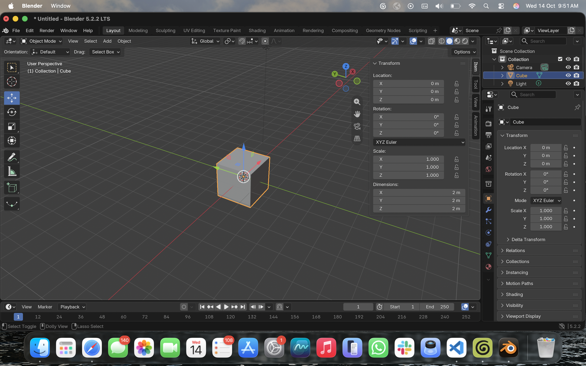

# BLENDER-NOTES — six parts of the Blender window

> From my "learn the window" session on 2026-10-14, Blender 5.2.2 LTS on macOS, before any prompting.

**1. 3D Viewport.** The big grey grid area in the middle, where the scene is. I orbit with a two-finger drag, pan with Shift + drag, and pinch to zoom. Clicking Z on the gizmo gives the top view, so Z is up in Blender. The red and green lines on the floor are X and Y. From below it looks almost the same, just without the 2 elements that float (the camera and the light), so the grid isn't a real floor. The buttons on its right edge zoom, switch to the camera view, and switch between perspective and orthographic.

**2. Toolbar.** The column of icons on the left. With the Move tool, grabbing the white circle moved the cube everywhere at once and it ended up below the floor. I found a way to move it along one axis: G then Z moved it up, and only Z changed. Confirm and Cancel aren't buttons, they're hints in the bottom bar (left-click to keep, right-click or Esc to cancel).

**3. Outliner.** The list at the top right: Scene Collection, then Collection, then Camera, Cube and Light. Click a name and that thing gets selected (it lights up in the list and gets the orange outline), and the little eye hides or shows it.

**4. Properties editor.** The big panel under the Outliner. With the cube picked it shows where it is, how it's turned and how stretched it is: Location 0, 0, 0, Rotation 0°, Scale 1, 1, 1.

**5. Sidebar (N).** Hover over the viewport and hit N and it slides out. Same location, rotation and scale, but it also has Dimensions, and the default cube turns out to be 2 m on every side. That's the real size, so that's the number I'll check against my brief and Godot.

**6. Mode selector.** The dropdown at the top-left of the viewport (Object Mode / Edit Mode, or Tab). In Object Mode the cube is orange and selected as one object. In Edit Mode I'm able to select faces of the cube, and the corner dots and edges show. A corner was at Z = -1 m, so the cube's origin is in its middle and half of it is under the floor.

Also from the session: [Edit Mode with the mesh selected](evidence/blender-edit-mode.png).
