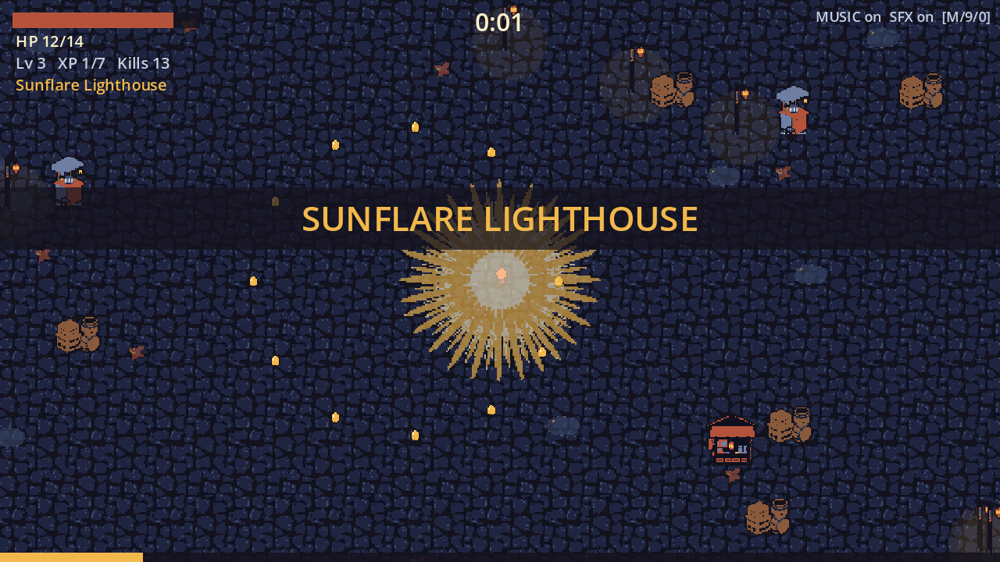
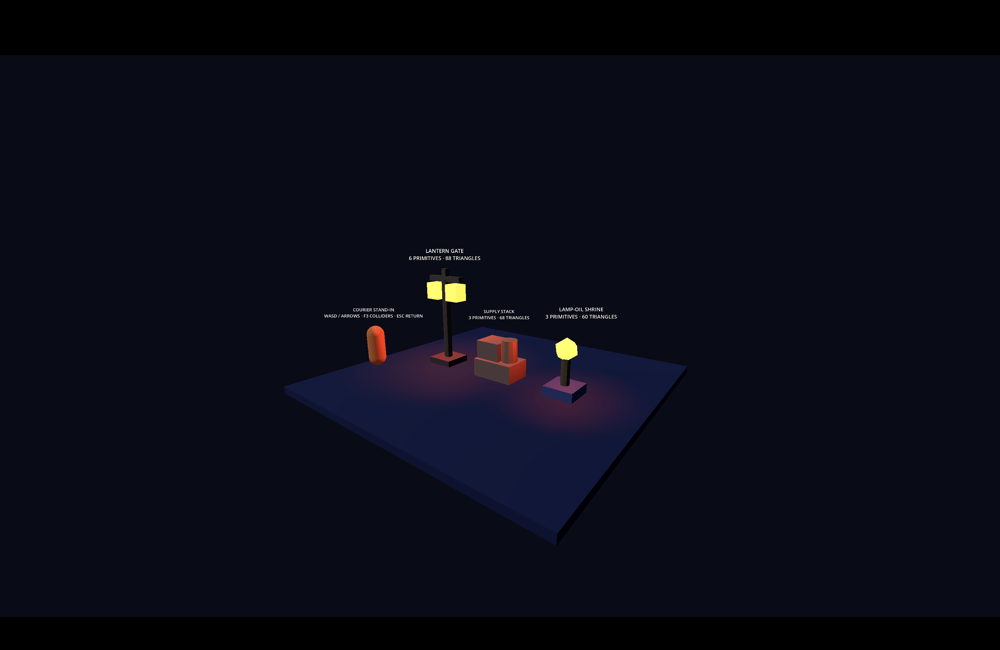

# walker-lanternfall-bao-x — Lanternfall

**CSYE 7270 · Assignments 2–3 · Bao Xing**

A lamp-headed courier is trapped in a fog-bound midnight market, and the light on his shoulders is his only weapon. Keep moving, grow the light, and survive three minutes until the fog lifts.

This is an **asset slice**, not a finished game: a playable Godot scene that proves generated art, sound effects and music work together. It is a small survivors-like — you only move; the Beam and the Lamp-Moths fire on their own; enemies drop lamp-oil gems; level-ups offer branching cards; maxing both weapons unlocks the **Sunflare Lighthouse** evolution.



## Started from

A **blank Godot 4.7.2 project**. The protagonist concept is carried over from my Assignment 1, [yanxlh/walker-jumpman-bao-x](https://github.com/yanxlh/walker-jumpman-bao-x), itself an extension of [nikbearbrown/walker-jumpman](https://github.com/nikbearbrown/walker-jumpman). No files from either are included.

## Run it

- Engine: **Godot 4.7.2.stable.official.ed1daf0bf** (GL Compatibility). Tested on macOS 26, Apple M4 Pro.
- macOS: double-click [`walker-lanternfall.command`](walker-lanternfall.command) (expects Godot in `/Applications`). On the first run it imports the assets, then starts the game.
- Anywhere else: import once, then run — `godot --headless --path godot --import --quit` then `godot --path godot` — or open `godot/project.godot` in the Godot editor (which imports automatically). **Without the import step a fresh clone runs with placeholder shapes and no sound.** All assets are committed; nothing is downloaded at run time.

## Controls

| Action | Keyboard | Gamepad |
|---|---|---|
| Start | Enter / Space | A |
| Move | WASD / arrow keys | left stick |
| Pick a level-up card | 1 / 2 / 3, or ← → + Enter | d-pad + A |
| Pause / resume | Esc / P | Start |
| Restart | R | Y |
| **Mute everything / music only / effects only** | **M / 9 / 0** | — |
| Show the hurtbox | F3 | — |
| Enter the Assignment 3 three-asset room | F4 | — |

The HUD always shows `MUSIC on/off  SFX on/off`. The game is fully playable muted: every sound has a visual (hit flash + knockback + HP bar, gem flight, paused card screen, evolution banner, result panel).

## What this slice proves

- **Design before generation.** CONCEPT, STORYBOARD, CHARACTER-SHEET and CHANGE-BRIEF were committed and tagged [`design-v1`](https://github.com/yanxlh/walker-lanternfall-bao-x/releases/tag/design-v1) (2026-09-28 15:21 EDT) before the first generation; `scripts/audit_repo.py --stage final` checks that every generation sidecar is newer than the tag. Later changes are appended as dated **Revisions**.
- **Generated art in the scene:** a 10-pose courier sheet, two 2-frame enemies, a seamless ground tile, a broken-up market of stalls, noodle carts, lantern posts, crates, puddles and leaves, three weapon effects and a pickup — 14 sprites from FLUX.1-schnell, run locally, reduced to game size and locked to two fixed palettes.
- **Sound tied to events, once per event:** 7 effects (Stable Audio Open) triggered only by game signals and throttled by a pure `SfxGate` (cooldowns, voice caps, once-per-run).
- **Seamless music:** a 20 s night-market loop plus a Sunflare layer of exactly the same length (MusicGen), cut on beats with a crossfaded seam; pause muffles and ducks it, level-up ducks it, lose/win fade it out while the stinger plays.
- **Sound never drives the game:** a full seeded run with every stream removed and the master bus muted ends in exactly the same state as a run with sound (`test_audio.gd::independence`).

## Checks

```bash
cd godot && godot --headless --path . --import --quit && for s in logic gameplay audio; do godot --headless --path . --script res://tests/test_$s.gd || break; done
```

| Check | What it proves | Evidence |
|---|---|---|
| `godot/tests/test_logic.gd` | state machine, upgrade cards and evolution, SFX gate rules | `evidence/logic.json` |
| `godot/tests/test_gameplay.gd` | movement, facing, poses, weapons, level-up queue, hurt i-frames, win/lose, restart, missing-art fallback, HUD text, hurtbox on the generated torso | `evidence/gameplay.json` |
| `godot/tests/test_audio.gd` | once-per-event SFX, bursts, held/rapid input, music duck/filter/fade, restart during fade, sound-independence | `evidence/audio.json` |
| `gen/checks/palette_check.py` | every sprite: exact size, binary alpha, palette only; enemy/ground contrast | `evidence/palette-check.json` |
| `gen/checks/loop_check.py` | music wrap point has no click or gap; layer length = base length | `evidence/loop-check.json` |
| `scripts/audit_repo.py --stage final` | no MP3/MP4/big files/caches/keys; every CHANGE-BRIEF asset exists; generation after `design-v1` | `evidence/repo-audit.json` |

Python checks run with the generation environment: `gen/.venv-audio/bin/python gen/checks/palette_check.py`, etc. (setup in `gen/requirements-*.txt`, Python 3.12 via uv).

## Assignment 3 — three Blender assets

Assignment 3 adds three simple, metre-scale assets for Lanternfall's midnight
market. All three were built through the Blender MCP (`mcp-for-blender` 2.1.9)
in a running Blender 5.2.2, one `execute_blender_code` call per object. Each
has its own `.blend` source, the saved MCP calls as a build script, and a
binary glTF export:

| Asset | Purpose | Size W × D × H | Visible primitives / triangles |
|---|---|---:|---:|
| Lantern Gate | entrance landmark and static blocker | 1.20 × 0.80 × 2.85 m | 6 / 88 |
| Supply Stack | market-stall obstacle | 1.20 × 0.80 × 1.10 m | 3 / 68 |
| Lamp-oil Shrine | upgrade-area collectible landmark | 0.80 × 0.80 × 1.45 m | 3 / 60 |

Press **F4** from the 2D game to enter their shared 3D room (floor, moon light,
two practical lights and one camera). Use WASD/arrows to drive the orange
courier stand-in around the assets, **Q / E** (or right-drag) to orbit the
camera, **R / F** to tilt it (down to 50° below the floor, which then hides its
mesh so the undersides show), **Z / X** or the wheel to zoom, **F3** to request
the collision overlay and Esc to return. Only the gate is a blocker; its two `-convcolonly` meshes import
on named physics layer 3 (`market_prop`).



*Captured 2026-10-13 from the script-route build. The MCP rebuild has the same
parts and sizes; only the shrine's gem has since been turned 20°.*

`tools/blender/build_<asset>.py` holds every MCP call for that asset, verbatim
and in order. Run headless, the gate and stack scripts reproduce the committed
GLBs byte for byte:

```bash
/Applications/Blender.app/Contents/MacOS/Blender -b --factory-startup --python-exit-code 1 --python tools/blender/build_lantern_gate.py
/Applications/Blender.app/Contents/MacOS/Blender -b --factory-startup --python-exit-code 1 --python tools/blender/build_supply_stack.py
/Applications/Godot.app/Contents/MacOS/Godot --headless --path godot --import
gtimeout 120 /Applications/Godot.app/Contents/MacOS/Godot --headless --path godot --script res://tests/test_a3_assets.gd --fixed-fps 60
gtimeout 120 /Applications/Godot.app/Contents/MacOS/Godot --headless --path godot --script res://tests/test_lantern_gate.gd --fixed-fps 60
gtimeout 120 /Applications/Godot.app/Contents/MacOS/Godot --headless --path godot --script res://tests/test_a3_camera.gd --fixed-fps 60
```

**The Lamp-oil Shrine's source is `blender/a3/oil_shrine.blend`, not its
script.** Its `OilGem` was rotated 20° around Z by hand in Blender (Rotation
applied) after the MCP build, and the GLB was re-exported with File > Export.
`build_oil_shrine.py` rebuilds only the pre-edit version and would overwrite
that edit. To change the shrine, edit the `.blend` and export again (glTF
Binary, +Y Up, Apply Modifiers, materials exported).

The scripts from before the MCP connected are kept in
`tools/blender/script_route/`; they write the same output paths.

The three-asset suite reports **17/17 PASS**: imported size and floor origin,
+Y height, unit scale, primitive and triangle budgets, exact material names,
shared-room placement and a caught/restored non-unit-scale mutation. The gate's
separate collision suite reports **14/14 PASS**, and the orbit-camera suite
(A3-R3) **9/9 PASS**. The earlier Assignment 2
suites remain **122/122 PASS** (all re-run 2026-10-14 after the hand edit).
Build logs: [`evidence/a3/mcp/`](evidence/a3/mcp/).

## Read in this order

1. [CONCEPT.md](CONCEPT.md) — the game, pillars, art/audio/music direction, and revisions R1–R7 (aiming, pixel art, XP, map, HP growth and cards, solid props, broken-up map, art references in words)
2. [STORYBOARD.md](STORYBOARD.md) — nine panels, and the storyboard-vs-game comparison
3. [CHARACTER-SHEET.md](CHARACTER-SHEET.md) — silhouettes, facing, poses, hurtbox, palette, and the sheet-vs-game comparison
4. [CHANGE-BRIEF.md](CHANGE-BRIEF.md) — asset list, event→sound map, music behaviour, predictions and how they turned out
5. [ASSET-LOG.md](ASSET-LOG.md) — every generation, accepted or rejected, with prompts, seeds and edits
6. [SOURCES.md](SOURCES.md) — models, exact revisions, licences, tools, who contributed what, and how to re-run any logged generation
7. [TEST-REPORT.md](TEST-REPORT.md) — automated checks and my two playtests
8. [FRICTIONAL.md](FRICTIONAL.md) — the daily diary of what I wanted, what came back, what I decided

## Known limitations

- The fog-wraith has the lowest measured contrast against the ground (0.03) and the courier is small (≈20 px on a 360 px screen); both were readable in my muted playtest, but they are the first things to revisit.
- Music loops are 20 s (MusicGen's 30 s limit), so a 3-minute run hears the loop 9 times.
- One map, two weapons, one evolution, no saving; balance is only roughly tuned (my playtests and scripted bots).
- Gamepad support exists but is untested; on the card screen the left stick can skip several cards.
- The A3 room uses a labelled orange stand-in instead of the 2D courier because
  the cumulative game is otherwise 2D. Bao's first owner playtest covered the
  earlier one-gate room and found no visual/collision problem. The final
  three-asset room was checked by Bao on 2026-10-15 from the front, behind and
  below with the orbit camera (TEST-REPORT). The required Blender hand edit is complete:
  `OilGem` was rotated 20° around Z, Rotation was applied, and the file was saved.
- From below, the Supply Stack's barrel cap shares a plane with the lower
  crate's underside (z-fighting). Bao's look: visible only at very low angles,
  basically invisible from a normal game view. Fix, not yet made: barrel 0.60 m
  tall at z = 0.80.
- In Godot the lanterns and the gem draw pale yellow and the orange lamp light
  tints the Supply Stack red; Bao accepted this as consistent.

## Film

### Assignment 3 — Lanternfall in 3D, Taken Apart

A 4K landscape teardown of the three Blender props, made with the godot-gamedev skill + walker modifier (6 min 02 s).
It shows the brief, the MCP route, one plan Bao approved, Blender's own window during the build calls (a labelled
film re-run), Bao's hand edit (not recorded live; before/after and the measured check), the headless numbers beside
the brief, the gate blocking in the running room, the orbit camera from behind and below, Bao's look, what Claude got
wrong, and who did what.

| | |
|---|---|
| File | `claude-liam-walker-lanternfall-bao-x-a3-gamedev.mp4` (3840 × 2160, 30 fps, H.264 + AAC, 35,380,091 bytes) |
| Link | https://drive.google.com/file/d/18uATsiaC6W5U8WSwVLngP1uRZnvHrw56/view?usp=drivesdk |
| SHA-256 | `0517f3e0c65f977b1324467eacb84054b7e3f7e477d817c258fd27aaeb92a87b` |
| Source revision shown | `c0dba4c000330c4b770c4244ad85cde2d55d3440` (`godot/` is unchanged since) |

Beat sheet, script, prompts, evidence ledger, capture method and checks:
[`youtube/claude-liam-walker-lanternfall-bao-x-a3-gamedev/`](youtube/claude-liam-walker-lanternfall-bao-x-a3-gamedev/README.md).

### Assignment 2 — Lanternfall, Taken Apart

**Lanternfall, Taken Apart** — a 4K landscape teardown made with the godot-gamedev skill + walker modifier (9 min 44 s).

| | |
|---|---|
| File | `claude-liam-walker-lanternfall-bao-x-gamedev.mp4` (3840 × 2160, 30 fps, H.264 + AAC, 322.6 MB) |
| Link | https://drive.google.com/file/d/1gTWvQ8B_j_6DBn81V0L9I-onbXgtg0nU/view?usp=sharing |
| SHA-256 | `585a89d4a1818588e659e20b69f835176d490790bf03f49efec30b5538ddc779` |
| Source revision shown | `8a6f9881e0e2858e523d22bb09f1a423695f04e1` (`godot/` is unchanged since) |

Beat sheet, script, prompts, evidence ledger, capture method and checks: [`youtube/claude-liam-walker-lanternfall-bao-x-gamedev/`](youtube/claude-liam-walker-lanternfall-bao-x-gamedev/README.md). The video file itself is not in git. The link was opened without signing in on 2026-10-06; Google Drive lists the file at 322,567,779 bytes, the same size as the export.
