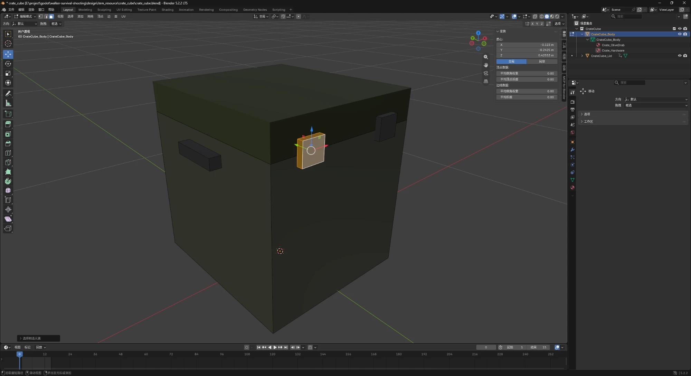

# Blender interface notes (BLENDER-NOTES)

Blender 5.2.2 LTS (Windows); interface language: Simplified Chinese. I wrote these notes myself in Chinese; this is an English translation.

*Screenshot: my own Blender session with `crate_cube.blend` open, shown with my Simplified Chinese interface. Edit Mode; `CrateCube_Body` selected in the Outliner; one latch selected (orange) in the 3D Viewport; the sidebar (N) shows its median coordinates under Transform.*

## 1. 3D Viewport
The 3D Viewport is the main area where I look at and edit 3D models. I used it to build and adjust my crate model, including the body, the lid, the latches, and the handles. For example, I selected the right latch in the 3D Viewport and moved it so that it joins the body correctly.

## 2. Toolbar
The Toolbar is on the left side of the 3D Viewport and holds tools such as select, move, rotate, and scale. I mainly used the Move tool to adjust the different parts of the crate, for example moving the latches and handles to the right positions.

## 3. Outliner
The Outliner is at the top right of the Blender window and lists every object in the scene. I used it to find and select the different parts of the crate model, such as the body, the lid, and other separate parts. When several objects are close together and hard to select directly in the 3D Viewport, the Outliner is more convenient.

## 4. Properties Editor
The Properties Editor is on the right side of the Blender window and holds the settings, materials, modifiers, and other properties of the selected object. I used it when checking and changing the crate model's materials, for example looking at the different materials used by the crate body and the metal parts.

## 5. Sidebar
The Sidebar opens with the N key in the 3D Viewport. It shows the exact location, rotation, scale, and dimensions of the selected object. When I need a precise adjustment instead of moving things by feel with the mouse, I use the values here. For example, I accidentally stretched the right latch to about 10 cm deep, into the inside of the crate; I used the values here to bring it back to 1.5 cm thick and make the left and right latches symmetric. In Edit Mode the Sidebar shows the median coordinates of the selected part (X −0.123, Y −0.2425, Z 0.4255 in the screenshot); only in Object Mode does it show the whole object's location, rotation, scale, and dimensions.

## 6. Mode switch
The mode switch is at the top left of the 3D Viewport. I use it to switch between Object Mode and Edit Mode. Object Mode is for moving whole parts of the crate, while Edit Mode can change the shape of the object itself. I used Edit Mode when changing the shape and depth of the crate's latches.
