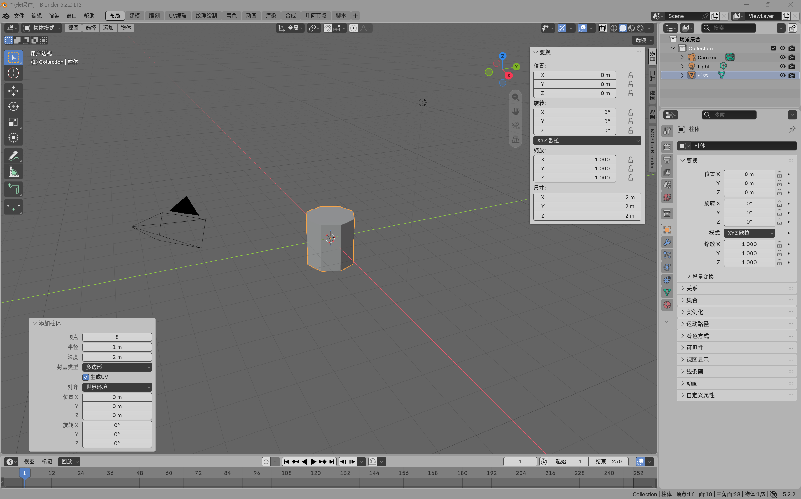

# Blender interface notes

Blender 5.2.2 LTS, Windows
## 3D viewport
- Orbit: hold the middle mouse button and drag.
- Pan: Shift + middle mouse drag.
- Zoom: scroll wheel, or Ctrl + middle mouse drag.

## Toolbar
The column of tools on the left: select box, 3D cursor, move (G), rotate (R), scale (S), transform and measure.

## Outliner
Lists the scene collection and what is in it: Camera, the default Cube and Light. When I add an object its name appears in the list; when I delete it, it disappears.

## Properties editor
Has tabs for render settings, output size, the object's transform, modifiers (wrench icon), materials (sphere icon) and the world.

## Sidebar (N)
Shows the selected object's live transform: location, rotation, scale and dimensions. It also holds panels from installed add-ons and view and camera controls.

## Mode selector
Pressing Tab switches to Edit Mode. The object then shows its vertices, edges and faces, and the toolbar changes to mesh tools such as Extrude, Inset, Bevel and Loop Cut.

## Screenshot

