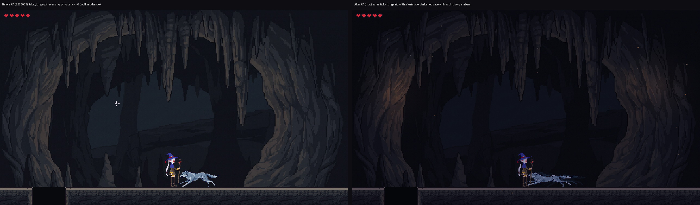

# walker-magic — Assignment 7: animation with Godot and Claude

Zhefan Zhang (zhefan-z), CSYE 7270 Fall 2026. *walker-magic* is a 2D side-scroller: a mage crosses a cave and casts fireballs at a wolf. Godot 4.7.2-stable, Forward+, Windows. Starting point: my Assignment 6 project, unchanged (`027a0ab`).

*The same moment (`take_lunge`, physics tick 40) before Assignment 7 (`2276069`) and now: the wolf's lunge is a keyed cutout rig with a crouch, a stretch and an afterimage; the mage runs a four-frame cycle; the cave is lit by flickering torches with drifting embers. Gameplay in this scenario is identical on every tick; across all eight pin scenarios only the two growl-hit scenarios changed, by design (pin, below).*

Paths: game files (`tests/`, `effects/`, `features/`, `tools/`, `design/`) are relative to `walker-magic-zhefan/`; `captures/`, `logs/` and the documents are relative to this folder.

## Evidence at a glance

**8** behaviour pin scenarios compared tick by tick at **30, 60 and 144 fps** · **7** new suites (pin, edges, three clip read-backs, structure, afterimage) · **13** earlier suites unchanged · **5** mutations, **4** caught and the fifth shown harmless on this engine · every visual upgrade added with the pin still **8/8** · the clips' phase table measured from the game (31 / 22 / 36 ticks), not assumed.

| Rubric area (of 60) | Where the evidence is |
|---|---|
| **Pinning (12)** | Pin recorded before any change (`a9b4bc1`, `logs/pin/`); clips wired with the pin unchanged (`33d78ae`); the one behaviour change made apart (`72f37b8`), differing only in `hit_growl` and `kill`; re-pinned only after play, in its own commit (`ff71bbb`). Figure: `captures/figures/pin_timeline.png` |
| **State machine (12)** | One AnimationPlayer per sprite, driven only by `play()` from each state machine; `tests/test_anim_structure.gd` (11/11) scans the scripts so nothing writes a property a clip keys; both players on the physics callback and run before their owner (`process_physics_priority = -1`). No AnimationTree. |
| **Edges and verification (14)** | `tests/test_anim_edges.gd`, 13/13 at 30, 60, 144: hits on the first and last tick of every phase, a killing hit in each phase, Esc mid-lunge, run → jump → land → run, clip frame = phase tick on all 119 lunge-clip ticks (a full growl, lunge and recovery plus a second growl); mutations a7-1 to a7-5 in temporary worktrees; windowed Movie Maker strips with `--debug-collisions`, aligned frame by frame with the tick log (frame n shows tick n − 1) |
| **The animations (12)** | Run: Sprite2D + AnimationPlayer frame track, discrete, read back by `test_clip_run.gd` (16/16). Lunge: cutout rig keyed as resource text, read back by `test_clip_lunge.gd` (17/17) with the assignment's `track_problems()` verbatim. Seams by track type; the lunge keyed at every phase boundary |
| **Film (10)** | see Film below |

## The two clips

| | Clip 1: mage run cycle | Clip 2: wolf lunge |
|---|---|---|
| Route | Sprite2D with an AnimationPlayer frame track | Cutout rig keyed as resource text |
| Driven by | the player's state machine (RUN) | the wolf's state machine (GROWL → LUNGE → RECOVER) |
| Loop | `LOOP_LINEAR`, 4 frames at 10 fps (24 ticks per cycle; 5/6/6/7 ticks per frame after the first loop) | `LOOP_NONE`, committing action, 89 ticks |
| Source | 4-frame sheet drawn by Gemini from my prompt with my A2 sprite as the reference, cleaned onto my A2 palette (`tools/clean_run_cycle.py`) | my A2 `wolf_lunge.png`, unchanged, as two `region_rect` parts on hip and shoulder pivots |
| Timing | cycle 0.4 s; seam: no duplicate across the wrap, last-key gap = key interval | phase table measured by the pin: growl 31, lunge 22, recover 36 ticks; keys at frames 0, 25, 31, 37, 53, 65, 89 |
| Motion reference | Muybridge, *Animal Locomotion* plate 60, a man running (1887, public domain) | Muybridge plate 707, a dog galloping (1887, public domain) |

**Behaviour change (one, by design):** a fireball hit during the growl cancels the lunge; a hit during the lunge does not; death wins in every phase. Measured in play with real clicks: from sight distance only a cast in the first 12 of 31 growl ticks (0.2 s) arrives in time (`captures/figures/growl_window.png`).

## Beyond the requirements

| Upgrade | What you see | Evidence |
|---|---|---|
| Flickering cave torches | warm pools of light on both walls, a looping continuous-track clip | `effects/cave_lights.tscn`, `test_clip_flicker.gd` (11/11, seam per track) |
| Drifting embers | 144 slow sparks across the level | `effects/embers.tscn` |
| Lunge afterimage | about five warm ghosts trail the dash | `features/wolf/lunge_afterimage.gd`, `test_afterimage.gd` (6/6 at 30, 60, 144) |
| Four-frame run | from two flickering pictures to a run, after three rejected attempts | `TUNING.md` run r0–r2 |
| Measured readability | the mage's robe-to-cave contrast 3.07, above the 2.74 before A7 | `TUNING.md` visual r1 |
| Figures from the logs | pin timeline, growl window, two clocks, lunge onion skin, run cycle | `captures/figures/`, `tools/make_figures.py` |

Every upgrade is visual only: the pin passes 8/8 at 30, 60 and 144 fps after each.

## Run it

- Open `walker-magic-zhefan/project.godot` in Godot 4.7.2 and press F5. Controls: A/D or arrows to walk, Space/W/Up to jump, left mouse to cast, Esc to pause, R to restart, M and N to mute.
- Tests, from this folder in Git Bash, after `godot --headless --path walker-magic-zhefan --import` once:
  - `./scripts/run-test.sh test_pin_behaviour.gd 60` (also 30 and 144; `PIN_MODE=record` re-records)
  - `./scripts/run-test.sh test_anim_edges.gd 60` (also 30, 144), `test_afterimage.gd` (30, 60, 144)
  - `./scripts/run-test.sh test_clip_run.gd 60`, `test_clip_lunge.gd`, `test_clip_flicker.gd`, `test_anim_structure.gd`
  - the thirteen earlier suites as listed in `CLAUDE.md`
- Documents: `CHANGE-BRIEF.md` (spec and dated revisions), `TUNING.md` (every observation, prediction, comparison and verdict), `TEST-REPORT.md`, `FRICTIONAL.md`, `SOURCES.md`.

## Known limitations

- The growl-cancel window is 0.2 s from sight distance, kept by my decision.
- The run's planted foot still slides while a frame is held; frame 1 of the Gemini sheet is close to my A2 contact pose.
- The wolf's removal after death runs on the frame clock (tick 79 at 60 fps, 80 at 30 and 144); gameplay never reads it.

## Film

(Link, filename and SHA-256 added after the final render.)
